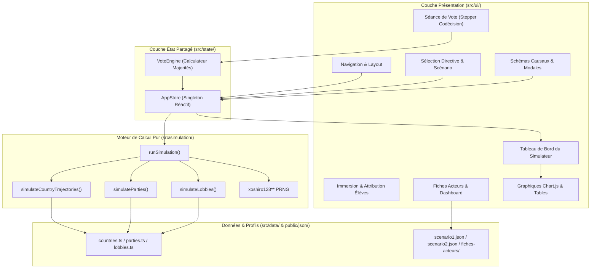
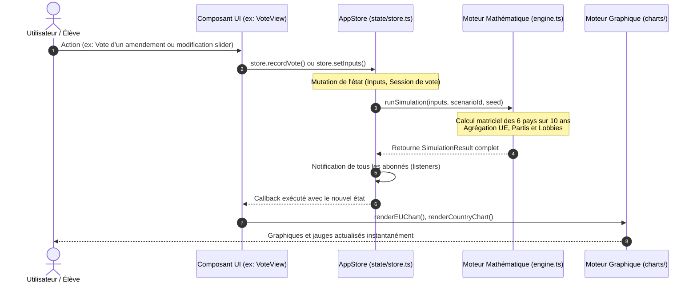
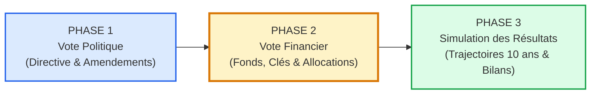
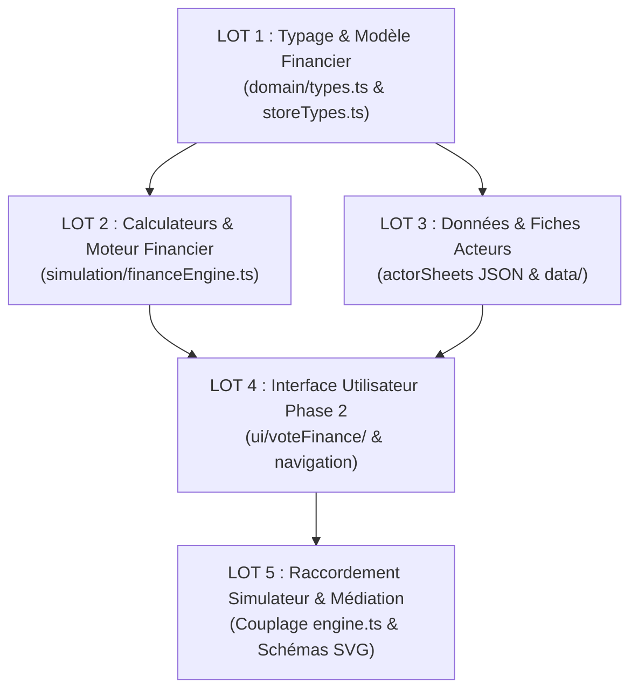

# Audit Fonctionnel, Technique, Données et Propagation — UE-SIMU (Version 2 TypeScript)

> **Document de référence pour le futur cahier d’implémentation**  
> **Dépôt** : `UE-SIMU` | **Version auditée** : TypeScript (`projet2/`)  
> **Date de l'audit** : 8 octobre 2026  
> **Auteur de l'audit** : Antigravity AI  
> **Statut** : Document d'audit et de cadrage architectural — *Aucune modification du code applicatif, des calculs ni des fichiers JSON n'a été appliquée au cours de cet audit.*

---

## Sommaire

1. [Synthèse de l’existant](#1-synthèse-de-lexistant)
2. [Périmètre et preuves de l’audit](#2-périmètre-et-preuves-de-laudit)
3. [Inventaire fonctionnel exhaustif](#3-inventaire-fonctionnel-exhaustif)
4. [Architecture et cartographie des flux actuels](#4-architecture-et-cartographie-des-flux-actuels)
5. [Audit des données et des fiches acteurs](#5-audit-des-données-et-des-fiches-acteurs)
6. [Écart avec les trois phases cibles](#6-écart-avec-les-trois-phases-cibles)
7. [Matrice de propagation du changement](#7-matrice-de-propagation-du-changement)
8. [Propositions d’évolution des schémas JSON](#8-propositions-dévolution-des-schémas-json)
9. [Médiation pédagogique et UX Mobile](#9-médiation-pédagogique-et-ux-mobile)
10. [Tests à préserver ou compléter](#10-tests-à-préserver-ou-compléter)
11. [Décisions ouvertes et arbitrages préalables](#11-décisions-ouvertes-et-arbitrages-préalables)
12. [Lots d’implémentation proposés & Conclusion](#12-lots-dimplémentation-proposés--conclusion)

---

## 1. Synthèse de l’existant

L'application **UE-SIMU** est un outil pédagogique et de simulation institutionnelle modélisant la fabrique des politiques publiques au sein de l'Union européenne selon la procédure législative ordinaire (codécision). Initialement développée sous forme d'application web JavaScript monolithique ([`projet1/`](file:///c:/Users/alano/OneDrive/Documents/GitHub/ue-simu/projet1)), elle a fait l'objet d'une refonte complète et rigoureuse en **TypeScript natif** hébergée dans le dossier [`projet2/`](file:///c:/Users/alano/OneDrive/Documents/GitHub/ue-simu/projet2).

### 1.1. Socle technique de la version TypeScript (`projet2/`)
- **Langage & Environnement** : TypeScript strict (`target: ES2022`, `noImplicitAny: true`, `strict: true`), bundler Vite 5, serveur de développement sur le port 3000.
- **Architecture Applicative** : Modèle réactif sans framework lourd (Vanilla DOM optimisé), structuré autour d'un gestionnaire d'état partagé unidirectionnel (`AppStore`) implémentant le pattern Observer/Subscriber.
- **Règle architecturale de modularité** : **Strictement aucun fichier ne dépasse 200 lignes de code** (règle $\le 200$ lignes appliquée à l'intégralité du code source TypeScript et aux feuilles de style CSS).
- **Moteur Mathématique & Simulation** : Moteur déterministe d'équations aux différences finies sur un horizon de 10 ans (2025–2034), couplant matrices de sensibilité nationales, agrégation démographique européenne, projection des équilibres parlementaires, dynamique d'influence des lobbies et générateur pseudo-aléatoire reproductible (`xoshiro128**`).
- **Validation Automatisée** : Suite de 62 tests unitaires sous Vitest couvrant les invariants mathématiques, la reproductibilité déterministe, les totaux institutionnels, la sensibilité politique et les cas de repli (fallbacks).

### 1.2. Acteurs modélisés (19 acteurs au total)
L'application met en scène l'ensemble du jeu d'acteurs institutionnel et d'influence européen :
1. **La Commission européenne** (1 acteur) : Initiatrice exclusive des propositions de directives et gardienne de l'intérêt général européen.
2. **Le Conseil de l'Union européenne** (6 États membres représentatifs) :
   - **Allemagne (`DE`)** (84,4 M hab.) : Modèle ordolibéral et industriel, pivot de la coalition verte et hydrogène.
   - **France (`FR`)** (68,0 M hab.) : Modèle colbertiste et nucléaire, autonomie stratégique et planification.
   - **Italie (`IT`)** (58,9 M hab.) : Forte sensibilité à la dette, cohésion industrielle et relance Sud.
   - **Pologne (`PL`)** (36,8 M hab.) : Économie de rattrapage, dépendance charbonnière et vigilance sécuritaire Est.
   - **Hongrie (`HU`)** (9,6 M hab.) : Défense de la souveraineté nationale, souverainisme énergétique et fossiles.
   - **Suède (`SE`)** (10,5 M hab.) : Économie nordique décarbonée, rigorisme budgétaire et leadership environnemental.
   *Ces 6 pays totalisent 268,2 millions d'habitants, soit 62,4% de la population de l'UE à 27 (représentativité démographique et typologique).*
3. **Le Parlement européen** (6 groupes politiques) :
   - **PPE** (Parti Populaire Européen) : 188 sièges — Centre-droit, compétitivité industrielle, stabilité.
   - **S&D** (Socialistes & Démocrates) : 136 sièges — Centre-gauche, justice sociale, transition juste.
   - **Renew** (Renouveau Européen) : 77 sièges — Libéraux, marché intérieur, intégration approfondie.
   - **Verts/ALE** : 53 sièges — Écologistes, neutralité carbone stricte, biodiversité.
   - **ECR** (Conservateurs et Réformistes) : 78 sièges — Droite souverainiste, subsidiarité.
   - **La Gauche (GUE/NGL)** : 47 sièges — Gauche radicale, redistribution, services publics.
   *Total de référence : 611 sièges représentés. Seuil de majorité absolue fixé à 306 voix.*
4. **Les Groupes d'Intérêt / Lobbies** (6 secteurs économiques) :
   - **Automobile (`AUTO`)**, **Agrochimie (`AGRO`)**, **Énergies Fossiles (`FOSS`)**, **Big Tech (`TECH`)**, **Industrie Pharmaceutique (`PHAR`)**, **Secteur Financier (`FINA`)**.

### 1.3. Scénarios et Directives
Deux grands scénarios prospectifs indépendants sont implémentés :
- **Scénario 1 : Transition Écologique & Pacte Vert** (Indicateurs : Croissance PIB `%`, Inégalités Gini `0-1`, Émissions CO₂ `t/hab`, Bien-être VEB `0-100`).
- **Scénario 2 : Sécurité Commune & Démocratie** (Indicateurs : Indice Normandie Sécurité `0-100`, Démocratie V-Dem `0-1`, Croissance PIB `%`, Développement Humain IDH `0-1`).
Chaque scénario comporte **8 directives négociables** (D1 à D8), et chaque directive dispose de **8 amendements** (4 parlementaires issus des groupes politiques et 4 nationaux issus des capitales), soit un catalogue de **16 directives** et **128 amendements** documentés dans les fiches acteurs JSON.

---

## 2. Périmètre et preuves de l’audit

### 2.1. Répertoire et commit audité
- **Dépôt** : `c:\Users\alano\OneDrive\Documents\GitHub\ue-simu`
- **Répertoire de la version TypeScript auditée** : [`projet2/`](file:///c:/Users/alano/OneDrive/Documents/GitHub/ue-simu/projet2)
- **Répertoire historique** : [`projet1/`](file:///c:/Users/alano/OneDrive/Documents/GitHub/ue-simu/projet1) (code JavaScript ES5/ES6 d'origine, conservé pour rétro-compatibilité et traçabilité).
- **Commit Git de référence** : `a30f88ddf09268f6b76654d7ac88931fa3e1968a`
- **État du répertoire de travail** :
  - Modularisation de l'arborescence `projet2/src/ui/` achevée avec succès en 8 sous-dossiers thématiques (`layout/`, `intro/`, `actors/`, `vote/`, `simulator/`, `charts/`, `scenario/`, `pedagogy/`).
  - Correction de l'anomalie d'affichage du Score de Réussite Global de l'UE (`sim?.euScoreSucces` au lieu de l'attribut historique obsolète).
  - Documentation du wiki mise à jour dans [`projet2/docs/wiki/files_documentation.md`](file:///c:/Users/alano/OneDrive/Documents/GitHub/ue-simu/projet2/docs/wiki/files_documentation.md).

### 2.2. Preuves d'exécution et vérifications réelles
Les commandes suivantes ont été exécutées et validées sans erreur dans l'environnement de développement :

1. **Vérification statique TypeScript** :
   ```powershell
   cd c:\Users\alano\OneDrive\Documents\GitHub\ue-simu\projet2
   npx tsc --noEmit
   # Code de retour : 0 (aucune erreur de compilation TypeScript)
   ```

2. **Exécution de la suite de tests unitaires** :
   ```powershell
   npm test
   # Résultat : 13 suites exécutées, 62 tests passés avec succès (0 échec)
   # Durée d'exécution : 357 ms
   ```

3. **Vérification de la règle d'or architecturale ($\le 200$ lignes par fichier)** :
   ```powershell
   Get-ChildItem -Path src -Recurse -File -Include *.ts,*.css | ForEach-Object {
       $lines = (Get-Content $_.FullName | Measure-Object -Line).Lines
       if ($lines -gt 200) { Write-Output "$($_.FullName): $lines lines" }
   }
   # Résultat : 0 fichier au-delà de 200 lignes. 
   # Fichier le plus long : src/data/actorSheets.ts (192 lignes).
   ```

4. **Vérification de l'interface en direct via le serveur de développement Vite** :
   - Requête HTTP sur `http://localhost:3000/` : statut `200 OK`.
   - Inspection du DOM : conteneur racine `#app`, barre de navigation adaptative, affichage temps réel des jauges du Conseil (55% États / 65% population) et de l'hémicycle parlementaire Chart.js.

### 2.3. Limites de l'inspection
L'audit a été mené via le terminal PowerShell et l'environnement Node.js/Vitest. Les tests d'intégration simulant des requêtes `fetch()` asynchrones sur les fichiers JSON locaux (`./json/scenario1.json`) utilisent des chargeurs statiques de secours (fallbacks typés) dans l'environnement de test Vitest headless, tandis qu'en environnement navigateur réel, ces fichiers sont servis via les assets publics de Vite.

---

## 3. Inventaire fonctionnel exhaustif

Le tableau ci-dessous recense l'intégralité des 26 fonctionnalités réelles de l'application, en précisant leur statut réel, leurs entrées/sorties, leurs dépendances et l'impact anticipé de l'introduction de la phase de négociation financière :

| ID | Fonctionnalité | Statut réel | Utilisateur | Entrées | Traitement | Sorties | Fichiers & Fonctions | Données utilisées | Tests | Limites actuelles | Impact de la refonte |
| :--- | :--- | :--- | :--- | :--- | :--- | :--- | :--- | :--- | :--- | :--- | :--- |
| **F01** | **Accueil & Immersion** | Implémenté & Accessible | Tous | Clic onglet | Montage vidéo Europa.mp4, piliers d'acteurs | DOM interactif | [`introImmersionView.ts`](file:///c:/Users/alano/OneDrive/Documents/GitHub/ue-simu/projet2/src/ui/intro/introImmersionView.ts) | Textes statiques, vidéo | Navigation manuelle | Vidéo purement illustrative | Ajout de la présentation des 3 phases |
| **F02** | **Attribution des Rôles** | Implémenté & Accessible | Enseignant / Groupe | Noms des élèves (texte/CSV) | Tirage aléatoire équilibré sur les 19 acteurs | Table d'affectation | [`groupAllocator.ts`](file:///c:/Users/alano/OneDrive/Documents/GitHub/ue-simu/projet2/src/ui/intro/groupAllocator.ts) | Liste des 19 acteurs | [`groups.test.ts`](file:///c:/Users/alano/OneDrive/Documents/GitHub/ue-simu/projet2/tests/groups.test.ts) | Pas de persistance cloud | Prise en compte des rôles financiers |
| **F03** | **Export CSV des Groupes** | Implémenté & Accessible | Enseignant | Clic bouton export | Génération blob CSV format UTF-8 | Téléchargement fichier `.csv` | [`groupAllocator.ts`](file:///c:/Users/alano/OneDrive/Documents/GitHub/ue-simu/projet2/src/ui/intro/groupAllocator.ts) : `exportGroupsToCSV()` | Données élèves | Manuel | CSV basique | Ajout des colonnes de rôles budgétaires |
| **F04** | **Sélection Scénario & Directive** | Implémenté & Accessible | Tous | Clic radio / carte | `store.setScenarioId()`, `store.setSelectedDirective()` | Rechargement données et recalcul | [`scenarioView.ts`](file:///c:/Users/alano/OneDrive/Documents/GitHub/ue-simu/projet2/src/ui/scenario/scenarioView.ts) | `scenarios.ts`, `scenario1.json`, `scenario2.json` | [`data.test.ts`](file:///c:/Users/alano/OneDrive/Documents/GitHub/ue-simu/projet2/tests/data.test.ts) | 8 directives par scénario | Ajout des besoins d'investissement estimés |
| **F05** | **Fiche de Négociation Acteur** | Implémenté & Accessible | Élève (Acteur) | Choix de l'acteur dans la pill-bar | Parsing JSON de la fiche acteur pour la directive choisie | Rendu HTML complet (enjeux, stratégie, note interne) | [`actorsSheetCard.ts`](file:///c:/Users/alano/OneDrive/Documents/GitHub/ue-simu/projet2/src/ui/actors/actorsSheetCard.ts) | JSON `fiches-acteurs/sX/dY/*.json` | [`actorSheets.test.ts`](file:///c:/Users/alano/OneDrive/Documents/GitHub/ue-simu/projet2/tests/actorSheets.test.ts) | Données textuelles non chiffrées | **Majeur** : Ajout du mandat budgétaire |
| **F06** | **Tableau de Bord Synoptique** | Implémenté & Accessible | Tous | Clic vue "Dashboard" | Synthèse comparative des 6 États, 6 Partis, 6 Lobbies | Grille de cartes synthétiques | [`actorsDashboard.ts`](file:///c:/Users/alano/OneDrive/Documents/GitHub/ue-simu/projet2/src/ui/actors/actorsDashboard.ts) | `SimulationResult`, profils TS | Manuel | Synthèse macro uniquement | Ajout des soldes nets (€) |
| **F07** | **Activation / Choix Amendements** | Implémenté & Accessible | Tous | Checkbox ou étape stepper | `store.toggleAmendment()`, cumul des impacts | Nouvel état des curseurs | [`store.ts`](file:///c:/Users/alano/OneDrive/Documents/GitHub/ue-simu/projet2/src/state/store.ts) | `Directive.amendements` | [`vote.test.ts`](file:///c:/Users/alano/OneDrive/Documents/GitHub/ue-simu/projet2/tests/vote.test.ts) | Impacts additifs simples | Lié au coût de réalisation |
| **F08** | **Vote Réaliste Automatique** | Implémenté & Accessible | Tous | Clic "Vote Réaliste" | Lecture des positions dans les fiches JSON | Remplissage des votes pour et contre | [`voteEngine.ts`](file:///c:/Users/alano/OneDrive/Documents/GitHub/ue-simu/projet2/src/state/voteEngine.ts) | `positions_amendements` | [`vote.test.ts`](file:///c:/Users/alano/OneDrive/Documents/GitHub/ue-simu/projet2/tests/vote.test.ts) | Binaire (Pour/Contre) | Positions réalistes sur la dépense |
| **F09** | **Majorité Qualifiée Conseil** | Implémenté & Accessible | Tous | Votes des 6 États | Calcul : $\ge 4/6$ États (66,7%) et $\ge 65\%$ population | Jauge double & statut (Adopté/Rejeté) | [`voteCouncilView.ts`](file:///c:/Users/alano/OneDrive/Documents/GitHub/ue-simu/projet2/src/ui/vote/voteCouncilView.ts) | Populations de `countries.ts` | [`institutionalTotals.test.ts`](file:///c:/Users/alano/OneDrive/Documents/GitHub/ue-simu/projet2/tests/institutionalTotals.test.ts) | Échantillon de 6 États | Doit s'appliquer au vote du fonds |
| **F10** | **Majorité Absolue Parlement** | Implémenté & Accessible | Tous | Votes des 6 Partis | Calcul de la somme des sièges Pour ($\ge 306/611$) | Graphique Doughnut & jauge de sièges | [`voteParliamentView.ts`](file:///c:/Users/alano/OneDrive/Documents/GitHub/ue-simu/projet2/src/ui/vote/voteParliamentView.ts) | Sièges de `parties.ts` | [`institutionalTotals.test.ts`](file:///c:/Users/alano/OneDrive/Documents/GitHub/ue-simu/projet2/tests/institutionalTotals.test.ts) | Échantillon de 6 partis | Doit s'appliquer au vote du fonds |
| **F11** | **Stepper de Vote (10 étapes)** | Implémenté & Accessible | Tous | Clic "Suivant / Précédent" | Étape 0: Directive, 1..8: Amendements, 9: Package | Navigation étape par étape | [`voteView.ts`](file:///c:/Users/alano/OneDrive/Documents/GitHub/ue-simu/projet2/src/ui/vote/voteView.ts) | `session.currentStep` | Manuel | Déroulement linéaire | Doit déboucher sur la Phase 2 |
| **F12** | **Inversion & Reset des Votes** | Implémenté & Accessible | Tous | Clic boutons d'action | Inversion Pour/Contre ou reset à blanc | Réinitialisation des votes | [`storeVoteActions.ts`](file:///c:/Users/alano/OneDrive/Documents/GitHub/ue-simu/projet2/src/state/storeVoteActions.ts) | État local de la session | [`vote.test.ts`](file:///c:/Users/alano/OneDrive/Documents/GitHub/ue-simu/projet2/tests/vote.test.ts) | Pas d'annulation pas à pas | Préservation du reset |
| **F13** | **Package Final & Application Simu** | Implémenté & Accessible | Tous | Clic "Appliquer au Simulateur" | Calcul des $\Delta$ adoptés et mise à jour de `inputs` | Bascule vers l'onglet simulateur | [`voteSummaryView.ts`](file:///c:/Users/alano/OneDrive/Documents/GitHub/ue-simu/projet2/src/ui/vote/voteSummaryView.ts) | Impacts des amendements adoptés | [`vote.test.ts`](file:///c:/Users/alano/OneDrive/Documents/GitHub/ue-simu/projet2/tests/vote.test.ts) | Applique les deltas directement | **Majeur** : Transition vers Phase 2 |
| **F14** | **Curseurs de Politique Publique** | Implémenté & Accessible | Tous | Sliders de valeurs initiales | `store.setInputs()`, recalcul immédiat de l'horizon | Rendu dynamique des valeurs | [`simulatorControls.ts`](file:///c:/Users/alano/OneDrive/Documents/GitHub/ue-simu/projet2/src/ui/simulator/simulatorControls.ts) | Métadonnées de `indicators.ts` | [`inputValidation.test.ts`](file:///c:/Users/alano/OneDrive/Documents/GitHub/ue-simu/projet2/tests/inputValidation.test.ts) | Bornes min/max statiques | Doit intégrer l'enveloppe financière |
| **F15** | **Calcul Trajectoires (10 ans)** | Implémenté & Accessible | Système | `inputs`, `scenarioId`, `seed` | Équations de récurrence $x_{t} = \alpha x_{t-1} + (1-\alpha)(\dots)$ | `SimulationResult.yearlyStates` | [`engine.ts`](file:///c:/Users/alano/OneDrive/Documents/GitHub/ue-simu/projet2/src/simulation/engine.ts) : `runSimulation()` | Matrices $M$ de `countries.ts` | [`simulation.test.ts`](file:///c:/Users/alano/OneDrive/Documents/GitHub/ue-simu/projet2/tests/simulation.test.ts) | Pas de saturation financière | **Majeur** : Intégration du financement |
| **F16** | **Satisfaction & Score Pays** | Implémenté & Accessible | Système | Séries temporelles par pays | Utilité $S_t \in [0, 1]$, score $Q \in [-12, 92]$ | `CountryResult.scoreSucces` | [`countryTrajectories.ts`](file:///c:/Users/alano/OneDrive/Documents/GitHub/ue-simu/projet2/src/simulation/countryTrajectories.ts) | Priorités et cibles de chaque pays | [`successScores.test.ts`](file:///c:/Users/alano/OneDrive/Documents/GitHub/ue-simu/projet2/tests/successScores.test.ts) | Paradoxe de la cible $0.8$ | Intégration du solde financier net |
| **F17** | **Simulation des Partis** | Implémenté & Accessible | Système | Séries UE | Satisfaction doctrine, projection sièges | `PartyResult.mepsArr`, `scoreSucces` | [`partiesEngine.ts`](file:///c:/Users/alano/OneDrive/Documents/GitHub/ue-simu/projet2/src/simulation/partiesEngine.ts) | Doctrines de `parties.ts` | [`politicalSensitivity.test.ts`](file:///c:/Users/alano/OneDrive/Documents/GitHub/ue-simu/projet2/tests/politicalSensitivity.test.ts) | Modèle de réélection simplifié | Prise en compte de la discipline fiscale |
| **F18** | **Simulation des Lobbies** | Implémenté & Accessible | Système | Séries UE, PRNG | Réputation, influence Conseil/PE/Com | `LobbyResult.reputationArr`, etc. | [`lobbiesEngine.ts`](file:///c:/Users/alano/OneDrive/Documents/GitHub/ue-simu/projet2/src/simulation/lobbiesEngine.ts) | Matrices de `lobbies.ts` | [`reproducibility.test.ts`](file:///c:/Users/alano/OneDrive/Documents/GitHub/ue-simu/projet2/tests/reproducibility.test.ts) | Pas d'allocation directe de fonds | Financement ciblé par secteur |
| **F19** | **Score de Réussite Global UE** | Implémenté & Accessible | Tous | Moyennes pondérées UE | Utilité globale, calcul du score $Q_{UE}$ | `sim.euScoreSucces` (/100) | [`engine.ts`](file:///c:/Users/alano/OneDrive/Documents/GitHub/ue-simu/projet2/src/simulation/engine.ts) | Populations de `countries.ts` | [`aggregation.test.ts`](file:///c:/Users/alano/OneDrive/Documents/GitHub/ue-simu/projet2/tests/aggregation.test.ts) | Score synthétique abstrait | Pondération de l'équilibre financier |
| **F20** | **Graphiques Multi-Courbes** | Implémenté & Accessible | Tous | Séries temporelles | Instances Chart.js (courbes, barres, doughnut) | Graphiques interactifs canvas | [`charts.ts`](file:///c:/Users/alano/OneDrive/Documents/GitHub/ue-simu/projet2/src/ui/charts/charts.ts) | `SimulationResult` | Manuel | Risque de superposition | Ajout d'un graphique financier |
| **F21** | **Schémas Causaux SVG** | Implémenté & Accessible | Tous | Scénario actif | Génération de SVG vectoriel avec nœuds et liens | Diagramme visuel des rétroactions | [`schemas.ts`](file:///c:/Users/alano/OneDrive/Documents/GitHub/ue-simu/projet2/src/pedagogy/schemas.ts) : `renderCausalSchemaSVG()` | Définitions vectorielles | Manuel | Schéma statique (non paramétré) | Intégration du nœud "Fonds Financier" |
| **F22** | **Modales « Comprendre le graphique »** | Implémenté & Accessible | Tous | Clic bouton "💡 Décrypter" | Affichage d'un tiroir modal contextuel | Modale explicative (unités, mécanismes) | [`pedagogyModal.ts`](file:///c:/Users/alano/OneDrive/Documents/GitHub/ue-simu/projet2/src/ui/pedagogy/pedagogyModal.ts) | `CHART_PEDAGOGY` | Manuel | 4 graphiques couverts | Ajout du décryptage financier |
| **F23** | **Présentation Institutions** | Implémenté & Accessible | Tous | Clic onglet "Institutions" | Rendu visuel du triangle institutionnel | Fiches Commission, Conseil, PE | [`institutionsView.ts`](file:///c:/Users/alano/OneDrive/Documents/GitHub/ue-simu/projet2/src/ui/pedagogy/institutionsView.ts) | Textes constitutionnels | Manuel | Contenu informatif statique | Explication du rôle budgétaire |
| **F24** | **Génération Aléatoire Déterministe** | Implémenté & Accessible | Tous | Clic "🎲 Aléas" | Nouvelle graine PRNG $\rightarrow$ régénération | Trajectoire recalculée | [`prng.ts`](file:///c:/Users/alano/OneDrive/Documents/GitHub/ue-simu/projet2/src/simulation/prng.ts) | Graine entière (`seed`) | [`prng.test.ts`](file:///c:/Users/alano/OneDrive/Documents/GitHub/ue-simu/projet2/tests/prng.test.ts) | Aléas gaussiens centrés | Préservation de la reproductibilité |
| **F25** | **Tableau Accessible des Données** | Implémenté & Accessible | Tous | `SimulationResult` | Génération table HTML responsive | Table tabulaire accessible aux lecteurs | [`chartTable.ts`](file:///c:/Users/alano/OneDrive/Documents/GitHub/ue-simu/projet2/src/ui/charts/chartTable.ts) | `SimulationResult.years` | Manuel | Affichage chiffres bruts | Colonnes budgétaires à intégrer |
| **F26** | **Navigation & Ergonomie Mobile** | Implémenté & Accessible | Tous | Clic barre haute / basse | Bascule d'onglet sans rechargement | Vue affichée dans `#app` | [`navigation.ts`](file:///c:/Users/alano/OneDrive/Documents/GitHub/ue-simu/projet2/src/ui/layout/navigation.ts) | `store.state.activeTab` | Manuel | 6 onglets principaux | Intégration du 7e onglet financier |

### Fonctionnalités absentes identifiées lors de l'audit
1. **Négociation financière (Phase 2)** : Aucun module de vote de budget, de fonds commun ni de calcul de solde net n'existe dans le code actuel.
2. **Sauvegarde et Restauration d'états (Local Storage / JSON)** : L'état applicatif est réinitialisé lors d'un rechargement de la page (`F5`).
3. **Mode Multi-joueurs en réseau** : L'outil est conçu pour une utilisation sur un écran partagé en classe ou des sessions individuelles.
4. **Conciliation (Trilogue institutionnel formel en cas de désaccord)** : Si le Conseil et le Parlement rejettent un amendement, celui-ci est simplement écarté ; aucun comité de conciliation n'est formalisé.

---

## 4. Architecture et cartographie des flux actuels

### 4.1. Vue d'ensemble des couches de l'application
L'application respecte une séparation stricte des responsabilités illustrée par le diagramme ci-dessous :



### 4.2. Cycle de vie : de l'action utilisateur au rendu visuel
Chaque interaction utilisateur suit un cycle unidirectionnel strict :



### 4.3. Points de rupture et risques d'incohérence identifiés
1. **Découplage Amendements / Simulateur** : Aujourd'hui, les impacts des amendements adoptés (`impact.pib_eu`, `impact.co2_eu`, etc.) écrasent ou modifient directement les valeurs initiales (`inputs`) à la fin du vote. Si l'on ajoute un financement, ce mécanisme d'écrasement brut est inadapté : il faut distinguer l'**impulsion réglementaire** de l'**enveloppe budgétaire allouée**.
2. **Absence de persistance du vote** : Si l'utilisateur change de scénario ou recharge la page, la session de vote est réinitialisée sans avertissement.
3. **Multiplicité des sources de vérité** : Les données descriptives d'un pays résident dans le JSON `cou_sX-dY.json`, tandis que ses coefficients de sensibilité matricielle résident dans le fichier TypeScript immuable `countries.ts`.

---

## 5. Audit des données et des fiches acteurs

L'audit approfondi des fichiers du répertoire [`projet2/public/json/`](file:///c:/Users/alano/OneDrive/Documents/GitHub/ue-simu/projet2/public/json) et des profils statiques TypeScript [`projet2/src/data/`](file:///c:/Users/alano/OneDrive/Documents/GitHub/ue-simu/projet2/src/data) met en évidence la répartition suivante des sources de vérité :

### 5.1. Sources de vérité actuelles
- **Profils mathématiques (TypeScript)** :
  - [`countries.ts`](file:///c:/Users/alano/OneDrive/Documents/GitHub/ue-simu/projet2/src/data/countries.ts) (142 lignes) : Population, poids démographique, valeurs initiales par indicateur et matrices de coefficients d'élasticité.
  - [`parties.ts`](file:///c:/Users/alano/OneDrive/Documents/GitHub/ue-simu/projet2/src/data/parties.ts) (86 lignes) : Nombre de sièges de référence, poids d'alignement doctrinal par indicateur.
  - [`lobbies.ts`](file:///c:/Users/alano/OneDrive/Documents/GitHub/ue-simu/projet2/src/data/lobbies.ts) (108 lignes) : Réputation initiale, relais institutionnels initiaux et matrices de sensibilité sectorielle.
- **Profils descriptifs et politiques (JSON)** :
  - `scenario1.json` / `scenario2.json` : Titres, déclarations d'intention des directives, statistiques de départ de l'Union, liste des 8 amendements par directive et leurs impacts additifs.
  - Fiches individuelles par directive :
    - `com_sX-dY.json` (Commission) : Rôle européen, enjeux de la directive, analyse d'impact des 8 amendements.
    - `cou_sX-dY.json` (États membres) : Fiches pour les 6 pays contenant stratégie nationale, alliances, oppositions, arguments et positions prédéfinies sur les amendements (`FAVORABLE`, `DEFAVORABLE`, `FAVORABLE_CONDITIONNEL`).
    - `par_sX-dY.json` (Partis politiques) : Fiches pour les 6 familles politiques contenant doctrine, priorités, arguments et positions d'amendements.
    - `lob_sX-dY.json` (Lobbies) : Fiches pour les 6 groupes d'intérêt contenant intérêts défendus, cibles de lobbying, arguments d'influence et recommandations de vote.

### 5.2. Inventaire d'audit par famille d'acteurs

| Acteur / Famille | Fichier réel | Clés principales | Consommateurs | Source de Vérité | Risque de Divergence | Adaptation Proposée pour la Phase Financière |
| :--- | :--- | :--- | :--- | :--- | :--- | :--- |
| **Commission** | `com_sX-dY.json` | `role_europeen`, `enjeux_directive`, `impacts_amendements` | [`actorsSheetCard.ts`](file:///c:/Users/alano/OneDrive/Documents/GitHub/ue-simu/projet2/src/ui/actors/actorsSheetCard.ts) | JSON local | Texte statique sans paramètre chiffré | Introduire l'enveloppe budgétaire proposée et la formule de clé de répartition |
| **États Membres** (6 pays) | `cou_sX-dY.json` & [`countries.ts`](file:///c:/Users/alano/OneDrive/Documents/GitHub/ue-simu/projet2/src/data/countries.ts) | `nom`, `stratégie`, `alliances`, `positions_amendements` (JSON) / `matrix`, `weights`, `population` (TS) | [`actorsView.ts`](file:///c:/Users/alano/OneDrive/Documents/GitHub/ue-simu/projet2/src/ui/actors/actorsView.ts), [`countryTrajectories.ts`](file:///c:/Users/alano/OneDrive/Documents/GitHub/ue-simu/projet2/src/simulation/countryTrajectories.ts) | Double source : TS pour les calculs, JSON pour le texte | Un changement de texte d'enjeu n'altère aucunement le calcul de trajectoire | Ajouter le PIB national brut (€), la capacité d'absorption budgétaire et le plafond de cofinancement |
| **Partis Politiques** (6 partis) | `par_sX-dY.json` & [`parties.ts`](file:///c:/Users/alano/OneDrive/Documents/GitHub/ue-simu/projet2/src/data/parties.ts) | `doctrine`, `priorités`, `positions_amendements` (JSON) / `seats`, `weights` (TS) | [`actorsView.ts`](file:///c:/Users/alano/OneDrive/Documents/GitHub/ue-simu/projet2/src/ui/actors/actorsView.ts), [`partiesEngine.ts`](file:///c:/Users/alano/OneDrive/Documents/GitHub/ue-simu/projet2/src/simulation/partiesEngine.ts) | Double source : Sièges fixés en dur dans TS | Les positions des amendements JSON ne mentionnent pas le coût budgétaire | Ajouter la position doctrinale sur la taille du fonds (orthodoxie vs relance) et la conditionnalité |
| **Lobbies** (6 secteurs) | `lob_sX-dY.json` & [`lobbies.ts`](file:///c:/Users/alano/OneDrive/Documents/GitHub/ue-simu/projet2/src/data/lobbies.ts) | `intérêts`, `revendications`, `recommandations` (JSON) / `matrix`, `influence` (TS) | [`actorsView.ts`](file:///c:/Users/alano/OneDrive/Documents/GitHub/ue-simu/projet2/src/ui/actors/actorsView.ts), [`lobbiesEngine.ts`](file:///c:/Users/alano/OneDrive/Documents/GitHub/ue-simu/projet2/src/simulation/lobbiesEngine.ts) | Double source | Aucune corrélation entre subventions demandées et dépenses réelles | Ajouter les subventions industrielles cibles revendiquées et les exemptions fiscales exigées |

---

## 6. Écart avec les trois phases cibles

Le cahier des charges de la future évolution définit un déroulement pédagogique et institutionnel rigoureux en **trois phases successives** :



### Comparaison méthodique : Existant vs Cible

| Caractéristique | Phase 1 (Directive & Amendements) | Phase 2 (Vote du Financement) | Phase 3 (Simulation Finale) |
| :--- | :--- | :--- | :--- |
| **Statut Actuel** | **Implémenté et fonctionnel** dans [`src/ui/vote/`](file:///c:/Users/alano/OneDrive/Documents/GitHub/ue-simu/projet2/src/ui/vote) et [`src/state/voteEngine.ts`](file:///c:/Users/alano/OneDrive/Documents/GitHub/ue-simu/projet2/src/state/voteEngine.ts). | **Totalement absent** du code applicatif, du store et des calculateurs. | **Partiellement implémenté** : Moteur fonctionnel, mais déconnecté de tout compromis budgétaire. |
| **Objet de Négociation** | Objectifs juridiques, interdictions, seuils, calendrier et orientations réglementaires. | **Volume total du fonds (€)**, **Clé de contribution** des États, **Critères de redistribution**, **Taux de cofinancement**. | Évaluation de l'atteinte des objectifs, résilience économique, justice sociale et bilans individuels des 19 acteurs. |
| **Nature de la Décision** | Vote législatif par codécision : Double majorité au Conseil + Majorité absolue au PE. | Vote budgétaire européen : Équilibre des contributions nationales et validation par les deux branches législatives. | Calcul mathématique déterministe sur 10 ans (2025–2034) avec propagation en cascade. |
| **Données Utilisées** | 8 amendements par directive, positions des acteurs (`FAVORABLE`, etc.). | *À créer* : PIB/RNB nationaux, clés de répartition (RNB, CO₂, IDH), capacités d'absorption. | Séries temporelles, score de réussite $Q$ par pays, sièges des partis, réputation des lobbies. |
| **Écart Principal** | Pas d'affichage des besoins de financement associés à la proposition retenue. | **Module entier à concevoir et implémenter** (écran, règles de vote, store, données). | Le simulateur applique directement des deltas arbitraires au lieu de modéliser le taux de couverture financière du programme. |

---

## 7. Matrice de propagation du changement

Cette matrice centrale identifie de façon exhaustive l'ensemble des composants, calculateurs, types et documents qui devront évoluer pour intégrer la phase financière et adapter le moteur mathématique :

| Changement Envisagé | Producteur | Type / Schéma | Calculateur | État Partagé (`store.ts`) | Vue ou Composant | Fiche Acteur | Texte Pédagogique | Export / Sauvegarde | Tests | Documentation | Risque Identifié | Décision Requise |
| :--- | :--- | :--- | :--- | :--- | :--- | :--- | :--- | :--- | :--- | :--- | :--- | :--- |
| **Taille globale du fonds européen (€ Mrds)** | Négociation Phase 2 | `FinancialPackage.fundSize` | Moteur financier | `state.financialPackage.totalBudget` | Nouvelle vue `voteFinanceView.ts` | Fiches Commission & Partis | Panneau explicatif du budget | Ajout au CSV des résultats | Nouveau test d'intégrité budgétaire | Wiki : fiche module budget | Blocage si le Conseil refuse un fonds jugé trop lourd | Définir la fourchette de négociation (ex: 50 à 500 Mrds €) |
| **Clé de contribution des États** | Conseil (États) | `ContributionKey` (RNB ou Mixte) | Calculateur de quotes-parts | `state.financialPackage.contributions` | Tableau des contributions par pays | Fiches États (`cou_*.json`) | Explication de la quote-part nationale | Colonnes "Contribution (€)" | Test conservation : $\sum C_i = B_{total}$ | Wiki : matrice des quotes-parts | Sentiment d'injustice des contributeurs nets | Valider si la clé est basée sur le PIB seul ou corrigée par le carbone |
| **Critères d'allocation / redistribution** | Codécision Conseil & PE | `AllocationRule` (Rattrapage, Climat, etc.) | Calculateur d'allocations | `state.financialPackage.allocations` | Jauges comparatives retour net | Fiches États & Lobbies | Visualisation des flux de solidarité | Colonnes "Allocation (€)" | Test : $\sum A_i \le B_{total}$ | Wiki : règles de cohésion | Rejet par les pays frugaux si transferts trop asymétriques | Fixer le poids de la population vs du besoin de transition |
| **Taux de cofinancement national (%)** | États membres | `countryCoFinancingRate` | Calculateur de mobilisation | `state.financialPackage.coFinancing` | Curseurs de cofinancement national | Fiches États (`cou_*.json`) | Explication de l'effet levier | Champ "Cofinancement" | Test de positivité des montants | Wiki : effet de levier | Incapacité budgétaire des pays endettés | Plafonner le taux exigé (ex: 20% à 50%) |
| **Capacité d'absorption des fonds** | Donnée pays statique | `countryAbsorptionCapacity` | Moteur de trajectoire | `state.countryCapacities` | Indicateur de saturation dans le simu | Fiches États | Pourquoi plus d'argent n'augmente pas tout | Statistique de rendement | Test des rendements décroissants | Wiki : dynamique d'absorption | Illusion qu'un fonds géant résout tout instantanément | Modéliser un plafond d'absorption annuel par pays |
| **Impact financier sur les trajectoires** | Moteur de simulation | `FinancialImpactOnIndicators` | [`engine.ts`](file:///c:/Users/alano/OneDrive/Documents/GitHub/ue-simu/projet2/src/simulation/engine.ts) | `state.simulationResult` | [`chartsEU.ts`](file:///c:/Users/alano/OneDrive/Documents/GitHub/ue-simu/projet2/src/ui/charts/chartsEU.ts), [`chartsCountry.ts`](file:///c:/Users/alano/OneDrive/Documents/GitHub/ue-simu/projet2/src/ui/charts/chartsCountry.ts) | Bilan final de mandat | Nouveau schéma causal avec nœud finance | Table complète de simulation | Tests de sensibilité financière | Wiki : couplage argent-indicateurs | Dénaturer les équations historiques étalonnées | Introduire l'argent comme un modulateur d'efficacité ($0 \le \eta \le 1$) |
| **Solde net & Satisfaction pays** | Calculateur d'utilité | `countryNetBalance` (€) | [`countryTrajectories.ts`](file:///c:/Users/alano/OneDrive/Documents/GitHub/ue-simu/projet2/src/simulation/countryTrajectories.ts) | `CountryResult.netBalance` | [`actorsDashboard.ts`](file:///c:/Users/alano/OneDrive/Documents/GitHub/ue-simu/projet2/src/ui/actors/actorsDashboard.ts) | Bilan de réussite de l'acteur | Note explicative sur le solde net | Colonne "Solde Net (€)" | Test calcul exact : $A_i - C_i$ | Wiki : fonction de score pays | Conflit entre réussite écologique et solde budgétaire | Définir le poids du solde net dans le score de victoire finale |

---

## 8. Propositions d’évolution des schémas JSON

Afin de préserver l'intégrité absolue des fichiers actuels sans appliquer de modification prématurée, les propositions suivantes constituent le schéma cible des nouvelles propriétés à introduire.

### 8.1. Fiches des États Membres (`cou_sX-dY.json`)
Pour chaque pays, il est proposé d'insérer un bloc structuré `mandat_financier` :
```json
{
  "type": "Etat",
  "nom": "Pologne",
  "role_europeen": "Défenseur de la transition juste et de la cohésion régionale",
  "mandat_financier": {
    "profil_economique": {
      "pib_national_milliards": 680,
      "part_pib_ue_pourcent": 4.1,
      "capacite_absorption_annuelle_milliards": 18.5
    },
    "preferences_financement": {
      "taille_fonds_souhaitee": "AMBITIEUX",
      "plafond_contribution_annuelle_milliards": 6.5,
      "cle_repartition_preferee": "INTENSITE_CARBONE_ET_RATTRAPAGE",
      "taux_cofinancement_national_max_pourcent": 20
    },
    "lignes_rouges_financieres": [
      "Refus d'une contribution proportionnelle aux émissions sans fonds de compensation massif.",
      "Conditionnalité stricte refusée si elle bloque les versements d'urgence énergétique."
    ],
    "objectifs_retour": {
      "solde_net_cible": "BENEFICIAIRE_NET_MAJEUR",
      "allocation_minimale_demandee_milliards": 12.0
    }
  }
}
```

### 8.2. Fiches des Partis Politiques (`par_sX-dY.json`)
Pour chaque groupe parlementaire, enrichissement de la doctrine par un bloc budgétaire :
```json
{
  "parti": "Verts/ALE",
  "doctrine_financiere": {
    "priorite_budgetaire": "MASSIVE_CLIMAT",
    "volume_fonds_cible_milliards": 300,
    "critere_redistribution_prioritaire": "IMPACT_DECARBONATION",
    "conditionnalite_stricte": true,
    "position_ressources_propres": "FAVORABLE_TAXE_CARBONE_FRONTIERES",
    "arguments_financiers": [
      "Le coût de l'inaction climatique est dix fois supérieur au coût de l'investissement initial.",
      "Les subventions publiques ne doivent en aucun cas financer le maintien d'infrastructures fossiles."
    ]
  }
}
```

### 8.3. Fiches des Groupes d'Intérêt / Lobbies (`lob_sX-dY.json`)
Pour chaque lobby, modélisation des revendications budgétaires sectorielles :
```json
{
  "lobby": "Automobile",
  "interets_financiers": {
    "enveloppe_sectorielle_revendiquee_milliards": 45.0,
    "type_aide_recherche": ["SUBVENTION_DIRECTE_GIGUFACTORY", "PRIME_CONVERSION_VEHICULES"],
    "clauses_fiscales_contestees": ["TAXATION_SURPOIDS_BATTERIES"],
    "cibles_principales_lobbying": ["CONSEIL_ALLEMAGNE", "CONSEIL_ITALIE", "PARLEMENT_PPE"],
    "indicateur_succes_financier": "Part du fonds européen fléchée vers l'industrie manufacturière"
  }
}
```

### 8.4. Fiche de la Commission Européenne (`com_sX-dY.json`)
La Commission formule la proposition budgétaire initiale et veille à l'équilibre institutionnel :
```json
{
  "type": "Commission",
  "proposition_financiere_initiale": {
    "volume_total_milliards": 150.0,
    "duree_mobilisation_annees": 10,
    "cle_contribution_proposee": "QUOTA_RNB_CLASSIQUE",
    "cle_allocation_proposee": "50_POURCENT_POPULATION_50_POURCENT_RATTRAPAGE",
    "reserve_de_flexibilite_milliards": 15.0,
    "regle_de_compromis": "Chercher un équilibre où aucun État ne supporte un solde net négatif supérieur à 0,35% de son PIB."
  }
}
```

---

## 9. Médiation pédagogique et UX Mobile

### 9.1. Pédagogie compréhensible par des élèves non spécialistes
Pour que l'exercice reste accessible à des lycéens ou des étudiants de premier cycle non mathématiciens :
1. **La Métaphore des Trois Vases** : Présenter la négociation financière non sous forme de système d'équations, mais sous forme d'une balance à 3 plateaux :
   - *Combien met-on dans le pot commun ?* (Taille du fonds).
   - *Qui alimente le pot ?* (Contributions nationales).
   - *Qui reçoit pour agir ?* (Allocations & Projets).
2. **Visualisation du Solde Net par Code Couleur Universel** :
   - Carte de l'Europe ou tableau de synthèse affichant chaque pays en vert (bénéficiaire net) ou en bleu (contributeur net solidaire), avec une jauge claire exprimée en euros par habitant.
3. **Le Principe du Taux de Réalisation** :
   - Expliquer que si la directive vote une ambition de 100% mais que le financement n'en couvre que 60%, le modèle mathématique bride automatiquement la vitesse de déploiement et les résultats environnementaux.

### 9.2. Ergonomie Mobile-First (Smartphones)
L'interface de la version 2 a été conçue en priorité pour les écrans tactiles mobiles :
- **Barre de Navigation Inférieure Fixe (`mobile-nav`)** : Les onglets principaux restent accessibles au pouce, avec mise en valeur dorée du Simulateur.
- **Remplacement des Tableaux Complexes par des Cartes Empilées** : Sur smartphone ($< 768$ px), les tableaux financiers de comparaison doivent se convertir en cartes accordéons individuelles par pays, affichant la contribution, l'allocation et le solde net sans défilement horizontal tronqué.
- **Micro-interactions Tactiles** : Boutons de vote ergonomiques avec retour haptique/visuel immédiat, sliders tactiles fluides avec pas adaptés (`step`).

---

## 10. Tests à préserver ou compléter

### 10.1. Tests existants à sanctuariser (62 tests Vitest)
La suite actuelle garantit l'intégrité du socle et doit impérativement rester au vert :
- [`tests/prng.test.ts`](file:///c:/Users/alano/OneDrive/Documents/GitHub/ue-simu/projet2/tests/prng.test.ts) (3 tests) : Reproductibilité déterministe de `xoshiro128**`.
- [`tests/successScores.test.ts`](file:///c:/Users/alano/OneDrive/Documents/GitHub/ue-simu/projet2/tests/successScores.test.ts) (5 tests) : Formule d'utilité et de score $Q$ dans les cas limites.
- [`tests/institutionalTotals.test.ts`](file:///c:/Users/alano/OneDrive/Documents/GitHub/ue-simu/projet2/tests/institutionalTotals.test.ts) (3 tests) : Total des 611 sièges du Parlement et des 268,2 M d'habitants au Conseil.
- [`tests/politicalSensitivity.test.ts`](file:///c:/Users/alano/OneDrive/Documents/GitHub/ue-simu/projet2/tests/politicalSensitivity.test.ts) (8 tests) : Réactions doctrinales des familles politiques.
- [`tests/simulation.test.ts`](file:///c:/Users/alano/OneDrive/Documents/GitHub/ue-simu/projet2/tests/simulation.test.ts) (7 tests) : Cohérence globale de l'horizon de 10 ans.
- [`tests/vote.test.ts`](file:///c:/Users/alano/OneDrive/Documents/GitHub/ue-simu/projet2/tests/vote.test.ts) (7 tests) : Calcul des seuils de majorité qualifiée et absolue.

### 10.2. Nouveaux contrats de tests à introduire lors de l'évolution
1. **`tests/financialConservation.test.ts`** :
   - *Invariant de conservation* : $\sum_{i=1}^6 \text{Allocations}_i \le \text{Fonds Total}$.
   - *Exactitude du solde net* : $\text{Solde}_i = \text{Allocation}_i - \text{Contribution}_i$.
2. **`tests/financialMajorities.test.ts`** :
   - Vérification que l'accord financier respecte la double majorité qualifiée au Conseil et la majorité absolue au Parlement.
3. **`tests/budgetaryCoupling.test.ts`** :
   - Vérification que l'absence de budget ($\text{Fonds} = 0$) bride la mise en œuvre de la directive sans générer d'erreur de division par zéro ni de résultat aberrant.
   - Vérification des rendements décroissants au-delà de la capacité d'absorption maximale d'un État.

---

## 11. Décisions ouvertes et arbitrages préalables

Avant de débuter la moindre ligne d'implémentation de la Phase 2, le comité de pilotage pédagogique et technique doit trancher les 7 arbitrages suivants :

1. **Unité monétaire affichée** : Doit-on négocier en **Milliards d'euros réels** (ex: 150 Mrds € sur 10 ans) ou en **Pourcentage du PIB européen** (ex: 1,2% du PIB) ?  
   *Recommandation de l'audit* : Utiliser les **Milliards d'euros réels**, infiniment plus intuitifs pour les élèves.
2. **Sort d'une directive votée sans accord financier** : Si la directive politique est adoptée en Phase 1 mais que la négociation financière échoue en Phase 2 (blocage au Conseil) :
   - Option A : Blocage complet du jeu et obligation de renégocier.
   - Option B : Entrée en vigueur de la directive sans fonds commun européen (chaque État membre applique la loi sur ses fonds nationaux propres, accentuant les inégalités de résultats).  
   *Recommandation* : L'option B est pédagogiquement magistrale car elle démontre la différence fondamentale entre une norme juridique et un moyen financier de solidarité.
3. **Clé de contribution automatique ou négociée** : La contribution de chaque État au fonds doit-elle être calculée strictement selon son poids de richesse (RNB), ou les élèves peuvent-ils marchander des rabais (à l'image des célèbres « chèques britanniques » ou rabais des pays frugaux) ?
4. **Impact de l'argent sur la satisfaction des acteurs** : Un État contributeur net qui voit son écologie progresser est-il satisfait ou mécontent de son solde budgétaire ? Quel poids donner au portefeuille par rapport aux objectifs thématiques ?
5. **Gestion du trilogue et conciliation** : Doit-on introduire un bouton "Compromis de conciliation" porté par la Commission en cas de désaccord entre le Conseil et le Parlement ?
6. **Interaction entre les amendements et le coût** : Faut-il associer à chaque amendement voté en Phase 1 une étiquette financière explicite (ex: Amendement 1-1A : $+25$ Mrds € de besoin de financement) ?
7. **Persistance des sessions élèves** : L'outil doit-il enregistrer la progression dans le `localStorage` du navigateur pour permettre une reprise d'activité d'un cours sur l'autre ?

---

## 12. Lots d’implémentation proposés & Conclusion

### 12.1. Découpage en 5 lots d’implémentation progressifs



- **Lot 1 : Domaine, Typage & État partagé**
  - Enrichissement des contrats de typage dans `src/domain/types.ts` (`FinancialProposal`, `CountryBudget`, etc.).
  - Extension du `storeTypes.ts` et actions dédiées dans `store.ts`.
- **Lot 2 : Moteur de Calcul Financier & Invariants**
  - Création de `src/simulation/financeEngine.ts` (calculateur de quotes-parts, allocations, soldes nets et majorité budgétaire).
  - Écriture de la suite de tests unitaires associée sous Vitest.
- **Lot 3 : Enrichissement des Fiches et Données JSON**
  - Ajout des blocs de mandats financiers dans les JSON des États, Partis, Lobbies et Commission.
  - Mise à jour des chargeurs avec fallbacks sécurisés.
- **Lot 4 : Composants d'Interface de la Phase 2**
  - Création du sous-dossier `src/ui/voteFinance/` avec cartes de répartition, double jauge d'accord budgétaire et vue responsive smartphone.
  - Raccordement du stepper : Phase 1 $\rightarrow$ Phase 2 $\rightarrow$ Phase 3.
- **Lot 5 : Raccordement au Simulateur et Médiation Pédagogique**
  - Intégration de l'impact financier comme coefficient d'avancement dans `engine.ts`.
  - Mise à jour des schémas causaux vectoriels SVG et des modales pédagogiques.
  - Validation de la règle des 200 lignes et non-régression des tests.

---

### 12.2. Réponse synthétique à la question clé de la mission

> **« Si nous modifions le moteur et ajoutons la négociation financière, quels fichiers, données, rôles, parcours, résultats et explications doivent évoluer pour que le simulateur reste cohérent dans son ensemble ? »**

1. **Au niveau des Fichiers de Code** :
   - Le contrat d'état [`src/domain/types.ts`](file:///c:/Users/alano/OneDrive/Documents/GitHub/ue-simu/projet2/src/domain/types.ts) et le store partagé [`src/state/store.ts`](file:///c:/Users/alano/OneDrive/Documents/GitHub/ue-simu/projet2/src/state/store.ts) doivent intégrer l'accord financier voté.
   - Un nouveau module de calcul pur `src/simulation/financeEngine.ts` ($\le 200$ lignes) doit être créé.
   - Le moteur [`src/simulation/engine.ts`](file:///c:/Users/alano/OneDrive/Documents/GitHub/ue-simu/projet2/src/simulation/engine.ts) doit moduler l'intensité des réformes adoptées par le taux de réalisation budgétaire réel plutôt que par un écrasement direct des curseurs.
   - Une nouvelle vue `src/ui/voteFinance/` doit s'insérer entre le vote du package législatif et l'accès au simulateur.
2. **Au niveau des Données et Fiches Acteurs** :
   - Les fiches des 6 États membres (`cou_*.json`) doivent expliciter leur capacité financière nationale, leur ligne rouge sur la contribution et leurs attentes d'allocation.
   - La Commission européenne (`com_*.json`) doit formuler une proposition d'enveloppe chiffrée initiale.
3. **Au niveau des Rôles et Parcours Élèves** :
   - Le parcours devient une progression tripartite naturelle : **1. Débat politique et amendements** $\rightarrow$ **2. Accord budgétaire et arbitrages financiers** $\rightarrow$ **3. Bilan d'impact à 10 ans**.
4. **Au niveau des Explications et de la Médiation** :
   - Les schémas SVG de [`src/pedagogy/schemas.ts`](file:///c:/Users/alano/OneDrive/Documents/GitHub/ue-simu/projet2/src/pedagogy/schemas.ts) doivent intégrer le nœud « Financement et Moyens de Réalisation » comme médiateur indispensable entre la directive juridique et ses impacts sur le monde réel.

---
*Fin du document d'audit — Ce livrable est prêt à servir de fondation au futur cahier d’implémentation dès arbitrage des décisions ouvertes.*
