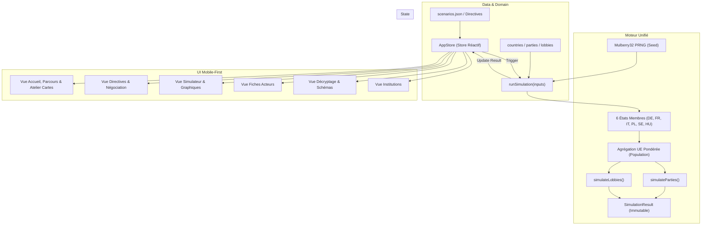

# Carte de l'Architecture — Projet 2 (TypeScript)

## 1. Vue d'Ensemble des Flux de Données

## 2. Responsabilités des Modules

* **`src/domain/`** : Contrats de typage stricts et métadonnées des indicateurs sans logique d'interface.
* **`src/data/`** : Profils statiques immuables et chargeur de scénarios avec validation.
* **`src/simulation/`** : Fonctions pures de calcul de la simulation (aucune dépendance DOM/UI).
* **`src/state/`** : Gestionnaire d'état partagé (AppStore) avec modèle publication/souscription.
* **`src/ui/`** : Composants graphiques et formulaires ergonomiques, conçus en priorité pour les smartphones.
* **`src/pedagogy/`** : Schémas causaux SVG interactifs et textes d'explication par graphique.
