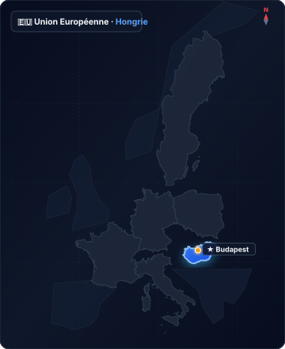

# hongrie

Source : `directives/fiches-acteurs/pays/hongrie.json`

## Situation géographique en Europe

## Détail des entités et coordonnées GeoJSON

Cliquez pour afficher les 1,084 points de coordonnées géographiques

- **type** : FeatureCollection
- **features** :
  - **Élément 1** :
    - **type** : Feature
    - **properties** :
      `{}` (objet vide)
    - **geometry** :
      - **coordinates** :
        - **Élément 1** :
          - **Élément 1** :
            - `21.44033432006836`
            - `48.585124484413754`
          - **Élément 2** :
            - `21.435184478759766`
            - `48.58364824613257`
          - **Élément 3** :
            - `21.428146362304688`
            - `48.58364824613257`
          - **Élément 4** :
            - `21.42660140991211`
            - `48.580127811607`
          - **Élément 5** :
            - `21.422653198242188`
            - `48.57887856622344`
          - **Élément 6** :
            - `21.420936584472543`
            - `48.57524422229134`
          - **Élément 7** :
            - `21.422138214111328`
            - `48.562862777519925`
          - **Élément 8** :
            - `21.415443420410156`
            - `48.55911366886784`
          - **Élément 9** :
            - `21.407718658447152`
            - `48.55956812108008`
          - **Élément 10** :
            - `21.40462875366211`
            - `48.56274917224952`
          - **Élément 11** :
            - `21.39638900756836`
            - `48.563317196049795`
          - **Élément 12** :
            - `21.38265609741211`
            - `48.56024979174329`
          - **Élément 13** :
            - `21.37939453125`
            - `48.55854559786118`
          - **Élément 14** :
            - `21.37355804443348`
            - `48.55911366886784`
          - **Élément 15** :
            - `21.364974975585938`
            - `48.5603634026274`
          - **Élément 16** :
            - `21.353473663330078`
            - `48.560590623630105`
          - **Élément 17** :
            - `21.3409423828125`
            - `48.560022569209565`
          - **Élément 18** :
            - `21.340084075927734`
            - `48.559000055176874`
          - **Élément 19** :
            - `21.32823944091797`
            - `48.559340895484326`
          - **Élément 20** :
            - `21.324119567871094`
            - `48.557636670981594`
          - **Élément 21** :
            - `21.32549285888672`
            - `48.56206753526866`
          - **Élément 22** :
            - `21.322059631347656`
            - `48.56206753526866`
          - **Élément 23** :
            - `21.31673812866211`
            - `48.559000055176874`
          - **Élément 24** :
            - `21.315536499023438`
            - `48.55593238906489`
          - **Élément 25** :
            - `21.317424774169922`
            - `48.55559152579185`
          - **Élément 26** :
            - `21.32635116577137`
            - `48.55593238906489`
          - **Élément 27** :
            - `21.326007843017578`
            - `48.55252365298789`
          - **Élément 28** :
            - `21.321887969970703`
            - `48.55138735659328`
          - **Élément 29** :
            - `21.317081451416016`
            - `48.55320541857607`
          - **Élément 30** :
            - `21.314678192138672`
            - `48.5521827667489`
          - **Élément 31** :
            - `21.3134765625`
            - `48.54991013313083`
          - **Élément 32** :
            - `21.316394805908203`
            - `48.5493419587775`
          - **Élément 33** :
            - `21.318454742431527`
            - `48.54968286415505`
          - **Élément 34** :
            - `21.321201324462777`
            - `48.548546503965134`
          - **Élément 35** :
            - `21.31999969482422`
            - `48.54468268844167`
          - **Élément 36** :
            - `21.316566467285156`
            - `48.54377351250597`
          - **Élément 37** :
            - `21.318626403808594`
            - `48.53956836135791`
          - **Élément 38** :
            - `21.316909790039062`
            - `48.539000070894105`
          - **Élément 39** :
            - `21.31038665771473`
            - `48.5408185779213`
          - **Élément 40** :
            - `21.309528350830078`
            - `48.53718149853727`
          - **Élément 41** :
            - `21.3134765625`
            - `48.53661318127798`
          - **Élément 42** :
            - `21.31399154663086`
            - `48.533771499282615`
          - **Élément 43** :
            - `21.31622314453125`
            - `48.53320314374362`
          - **Élément 44** :
            - `21.312103271484375`
            - `48.53070230357739`
          - **Élément 45** :
            - `21.31038665771473`
            - `48.530247592094824`
          - **Élément 46** :
            - `21.306610107421875`
            - `48.52945183717502`
          - **Élément 47** :
            - `21.304035186767578`
            - `48.52763292182915`
          - **Élément 48** :
            - `21.302318572998047`
            - `48.525131806552224`
          - **Élément 49** :
            - `21.305580139160156`
            - `48.525131806552224`
          - **Élément 50** :
            - `21.307296752929688`
            - `48.52660975323643`
          - **Élément 51** :
            - `21.30849838256836`
            - `48.52626869244511`
          - **Élément 52** :
            - `21.30540847778309`
            - `48.52183469314155`
          - **Élément 53** :
            - `21.30197525024414`
            - `48.52206208716401`
          - **Élément 54** :
            - `21.297168731689453`
            - `48.52285795820353`
          - **Élément 55** :
            - `21.296825408935547`
            - `48.521720995747465`
          - **Élément 56** :
            - `21.28704071044922`
            - `48.524108587428216`
          - **Élément 57** :
            - `21.270732879638672`
            - `48.52740555281722`
          - **Élément 58** :
            - `21.269359588623047`
            - `48.52547287499977`
          - **Élément 59** :
            - `21.26455307006836`
            - `48.52717818278446`
          - **Élément 60** :
            - `21.252536773681527`
            - `48.53172538948382`
          - **Élément 61** :
            - `21.246185302734375`
            - `48.53559019413391`
          - **Élément 62** :
            - `21.238632202148438`
            - `48.53968201868509`
          - **Élément 63** :
            - `21.232624053955078`
            - `48.5386590935535`
          - **Élément 64** :
            - `21.23382568359375`
            - `48.53559019413391`
          - **Élément 65** :
            - `21.233482360839844`
            - `48.53422617912022`
          - **Élément 66** :
            - `21.221122741699105`
            - `48.537408823654594`
          - **Élément 67** :
            - `21.218204498291016`
            - `48.53536286085027`
          - **Élément 68** :
            - `21.216659545898438`
            - `48.53138436314516`
          - **Élément 69** :
            - `21.2091064453125`
            - `48.533430486724825`
          - **Élément 70** :
            - `21.208934783935547`
            - `48.52729186792845`
          - **Élément 71** :
            - `21.205673217773438`
            - `48.52717818278446`
          - **Élément 72** :
            - `21.198978424072266`
            - `48.52444966276642`
          - **Élément 73** :
            - `21.19588851928711`
            - `48.5246770450492`
          - **Élément 74** :
            - `21.192626953125`
            - `48.52626869244511`
          - **Élément 75** :
            - `21.191425323486328`
            - `48.52354012342696`
          - **Élément 76** :
            - `21.188507080078125`
            - `48.524563354035415`
          - **Élément 77** :
            - `21.185760498046875`
            - `48.52047030756873`
          - **Élément 78** :
            - `21.181468963622933`
            - `48.51990180273348`
          - **Élément 79** :
            - `21.178722381591797`
            - `48.518082544384434`
          - **Élément 80** :
            - `21.174259185791016`
            - `48.521720995747465`
          - **Élément 81** :
            - `21.169281005859375`
            - `48.52228948016565`
          - **Élément 82** :
            - `21.167564392089844`
            - `48.52069770771634`
          - **Élément 83** :
            - `21.160526275634652`
            - `48.52126620361911`
          - **Élément 84** :
            - `21.158981323242188`
            - `48.517968838568294`
          - **Élément 85** :
            - `21.15692138671875`
            - `48.51649063973351`
          - **Élément 86** :
            - `21.153316497802734`
            - `48.51717289070915`
          - **Élément 87** :
            - `21.150741577148438`
            - `48.515694668649466`
          - **Élément 88** :
            - `21.146106719970703`
            - `48.51046369041121`
          - **Élément 89** :
            - `21.141986846923714`
            - `48.50841663887411`
          - **Élément 90** :
            - `21.135635375976562`
            - `48.499886367355025`
          - **Élément 91** :
            - `21.133575439453125`
            - `48.49533630216996`
          - **Élément 92** :
            - `21.127052307128906`
            - `48.492264777304264`
          - **Élément 93** :
            - `21.11949920654297`
            - `48.49124089433275`
          - **Élément 94** :
            - `21.1102294921875`
            - `48.492492304045776`
          - **Élément 95** :
            - `21.100616455078125`
            - `48.49442624012677`
          - **Élément 96** :
            - `21.094436645507812`
            - `48.50113756368663`
          - **Élément 97** :
            - `21.097526550292855`
            - `48.50386733939323`
          - **Élément 98** :
            - `21.097698211669922`
            - `48.5106911354775`
          - **Élément 99** :
            - `21.09272003173828`
            - `48.5152398224152`
          - **Élément 100** :
            - `21.088085174560547`
            - `48.51842366030161`
          - **Élément 101** :
            - `21.0772705078125`
            - `48.51967439901287`
          - **Élément 102** :
            - `21.069889068603516`
            - `48.5234264298611`
          - **Élément 103** :
            - `21.066455841064453`
            - `48.52558656397187`
          - **Élément 104** :
            - `21.053752899169922`
            - `48.52217578379245`
          - **Élément 105** :
            - `21.054096221923828`
            - `48.526496066561194`
          - **Élément 106** :
            - `21.046371459960938`
            - `48.52524549628992`
          - **Élément 107** :
            - `21.038646697998047`
            - `48.52729186792845`
          - **Élément 108** :
            - `21.034011840820312`
            - `48.52729186792845`
          - **Élément 109** :
            - `21.02645874023426`
            - `48.531498038846586`
          - **Élément 110** :
            - `21.02336883544922`
            - `48.52956551721488`
          - **Élément 111** :
            - `21.01409912109375`
            - `48.53183906441962`
          - **Élément 112** :
            - `21.005859375`
            - `48.52729186792845`
          - **Élément 113** :
            - `20.990066528320312`
            - `48.52592762935692`
          - **Élément 114** :
            - `20.990066528320312`
            - `48.522516872146426`
          - **Élément 115** :
            - `20.982513427734375`
            - `48.517514012751505`
          - **Élément 116** :
            - `20.974273681640625`
            - `48.524790735807755`
          - **Élément 117** :
            - `20.96603393554676`
            - `48.52024290640028`
          - **Élément 118** :
            - `20.956764221191406`
            - `48.52206208716401`
          - **Élément 119** :
            - `20.956764221191406`
            - `48.533430486724825`
          - **Élément 120** :
            - `20.946121215820312`
            - `48.53684050894728`
          - **Élément 121** :
            - `20.94165802001953`
            - `48.53524919382565`
          - **Élément 122** :
            - `20.94234466552723`
            - `48.54343256731947`
          - **Élément 123** :
            - `20.934448242187386`
            - `48.53843177405044`
          - **Élément 124** :
            - `20.927581787109375`
            - `48.554568922193205`
          - **Élément 125** :
            - `20.916595458984375`
            - `48.56024979174329`
          - **Élément 126** :
            - `20.877113342285156`
            - `48.550932830890396`
          - **Élément 127** :
            - `20.8740234375`
            - `48.55365992386462`
          - **Élément 128** :
            - `20.867156982421875`
            - `48.551614617913636`
          - **Élément 129** :
            - `20.85479736328125`
            - `48.56706599314278`
          - **Élément 130** :
            - `20.846214294433594`
            - `48.565930023367635`
          - **Élément 131** :
            - `20.850677490234375`
            - `48.581604152711776`
          - **Élément 132** :
            - `20.83728790283203`
            - `48.5743355954839`
          - **Élément 133** :
            - `20.83694458007801`
            - `48.57728857290222`
          - **Élément 134** :
            - `20.83969116210926`
            - `48.580468509535294`
          - **Élément 135** :
            - `20.836257934570312`
            - `48.58273977037357`
          - **Élément 136** :
            - `20.803298950195312`
            - `48.575017067120385`
          - **Élément 137** :
            - `20.79437255859375`
            - `48.575017067120385`
          - **Élément 138** :
            - `20.734291076660043`
            - `48.570246572767076`
          - **Élément 139** :
            - `20.733604431152344`
            - `48.56706599314278`
          - **Élément 140** :
            - `20.72742462158203`
            - `48.56524842925465`
          - **Élément 141** :
            - `20.7263946533202`
            - `48.56979221649702`
          - **Élément 142** :
            - `20.71197509765625`
            - `48.5686563079607`
          - **Élément 143** :
            - `20.708198547363168`
            - `48.569337856144415`
          - **Élément 144** :
            - `20.68004608154297`
            - `48.55956812108008`
          - **Élément 145** :
            - `20.67180633544922`
            - `48.56161310551136`
          - **Élément 146** :
            - `20.664939880371094`
            - `48.56047701325633`
          - **Élément 147** :
            - `20.65326690673828`
            - `48.5611586716714`
          - **Élément 148** :
            - `20.643997192382812`
            - `48.55116009425219`
          - **Élément 149** :
            - `20.64056396484375`
            - `48.55547790419049`
          - **Élément 150** :
            - `20.63507080078125`
            - `48.5520691374922`
          - **Élément 151** :
            - `20.624427795410156`
            - `48.551614617913636`
          - **Élément 152** :
            - `20.618247985839844`
            - `48.54525091510785`
          - **Élément 153** :
            - `20.60863494873047`
            - `48.54297797016485`
          - **Élément 154** :
            - `20.605201721191406`
            - `48.54343256731947`
          - **Élément 155** :
            - `20.58700561523426`
            - `48.5386590935535`
          - **Élément 156** :
            - `20.585975646972656`
            - `48.53593119214538`
          - **Élément 157** :
            - `20.557823181152344`
            - `48.54275067005638`
          - **Élément 158** :
            - `20.553359985351562`
            - `48.542068763606466`
          - **Élément 159** :
            - `20.544776916503906`
            - `48.54411445539576`
          - **Élément 160** :
            - `20.536880493164062`
            - `48.5275192374508`
          - **Élément 161** :
            - `20.52520751953125`
            - `48.529792876529015`
          - **Élément 162** :
            - `20.52074432373047`
            - `48.53593119214538`
          - **Élément 163** :
            - `20.510787963867074`
            - `48.53502185901084`
          - **Élément 164** :
            - `20.50495147705078`
            - `48.53206641352563`
          - **Élément 165** :
            - `20.50220489501953`
            - `48.52729186792845`
          - **Élément 166** :
            - `20.50426483154297`
            - `48.52592762935692`
          - **Élément 167** :
            - `20.501861572265625`
            - `48.52365381673764`
          - **Élément 168** :
            - `20.504608154296875`
            - `48.52228948016565`
          - **Élément 169** :
            - `20.50220489501953`
            - `48.52024290640028`
          - **Élément 170** :
            - `20.51044464111328`
            - `48.51342039664282`
          - **Élément 171** :
            - `20.50769805908203`
            - `48.50978134908701`
          - **Élément 172** :
            - `20.5059814453125`
            - `48.4908995954145`
          - **Élément 173** :
            - `20.507354736328125`
            - `48.48930683675482`
          - **Élément 174** :
            - `20.49396514892578`
            - `48.48771402806647`
          - **Élément 175** :
            - `20.48847198486328`
            - `48.47633536820322`
          - **Élément 176** :
            - `20.474052429199105`
            - `48.46677532125395`
          - **Élément 177** :
            - `20.464096069335938`
            - `48.46415737524089`
          - **Élément 178** :
            - `20.469417572021484`
            - `48.4604009559556`
          - **Élément 179** :
            - `20.46976089477539`
            - `48.45243187354599`
          - **Élément 180** :
            - `20.46804428100586`
            - `48.4533426891321`
          - **Élément 181** :
            - `20.462207794189453`
            - `48.45072405028467`
          - **Élément 182** :
            - `20.452251434326172`
            - `48.448560725028194`
          - **Élément 183** :
            - `20.45019149780262`
            - `48.446511173983296`
          - **Élément 184** :
            - `20.44607162475586`
            - `48.445144760667006`
          - **Élément 185** :
            - `20.44281005859375`
            - `48.43899544580258`
          - **Élément 186** :
            - `20.435943603515625`
            - `48.433073179725845`
          - **Élément 187** :
            - `20.434741973876953`
            - `48.43033959331093`
          - **Élément 188** :
            - `20.429763793945312`
            - `48.428631027122904`
          - **Élément 189** :
            - `20.427017211914062`
            - `48.424758064419386`
          - **Élément 190** :
            - `20.42306900024414`
            - `48.423163229284256`
          - **Élément 191** :
            - `20.41585922241211`
            - `48.4186062817229`
          - **Élément 192** :
            - `20.416545867919922`
            - `48.4164415885222`
          - **Élément 193** :
            - `20.41431427001953`
            - `48.41222586882221`
          - **Élément 194** :
            - `20.415172576904297`
            - `48.40994695587821`
          - **Élément 195** :
            - `20.417404174804688`
            - `48.40937721168385`
          - **Élément 196** :
            - `20.420665740966797`
            - `48.4043631875212`
          - **Élément 197** :
            - `20.416717529296875`
            - `48.40060234499032`
          - **Élément 198** :
            - `20.416717529296875`
            - `48.39421967286081`
          - **Élément 199** :
            - `20.414485931396484`
            - `48.391939953034786`
          - **Élément 200** :
            - `20.41311264038086`
            - `48.38829218885893`
          - **Élément 201** :
            - `20.402469635009766`
            - `48.38247802423885`
          - **Élément 202** :
            - `20.404529571533203`
            - `48.38053982176634`
          - **Élément 203** :
            - `20.406932830810547`
            - `48.37985573268528`
          - **Élément 204** :
            - `20.406417846679688`
            - `48.37848752694363`
          - **Élément 205** :
            - `20.411739349365234`
            - `48.369935407913786`
          - **Élément 206** :
            - `20.409164428710938`
            - `48.36799672789781`
          - **Élément 207** :
            - `20.410194396972656`
            - `48.36617202046287`
          - **Élément 208** :
            - `20.407962799072266`
            - `48.36503154511661`
          - **Élément 209** :
            - `20.407447814941406`
            - `48.362864571600966`
          - **Élément 210** :
            - `20.39937973022461`
            - `48.35898659941894`
          - **Élément 211** :
            - `20.39989471435547`
            - `48.35830222074041`
          - **Élément 212** :
            - `20.398693084716797`
            - `48.35670530140269`
          - **Élément 213** :
            - `20.397663116454964`
            - `48.35590682296266`
          - **Élément 214** :
            - `20.394916534423714`
            - `48.356249029540734`
          - **Élément 215** :
            - `20.384788513183594`
            - `48.35134384895066`
          - **Élément 216** :
            - `20.386333465576172`
            - `48.347807263028514`
          - **Élément 217** :
            - `20.379467010498047`
            - `48.34096156077363`
          - **Élément 218** :
            - `20.371742248535156`
            - `48.33377258383178`
          - **Élément 219** :
            - `20.367450714111328`
            - `48.332060773238894`
          - **Élément 220** :
            - `20.36916732788086`
            - `48.32955001374816`
          - **Élément 221** :
            - `20.373973846435433`
            - `48.32681086240346`
          - **Élément 222** :
            - `20.368995666503906`
            - `48.32110382457018`
          - **Élément 223** :
            - `20.365562438964844`
            - `48.3167660487429`
          - **Élément 224** :
            - `20.35663604736328`
            - `48.312998733654524`
          - **Élément 225** :
            - `20.357837677001953`
            - `48.309687833182515`
          - **Élément 226** :
            - `20.348567962646484`
            - `48.30626253766488`
          - **Élément 227** :
            - `20.34290313720703`
            - `48.30375050817212`
          - **Élément 228** :
            - `20.33517837524414`
            - `48.29906866875412`
          - **Élément 229** :
            - `20.335865020751953`
            - `48.295985271707636`
          - **Élément 230** :
            - `20.333290100097656`
            - `48.296556285210585`
          - **Élément 231** :
            - `20.333290100097656`
            - `48.2934727364249`
          - **Élément 232** :
            - `20.332088470458984`
            - `48.29324431799557`
          - **Élément 233** :
            - `20.332775115966797`
            - `48.291645360378894`
          - **Élément 234** :
            - `20.335693359375`
            - `48.290960077501445`
          - **Élément 235** :
            - `20.334491729736214`
            - `48.28958948415696`
          - **Élément 236** :
            - `20.335521697998047`
            - `48.287533525165955`
          - **Élément 237** :
            - `20.33346176147461`
            - `48.287419302795136`
          - **Élément 238** :
            - `20.331573486328125`
            - `48.288333074608836`
          - **Élément 239** :
            - `20.328140258789062`
            - `48.288333074608836`
          - **Élément 240** :
            - `20.325908660888672`
            - `48.27405352192057`
          - **Élément 241** :
            - `20.324878692626953`
            - `48.27302524007771`
          - **Élément 242** :
            - `20.307540893554688`
            - `48.272796730191274`
          - **Élément 243** :
            - `20.306167602539062`
            - `48.27028305399427`
          - **Élément 244** :
            - `20.309085845947266`
            - `48.269140433028`
          - **Élément 245** :
            - `20.310630798339844`
            - `48.26525533064221`
          - **Élément 246** :
            - `20.30290603637684`
            - `48.264341145983074`
          - **Élément 247** :
            - `20.29397964477539`
            - `48.26308411537845`
          - **Élément 248** :
            - `20.290889739990234`
            - `48.261712774007066`
          - **Élément 249** :
            - `20.284366607665902`
            - `48.26194133345718`
          - **Élément 250** :
            - `20.28024673461914`
            - `48.26662657697274`
          - **Élément 251** :
            - `20.27029037475586`
            - `48.26811205231475`
          - **Élément 252** :
            - `20.26891708374012`
            - `48.27051157512175`
          - **Élément 253** :
            - `20.262908935546875`
            - `48.272111194400516`
          - **Élément 254** :
            - `20.26153564453125`
            - `48.27462478066938`
          - **Élément 255** :
            - `20.256214141845703`
            - `48.274739031652715`
          - **Élément 256** :
            - `20.249347686767578`
            - `48.278966138438`
          - **Élément 257** :
            - `20.244712829589844`
            - `48.27793795546357`
          - **Élément 258** :
            - `20.240421295166016`
            - `48.28010853969537`
          - **Élément 259** :
            - `20.234584808349496`
            - `48.27999430071926`
          - **Élément 260** :
            - `20.23080825805664`
            - `48.27759522320693`
          - **Élément 261** :
            - `20.22806167602539`
            - `48.27725248865106`
          - **Élément 262** :
            - `20.228919982910156`
            - `48.27519603303132`
          - **Élément 263** :
            - `20.23355484008789`
            - `48.27325374894222`
          - **Élément 264** :
            - `20.235614776611328`
            - `48.27131139102036`
          - **Élément 265** :
            - `20.228748321533203`
            - `48.2661694989503`
          - **Élément 266** :
            - `20.22857666015625`
            - `48.26319839216539`
          - **Élément 267** :
            - `20.227375030517578`
            - `48.262627005675796`
          - **Élément 268** :
            - `20.22359848022461`
            - `48.26354122099329`
          - **Élément 269** :
            - `20.220165252685547`
            - `48.262741283484694`
          - **Élément 270** :
            - `20.214157104492188`
            - `48.25874140815746`
          - **Élément 271** :
            - `20.20986557006836`
            - `48.259312838080234`
          - **Élément 272** :
            - `20.206260681152344`
            - `48.26216989188534`
          - **Élément 273** :
            - `20.203685760498047`
            - `48.26159849389878`
          - **Élément 274** :
            - `20.203685760498047`
            - `48.25839854713787`
          - **Élément 275** :
            - `20.20763397216797`
            - `48.253026757626124`
          - **Élément 276** :
            - `20.205917358398438`
            - `48.25119793455411`
          - **Élément 277** :
            - `20.198707580566406`
            - `48.25016919283248`
          - **Élément 278** :
            - `20.19613265991211`
            - `48.248797505010565`
          - **Élément 279** :
            - `20.184631347656136`
            - `48.24834026756053`
          - **Élément 280** :
            - `20.181713104248047`
            - `48.24959766071127`
          - **Élément 281** :
            - `20.173988342285043`
            - `48.24925473837254`
          - **Élément 282** :
            - `20.172958374023438`
            - `48.250740718566156`
          - **Élément 283** :
            - `20.167293548583984`
            - `48.25142654101509`
          - **Élément 284** :
            - `20.156307220458984`
            - `48.25119793455411`
          - **Élément 285** :
            - `20.1544189453125`
            - `48.25016919283248`
          - **Élément 286** :
            - `20.147380828857422`
            - `48.25462692415962`
          - **Élément 287** :
            - `20.14291763305664`
            - `48.25508410539992`
          - **Élément 288** :
            - `20.140857696533203`
            - `48.25416973883142`
          - **Élément 289** :
            - `20.136737823486328`
            - `48.25496981047307`
          - **Élément 290** :
            - `20.13347625732422`
            - `48.25382684715254`
          - **Élément 291** :
            - `20.133991241455078`
            - `48.2524552574423`
          - **Élément 292** :
            - `20.131931304931527`
            - `48.2489118137343`
          - **Élément 293** :
            - `20.1324462890625`
            - `48.24651127688003`
          - **Élément 294** :
            - `20.139141082763672`
            - `48.24388198818308`
          - **Élément 295** :
            - `20.138797760009766`
            - `48.239766308439165`
          - **Élément 296** :
            - `20.13347625732422`
            - `48.23302045056474`
          - **Élément 297** :
            - `20.133647918701172`
            - `48.228217772499`
          - **Élément 298** :
            - `20.133304595947266`
            - `48.22535882155546`
          - **Élément 299** :
            - `20.12798309326172`
            - `48.220784167861886`
          - **Élément 300** :
            - `20.122318267822266`
            - `48.220784167861886`
          - **Élément 301** :
            - `20.122318267822266`
            - `48.21952606642027`
          - **Élément 302** :
            - `20.11613845825184`
            - `48.216209105320175`
          - **Élément 303** :
            - `20.112533569335938`
            - `48.2159803414607`
          - **Élément 304** :
            - `20.112533569335938`
            - `48.21426457993381`
          - **Élément 305** :
            - `20.10875701904297`
            - `48.21209119946136`
          - **Élément 306** :
            - `20.102405548095703`
            - `48.20923134776693`
          - **Élément 307** :
            - `20.10000228881836`
            - `48.2074009588649`
          - **Élément 308** :
            - `20.101375579833984`
            - `48.206028124257095`
          - **Élément 309** :
            - `20.099830627441406`
            - `48.20373998480294`
          - **Élément 310** :
            - `20.095882415771484`
            - `48.20431202924946`
          - **Élément 311** :
            - `20.09296417236328`
            - `48.20122291334052`
          - **Élément 312** :
            - `20.092792510986328`
            - `48.19893455922565`
          - **Élément 313** :
            - `20.085411071777344`
            - `48.195730691733665`
          - **Élément 314** :
            - `20.081806182861214`
            - `48.196760528134504`
          - **Élément 315** :
            - `20.076828002929574`
            - `48.19607397283394`
          - **Élément 316** :
            - `20.076141357421875`
            - `48.194243113721335`
          - **Élément 317** :
            - `20.069961547851562`
            - `48.19229775423053`
          - **Élément 318** :
            - `20.067729949951172`
            - `48.18875014384656`
          - **Élément 319** :
            - `20.070133209228516`
            - `48.187033470008174`
          - **Élément 320** :
            - `20.074081420898324`
            - `48.18714791671967`
          - **Élément 321** :
            - `20.07854461669922`
            - `48.183714404203776`
          - **Élément 322** :
            - `20.073394775390625`
            - `48.18005173733074`
          - **Élément 323** :
            - `20.061378479003906`
            - `48.17822030575523`
          - **Élément 324** :
            - `20.05880355834961`
            - `48.17467172089259`
          - **Élément 325** :
            - `20.056228637695312`
            - `48.174786195205655`
          - **Élément 326** :
            - `20.05331039428711`
            - `48.169405626211876`
          - **Élément 327** :
            - `20.051422119140625`
            - `48.16745932392312`
          - **Élément 328** :
            - `20.044384002685547`
            - `48.167115851145844`
          - **Élément 329** :
            - `20.043869018554688`
            - `48.1707794421798`
          - **Élément 330** :
            - `20.044212341308594`
            - `48.17261113955378`
          - **Élément 331** :
            - `20.040950775146484`
            - `48.17455724632397`
          - **Élément 332** :
            - `20.03408432006836`
            - `48.174900669263145`
          - **Élément 333** :
            - `20.028934478759766`
            - `48.17741903386739`
          - **Élément 334** :
            - `20.016403198242188`
            - `48.17593092427964`
          - **Élément 335** :
            - `20.01623153686512`
            - `48.17409934549364`
          - **Élément 336** :
            - `20.012454986572266`
            - `48.17215322134416`
          - **Élément 337** :
            - `20.00335693359375`
            - `48.172038741152825`
          - **Élément 338** :
            - `20.001983642578125`
            - `48.1705504754076`
          - **Élément 339** :
            - `19.999065399169922`
            - `48.16974908365419`
          - **Élément 340** :
            - `19.998207092285156`
            - `48.16871870442653`
          - **Élément 341** :
            - `19.991168975830078`
            - `48.168260751458`
          - **Élément 342** :
            - `19.98859405517578`
            - `48.16196348345478`
          - **Élément 343** :
            - `19.984645843505746`
            - `48.16242149265211`
          - **Élément 344** :
            - `19.981212615966797`
            - `48.16562744253031`
          - **Élément 345** :
            - `19.974174499511605`
            - `48.16608541901253`
          - **Élément 346** :
            - `19.963016510009766`
            - `48.152344345643336`
          - **Élément 347** :
            - `19.951000213623047`
            - `48.15119909005971`
          - **Élément 348** :
            - `19.95014190673828`
            - `48.14650327493638`
          - **Élément 349** :
            - `19.93709564208973`
            - `48.13745402934834`
          - **Élément 350** :
            - `19.93795394897461`
            - `48.13172583437477`
          - **Élément 351** :
            - `19.910659790039062`
            - `48.12851776605501`
          - **Élément 352** :
            - `19.89898681640625`
            - `48.123934463666366`
          - **Élément 353** :
            - `19.90310668945301`
            - `48.1358501991708`
          - **Élément 354** :
            - `19.909286499023438`
            - `48.13814136980191`
          - **Élément 355** :
            - `19.91546630859375`
            - `48.146846885734256`
          - **Élément 356** :
            - `19.90997314453125`
            - `48.15051192444076`
          - **Élément 357** :
            - `19.897613525390625`
            - `48.167001359708934`
          - **Élément 358** :
            - `19.885940551757812`
            - `48.1642534885474`
          - **Élément 359** :
            - `19.879074096679688`
            - `48.169291139886596`
          - **Élément 360** :
            - `19.859161376953125`
            - `48.17112289042123`
          - **Élément 361** :
            - `19.852294921875`
            - `48.177533502046636`
          - **Élément 362** :
            - `19.844741821289062`
            - `48.16242149265211`
          - **Élément 363** :
            - `19.828948974609375`
            - `48.16242149265211`
          - **Élément 364** :
            - `19.828262329101562`
            - `48.1683752400835`
          - **Élément 365** :
            - `19.814529418945312`
            - `48.16608541901253`
          - **Élément 366** :
            - `19.805603027343636`
            - `48.154176701412744`
          - **Élément 367** :
            - `19.790496826171875`
            - `48.156925112380684`
          - **Élément 368** :
            - `19.785690307617188`
            - `48.167001359708934`
          - **Élément 369** :
            - `19.78981018066395`
            - `48.17432829641993`
          - **Élément 370** :
            - `19.806976318359375`
            - `48.184401125107684`
          - **Élément 371** :
            - `19.80010986328125`
            - `48.194929693555245`
          - **Élément 372** :
            - `19.78981018066395`
            - `48.193556524687395`
          - **Élément 373** :
            - `19.78912353515625`
            - `48.19584511902266`
          - **Élément 374** :
            - `19.778823852539062`
            - `48.20087966673985`
          - **Élément 375** :
            - `19.764404296875`
            - `48.209574538403075`
          - **Élément 376** :
            - `19.756851196289062`
            - `48.21415019378771`
          - **Élément 377** :
            - `19.73487854003895`
            - `48.21506527580137`
          - **Élément 378** :
            - `19.725265502929688`
            - `48.20408321223749`
          - **Élément 379** :
            - `19.7149658203125`
            - `48.201794985897344`
          - **Élément 380** :
            - `19.694366455078125`
            - `48.203167933967755`
          - **Élément 381** :
            - `19.677200317382812`
            - `48.21735290928554`
          - **Élément 382** :
            - `19.666900634765625`
            - `48.24022362254108`
          - **Élément 383** :
            - `19.65042114257801`
            - `48.23747967660676`
          - **Élément 384** :
            - `19.631195068359375`
            - `48.24845457730629`
          - **Élément 385** :
            - `19.6160888671875`
            - `48.242052838067174`
          - **Élément 386** :
            - `19.5721435546875`
            - `48.21643786815753`
          - **Élément 387** :
            - `19.5391845703125`
            - `48.20820176205911`
          - **Élément 388** :
            - `19.5281982421875`
            - `48.204540845239244`
          - **Élément 389** :
            - `19.5281982421875`
            - `48.189894561126884`
          - **Élément 390** :
            - `19.50897216796875`
            - `48.177991372208`
          - **Élément 391** :
            - `19.51171875`
            - `48.15326053170717`
          - **Élément 392** :
            - `19.496612548828125`
            - `48.14226521928136`
          - **Élément 393** :
            - `19.4842529296875`
            - `48.10101181655198`
          - **Élément 394** :
            - `19.46365356445301`
            - `48.08174889040687`
          - **Élément 395** :
            - `19.45404052734375`
            - `48.098260411732674`
          - **Élément 396** :
            - `19.441680908203125`
            - `48.09917756303404`
          - **Élément 397** :
            - `19.40185546875`
            - `48.08450117877953`
          - **Élément 398** :
            - `19.386749267578125`
            - `48.09000531373827`
          - **Élément 399** :
            - `19.309844970703125`
            - `48.08817066753472`
          - **Élément 400** :
            - `19.259033203125`
            - `48.0771614158644`
          - **Élément 401** :
            - `19.246673583984375`
            - `48.053299953804434`
          - **Élément 402** :
            - `19.2205810546875`
            - `48.06247874831347`
          - **Élément 403** :
            - `19.136810302734375`
            - `48.07257353224749`
          - **Élément 404** :
            - `19.124450683593636`
            - `48.066149807925314`
          - **Élément 405** :
            - `19.09011840820301`
            - `48.06982060571869`
          - **Élément 406** :
            - `19.061279296874886`
            - `48.057889555610984`
          - **Élément 407** :
            - `19.00909423828125`
            - `48.0762438718672`
          - **Élément 408** :
            - `18.984375`
            - `48.05513584361998`
          - **Élément 409** :
            - `18.889617919921875`
            - `48.057889555610984`
          - **Élément 410** :
            - `18.8800048828125`
            - `48.05146399853115`
          - **Élément 411** :
            - `18.84567260742176`
            - `48.049627977799595`
          - **Élément 412** :
            - `18.820953369140625`
            - `48.04044689225304`
          - **Élément 413** :
            - `18.829193115234375`
            - `48.011975126709956`
          - **Élément 414** :
            - `18.811340332031136`
            - `47.989921667414194`
          - **Élément 415** :
            - `18.771514892578125`
            - `47.98440682947526`
          - **Élément 416** :
            - `18.752288818359375`
            - `47.97613346768237`
          - **Élément 417** :
            - `18.77288818359375`
            - `47.958663127446556`
          - **Élément 418** :
            - `18.77288818359375`
            - `47.94026691125948`
          - **Élément 419** :
            - `18.757781982421875`
            - `47.91910316704857`
          - **Élément 420** :
            - `18.763275146484375`
            - `47.8730651468353`
          - **Élément 421** :
            - `18.81683349609375`
            - `47.854638476529935`
          - **Élément 422** :
            - `18.8250732421875`
            - `47.84081417507446`
          - **Élément 423** :
            - `18.85528564453125`
            - `47.82883013320963`
          - **Élément 424** :
            - `18.8525390625`
            - `47.818687628247105`
          - **Élément 425** :
            - `18.793487548828125`
            - `47.82237604116143`
          - **Élément 426** :
            - `18.741302490234375`
            - `47.81315451752768`
          - **Élément 427** :
            - `18.72894287109375`
            - `47.79009354271755`
          - **Élément 428** :
            - `18.642425537109375`
            - `47.758714187846294`
          - **Élément 429** :
            - `18.54766845703125`
            - `47.76517619125415`
          - **Élément 430** :
            - `18.498229980468636`
            - `47.75132805819867`
          - **Élément 431** :
            - `18.458404541015625`
            - `47.76517619125415`
          - **Élément 432** :
            - `18.30596923828125`
            - `47.73193447949174`
          - **Élément 433** :
            - `18.22357177734375`
            - `47.74024689788072`
          - **Élément 434** :
            - `18.1549072265625`
            - `47.745787772920934`
          - **Élément 435** :
            - `18.02993774414051`
            - `47.75779097897638`
          - **Élément 436** :
            - `18.003845214843636`
            - `47.748557989279426`
          - **Élément 437** :
            - `17.97088623046875`
            - `47.758714187846294`
          - **Élément 438** :
            - `17.94287265726149`
            - `47.74394718046157`
          - **Élément 439** :
            - `17.809001115512046`
            - `47.743340351722985`
          - **Élément 440** :
            - `17.773079750891654`
            - `47.74451507453966`
          - **Élément 441** :
            - `17.71053693144748`
            - `47.75653850489179`
          - **Élément 442** :
            - `17.60615914779416`
            - `47.82179300437652`
          - **Élément 443** :
            - `17.56598717673333`
            - `47.81525291974852`
          - **Élément 444** :
            - `17.523793371981583`
            - `47.867272782863424`
          - **Élément 445** :
            - `17.45415059186118`
            - `47.885271361393485`
          - **Élément 446** :
            - `17.43059869128531`
            - `47.92180970180529`
          - **Élément 447** :
            - `17.40141204596668`
            - `47.94792194686099`
          - **Élément 448** :
            - `17.37353532141394`
            - `47.96018059052726`
          - **Élément 449** :
            - `17.329559326171875`
            - `47.995435916095225`
          - **Élément 450** :
            - `17.281634227830196`
            - `47.9939475172157`
          - **Élément 451** :
            - `17.24870257137016`
            - `48.00320901241851`
          - **Élément 452** :
            - `17.24282336886651`
            - `48.022162645982995`
          - **Élément 453** :
            - `17.22432948885873`
            - `48.017200412512366`
          - **Élément 454** :
            - `17.197267927776238`
            - `48.02023743794459`
          - **Élément 455** :
            - `17.16135112789624`
            - `48.0064921631696`
          - **Élément 456** :
            - `17.0947265625`
            - `47.97521412341618`
          - **Élément 457** :
            - `17.105712890625`
            - `47.96050238891509`
          - **Élément 458** :
            - `17.100219726562496`
            - `47.936586882217306`
          - **Élément 459** :
            - `17.105712890625`
            - `47.92554522341879`
          - **Élément 460** :
            - `17.0892333984375`
            - `47.88503897004144`
          - **Élément 461** :
            - `17.0452880859375`
            - `47.87582858242869`
          - **Élément 462** :
            - `17.01507568359375`
            - `47.85924575819688`
          - **Élément 463** :
            - `17.06451416015625`
            - `47.81315451752768`
          - **Élément 464** :
            - `17.053527832031246`
            - `47.78917089079263`
          - **Élément 465** :
            - `17.07550048828125`
            - `47.72269690266809`
          - **Élément 466** :
            - `17.083740234375`
            - `47.70791337194979`
          - **Élément 467** :
            - `16.8804931640625`
            - `47.68942806015855`
          - **Élément 468** :
            - `16.875`
            - `47.720849190702324`
          - **Élément 469** :
            - `16.8365478515625`
            - `47.70606513569572`
          - **Élément 470** :
            - `16.82830810546875`
            - `47.68757916850813`
          - **Élément 471** :
            - `16.75689697265625`
            - `47.68757916850813`
          - **Élément 472** :
            - `16.72393798828125`
            - `47.73193447949174`
          - **Élément 473** :
            - `16.6387939453125`
            - `47.75225138174104`
          - **Élément 474** :
            - `16.600341796875`
            - `47.759637380334595`
          - **Élément 475** :
            - `16.53717041015625`
            - `47.74486433470359`
          - **Élément 476** :
            - `16.5509033203125`
            - `47.719001413201916`
          - **Élément 477** :
            - `16.48223876953125`
            - `47.69867153529717`
          - **Élément 478** :
            - `16.4630126953125`
            - `47.68388118858139`
          - **Élément 479** :
            - `16.44378662109375`
            - `47.69497434186282`
          - **Élément 480** :
            - `16.424560546875`
            - `47.66723703450518`
          - **Élément 481** :
            - `16.509704589843746`
            - `47.635783590864854`
          - **Élément 482** :
            - `16.5234375`
            - `47.646886969413`
          - **Élément 483** :
            - `16.5728759765625`
            - `47.622826666563675`
          - **Élément 484** :
            - `16.63330078125`
            - `47.632081940263305`
          - **Élément 485** :
            - `16.66900634765625`
            - `47.59505101193038`
          - **Élément 486** :
            - `16.67449951171875`
            - `47.56726060598141`
          - **Élément 487** :
            - `16.69647216796875`
            - `47.537601245618134`
          - **Élément 488** :
            - `16.65802001953125`
            - `47.502358951968574`
          - **Élément 489** :
            - `16.65802001953125`
            - `47.46337939935778`
          - **Élément 490** :
            - `16.60308837890625`
            - `47.42437092240519`
          - **Élément 491** :
            - `16.53717041015625`
            - `47.40020832118433`
          - **Élément 492** :
            - `16.490478515625`
            - `47.39834920035926`
          - **Élément 493** :
            - `16.47674560546875`
            - `47.41136166853917`
          - **Élément 494** :
            - `16.446533203125`
            - `47.4057852900587`
          - **Élément 495** :
            - `16.45477294921875`
            - `47.38905261221537`
          - **Élément 496** :
            - `16.449279785156246`
            - `47.3630134401339`
          - **Élément 497** :
            - `16.42181396484375`
            - `47.34812813983327`
          - **Élément 498** :
            - `16.4849853515625`
            - `47.297859249409825`
          - **Élément 499** :
            - `16.46575927734375`
            - `47.25872815157009`
          - **Élément 500** :
            - `16.43829345703125`
            - `47.2549998709802`
          - **Élément 501** :
            - `16.42181396484375`
            - `47.21583707523794`
          - **Élément 502** :
            - `16.4300537109375`
            - `47.191578934752954`
          - **Élément 503** :
            - `16.446533203125`
            - `47.187845928576344`
          - **Élément 504** :
            - `16.449279785156246`
            - `47.150501425705635`
          - **Élément 505** :
            - `16.509704589843746`
            - `47.15236927446393`
          - **Élément 506** :
            - `16.5179443359375`
            - `47.131819327544115`
          - **Élément 507** :
            - `16.47674560546875`
            - `47.100044694025215`
          - **Élément 508** :
            - `16.47674560546875`
            - `47.075733642316195`
          - **Élément 509** :
            - `16.51519775390625`
            - `47.06263847995432`
          - **Élément 510** :
            - `16.44378662109375`
            - `47.034566583590426`
          - **Élément 511** :
            - `16.46026611328125`
            - `47.02333368818491`
          - **Élément 512** :
            - `16.49871826171875`
            - `47.00647991252098`
          - **Élément 513** :
            - `16.46026611328125`
            - `46.9933677428342`
          - **Élément 514** :
            - `16.3751220703125`
            - `47.00273390667881`
          - **Élément 515** :
            - `16.32568359375`
            - `46.997114405385986`
          - **Élément 516** :
            - `16.2982177734375`
            - `47.00460694243501`
          - **Élément 517** :
            - `16.27899169921875`
            - `46.97275640318636`
          - **Élément 518** :
            - `16.25152587890625`
            - `46.95401192579361`
          - **Élément 519** :
            - `16.1993408203125`
            - `46.931509883369316`
          - **Élément 520** :
            - `16.17462158203125`
            - `46.9052455464292`
          - **Élément 521** :
            - `16.113210563601513`
            - `46.869167053056486`
          - **Élément 522** :
            - `16.138916015625`
            - `46.854556538855746`
          - **Élément 523** :
            - `16.173248291015625`
            - `46.86019101567027`
          - **Élément 524** :
            - `16.230926513671875`
            - `46.874274621077795`
          - **Élément 525** :
            - `16.285171508789062`
            - `46.87239702052007`
          - **Élément 526** :
            - `16.335983276367188`
            - `46.84610371505515`
          - **Élément 527** :
            - `16.35040283203125`
            - `46.83483121393447`
          - **Élément 528** :
            - `16.3421630859375`
            - `46.803819640791566`
          - **Élément 529** :
            - `16.315383911132812`
            - `46.79911935722295`
          - **Élément 530** :
            - `16.312637329101562`
            - `46.77749276376827`
          - **Élément 531** :
            - `16.330490112304574`
            - `46.77749276376827`
          - **Élément 532** :
            - `16.32293701171875`
            - `46.755387052132136`
          - **Élément 533** :
            - `16.34353637695301`
            - `46.73844888224751`
          - **Élément 534** :
            - `16.358642578125`
            - `46.71538559839362`
          - **Élément 535** :
            - `16.36962890625`
            - `46.721976114280686`
          - **Élément 536** :
            - `16.381301879882812`
            - `46.713973240259`
          - **Élément 537** :
            - `16.373062133789062`
            - `46.703614817813545`
          - **Élément 538** :
            - `16.385421752929688`
            - `46.69843486113957`
          - **Élément 539** :
            - `16.425933837890625`
            - `46.69419634511967`
          - **Élément 540** :
            - `16.419754028320312`
            - `46.6588624401289`
          - **Élément 541** :
            - `16.39434814453125`
            - `46.663103728640706`
          - **Élément 542** :
            - `16.384735107421875`
            - `46.65273554711876`
          - **Élément 543** :
            - `16.3916015625`
            - `46.63765100682623`
          - **Élément 544** :
            - `16.4252471923827`
            - `46.61548796222358`
          - **Élément 545** :
            - `16.443786621093636`
            - `46.61171462536894`
          - **Élément 546** :
            - `16.482925415039062`
            - `46.5782147398224`
          - **Élément 547** :
            - `16.481895446777344`
            - `46.56641407568593`
          - **Élément 548** :
            - `16.491851806640625`
            - `46.5640536347374`
          - **Élément 549** :
            - `16.50867462158203`
            - `46.564761777806275`
          - **Élément 550** :
            - `16.518630981445312`
            - `46.552958186495715`
          - **Élément 551** :
            - `16.51897430419922`
            - `46.53737351420491`
          - **Élément 552** :
            - `16.53167724609375`
            - `46.53146906088904`
          - **Élément 553** :
            - `16.524810791015625`
            - `46.51587821960058`
          - **Élément 554** :
            - `16.53305053710926`
            - `46.514460648524775`
          - **Élément 555** :
            - `16.529617309570312`
            - `46.50855370434326`
          - **Élément 556** :
            - `16.52618408203125`
            - `46.50878999443673`
          - **Élément 557** :
            - `16.523780822753906`
            - `46.50571814310074`
          - **Élément 558** :
            - `16.534767150878906`
            - `46.5002829039397`
          - **Élément 559** :
            - `16.566696166992188`
            - `46.48941079543939`
          - **Élément 560** :
            - `16.57390594482422`
            - `46.48255552297668`
          - **Élément 561** :
            - `16.5838623046875`
            - `46.47782724551892`
          - **Élément 562** :
            - `16.605491638183594`
            - `46.47546295270333`
          - **Élément 563** :
            - `16.612213012039263`
            - `46.46982399144435`
          - **Élément 564** :
            - `16.619009425505453`
            - `46.46535950217538`
          - **Élément 565** :
            - `16.625189235075766`
            - `46.46823722413006`
          - **Élément 566** :
            - `16.629867553710938`
            - `46.462457505996056`
          - **Élément 567** :
            - `16.636734008789062`
            - `46.46576827816456`
          - **Élément 568** :
            - `16.659393310546875`
            - `46.45961954102543`
          - **Élément 569** :
            - `16.666946411132812`
            - `46.455362316203846`
          - **Élément 570** :
            - `16.658706665039062`
            - `46.44731998341687`
          - **Élément 571** :
            - `16.6717529296875`
            - `46.44873930490745`
          - **Élément 572** :
            - `16.706085205078125`
            - `46.402829175697995`
          - **Élément 573** :
            - `16.71844482421875`
            - `46.39146400155906`
          - **Élément 574** :
            - `16.728744506835938`
            - `46.4023556740354`
          - **Élément 575** :
            - `16.738357543945312`
            - `46.39809397414284`
          - **Élément 576** :
            - `16.741104125976562`
            - `46.38720145098313`
          - **Élément 577** :
            - `16.752777099609375`
            - `46.38909595900196`
          - **Élément 578** :
            - `16.760330200195312`
            - `46.379622761364125`
          - **Élément 579** :
            - `16.7706298828125`
            - `46.3862541723159`
          - **Élément 580** :
            - `16.775436401367188`
            - `46.379622761364125`
          - **Élément 581** :
            - `16.78848266601562`
            - `46.38672781370433`
          - **Élément 582** :
            - `16.802902221679688`
            - `46.3838859037291`
          - **Élément 583** :
            - `16.807022094726562`
            - `46.37772792457245`
          - **Élément 584** :
            - `16.818008422851562`
            - `46.37156925087649`
          - **Élément 585** :
            - `16.821441650390625`
            - `46.37204301966532`
          - **Élément 586** :
            - `16.827621459960938`
            - `46.36730514683829`
          - **Élément 587** :
            - `16.833114624023438`
            - `46.37251678434442`
          - **Élément 588** :
            - `16.838607788085938`
            - `46.36493605630856`
          - **Élément 589** :
            - `16.851654052734375`
            - `46.36114529775181`
          - **Élément 590** :
            - `16.855087280273438`
            - `46.35356299155248`
          - **Élément 591** :
            - `16.865386962890625`
            - `46.3530890624813`
          - **Élément 592** :
            - `16.861953735351562`
            - `46.348349545726215`
          - **Élément 593** :
            - `16.875`
            - `46.34313560260196`
          - **Élément 594** :
            - `16.871566772460938`
            - `46.33886927924262`
          - **Élément 595** :
            - `16.881179809570312`
            - `46.336498955749924`
          - **Élément 596** :
            - `16.876373291015625`
            - `46.32180065671089`
          - **Élément 597** :
            - `16.879119873046875`
            - `46.30520105581194`
          - **Élément 598** :
            - `16.886672973632812`
            - `46.28052949433555`
          - **Élément 599** :
            - `16.906585693359375`
            - `46.272936008641494`
          - **Élément 600** :
            - `16.918258666992188`
            - `46.26154380710643`
          - **Élément 601** :
            - `16.9244384765625`
            - `46.26059435010689`
          - **Élément 602** :
            - `16.95602416992187`
            - `46.2397021362749`
          - **Élément 603** :
            - `16.973190307617188`
            - `46.24160175728607`
          - **Élément 604** :
            - `16.975250244140625`
            - `46.225927917007525`
          - **Élément 605** :
            - `16.989669799804688`
            - `46.22260258751594`
          - **Élément 606** :
            - `17.00408935546875`
            - `46.222127524002886`
          - **Élément 607** :
            - `17.054214477539062`
            - `46.20217114444467`
          - **Élément 608** :
            - `17.065887451171875`
            - `46.20074541128312`
          - **Élément 609** :
            - `17.071380615234375`
            - `46.19266555785523`
          - **Élément 610** :
            - `17.085113525390625`
            - `46.187912147928145`
          - **Élément 611** :
            - `17.094039916992188`
            - `46.18743678432541`
          - **Élément 612** :
            - `17.10296630859375`
            - `46.18458451637958`
          - **Élément 613** :
            - `17.114639282226562`
            - `46.176977744996904`
          - **Élément 614** :
            - `17.120819091796875`
            - `46.17792864897331`
          - **Élément 615** :
            - `17.128372192382812`
            - `46.16889439727124`
          - **Élément 616** :
            - `17.140045166015625`
            - `46.17174747919073`
          - **Élément 617** :
            - `17.157211303710938`
            - `46.16889439727124`
          - **Élément 618** :
            - `17.15789794921875`
            - `46.15748058961549`
          - **Élément 619** :
            - `17.178497314453125`
            - `46.150345757336574`
          - **Élément 620** :
            - `17.17987060546875`
            - `46.1408312087306`
          - **Élément 621** :
            - `17.183990478515625`
            - `46.1322667089571`
          - **Élément 622** :
            - `17.1771240234375`
            - `46.12941157969048`
          - **Élément 623** :
            - `17.181930541992188`
            - `46.11798958256461`
          - **Élément 624** :
            - `17.177810668945312`
            - `46.10942153064161`
          - **Élément 625** :
            - `17.191543579101562`
            - `46.10846944264524`
          - **Élément 626** :
            - `17.202529907226562`
            - `46.11084963180091`
          - **Élément 627** :
            - `17.211456298828125`
            - `46.107993392479976`
          - **Élément 628** :
            - `17.214889526367188`
            - `46.11322971817248`
          - **Élément 629** :
            - `17.211456298828125`
            - `46.09942378645679`
          - **Élément 630** :
            - `17.234802246093746`
            - `46.10085214663405`
          - **Élément 631** :
            - `17.221069335937496`
            - `46.08894801450992`
          - **Élément 632** :
            - `17.203903198242188`
            - `46.081804301792545`
          - **Élément 633** :
            - `17.203216552734375`
            - `46.074659663982324`
          - **Élément 634** :
            - `17.22930908203125`
            - `46.081328021385964`
          - **Élément 635** :
            - `17.237548828125`
            - `46.07323062540835`
          - **Élément 636** :
            - `17.243728637695312`
            - `46.065132041186985`
          - **Élément 637** :
            - `17.254714965820312`
            - `46.066561289451926`
          - **Élément 638** :
            - `17.245101928710938`
            - `46.061320531569244`
          - **Élément 639** :
            - `17.230682373046875`
            - `46.065132041186985`
          - **Élément 640** :
            - `17.23274230957031`
            - `46.057985244793024`
          - **Élément 641** :
            - `17.268447875976562`
            - `46.056079276178885`
          - **Élément 642** :
            - `17.258834838867188`
            - `46.044642082970135`
          - **Élément 643** :
            - `17.260208129882812`
            - `46.03177240968806`
          - **Élément 644** :
            - `17.294540405273438`
            - `46.02891207522667`
          - **Élément 645** :
            - `17.260208129882812`
            - `46.01174695991616`
          - **Élément 646** :
            - `17.301406860351562`
            - `46.001254543846926`
          - **Élément 647** :
            - `17.295913696289062`
            - `45.98789768139442`
          - **Élément 648** :
            - `17.317886352539062`
            - `45.98932892799953`
          - **Élément 649** :
            - `17.315139770507812`
            - `45.966901812666784`
          - **Élément 650** :
            - `17.335052490234375`
            - `45.9688108569718`
          - **Élément 651** :
            - `17.334365844726562`
            - `45.99696161820381`
          - **Élément 652** :
            - `17.356338500976562`
            - `45.97406038956237`
          - **Élément 653** :
            - `17.365951538085938`
            - `45.991714256768006`
          - **Élément 654** :
            - `17.376937866210938`
            - `45.97024259702345`
          - **Élément 655** :
            - `17.3638916015625`
            - `45.965469986260864`
          - **Élément 656** :
            - `17.390670776367184`
            - `45.96403812284582`
          - **Élément 657** :
            - `17.357711791992188`
            - `45.95449142095327`
          - **Élément 658** :
            - `17.341232299804688`
            - `45.96021963947196`
          - **Élément 659** :
            - `17.35015869140625`
            - `45.94303320745295`
          - **Élément 660** :
            - `17.381057739257812`
            - `45.94685287513411`
          - **Élément 661** :
            - `17.396163940429688`
            - `45.933482886823676`
          - **Élément 662** :
            - `17.414703369140625`
            - `45.940168283978565`
          - **Élément 663** :
            - `17.42568969726562`
            - `45.92631906688105`
          - **Élément 664** :
            - `17.433929443359375`
            - `45.94637543106672`
          - **Élément 665** :
            - `17.464141845703125`
            - `45.94542053059529`
          - **Élément 666** :
            - `17.565078735351562`
            - `45.93778073466329`
          - **Élément 667** :
            - `17.63031005859375`
            - `45.894787266838584`
          - **Élément 668** :
            - `17.6605224609375`
            - `45.836932440121316`
          - **Élément 669** :
            - `17.749786376953125`
            - `45.825928431131345`
          - **Élément 670** :
            - `17.830810546875`
            - `45.80487122128867`
          - **Élément 671** :
            - `17.86102294921875`
            - `45.763690956618674`
          - **Élément 672** :
            - `17.91046142578125`
            - `45.79721207992186`
          - **Élément 673** :
            - `17.99835205078125`
            - `45.79338211440398`
          - **Élément 674** :
            - `18.09173583984375`
            - `45.77135470445038`
          - **Élément 675** :
            - `18.13018798828125`
            - `45.79242458189578`
          - **Élément 676** :
            - `18.235931396484375`
            - `45.778059620080064`
          - **Élément 677** :
            - `18.255157470703125`
            - `45.75985868785574`
          - **Élément 678** :
            - `18.33343505859375`
            - `45.75123512069343`
          - **Élément 679** :
            - `18.369140624999996`
            - `45.767522962149876`
          - **Élément 680** :
            - `18.447418212890625`
            - `45.7387765043515`
          - **Élément 681** :
            - `18.455657958984375`
            - `45.766564985445`
          - **Élément 682** :
            - `18.491363525390625`
            - `45.79146703293602`
          - **Élément 683** :
            - `18.54217529296875`
            - `45.78859428734741`
          - **Élément 684** :
            - `18.621826171875`
            - `45.843151135002806`
          - **Élément 685** :
            - `18.63418579101562`
            - `45.87375611471934`
          - **Élément 686** :
            - `18.65478515625`
            - `45.87375611471934`
          - **Élément 687** :
            - `18.642425537109375`
            - `45.891919851282076`
          - **Élément 688** :
            - `18.66302490234375`
            - `45.90338862522072`
          - **Élément 689** :
            - `18.661651611328125`
            - `45.91867663909007`
          - **Élément 690** :
            - `18.7042236328125`
            - `45.91485503041033`
          - **Élément 691** :
            - `18.80584716796875`
            - `45.88140472759939`
          - **Élément 692** :
            - `18.821600926810078`
            - `45.91420413266544`
          - **Élément 693** :
            - `18.828898574398394`
            - `45.90436556692823`
          - **Élément 694** :
            - `18.866983700139862`
            - `45.91118388509112`
          - **Élément 695** :
            - `18.86415455772047`
            - `45.920420545113075`
          - **Élément 696** :
            - `18.87507190545122`
            - `45.915812295379666`
          - **Élément 697** :
            - `18.890177452067206`
            - `45.921563720759046`
          - **Élément 698** :
            - `18.906215739671268`
            - `45.93507718432427`
          - **Élément 699** :
            - `18.960521822682352`
            - `45.92647778127325`
          - **Élément 700** :
            - `18.98608207382466`
            - `45.93196199517861`
          - **Élément 701** :
            - `18.992682389826058`
            - `45.92389694472633`
          - **Élément 702** :
            - `19.007611099653985`
            - `45.92368840808385`
          - **Élément 703** :
            - `18.99718672951147`
            - `45.94605811762367`
          - **Élément 704** :
            - `19.006373096102948`
            - `45.96276483220891`
          - **Élément 705** :
            - `19.079026472442678`
            - `45.963484475497104`
          - **Élément 706** :
            - `19.065260138785987`
            - `46.00022173347971`
          - **Élément 707** :
            - `19.104112360289207`
            - `46.03962178469274`
          - **Élément 708** :
            - `19.133941709909152`
            - `46.036545208089436`
          - **Élément 709** :
            - `19.148057672789236`
            - `45.996285526891285`
          - **Élément 710** :
            - `19.203883758291013`
            - `45.99213282557196`
          - **Élément 711** :
            - `19.200935857082392`
            - `45.99790024937904`
          - **Élément 712** :
            - `19.284549140150034`
            - `45.99660839540386`
          - **Élément 713** :
            - `19.301304936917035`
            - `45.988636257955704`
          - **Élément 714** :
            - `19.285125732421875`
            - `46.01508503858`
          - **Élément 715** :
            - `19.36065673828125`
            - `46.049407867959005`
          - **Élément 716** :
            - `19.38262939453125`
            - `46.038922598236`
          - **Élément 717** :
            - `19.416961669921875`
            - `46.048454743854876`
          - **Élément 718** :
            - `19.46640014648426`
            - `46.081804301792545`
          - **Élément 719** :
            - `19.46640014648426`
            - `46.095138483907725`
          - **Élément 720** :
            - `19.52682495117176`
            - `46.119893413204245`
          - **Élément 721** :
            - `19.504852294921875`
            - `46.14178273759234`
          - **Élément 722** :
            - `19.51446533203125`
            - `46.148442979172565`
          - **Élément 723** :
            - `19.52682495117176`
            - `46.148442979172565`
          - **Élément 724** :
            - `19.565277099609375`
            - `46.176977744996904`
          - **Élément 725** :
            - `19.636688232421875`
            - `46.17127197581503`
          - **Élément 726** :
            - `19.658660888671875`
            - `46.18743678432541`
          - **Élément 727** :
            - `19.683380126953125`
            - `46.181732100439916`
          - **Élément 728** :
            - `19.6929931640625`
            - `46.18743678432541`
          - **Élément 729** :
            - `19.7149658203125`
            - `46.17317396465173`
          - **Élément 730** :
            - `19.730072021484375`
            - `46.17032095673059`
          - **Élément 731** :
            - `19.746551513671875`
            - `46.151297121751725`
          - **Élément 732** :
            - `19.77401733398426`
            - `46.144637225509136`
          - **Élément 733** :
            - `19.817962646484375`
            - `46.13036330589106`
          - **Élément 734** :
            - `19.85504150390625`
            - `46.148442979172565`
          - **Élément 735** :
            - `19.936065673828125`
            - `46.175075887712296`
          - **Élément 736** :
            - `20.018463134765625`
            - `46.175075887712296`
          - **Élément 737** :
            - `20.03631591796875`
            - `46.145588688591964`
          - **Élément 738** :
            - `20.06546319592772`
            - `46.146554041462075`
          - **Élément 739** :
            - `20.09674072265625`
            - `46.17792864897331`
          - **Élément 740** :
            - `20.105399126053698`
            - `46.175734152337085`
          - **Élément 741** :
            - `20.103607177734375`
            - `46.164614496897094`
          - **Élément 742** :
            - `20.14031760088571`
            - `46.14293386602744`
          - **Élément 743** :
            - `20.183278145854274`
            - `46.15928327578529`
          - **Élément 744** :
            - `20.208446175257905`
            - `46.14385751728555`
          - **Élément 745** :
            - `20.210415710322252`
            - `46.13580409119405`
          - **Élément 746** :
            - `20.228819403773088`
            - `46.12944805220748`
          - **Élément 747** :
            - `20.233024789046908`
            - `46.1240073462464`
          - **Élément 748** :
            - `20.24841266971933`
            - `46.12954572428678`
          - **Élément 749** :
            - `20.252161649400747`
            - `46.12555015684164`
          - **Élément 750** :
            - `20.249456005213766`
            - `46.11946393645745`
          - **Élément 751** :
            - `20.255494253259712`
            - `46.115975210290735`
          - **Élément 752** :
            - `20.264256726428982`
            - `46.12637515835607`
          - **Élément 753** :
            - `20.270333147184346`
            - `46.12731743618395`
          - **Élément 754** :
            - `20.272876067741393`
            - `46.13305173083097`
          - **Élément 755** :
            - `20.29572587092133`
            - `46.15171355590455`
          - **Élément 756** :
            - `20.30935203166092`
            - `46.15634176010867`
          - **Élément 757** :
            - `20.31287677946932`
            - `46.15018710565933`
          - **Élément 758** :
            - `20.354984083060344`
            - `46.16939355287393`
          - **Élément 759** :
            - `20.368154746916673`
            - `46.15326823854588`
          - **Élément 760** :
            - `20.37832429936077`
            - `46.15823584439191`
          - **Élément 761** :
            - `20.39473028994263`
            - `46.15227415885477`
          - **Élément 762** :
            - `20.3972024782355`
            - `46.15692977985313`
          - **Élément 763** :
            - `20.44540918770008`
            - `46.14176882447674`
          - **Élément 764** :
            - `20.459363277243483`
            - `46.14291994025914`
          - **Élément 765** :
            - `20.493772495270164`
            - `46.170733433047396`
          - **Élément 766** :
            - `20.501010798835495`
            - `46.189862211620984`
          - **Élément 767** :
            - `20.5389404296875`
            - `46.181732100439916`
          - **Élément 768** :
            - `20.636444091796875`
            - `46.12274903582433`
          - **Élément 769** :
            - `20.65017700195301`
            - `46.150345757336574`
          - **Élément 770** :
            - `20.69000244140625`
            - `46.14749156542368`
          - **Élément 771** :
            - `20.7147216796875`
            - `46.162712212065664`
          - **Élément 772** :
            - `20.7257080078125`
            - `46.20454728416395`
          - **Élément 773** :
            - `20.76416015625`
            - `46.20454728416395`
          - **Élément 774** :
            - `20.749053955078125`
            - `46.24824991289166`
          - **Élément 775** :
            - `20.77651977539051`
            - `46.27388525189855`
          - **Élément 776** :
            - `20.865783691406136`
            - `46.28717293114449`
          - **Élément 777** :
            - `20.886383056640625`
            - `46.27863122156088`
          - **Élément 778** :
            - `20.91522216796875`
            - `46.266290845476426`
          - **Élément 779** :
            - `20.924835205078125`
            - `46.27483447871404`
          - **Élément 780** :
            - `20.9454345703125`
            - `46.275783689088`
          - **Élément 781** :
            - `20.949554443359375`
            - `46.26724020382508`
          - **Élément 782** :
            - `20.972900390625`
            - `46.26154380710643`
          - **Élément 783** :
            - `21.02645874023426`
            - `46.264392079453856`
          - **Élément 784** :
            - `21.034698486328125`
            - `46.25204849722289`
          - **Élément 785** :
            - `21.067657470703125`
            - `46.24824991289166`
          - **Élément 786** :
            - `21.10198974609375`
            - `46.263442671779885`
          - **Élément 787** :
            - `21.117095947265625`
            - `46.3023549043942`
          - **Élément 788** :
            - `21.178894042968636`
            - `46.300457387911614`
          - **Élément 789** :
            - `21.178894042968636`
            - `46.33270622444249`
          - **Élément 790** :
            - `21.196746826171875`
            - `46.34597963322759`
          - **Élément 791** :
            - `21.20361328125`
            - `46.39146400155906`
          - **Élément 792** :
            - `21.224212646484375`
            - `46.41040464340645`
          - **Élément 793** :
            - `21.298370361328125`
            - `46.40661704105617`
          - **Élément 794** :
            - `21.290130615234375`
            - `46.41513877649199`
          - **Élément 795** :
            - `21.314849853515625`
            - `46.45299704748289`
          - **Élément 796** :
            - `21.295623779296875`
            - `46.475699386607516`
          - **Élément 797** :
            - `21.2750244140625`
            - `46.477590820859966`
          - **Élément 798** :
            - `21.26129150390625`
            - `46.5002829039397`
          - **Élément 799** :
            - `21.27639770507801`
            - `46.54563867035857`
          - **Élément 800** :
            - `21.29425048828125`
            - `46.54563867035857`
          - **Élément 801** :
            - `21.3189697265625`
            - `46.58246235035155`
          - **Élément 802** :
            - `21.301116943359375`
            - `46.592843997427416`
          - **Élément 803** :
            - `21.325836181640625`
            - `46.63057868059483`
          - **Élément 804** :
            - `21.372528076171875`
            - `46.639065361163226`
          - **Élément 805** :
            - `21.40960693359375`
            - `46.62209066910115`
          - **Élément 806** :
            - `21.4178466796875`
            - `46.64283679198892`
          - **Élément 807** :
            - `21.434326171874886`
            - `46.64660795992221`
          - **Élément 808** :
            - `21.454925537109375`
            - `46.66640227857272`
          - **Élément 809** :
            - `21.438446044921875`
            - `46.67111414362431`
          - **Élément 810** :
            - `21.434326171874886`
            - `46.69278343251575`
          - **Élément 811** :
            - `21.474151611328125`
            - `46.693725378358955`
          - **Élément 812** :
            - `21.487884521484375`
            - `46.68713141244413`
          - **Élément 813** :
            - `21.5277099609375`
            - `46.73515473113437`
          - **Élément 814** :
            - `21.493377685546875`
            - `46.75303484681343`
          - **Élément 815** :
            - `21.4837646484375`
            - `46.77184961467733`
          - **Élément 816** :
            - `21.500244140625`
            - `46.7756117797763`
          - **Élément 817** :
            - `21.51947021484375`
            - `46.80569963924226`
          - **Élément 818** :
            - `21.52633666992176`
            - `46.837649560937464`
          - **Élément 819** :
            - `21.603240966796875`
            - `46.87051935427163`
          - **Élément 820** :
            - `21.60736083984375`
            - `46.90243074674521`
          - **Élément 821** :
            - `21.59912109375`
            - `46.92963428624288`
          - **Élément 822** :
            - `21.6375732421875`
            - `46.930572093016316`
          - **Élément 823** :
            - `21.65679931640625`
            - `46.95494930564661`
          - **Élément 824** :
            - `21.67327880859375`
            - `46.95401192579361`
          - **Élément 825** :
            - `21.680145263671875`
            - `46.96432220110901`
          - **Élément 826** :
            - `21.671905517578125`
            - `46.973693454655916`
          - **Élément 827** :
            - `21.68701171875`
            - `46.9989876381546`
          - **Élément 828** :
            - `21.676025390624886`
            - `47.017716353979225`
          - **Élément 829** :
            - `21.660919189453125`
            - `47.020525094958174`
          - **Élément 830** :
            - `21.65267944335926`
            - `47.04205386721612`
          - **Élément 831** :
            - `21.678771972656136`
            - `47.04579711504287`
          - **Élément 832** :
            - `21.70623779296875`
            - `47.06638028321398`
          - **Élément 833** :
            - `21.7254638671875`
            - `47.09817500706038`
          - **Élément 834** :
            - `21.77215576171875`
            - `47.10845747289683`
          - **Élément 835** :
            - `21.792755126953125`
            - `47.10378387099161`
          - **Élément 836** :
            - `21.7913818359375`
            - `47.11313066447019`
          - **Élément 837** :
            - `21.811981201171875`
            - `47.16730970131578`
          - **Élément 838** :
            - `21.8572998046875`
            - `47.18597932702905`
          - **Élément 839** :
            - `21.858673095703125`
            - `47.21676985912017`
          - **Élément 840** :
            - `21.847686767578125`
            - `47.224231539472456`
          - **Élément 841** :
            - `21.864166259765625`
            - `47.25593196573788`
          - **Élément 842** :
            - `21.88751220703125`
            - `47.2708432505609`
          - **Élément 843** :
            - `21.8792724609375`
            - `47.284818765649284`
          - **Élément 844** :
            - `21.91497802734375`
            - `47.32672316405057`
          - **Élément 845** :
            - `21.932830810546875`
            - `47.360222766169485`
          - **Élément 846** :
            - `21.96029663085926`
            - `47.37696459572701`
          - **Élément 847** :
            - `22.00836181640625`
            - `47.378824470982245`
          - **Élément 848** :
            - `22.034454345703125`
            - `47.40671472747142`
          - **Élément 849** :
            - `22.0330810546875`
            - `47.441092383072515`
          - **Élément 850** :
            - `22.009735107421875`
            - `47.47916032149414`
          - **Élément 851** :
            - `22.02484130859375`
            - `47.514418190183974`
          - **Élément 852** :
            - `22.042694091796875`
            - `47.5394554474239`
          - **Élément 853** :
            - `22.060546875`
            - `47.52925652601813`
          - **Élément 854** :
            - `22.06878662109375`
            - `47.535746978239125`
          - **Élément 855** :
            - `22.057800292968636`
            - `47.54779854409145`
          - **Élément 856** :
            - `22.070159912109375`
            - `47.56170075451973`
          - **Élément 857** :
            - `22.093505859375`
            - `47.558920607496525`
          - **Élément 858** :
            - `22.1319580078125`
            - `47.597829241181465`
          - **Élément 859** :
            - `22.177276611328125`
            - `47.592272635166125`
          - **Élément 860** :
            - `22.20611572265625`
            - `47.65058757118734`
          - **Élément 861** :
            - `22.2198486328125`
            - `47.65891296651944`
          - **Élément 862** :
            - `22.2198486328125`
            - `47.69127688626756`
          - **Élément 863** :
            - `22.259674072265625`
            - `47.70144425833169`
          - **Élément 864** :
            - `22.26654052734375`
            - `47.730087095193056`
          - **Élément 865** :
            - `22.289886474609375`
            - `47.72823964536174`
          - **Élément 866** :
            - `22.313232421875`
            - `47.7420939217573`
          - **Élément 867** :
            - `22.32147216796875`
            - `47.76702233051035`
          - **Élément 868** :
            - `22.34893798828125`
            - `47.754097979680026`
          - **Élément 869** :
            - `22.432708740234375`
            - `47.7420939217573`
          - **Élément 870** :
            - `22.428588867187386`
            - `47.75132805819867`
          - **Élément 871** :
            - `22.445068359375`
            - `47.799319161084114`
          - **Élément 872** :
            - `22.48077392578125`
            - `47.8094654494779`
          - **Élément 873** :
            - `22.545318603515625`
            - `47.77348330190447`
          - **Élément 874** :
            - `22.611236572265625`
            - `47.77256035513371`
          - **Élément 875** :
            - `22.681274414062386`
            - `47.78548011929362`
          - **Élément 876** :
            - `22.68951416015625`
            - `47.806698476463836`
          - **Élément 877** :
            - `22.721099853515625`
            - `47.83804887261066`
          - **Élément 878** :
            - `22.745819091796875`
            - `47.8362052557492`
          - **Élément 879** :
            - `22.7801513671875`
            - `47.84081417507446`
          - **Élément 880** :
            - `22.765045166015625`
            - `47.86293128876346`
          - **Élément 881** :
            - `22.756805419921875`
            - `47.89516850516946`
          - **Élément 882** :
            - `22.7911376953125`
            - `47.89148526708789`
          - **Élément 883** :
            - `22.82135009765625`
            - `47.9062166475376`
          - **Élément 884** :
            - `22.847442626953125`
            - `47.908978314728714`
          - **Élément 885** :
            - `22.89096835111465`
            - `47.95334460250852`
          - **Élément 886** :
            - `22.89453352351346`
            - `47.951928261360266`
          - **Élément 887** :
            - `22.896523411021054`
            - `47.9526833193792`
          - **Élément 888** :
            - `22.89581504650794`
            - `47.95395907550616`
          - **Élément 889** :
            - `22.89723376875827`
            - `47.954080681207095`
          - **Élément 890** :
            - `22.89731011957593`
            - `47.95462636039581`
          - **Élément 891** :
            - `22.894779626892266`
            - `47.95490046191226`
          - **Élément 892** :
            - `22.895859206215718`
            - `47.956767743518924`
          - **Élément 893** :
            - `22.890892992626476`
            - `47.95650633181877`
          - **Élément 894** :
            - `22.89254007465052`
            - `47.9610891024364`
          - **Élément 895** :
            - `22.890032578535184`
            - `47.961591458974624`
          - **Élément 896** :
            - `22.892372090251378`
            - `47.96334581840268`
          - **Élément 897** :
            - `22.89208036914397`
            - `47.967093865062296`
          - **Élément 898** :
            - `22.8794090730338`
            - `47.963736300342276`
          - **Élément 899** :
            - `22.87733186757211`
            - `47.96776020931843`
          - **Élément 900** :
            - `22.873315858978856`
            - `47.966684243887364`
          - **Élément 901** :
            - `22.871544483599394`
            - `47.970249533302166`
          - **Élément 902** :
            - `22.873373742606702`
            - `47.973629385955974`
          - **Élément 903** :
            - `22.867476730897806`
            - `47.97742225873401`
          - **Élément 904** :
            - `22.866982664784434`
            - `47.97360906974392`
          - **Élément 905** :
            - `22.861226133026527`
            - `47.9736897383912`
          - **Élément 906** :
            - `22.861493739572435`
            - `47.97706152980392`
          - **Élément 907** :
            - `22.858299197668444`
            - `47.976168761653504`
          - **Élément 908** :
            - `22.85876516779185`
            - `47.97874034108733`
          - **Élément 909** :
            - `22.850368037881168`
            - `47.98159002961411`
          - **Élément 910** :
            - `22.839246997958327`
            - `47.980916339087855`
          - **Élément 911** :
            - `22.843615457257783`
            - `47.98393007602307`
          - **Élément 912** :
            - `22.83826623705079`
            - `47.99215480232215`
          - **Élément 913** :
            - `22.86383405781345`
            - `48.01231902784571`
          - **Élément 914** :
            - `22.8671569783111`
            - `48.021997545259055`
          - **Élément 915** :
            - `22.880947376978952`
            - `48.03571511301432`
          - **Élément 916** :
            - `22.88109942420465`
            - `48.05518368334702`
          - **Élément 917** :
            - `22.870195848616476`
            - `48.05185117175511`
          - **Élément 918** :
            - `22.86050005897033`
            - `48.057130130232046`
          - **Élément 919** :
            - `22.860298761313004`
            - `48.07667126655233`
          - **Élément 920** :
            - `22.846091670673573`
            - `48.0825722006566`
          - **Élément 921** :
            - `22.83711831912015`
            - `48.07932820547124`
          - **Élément 922** :
            - `22.829683763655453`
            - `48.095619404113165`
          - **Élément 923** :
            - `22.830916174813723`
            - `48.11044212056618`
          - **Élément 924** :
            - `22.82010466249244`
            - `48.11835790526039`
          - **Élément 925** :
            - `22.809627120871482`
            - `48.10701724666059`
          - **Élément 926** :
            - `22.80165437435653`
            - `48.10670409254671`
          - **Élément 927** :
            - `22.806272590326557`
            - `48.12070935255844`
          - **Élément 928** :
            - `22.798760367760764`
            - `48.12252028710788`
          - **Élément 929** :
            - `22.789682648256644`
            - `48.11638867970999`
          - **Élément 930** :
            - `22.770979285316685`
            - `48.12163075631239`
          - **Élément 931** :
            - `22.777526100768995`
            - `48.111162557398615`
          - **Élément 932** :
            - `22.764425929626725`
            - `48.10978779697693`
          - **Élément 933** :
            - `22.759103662179598`
            - `48.114975402385085`
          - **Élément 934** :
            - `22.756521014377427`
            - `48.12052879532611`
          - **Élément 935** :
            - `22.744380132260332`
            - `48.11742554570273`
          - **Élément 936** :
            - `22.734587495550585`
            - `48.11965235950372`
          - **Élément 937** :
            - `22.72914325326699`
            - `48.11402456250274`
          - **Élément 938** :
            - `22.720098368022988`
            - `48.114981349929565`
          - **Élément 939** :
            - `22.713284315917655`
            - `48.11073828473794`
          - **Élément 940** :
            - `22.705061316566685`
            - `48.10952647221352`
          - **Élément 941** :
            - `22.675781249999886`
            - `48.090922612296744`
          - **Élément 942** :
            - `22.63454631259019`
            - `48.09594087992518`
          - **Élément 943** :
            - `22.62080410020249`
            - `48.10533095861103`
          - **Élément 944** :
            - `22.590701320664493`
            - `48.1080823481874`
          - **Élément 945** :
            - `22.59924684895865`
            - `48.11665098901574`
          - **Élément 946** :
            - `22.59407090036606`
            - `48.12600410162889`
          - **Élément 947** :
            - `22.5959814863278`
            - `48.13558246233917`
          - **Élément 948** :
            - `22.588100944962463`
            - `48.14236147957226`
          - **Élément 949** :
            - `22.5976489142123`
            - `48.145786664661784`
          - **Élément 950** :
            - `22.576456803111753`
            - `48.16000622827511`
          - **Élément 951** :
            - `22.55998904837864`
            - `48.182554190651786`
          - **Élément 952** :
            - `22.56947297348235`
            - `48.18593344235043`
          - **Élément 953** :
            - `22.570014366886454`
            - `48.1965121198453`
          - **Élément 954** :
            - `22.534881003608604`
            - `48.208938228267485`
          - **Élément 955** :
            - `22.513245801386205`
            - `48.22676144692964`
          - **Élément 956** :
            - `22.514929404109523`
            - `48.23809743989692`
          - **Élément 957** :
            - `22.498390489410042`
            - `48.23988154664348`
          - **Élément 958** :
            - `22.503107510966743`
            - `48.246597172736614`
          - **Élément 959** :
            - `22.48840918855285`
            - `48.254696279914974`
          - **Élément 960** :
            - `22.470242426233426`
            - `48.24747756855156`
          - **Élément 961** :
            - `22.467963145469596`
            - `48.242661485234706`
          - **Élément 962** :
            - `22.448811163386694`
            - `48.243688374048745`
          - **Élément 963** :
            - `22.43311661899071`
            - `48.25225893892876`
          - **Élément 964** :
            - `22.431011933969423`
            - `48.24717490614981`
          - **Élément 965** :
            - `22.419667243653944`
            - `48.248340576409326`
          - **Élément 966** :
            - `22.420133444260344`
            - `48.251079231869156`
          - **Élément 967** :
            - `22.400738643029086`
            - `48.24922542235872`
          - **Élément 968** :
            - `22.384259150839938`
            - `48.2341892929867`
          - **Élément 969** :
            - `22.36925271803696`
            - `48.24493967908576`
          - **Élément 970** :
            - `22.3596455496548`
            - `48.26625169963491`
          - **Élément 971** :
            - `22.338743942760146`
            - `48.28034193109108`
          - **Élément 972** :
            - `22.336887945614876`
            - `48.30773606815364`
          - **Élément 973** :
            - `22.321142048754382`
            - `48.314832079125324`
          - **Élément 974** :
            - `22.319906675029415`
            - `48.32282576262266`
          - **Élément 975** :
            - `22.313813795711866`
            - `48.3262747991529`
          - **Élément 976** :
            - `22.320881623422906`
            - `48.338473828140096`
          - **Élément 977** :
            - `22.31780712349905`
            - `48.353224629289976`
          - **Élément 978** :
            - `22.267356284856362`
            - `48.36135651475081`
          - **Élément 979** :
            - `22.240137287652573`
            - `48.38773342885288`
          - **Élément 980** :
            - `22.256102388994464`
            - `48.3926531099033`
          - **Élément 981** :
            - `22.264590880779508`
            - `48.40998395658164`
          - **Élément 982** :
            - `22.25177883549486`
            - `48.41079614620919`
          - **Élément 983** :
            - `22.22937391258246`
            - `48.41178509612597`
          - **Élément 984** :
            - `22.210291927251234`
            - `48.42619112843703`
          - **Élément 985** :
            - `22.183114728153157`
            - `48.41454292525869`
          - **Élément 986** :
            - `22.15538370612586`
            - `48.4094192877621`
          - **Élément 987** :
            - `22.155857778008766`
            - `48.402296890849605`
          - **Élément 988** :
            - `22.151870727539062`
            - `48.3959293957007`
          - **Élément 989** :
            - `22.1319580078125`
            - `48.39137000711876`
          - **Élément 990** :
            - `22.136764526367188`
            - `48.379969748170524`
          - **Élément 991** :
            - `22.1209716796875`
            - `48.378601545493275`
          - **Élément 992** :
            - `22.112731933593636`
            - `48.37951368469732`
          - **Élément 993** :
            - `22.105865478515625`
            - `48.3767772180546`
          - **Élément 994** :
            - `22.094192504882812`
            - `48.378145469762444`
          - **Élément 995** :
            - `22.087326049804688`
            - `48.373128367053255`
          - **Élément 996** :
            - `22.0770263671875`
            - `48.38498617671135`
          - **Élément 997** :
            - `22.060546875`
            - `48.38270604320723`
          - **Élément 998** :
            - `22.056427001953125`
            - `48.377689389945736`
          - **Élément 999** :
            - `22.037200927734375`
            - `48.38635420778455`
          - **Élément 1000** :
            - `22.03033447265625`
            - `48.39228191752019`
          - **Élément 1001** :
            - `22.022781372070312`
            - `48.39319381157903`
          - **Élément 1002** :
            - `22.0220947265625`
            - `48.38954613728794`
          - **Élément 1003** :
            - `21.994628906249886`
            - `48.379057617138244`
          - **Élément 1004** :
            - `21.985702514648438`
            - `48.37723330604312`
          - **Élément 1005** :
            - `21.965103149414062`
            - `48.37951368469732`
          - **Élément 1006** :
            - `21.959609985351562`
            - `48.377689389945736`
          - **Élément 1007** :
            - `21.949310302734375`
            - `48.379057617138244`
          - **Élément 1008** :
            - `21.935577392578125`
            - `48.37084770238366`
          - **Élément 1009** :
            - `21.927337646484375`
            - `48.37039155719172`
          - **Élément 1010** :
            - `21.931457519531136`
            - `48.363092678417814`
          - **Élément 1011** :
            - `21.921844482421875`
            - `48.36354888898689`
          - **Élément 1012** :
            - `21.9129180908202`
            - `48.36947925454986`
          - **Élément 1013** :
            - `21.904678344726562`
            - `48.365829880540495`
          - **Élément 1014** :
            - `21.89849853515625`
            - `48.36947925454986`
          - **Élément 1015** :
            - `21.89849853515625`
            - `48.363092678417814`
          - **Élément 1016** :
            - `21.889572143554688`
            - `48.36491749617739`
          - **Élément 1017** :
            - `21.890945434570312`
            - `48.36856693556385`
          - **Élément 1018** :
            - `21.883392333984375`
            - `48.36537369040198`
          - **Élément 1019** :
            - `21.888885498046875`
            - `48.358530347988136`
          - **Élément 1020** :
            - `21.884765625`
            - `48.35670530140269`
          - **Élément 1021** :
            - `21.881332397460824`
            - `48.36218024502122`
          - **Élément 1022** :
            - `21.875152587890625`
            - `48.36126779528003`
          - **Élément 1023** :
            - `21.872406005859375`
            - `48.35670530140269`
          - **Élément 1024** :
            - `21.864852905273438`
            - `48.36035532919418`
          - **Élément 1025** :
            - `21.862792968749886`
            - `48.35579275359253`
          - **Élément 1026** :
            - `21.856613159179688`
            - `48.36674224855921`
          - **Élément 1027** :
            - `21.8353271484375`
            - `48.36400509546985`
          - **Élément 1028** :
            - `21.834640502929688`
            - `48.334343174592014`
          - **Élément 1029** :
            - `21.818161010742074`
            - `48.33343022631068`
          - **Élément 1030** :
            - `21.820220947265625`
            - `48.33616902211533`
          - **Élément 1031** :
            - `21.800994873046875`
            - `48.34210257500046`
          - **Élément 1032** :
            - `21.79412841796875`
            - `48.34027693997802`
          - **Élément 1033** :
            - `21.7694091796875`
            - `48.3393640979477`
          - **Élément 1034** :
            - `21.746749877929688`
            - `48.34712273417819`
          - **Élément 1035** :
            - `21.724090576171875`
            - `48.35168608617595`
          - **Élément 1036** :
            - `21.713790893554688`
            - `48.357161569178395`
          - **Élément 1037** :
            - `21.715164184570312`
            - `48.365829880540495`
          - **Élément 1038** :
            - `21.71035766601551`
            - `48.36491749617739`
          - **Élément 1039** :
            - `21.704177856445312`
            - `48.372672242291294`
          - **Élément 1040** :
            - `21.701431274414062`
            - `48.38042580755792`
          - **Élément 1041** :
            - `21.681518554687386`
            - `48.3904580803747`
          - **Élément 1042** :
            - `21.6657257080077`
            - `48.39228191752019`
          - **Élément 1043** :
            - `21.66229248046875`
            - `48.4164415885222`
          - **Élément 1044** :
            - `21.651992797851562`
            - `48.43330097195569`
          - **Élément 1045** :
            - `21.64031982421875`
            - `48.447877550537136`
          - **Élément 1046** :
            - `21.632080078125`
            - `48.44969932875655`
          - **Élément 1047** :
            - `21.633453369140625`
            - `48.459262592196325`
          - **Élément 1048** :
            - `21.621093749999886`
            - `48.469279317167164`
          - **Élément 1049** :
            - `21.625213623046875`
            - `48.4720108081634`
          - **Élément 1050** :
            - `21.616287231445312`
            - `48.49749763405313`
          - **Élément 1051** :
            - `21.613540649414062`
            - `48.50932644976633`
          - **Élément 1052** :
            - `21.606674194335938`
            - `48.507961727302515`
          - **Élément 1053** :
            - `21.59088134765625`
            - `48.51342039664282`
          - **Élément 1054** :
            - `21.57989501953125`
            - `48.50432228771794`
          - **Élément 1055** :
            - `21.567535400390625`
            - `48.505687108189804`
          - **Élément 1056** :
            - `21.561355590820312`
            - `48.511146022547344`
          - **Élément 1057** :
            - `21.542816162109375`
            - `48.50841663887411`
          - **Élément 1058** :
            - `21.542816162109375`
            - `48.51205578443625`
          - **Élément 1059** :
            - `21.527023315429688`
            - `48.521152504948994`
          - **Élément 1060** :
            - `21.52084350585926`
            - `48.53263478182463`
          - **Élément 1061** :
            - `21.521015167236214`
            - `48.53422617912022`
          - **Élément 1062** :
            - `21.515350341796875`
            - `48.53979567575707`
          - **Élément 1063** :
            - `21.518611907958984`
            - `48.54695555682849`
          - **Élément 1064** :
            - `21.513633728027344`
            - `48.55116009425219`
          - **Élément 1065** :
            - `21.50745391845703`
            - `48.5521827667489`
          - **Élément 1066** :
            - `21.50745391845703`
            - `48.55536428233394`
          - **Élément 1067** :
            - `21.500415802001953`
            - `48.554568922193205`
          - **Élément 1068** :
            - `21.499385833740234`
            - `48.559908957559955`
          - **Élément 1069** :
            - `21.49715423583973`
            - `48.56093145322036`
          - **Élément 1070** :
            - `21.496810913085938`
            - `48.558659212572856`
          - **Élément 1071** :
            - `21.49097442626953`
            - `48.559340895484326`
          - **Élément 1072** :
            - `21.489601135253906`
            - `48.558659212572856`
          - **Élément 1073** :
            - `21.48668289184559`
            - `48.55911366886784`
          - **Élément 1074** :
            - `21.485137939453125`
            - `48.56218114207004`
          - **Élément 1075** :
            - `21.479129791259766`
            - `48.56468042714349`
          - **Élément 1076** :
            - `21.47724151611328`
            - `48.56388521347092`
          - **Élément 1077** :
            - `21.470890045165902`
            - `48.565930023367635`
          - **Élément 1078** :
            - `21.468658447265625`
            - `48.569678626791614`
          - **Élément 1079** :
            - `21.46076202392578`
            - `48.57376769543674`
          - **Élément 1080** :
            - `21.45801544189453`
            - `48.576493557488014`
          - **Élément 1081** :
            - `21.452865600585938`
            - `48.574789910928864`
          - **Élément 1082** :
            - `21.44908905029297`
            - `48.57626640793046`
          - **Élément 1083** :
            - `21.446170806884766`
            - `48.580127811607`
          - **Élément 1084** :
            - `21.44033432006836`
            - `48.585124484413754`
      - **type** : Polygon

