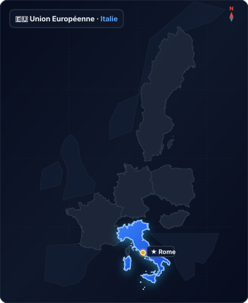

# italie

Source : `directives/fiches-acteurs/pays/italie.json`

## Situation géographique en Europe

## Détail des entités et coordonnées GeoJSON

Cliquez pour afficher les 2,661 points de coordonnées géographiques

- **type** : FeatureCollection
- **features** :
  - **Élément 1** :
    - **type** : Feature
    - **properties** :
      `{}` (objet vide)
    - **geometry** :
      - **coordinates** :
        - **Élément 1** :
          - **Élément 1** :
            - `12.19207763671875`
            - `47.092565552235705`
          - **Élément 2** :
            - `12.1234130859375`
            - `47.08508535995386`
          - **Élément 3** :
            - `12.057495117187498`
            - `47.05889641405164`
          - **Élément 4** :
            - `11.91741943359375`
            - `47.02707824931892`
          - **Élément 5** :
            - `11.82952880859375`
            - `46.9933677428342`
          - **Élément 6** :
            - `11.7608642578125`
            - `46.98212617904094`
          - **Élément 7** :
            - `11.744384765625`
            - `46.970882250990755`
          - **Élément 8** :
            - `11.7059326171875`
            - `46.98962081759436`
          - **Élément 9** :
            - `11.62078857421875`
            - `47.01209842876063`
          - **Élément 10** :
            - `11.55487060546875`
            - `46.98774725646568`
          - **Élément 11** :
            - `11.5191650390625`
            - `46.9989876381546`
          - **Élément 12** :
            - `11.483459472656248`
            - `47.00835281693705`
          - **Élément 13** :
            - `11.44500732421875`
            - `46.98212617904094`
          - **Élément 14** :
            - `11.37908935546875`
            - `46.965259400349275`
          - **Élément 15** :
            - `11.33514404296875`
            - `46.98025235521883`
          - **Élément 16** :
            - `11.2445068359375`
            - `46.98025235521883`
          - **Élément 17** :
            - `11.1895751953125`
            - `46.965259400349275`
          - **Élément 18** :
            - `11.15936279296875`
            - `46.931509883369316`
          - **Élément 19** :
            - `11.1126708984375`
            - `46.91087470241917`
          - **Élément 20** :
            - `11.085205078125`
            - `46.875213396722685`
          - **Élément 21** :
            - `11.0687255859375`
            - `46.84516443029276`
          - **Élément 22** :
            - `11.07696533203125`
            - `46.8169782502437`
          - **Élément 23** :
            - `11.02752685546875`
            - `46.77184961467733`
          - **Élément 24** :
            - `10.94512939453125`
            - `46.76808718675661`
          - **Élément 25** :
            - `10.8819580078125`
            - `46.76620587423741`
          - **Élément 26** :
            - `10.84625244140625`
            - `46.7756117797763`
          - **Élément 27** :
            - `10.79681396484375`
            - `46.78877728793222`
          - **Élément 28** :
            - `10.733642578125`
            - `46.77749276376827`
          - **Élément 29** :
            - `10.76934814453125`
            - `46.82073726164968`
          - **Élément 30** :
            - `10.71441650390625`
            - `46.84516443029276`
          - **Élément 31** :
            - `10.681457519531248`
            - `46.87709089874478`
          - **Élément 32** :
            - `10.57708740234375`
            - `46.83577067935951`
          - **Élément 33** :
            - `10.5413818359375`
            - `46.84516443029276`
          - **Élément 34** :
            - `10.469808251168445`
            - `46.85496216372534`
          - **Élément 35** :
            - `10.449371337890625`
            - `46.80475964822951`
          - **Élément 36** :
            - `10.424652099609261`
            - `46.79253827035982`
          - **Élément 37** :
            - `10.441131591796875`
            - `46.7549166192819`
          - **Élément 38** :
            - `10.40130615234375`
            - `46.73515473113437`
          - **Élément 39** :
            - `10.4150390625`
            - `46.717268685073954`
          - **Élément 40** :
            - `10.40130615234375`
            - `46.705027447019`
          - **Élément 41** :
            - `10.383453369140625`
            - `46.68618935159652`
          - **Élément 42** :
            - `10.40679931640625`
            - `46.63435070293566`
          - **Élément 43** :
            - `10.44525146484375`
            - `46.63717954716511`
          - **Élément 44** :
            - `10.4864501953125`
            - `46.613601326659726`
          - **Élément 45** :
            - `10.47821044921875`
            - `46.55130547880643`
          - **Élément 46** :
            - `10.456237792968636`
            - `46.53335855579562`
          - **Élément 47** :
            - `10.4205322265625`
            - `46.549416608392264`
          - **Élément 48** :
            - `10.394439697265625`
            - `46.543749602738565`
          - **Élément 49** :
            - `10.355987548828011`
            - `46.557916007595786`
          - **Élément 50** :
            - `10.3436279296875`
            - `46.54280504427768`
          - **Élément 51** :
            - `10.331268310546875`
            - `46.5503610518162`
          - **Élément 52** :
            - `10.2996826171875`
            - `46.5503610518162`
          - **Élément 53** :
            - `10.287322998046875`
            - `46.56735822330717`
          - **Élément 54** :
            - `10.269470214843636`
            - `46.57585481240773`
          - **Élément 55** :
            - `10.246124267578125`
            - `46.57019056757178`
          - **Élément 56** :
            - `10.2447509765625`
            - `46.59001283632443`
          - **Élément 57** :
            - `10.259857177734375`
            - `46.61077125007589`
          - **Élément 58** :
            - `10.237884521484261`
            - `46.63529366744315`
          - **Élément 59** :
            - `10.21728515625`
            - `46.61831779233193`
          - **Élément 60** :
            - `10.185699462890625`
            - `46.6239770088969`
          - **Élément 61** :
            - `10.1129150390625`
            - `46.60699758458517`
          - **Élément 62** :
            - `10.100555419921875`
            - `46.604167162931844`
          - **Élément 63** :
            - `10.103302001953125`
            - `46.58812531342674`
          - **Élément 64** :
            - `10.086822509765625`
            - `46.57679879569826`
          - **Élément 65** :
            - `10.084075927734375`
            - `46.568302354495195`
          - **Élément 66** :
            - `10.040130615234375`
            - `46.54091587805394`
          - **Élément 67** :
            - `10.053863525390625`
            - `46.52202060029237`
          - **Élément 68** :
            - `10.042877197265625`
            - `46.50973514453876`
          - **Élément 69** :
            - `10.052490234375`
            - `46.47380788661107`
          - **Élément 70** :
            - `10.040130615234375`
            - `46.44448122948704`
          - **Élément 71** :
            - `10.086822509765625`
            - `46.417979059090115`
          - **Élément 72** :
            - `10.12664794921875`
            - `46.42933871009928`
          - **Élément 73** :
            - `10.160980224609375`
            - `46.41513877649199`
          - **Élément 74** :
            - `10.162353515625`
            - `46.38767508415227`
          - **Élément 75** :
            - `10.130767822265625`
            - `46.379149058330746`
          - **Élément 76** :
            - `10.133514404296875`
            - `46.36304070990861`
          - **Élément 77** :
            - `10.108795166015511`
            - `46.357354276167015`
          - **Élément 78** :
            - `10.10467529296875`
            - `46.32891323009468`
          - **Élément 79** :
            - `10.15411376953125`
            - `46.29381556233369`
          - **Élément 80** :
            - `10.17608642578125`
            - `46.25394769073575`
          - **Élément 81** :
            - `10.149993896484375`
            - `46.23210299453147`
          - **Élément 82** :
            - `10.09368896484375`
            - `46.22640294763494`
          - **Élément 83** :
            - `10.0689697265625`
            - `46.21595132425726`
          - **Élément 84** :
            - `10.042877197265625`
            - `46.22545288226939`
          - **Élément 85** :
            - `10.059356689453125`
            - `46.24350131252777`
          - **Élément 86** :
            - `10.05523681640625`
            - `46.26913887119721`
          - **Élément 87** :
            - `9.99481201171875`
            - `46.2881219277807`
          - **Élément 88** :
            - `9.998931884765625`
            - `46.31373862226742`
          - **Élément 89** :
            - `9.9810791015625`
            - `46.319429593412906`
          - **Élément 90** :
            - `9.99755859375`
            - `46.34882351589622`
          - **Élément 91** :
            - `9.963226318359375`
            - `46.36588370484979`
          - **Élément 92** :
            - `9.953613281249886`
            - `46.37820163993491`
          - **Élément 93** :
            - `9.935760498046875`
            - `46.374411801963404`
          - **Élément 94** :
            - `9.930267333984375`
            - `46.36493605630856`
          - **Élément 95** :
            - `9.902801513671875`
            - `46.37820163993491`
          - **Élément 96** :
            - `9.87396240234375`
            - `46.36588370484979`
          - **Élément 97** :
            - `9.8382568359375`
            - `46.36114529775181`
          - **Élément 98** :
            - `9.77508544921875`
            - `46.336498955749924`
          - **Élément 99** :
            - `9.743499755859375`
            - `46.3507193554773`
          - **Élément 100** :
            - `9.72564697265625`
            - `46.34218755951396`
          - **Élément 101** :
            - `9.721527099609375`
            - `46.32417161725691`
          - **Élément 102** :
            - `9.7283935546875`
            - `46.31848113932307`
          - **Élément 103** :
            - `9.70916748046875`
            - `46.29096881904223`
          - **Élément 104** :
            - `9.674835205078011`
            - `46.29761098988109`
          - **Élément 105** :
            - `9.630889892578125`
            - `46.28717293114449`
          - **Élément 106** :
            - `9.60205078125`
            - `46.29381556233369`
          - **Élément 107** :
            - `9.559478759765625`
            - `46.30140615437332`
          - **Élément 108** :
            - `9.5416259765625`
            - `46.308047059262954`
          - **Élément 109** :
            - `9.4976806640625`
            - `46.35924981983804`
          - **Élément 110** :
            - `9.46197509765625`
            - `46.379149058330746`
          - **Élément 111** :
            - `9.46746826171875`
            - `46.40093514439044`
          - **Élément 112** :
            - `9.456481933593636`
            - `46.419872498633765`
          - **Élément 113** :
            - `9.460601806640625`
            - `46.50595444552049`
          - **Élément 114** :
            - `9.42626953125`
            - `46.494610770689384`
          - **Élément 115** :
            - `9.4097900390625`
            - `46.4662412291809`
          - **Élément 116** :
            - `9.371337890625`
            - `46.49082901981415`
          - **Élément 117** :
            - `9.371337890625`
            - `46.50784482789971`
          - **Élément 118** :
            - `9.282073974609375`
            - `46.495556167319506`
          - **Élément 119** :
            - `9.276580810546875`
            - `46.45772748219606`
          - **Élément 120** :
            - `9.249114990234375`
            - `46.44637374854379`
          - **Élément 121** :
            - `9.24774169921875`
            - `46.433124734438216`
          - **Élément 122** :
            - `9.28070068359375`
            - `46.41513877649199`
          - **Élément 123** :
            - `9.276580810546875`
            - `46.38199121488583`
          - **Élément 124** :
            - `9.28070068359375`
            - `46.36114529775181`
          - **Élément 125** :
            - `9.29718017578125`
            - `46.347875571446274`
          - **Élément 126** :
            - `9.2999267578125`
            - `46.326068311712596`
          - **Élément 127** :
            - `9.287567138671875`
            - `46.31184150036163`
          - **Élément 128** :
            - `9.283447265625`
            - `46.296187735377686`
          - **Élément 129** :
            - `9.260787963867188`
            - `46.27910579592009`
          - **Élément 130** :
            - `9.251861572265625`
            - `46.268189545732`
          - **Élément 131** :
            - `9.246368408203125`
            - `46.23210299453147`
          - **Élément 132** :
            - `9.235382080078011`
            - `46.23305294479828`
          - **Élément 133** :
            - `9.22027587890625`
            - `46.229253045075275`
          - **Élément 134** :
            - `9.219589233398324`
            - `46.214050815339526`
          - **Élément 135** :
            - `9.203796386718636`
            - `46.2088240766772`
          - **Élément 136** :
            - `9.193496704101449`
            - `46.19551740648851`
          - **Élément 137** :
            - `9.197616577148438`
            - `46.17983040759436`
          - **Élément 138** :
            - `9.180450439453125`
            - `46.16936992120204`
          - **Élément 139** :
            - `9.160537719726562`
            - `46.17174747919073`
          - **Élément 140** :
            - `9.157791137695312`
            - `46.162236630580146`
          - **Élément 141** :
            - `9.13787841796875`
            - `46.155102414967125`
          - **Élément 142** :
            - `9.119338989257812`
            - `46.13607331774968`
          - **Élément 143** :
            - `9.072647094726562`
            - `46.118941506107056`
          - **Élément 144** :
            - `9.08843994140625`
            - `46.0856143970306`
          - **Élément 145** :
            - `9.07470703125`
            - `46.06608487747521`
          - **Élément 146** :
            - `9.019088745117188`
            - `46.05083752327744`
          - **Élément 147** :
            - `9.009475708007812`
            - `46.034155908665014`
          - **Élément 148** :
            - `9.018402099609375`
            - `46.02033018369074`
          - **Élément 149** :
            - `9.026641845703125`
            - `45.99362244576694`
          - **Élément 150** :
            - `9.009475708007812`
            - `45.98837476770814`
          - **Élément 151** :
            - `9.012222290039062`
            - `45.980263741139915`
          - **Élément 152** :
            - `8.995742797851562`
            - `45.98312659209629`
          - **Élément 153** :
            - `8.990936279296761`
            - `45.97071983548312`
          - **Élément 154** :
            - `9.016342163085938`
            - `45.95831029909359`
          - **Élément 155** :
            - `9.017715454101562`
            - `45.95067227963381`
          - **Élément 156** :
            - `9.012222290039062`
            - `45.944943074191265`
          - **Élément 157** :
            - `9.019088745117188`
            - `45.93969078234`
          - **Élément 158** :
            - `9.021835327148438`
            - `45.92822950933618`
          - **Élément 159** :
            - `9.041061401367188`
            - `45.92631906688105`
          - **Élément 160** :
            - `9.053421020507812`
            - `45.92154267288144`
          - **Élément 161** :
            - `9.07470703125`
            - `45.91103315853962`
          - **Élément 162** :
            - `9.080200195312386`
            - `45.900999492657384`
          - **Élément 163** :
            - `9.089813232421875`
            - `45.900999492657384`
          - **Élément 164** :
            - `9.076080322265625`
            - `45.8876184503559`
          - **Élément 165** :
            - `9.05548095703125`
            - `45.8766244679252`
          - **Élément 166** :
            - `9.040374755859375`
            - `45.84649937512838`
          - **Élément 167** :
            - `9.031448364257812`
            - `45.82114340079471`
          - **Élément 168** :
            - `8.997116088867188`
            - `45.82114340079471`
          - **Élément 169** :
            - `8.991622924804688`
            - `45.836454050187726`
          - **Élément 170** :
            - `8.972396850585824`
            - `45.832626782661535`
          - **Élément 171** :
            - `8.953857421874886`
            - `45.841716113258904`
          - **Élément 172** :
            - `8.914031982421875`
            - `45.83119148947943`
          - **Élément 173** :
            - `8.925018310546761`
            - `45.85462997645187`
          - **Élément 174** :
            - `8.943557739257699`
            - `45.867540841540254`
          - **Élément 175** :
            - `8.936004638671875`
            - `45.869931413475676`
          - **Élément 176** :
            - `8.925704956054688`
            - `45.89000815866184`
          - **Élément 177** :
            - `8.9208984375`
            - `45.913421859301565`
          - **Élément 178** :
            - `8.907852172851562`
            - `45.916288164507876`
          - **Élément 179** :
            - `8.894119262695312`
            - `45.93396044192156`
          - **Élément 180** :
            - `8.895492553710938`
            - `45.9587876403564`
          - **Élément 181** :
            - `8.881072998046875`
            - `45.95640089292073`
          - **Élément 182** :
            - `8.842620849609375`
            - `45.98264946055033`
          - **Élément 183** :
            - `8.821334838867188`
            - `45.988851849909835`
          - **Élément 184** :
            - `8.784255981445312`
            - `45.991714256768006`
          - **Élément 185** :
            - `8.803482055664062`
            - `46.02128379298403`
          - **Élément 186** :
            - `8.822021484375`
            - `46.02271417608516`
          - **Élément 187** :
            - `8.832321166992188`
            - `46.04178241461432`
          - **Élément 188** :
            - `8.83575439453125`
            - `46.05083752327744`
          - **Élément 189** :
            - `8.844680786132812`
            - `46.05083752327744`
          - **Élément 190** :
            - `8.85498046875`
            - `46.057985244793024`
          - **Élément 191** :
            - `8.852920532226562`
            - `46.07227791246786`
          - **Élément 192** :
            - `8.807601928710938`
            - `46.0998999106273`
          - **Élément 193** :
            - `8.797988891601562`
            - `46.09561464508116`
          - **Élément 194** :
            - `8.77532958984375`
            - `46.098471525781505`
          - **Élément 195** :
            - `8.75885009765625`
            - `46.10085214663405`
          - **Élément 196** :
            - `8.743057250976562`
            - `46.12132124301515`
          - **Élément 197** :
            - `8.722457885742074`
            - `46.11132565729796`
          - **Élément 198** :
            - `8.714218139648438`
            - `46.09942378645679`
          - **Élément 199** :
            - `8.686065673828125`
            - `46.10132825847029`
          - **Élément 200** :
            - `8.67645263671875`
            - `46.10989756847276`
          - **Élément 201** :
            - `8.669586181640625`
            - `46.10894548869913`
          - **Élément 202** :
            - `8.662033081054574`
            - `46.11132565729796`
          - **Élément 203** :
            - `8.647613525390625`
            - `46.12274903582433`
          - **Élément 204** :
            - `8.61328125`
            - `46.123224958538096`
          - **Élément 205** :
            - `8.613967895507812`
            - `46.130839162824415`
          - **Élément 206** :
            - `8.592681884765625`
            - `46.14321000005104`
          - **Élément 207** :
            - `8.601608276367074`
            - `46.155102414967125`
          - **Élément 208** :
            - `8.583755493164062`
            - `46.160809861457125`
          - **Élément 209** :
            - `8.576202392578125`
            - `46.16176104498355`
          - **Élément 210** :
            - `8.567276000976449`
            - `46.18125668339498`
          - **Élément 211** :
            - `8.554916381835938`
            - `46.1893382140708`
          - **Élément 212** :
            - `8.540496826171875`
            - `46.19599270020596`
          - **Élément 213** :
            - `8.532257080078125`
            - `46.218801964311396`
          - **Élément 214** :
            - `8.515090942382812`
            - `46.220702308799446`
          - **Élément 215** :
            - `8.492431640625`
            - `46.22735299655779`
          - **Élément 216** :
            - `8.471145629882812`
            - `46.230203044669985`
          - **Élément 217** :
            - `8.463592529296875`
            - `46.244451065485094`
          - **Élément 218** :
            - `8.441619873046875`
            - `46.25204849722289`
          - **Élément 219** :
            - `8.453979492187386`
            - `46.26486677712518`
          - **Élément 220** :
            - `8.427886962890511`
            - `46.30093177319756`
          - **Élément 221** :
            - `8.433380126953125`
            - `46.301880531438854`
          - **Élément 222** :
            - `8.440933227538949`
            - `46.31895536842305`
          - **Élément 223** :
            - `8.462905883789062`
            - `46.33080976014871`
          - **Élément 224** :
            - `8.463592529296875`
            - `46.3540369165138`
          - **Élément 225** :
            - `8.470458984375`
            - `46.36019756701459`
          - **Élément 226** :
            - `8.462905883789062`
            - `46.38720145098313`
          - **Élément 227** :
            - `8.471145629882812`
            - `46.395252655951154`
          - **Élément 228** :
            - `8.46221923828125`
            - `46.4023556740354`
          - **Élément 229** :
            - `8.466339111328125`
            - `46.4141919827505`
          - **Élément 230** :
            - `8.459472656249886`
            - `46.41845242514014`
          - **Élément 231** :
            - `8.455352783203125`
            - `46.432651495778465`
          - **Élément 232** :
            - `8.465652465820312`
            - `46.443534945303284`
          - **Élément 233** :
            - `8.439559936523438`
            - `46.464349400461124`
          - **Élément 234** :
            - `8.383941650390625`
            - `46.45015858941525`
          - **Élément 235** :
            - `8.365402221679688`
            - `46.45299704748289`
          - **Élément 236** :
            - `8.322830200195312`
            - `46.42413249720715`
          - **Élément 237** :
            - `8.306350708007812`
            - `46.4250791183536`
          - **Élément 238** :
            - `8.2891845703125`
            - `46.4056700993737`
          - **Élément 239** :
            - `8.310470581054688`
            - `46.4023556740354`
          - **Élément 240** :
            - `8.315277099609375`
            - `46.39667333354005`
          - **Élément 241** :
            - `8.314590454101449`
            - `46.380096460287824`
          - **Élément 242** :
            - `8.287811279296875`
            - `46.36398839132818`
          - **Élément 243** :
            - `8.274765014648438`
            - `46.36730514683829`
          - **Élément 244** :
            - `8.263778686523438`
            - `46.36067143443812`
          - **Élément 245** :
            - `8.265151977539062`
            - `46.34692761055676`
          - **Élément 246** :
            - `8.223953247070312`
            - `46.33223211453405`
          - **Élément 247** :
            - `8.208847045898438`
            - `46.30567539999591`
          - **Élément 248** :
            - `8.161468505859375`
            - `46.2957133089894`
          - **Élément 249** :
            - `8.139495849609375`
            - `46.3023549043942`
          - **Élément 250** :
            - `8.1243896484375`
            - `46.29476444388206`
          - **Élément 251** :
            - `8.101730346679574`
            - `46.275783689088`
          - **Élément 252** :
            - `8.079757690429688`
            - `46.25964487666549`
          - **Élément 253** :
            - `8.109283447265625`
            - `46.248724750319965`
          - **Élément 254** :
            - `8.123703002929688`
            - `46.23067803830134`
          - **Élément 255** :
            - `8.136749267578125`
            - `46.226877974151705`
          - **Élément 256** :
            - `8.152542114257812`
            - `46.198844376182535`
          - **Élément 257** :
            - `8.164215087890625`
            - `46.17887953650578`
          - **Élément 258** :
            - `8.150482177734375`
            - `46.163187789440116`
          - **Élément 259** :
            - `8.147735595703125`
            - `46.13607331774968`
          - **Élément 260** :
            - `8.115463256835938`
            - `46.131315015646564`
          - **Élément 261** :
            - `8.109970092773438`
            - `46.112277695957935`
          - **Élément 262** :
            - `8.075637817382812`
            - `46.106089150705124`
          - **Élément 263** :
            - `8.034439086914062`
            - `46.1022804698085`
          - **Élément 264** :
            - `8.023452758789062`
            - `46.072754270993904`
          - **Élément 265** :
            - `8.035125732421875`
            - `46.044642082970135`
          - **Élément 266** :
            - `8.013153076171875`
            - `46.02986553649432`
          - **Élément 267** :
            - `8.013153076171875`
            - `46.01413132237831`
          - **Élément 268** :
            - `8.002853393554688`
            - `46.01079318614809`
          - **Élément 269** :
            - `7.9850006103515625`
            - `45.99696161820381`
          - **Élément 270** :
            - `7.9108428955078125`
            - `45.99743862638977`
          - **Élément 271** :
            - `7.895050048828125`
            - `45.976446376256575`
          - **Élément 272** :
            - `7.8792572021484375`
            - `45.97406038956237`
          - **Élément 273** :
            - `7.877883911132699`
            - `45.96165160157818`
          - **Élément 274** :
            - `7.875823974609375`
            - `45.94971745318209`
          - **Élément 275** :
            - `7.870330810546875`
            - `45.94780775093224`
          - **Élément 276** :
            - `7.8710174560546875`
            - `45.93587062119052`
          - **Élément 277** :
            - `7.878570556640625`
            - `45.92727429633322`
          - **Élément 278** :
            - `7.870330810546875`
            - `45.919154321669474`
          - **Élément 279** :
            - `7.8607177734375`
            - `45.920587344733654`
          - **Élément 280** :
            - `7.823638916015625`
            - `45.92631906688105`
          - **Élément 281** :
            - `7.80303955078125`
            - `45.916765867649005`
          - **Élément 282** :
            - `7.776947021484375`
            - `45.93300532761351`
          - **Élément 283** :
            - `7.7501678466796875`
            - `45.940168283978565`
          - **Élément 284** :
            - `7.7405548095703125`
            - `45.92870710966921`
          - **Élément 285** :
            - `7.72613525390625`
            - `45.923930921285205`
          - **Élément 286** :
            - `7.706909179687386`
            - `45.93061746987842`
          - **Élément 287** :
            - `7.7062225341796875`
            - `45.95449142095327`
          - **Élément 288** :
            - `7.679443359375`
            - `45.95544616516134`
          - **Élément 289** :
            - `7.659530639648324`
            - `45.975491993915114`
          - **Élément 290** :
            - `7.6471710205078125`
            - `45.97071983548312`
          - **Élément 291** :
            - `7.6251983642578125`
            - `45.97024259702345`
          - **Élément 292** :
            - `7.5867462158203125`
            - `45.97119706983072`
          - **Élément 293** :
            - `7.5798797607421875`
            - `45.98646639778119`
          - **Élément 294** :
            - `7.548980712890511`
            - `45.98598929501943`
          - **Élément 295** :
            - `7.5400543212890625`
            - `45.976446376256575`
          - **Élément 296** :
            - `7.5421142578125`
            - `45.95735560423149`
          - **Élément 297** :
            - `7.5167083740234375`
            - `45.95831029909359`
          - **Élément 298** :
            - `7.4988555908203125`
            - `45.96117428498824`
          - **Élément 299** :
            - `7.4713897705078125`
            - `45.95067227963381`
          - **Élément 300** :
            - `7.475509643554574`
            - `45.9353930825417`
          - **Élément 301** :
            - `7.4604034423828125`
            - `45.93443799290722`
          - **Élément 302** :
            - `7.444610595703125`
            - `45.930139885994556`
          - **Élément 303** :
            - `7.414398193359375`
            - `45.91055540605009`
          - **Élément 304** :
            - `7.4027252197265625`
            - `45.91055540605009`
          - **Élément 305** :
            - `7.384185791015625`
            - `45.89717666670996`
          - **Élément 306** :
            - `7.356719970703125`
            - `45.908644354968246`
          - **Élément 307** :
            - `7.3450469970703125`
            - `45.91533274588853`
          - **Élément 308** :
            - `7.323760986328125`
            - `45.90768880475299`
          - **Élément 309** :
            - `7.31964111328125`
            - `45.917243566677804`
          - **Élément 310** :
            - `7.288742065429574`
            - `45.920587344733654`
          - **Élément 311** :
            - `7.25921630859375`
            - `45.88714049635727`
          - **Élément 312** :
            - `7.254409790038949`
            - `45.891919851282076`
          - **Élément 313** :
            - `7.23724365234375`
            - `45.89000815866184`
          - **Élément 314** :
            - `7.2173309326171875`
            - `45.88905228767691`
          - **Élément 315** :
            - `7.200164794921875`
            - `45.87423418386832`
          - **Élément 316** :
            - `7.19879150390625`
            - `45.863237552964364`
          - **Élément 317** :
            - `7.189178466796875`
            - `45.85845573051733`
          - **Élément 318** :
            - `7.1665191650390625`
            - `45.86945330731374`
          - **Élément 319** :
            - `7.1575927734375`
            - `45.87853662114514`
          - **Élément 320** :
            - `7.1376800537109375`
            - `45.87184379699793`
          - **Élément 321** :
            - `7.126007080078125`
            - `45.86132487333675`
          - **Élément 322** :
            - `7.10540771484375`
            - `45.86084669314834`
          - **Élément 323** :
            - `7.096481323242074`
            - `45.87184379699793`
          - **Élément 324** :
            - `7.0868682861328125`
            - `45.88140472759939`
          - **Élément 325** :
            - `7.0786285400390625`
            - `45.89000815866184`
          - **Élément 326** :
            - `7.065582275390625`
            - `45.897654534346906`
          - **Élément 327** :
            - `7.060089111328125`
            - `45.91055540605009`
          - **Élément 328** :
            - `7.044150069975359`
            - `45.92258673523031`
          - **Élément 329** :
            - `7.040962453141219`
            - `45.922706722113375`
          - **Élément 330** :
            - `7.037120275054207`
            - `45.92085633902385`
          - **Élément 331** :
            - `7.029508860723254`
            - `45.92017876751207`
          - **Élément 332** :
            - `7.018990347943422`
            - `45.91448939224855`
          - **Élément 333** :
            - `7.0017145738833335`
            - `45.89766495223813`
          - **Élément 334** :
            - `7.006070421034096`
            - `45.88690450313158`
          - **Élément 335** :
            - `6.998291015625`
            - `45.87327804145782`
          - **Élément 336** :
            - `6.974945068359375`
            - `45.868018964152476`
          - **Élément 337** :
            - `6.9550323486328125`
            - `45.86084669314834`
          - **Élément 338** :
            - `6.941986083984375`
            - `45.84649937512838`
          - **Élément 339** :
            - `6.8918609619140625`
            - `45.84362946735877`
          - **Élément 340** :
            - `6.880874633788949`
            - `45.84793427349226`
          - **Élément 341** :
            - `6.87469482421875`
            - `45.84410779560204`
          - **Élément 342** :
            - `6.8698883056640625`
            - `45.83932432809877`
          - **Élément 343** :
            - `6.865596771240234`
            - `45.83310520549682`
          - **Élément 344** :
            - `6.859245300292969`
            - `45.832985600173565`
          - **Élément 345** :
            - `6.853923797607422`
            - `45.83669324566859`
          - **Élément 346** :
            - `6.852378845214844`
            - `45.83944391979866`
          - **Élément 347** :
            - `6.843280792236328`
            - `45.84231404348377`
          - **Élément 348** :
            - `6.833152770996094`
            - `45.83788920765037`
          - **Élément 349** :
            - `6.821308135986328`
            - `45.83729122987253`
          - **Élément 350** :
            - `6.815128326415902`
            - `45.83047382900793`
          - **Élément 351** :
            - `6.807060241699219`
            - `45.817315080406246`
          - **Élément 352** :
            - `6.812725067138672`
            - `45.81109349837976`
          - **Élément 353** :
            - `6.8149566650390625`
            - `45.794698694740575`
          - **Élément 354** :
            - `6.806201934814453`
            - `45.79350180481077`
          - **Élément 355** :
            - `6.801738739013672`
            - `45.78009488139103`
          - **Élément 356** :
            - `6.804656982421761`
            - `45.77099548979183`
          - **Élément 357** :
            - `6.8060302734375`
            - `45.76967834958357`
          - **Élément 358** :
            - `6.805515289306641`
            - `45.761894613411535`
          - **Élément 359** :
            - `6.806545257568359`
            - `45.75039664725208`
          - **Élément 360** :
            - `6.806201934814453`
            - `45.748000939440544`
          - **Élément 361** :
            - `6.816501617431641`
            - `45.73997456905202`
          - **Élément 362** :
            - `6.812896728515625`
            - `45.7321866889887`
          - **Élément 363** :
            - `6.807918548583984`
            - `45.72631510756138`
          - **Élément 364** :
            - `6.819248199462891`
            - `45.71840547127867`
          - **Élément 365** :
            - `6.820449829101449`
            - `45.71265230517708`
          - **Élément 366** :
            - `6.831092834472543`
            - `45.70234306798271`
          - **Élément 367** :
            - `6.8424224853515625`
            - `45.70006518937886`
          - **Élément 368** :
            - `6.847057342529297`
            - `45.69023328032072`
          - **Élément 369** :
            - `6.857185363769418`
            - `45.68507683223297`
          - **Élément 370** :
            - `6.866283416748047`
            - `45.68435729005792`
          - **Élément 371** :
            - `6.868858337402344`
            - `45.680999304204065`
          - **Élément 372** :
            - `6.879158020019531`
            - `45.67884049258085`
          - **Élément 373** :
            - `6.883106231689453`
            - `45.68135909804323`
          - **Élément 374** :
            - `6.8932342529296875`
            - `45.676201831925525`
          - **Élément 375** :
            - `6.899585723876953`
            - `45.68111923574086`
          - **Élément 376** :
            - `6.903533935546875`
            - `45.68015977624821`
          - **Élément 377** :
            - `6.906452178955078`
            - `45.67536223198685`
          - **Élément 378** :
            - `6.905250549316406`
            - `45.6720037062618`
          - **Élément 379** :
            - `6.906452178955078`
            - `45.66936472322517`
          - **Élément 380** :
            - `6.90216064453125`
            - `45.66384644752443`
          - **Élément 381** :
            - `6.916065216064453`
            - `45.6608471564812`
          - **Élément 382** :
            - `6.9158935546875`
            - `45.65196831328892`
          - **Élément 383** :
            - `6.932029724121094`
            - `45.64608830455222`
          - **Élément 384** :
            - `6.9618988037109375`
            - `45.65484809235974`
          - **Élément 385** :
            - `6.970310211181527`
            - `45.65412816147472`
          - **Élément 386** :
            - `6.974773406982422`
            - `45.64704834814101`
          - **Élément 387** :
            - `6.990222930908203`
            - `45.64380813508572`
          - **Élément 388** :
            - `6.991252899169808`
            - `45.64020767854683`
          - **Élément 389** :
            - `6.999835968017578`
            - `45.63996763988405`
          - **Élément 390** :
            - `7.001209259033203`
            - `45.636126881422804`
          - **Élément 391** :
            - `6.996402740478516`
            - `45.62976504612542`
          - **Élément 392** :
            - `6.987133026123047`
            - `45.62508323440172`
          - **Élément 393** :
            - `6.983184814453125`
            - `45.616799071117406`
          - **Élément 394** :
            - `6.985931396484375`
            - `45.612116176517304`
          - **Élément 395** :
            - `6.9797515869140625`
            - `45.59638359087061`
          - **Élément 396** :
            - `6.978206634521371`
            - `45.58773479470078`
          - **Élément 397** :
            - `6.99554443359375`
            - `45.57079370812671`
          - **Élément 398** :
            - `6.99005126953125`
            - `45.52655459432095`
          - **Élément 399** :
            - `7.005157470703125`
            - `45.51404592560424`
          - **Élément 400** :
            - `7.005157470703125`
            - `45.50153447596235`
          - **Élément 401** :
            - `7.05322265625`
            - `45.493833740092185`
          - **Élément 402** :
            - `7.0477294921875`
            - `45.47361429775641`
          - **Élément 403** :
            - `7.104034423828125`
            - `45.468799075209894`
          - **Élément 404** :
            - `7.119140625`
            - `45.430262484682125`
          - **Élément 405** :
            - `7.18231201171875`
            - `45.40230699238177`
          - **Élément 406** :
            - `7.16033935546875`
            - `45.370478735401555`
          - **Élément 407** :
            - `7.161712646484375`
            - `45.35600542155823`
          - **Élément 408** :
            - `7.13836669921875`
            - `45.34828480683999`
          - **Élément 409** :
            - `7.12738037109375`
            - `45.32897866218559`
          - **Élément 410** :
            - `7.112274169921761`
            - `45.32801318215748`
          - **Élément 411** :
            - `7.134246826171875`
            - `45.25362179991922`
          - **Élément 412** :
            - `7.109527587890625`
            - `45.24298649437894`
          - **Élément 413** :
            - `7.073822021484375`
            - `45.213003555993964`
          - **Élément 414** :
            - `7.042236328125`
            - `45.22557897178979`
          - **Élément 415** :
            - `6.963958740234375`
            - `45.205263456162385`
          - **Élément 416** :
            - `6.944732666015625`
            - `45.168483598156435`
          - **Élément 417** :
            - `6.888427734375`
            - `45.16267407976458`
          - **Élément 418** :
            - `6.893920898437386`
            - `45.1394300814679`
          - **Élément 419** :
            - `6.851348876953125`
            - `45.126835624332244`
          - **Élément 420** :
            - `6.773071289062386`
            - `45.158800738352106`
          - **Élément 421** :
            - `6.74285888671875`
            - `45.13652391514744`
          - **Élément 422** :
            - `6.707153320312386`
            - `45.1433047394883`
          - **Élément 423** :
            - `6.68243408203125`
            - `45.1394300814679`
          - **Élément 424** :
            - `6.667327880859375`
            - `45.11714568775032`
          - **Élément 425** :
            - `6.6302490234375`
            - `45.11036175291049`
          - **Élément 426** :
            - `6.649475097656136`
            - `45.07158094070473`
          - **Élément 427** :
            - `6.66046142578125`
            - `45.06964120886863`
          - **Élément 428** :
            - `6.675567626953011`
            - `45.023067895446175`
          - **Élément 429** :
            - `6.746978759765625`
            - `45.01627278577625`
          - **Élément 430** :
            - `6.749725341796875`
            - `44.99782485158904`
          - **Élément 431** :
            - `6.738739013671761`
            - `44.990055522906864`
          - **Élément 432** :
            - `6.763458251953125`
            - `44.969656023708175`
          - **Élément 433** :
            - `6.746978759765625`
            - `44.93758500391091`
          - **Élément 434** :
            - `6.760711669921875`
            - `44.932724194996155`
          - **Élément 435** :
            - `6.7510986328125`
            - `44.91035917458495`
          - **Élément 436** :
            - `6.810150146484375`
            - `44.87436239539944`
          - **Élément 437** :
            - `6.910400390625`
            - `44.8432118765634`
          - **Élément 438** :
            - `6.9378662109375`
            - `44.861709529639704`
          - **Élément 439** :
            - `7.00927734375`
            - `44.84029065139799`
          - **Élément 440** :
            - `7.023010253906136`
            - `44.82178611905465`
          - **Élément 441** :
            - `7.0037841796875`
            - `44.79255634014767`
          - **Élément 442** :
            - `7.021636962890625`
            - `44.767211884106956`
          - **Élément 443** :
            - `7.03125`
            - `44.72917434046452`
          - **Élément 444** :
            - `7.065582275390625`
            - `44.71063416158254`
          - **Élément 445** :
            - `7.07794189453125`
            - `44.680371641890375`
          - **Élément 446** :
            - `7.03948974609375`
            - `44.68623013803223`
          - **Élément 447** :
            - `6.980438232421875`
            - `44.69013547299005`
          - **Élément 448** :
            - `6.952972412109375`
            - `44.65888542068506`
          - **Élément 449** :
            - `6.95159912109375`
            - `44.63739123445585`
          - **Élément 450** :
            - `6.966705322265625`
            - `44.62566377574352`
          - **Élément 451** :
            - `6.952972412109375`
            - `44.61979915773973`
          - **Élément 452** :
            - `6.933746337890625`
            - `44.58753316908299`
          - **Élément 453** :
            - `6.928253173828011`
            - `44.57383915375391`
          - **Élément 454** :
            - `6.917266845703125`
            - `44.567969302679685`
          - **Élément 455** :
            - `6.9158935546875`
            - `44.56014191304745`
          - **Élément 456** :
            - `6.88018798828125`
            - `44.554270679675696`
          - **Élément 457** :
            - `6.854095458984375`
            - `44.53371669765759`
          - **Élément 458** :
            - `6.867828369140511`
            - `44.4906276800508`
          - **Élément 459** :
            - `6.899414062499886`
            - `44.46613109099745`
          - **Élément 460** :
            - `6.9488525390625`
            - `44.43181858864192`
          - **Élément 461** :
            - `6.895294189453125`
            - `44.42397290075389`
          - **Élément 462** :
            - `6.888427734375`
            - `44.364114902541495`
          - **Élément 463** :
            - `6.92138671875`
            - `44.34938634389529`
          - **Élément 464** :
            - `6.961212158203125`
            - `44.31107476590076`
          - **Élément 465** :
            - `6.96533203125`
            - `44.29338405866148`
          - **Élément 466** :
            - `6.99005126953125`
            - `44.280604121518145`
          - **Élément 467** :
            - `7.0037841796875`
            - `44.24027995298925`
          - **Élément 468** :
            - `7.046356201171875`
            - `44.228472525527614`
          - **Élément 469** :
            - `7.073822021484375`
            - `44.230440594623865`
          - **Élément 470** :
            - `7.145233154296875`
            - `44.201897151875094`
          - **Élément 471** :
            - `7.16033935546875`
            - `44.20583500104184`
          - **Élément 472** :
            - `7.227630615234375`
            - `44.17038488259618`
          - **Élément 473** :
            - `7.235870361328125`
            - `44.174324837518895`
          - **Élément 474** :
            - `7.279815673828125`
            - `44.14279782818058`
          - **Élément 475** :
            - `7.3443603515625`
            - `44.14476875978378`
          - **Élément 476** :
            - `7.359466552734375`
            - `44.11815563115412`
          - **Élément 477** :
            - `7.395172119140625`
            - `44.12702800650004`
          - **Élément 478** :
            - `7.428131103515511`
            - `44.1151978766043`
          - **Élément 479** :
            - `7.42950439453125`
            - `44.12998516884592`
          - **Élément 480** :
            - `7.505035400390625`
            - `44.1418123377033`
          - **Élément 481** :
            - `7.517395019531136`
            - `44.13885576756881`
          - **Élément 482** :
            - `7.573699951171875`
            - `44.15068115978094`
          - **Élément 483** :
            - `7.62451171875`
            - `44.1526518281754`
          - **Élément 484** :
            - `7.636871337890625`
            - `44.180234276372886`
          - **Élément 485** :
            - `7.68218994140625`
            - `44.17629471627438`
          - **Élément 486** :
            - `7.66845703125`
            - `44.12998516884592`
          - **Élément 487** :
            - `7.716522216796875`
            - `44.086598616569646`
          - **Élément 488** :
            - `7.702789306640625`
            - `44.04318021813762`
          - **Élément 489** :
            - `7.6629638671875`
            - `44.02540896761498`
          - **Élément 490** :
            - `7.669029967737629`
            - `43.99791537364733`
          - **Élément 491** :
            - `7.652037711289495`
            - `43.97415388314399`
          - **Élément 492** :
            - `7.61146495849502`
            - `43.95506142502405`
          - **Élément 493** :
            - `7.590149852852861`
            - `43.955526967633105`
          - **Élément 494** :
            - `7.568481643555344`
            - `43.94429912156508`
          - **Élément 495** :
            - `7.570943340436244`
            - `43.92827457980994`
          - **Élément 496** :
            - `7.558927787459794`
            - `43.91733688857752`
          - **Élément 497** :
            - `7.563674629394086`
            - `43.89787868315549`
          - **Élément 498** :
            - `7.535296459436907`
            - `43.891268073077896`
          - **Élément 499** :
            - `7.51713495833922`
            - `43.882427860207684`
          - **Élément 500** :
            - `7.511408692513367`
            - `43.88411584214748`
          - **Élément 501** :
            - `7.508507255927412`
            - `43.87715063419924`
          - **Élément 502** :
            - `7.497864993967042`
            - `43.87198049352451`
          - **Élément 503** :
            - `7.4999590397424`
            - `43.865131584500816`
          - **Élément 504** :
            - `7.495344116071777`
            - `43.8621012763587`
          - **Élément 505** :
            - `7.4966098372294425`
            - `43.84986604935899`
          - **Élément 506** :
            - `7.50705625341746`
            - `43.84221434543721`
          - **Élément 507** :
            - `7.519121494417675`
            - `43.80283927189591`
          - **Élément 508** :
            - `7.529480933870616`
            - `43.78956345748054`
          - **Élément 509** :
            - `7.5307067332656175`
            - `43.78113667158188`
          - **Élément 510** :
            - `7.562713623046875`
            - `43.77456454892858`
          - **Élément 511** :
            - `7.570266723632699`
            - `43.78497553389676`
          - **Élément 512** :
            - `7.598419189453125`
            - `43.781009658142914`
          - **Élément 513** :
            - `7.6581573486328125`
            - `43.77109381775651`
          - **Élément 514** :
            - `7.6815032958984375`
            - `43.77406874252176`
          - **Élément 515** :
            - `7.706909179687386`
            - `43.78894114656216`
          - **Élément 516** :
            - `7.730255126953125`
            - `43.78497553389676`
          - **Élément 517** :
            - `7.7618408203125`
            - `43.79786281313414`
          - **Élément 518** :
            - `7.7899932861328125`
            - `43.80678314779554`
          - **Élément 519** :
            - `7.8050994873046875`
            - `43.802323146954755`
          - **Élément 520** :
            - `7.855224609375`
            - `43.81718852149041`
          - **Élément 521** :
            - `7.9341888427734375`
            - `43.83452678223682`
          - **Élément 522** :
            - `8.0035400390625`
            - `43.85631630786513`
          - **Élément 523** :
            - `8.090744018554688`
            - `43.89145989477536`
          - **Élément 524** :
            - `8.093490600585938`
            - `43.90432419291183`
          - **Élément 525** :
            - `8.123016357421875`
            - `43.91273396203895`
          - **Élément 526** :
            - `8.147048950195312`
            - `43.935483850319756`
          - **Élément 527** :
            - `8.188247680663949`
            - `43.948832993633225`
          - **Élément 528** :
            - `8.1793212890625`
            - `43.95871931544918`
          - **Élément 529** :
            - `8.16558837890625`
            - `43.98095752608484`
          - **Élément 530** :
            - `8.183441162109375`
            - `43.99726025527434`
          - **Élément 531** :
            - `8.197860717773438`
            - `44.008620115415354`
          - **Élément 532** :
            - `8.2122802734375`
            - `44.02294031688536`
          - **Élément 533** :
            - `8.23699951171875`
            - `44.01800270702158`
          - **Élément 534** :
            - `8.239059448242188`
            - `44.033801611135644`
          - **Élément 535** :
            - `8.239059448242188`
            - `44.052557340648974`
          - **Élément 536** :
            - `8.240432739257812`
            - `44.07574700247845`
          - **Élément 537** :
            - `8.254165649413949`
            - `44.104351509943406`
          - **Élément 538** :
            - `8.292617797851562`
            - `44.136884638560495`
          - **Élément 539** :
            - `8.343429565429688`
            - `44.1526518281754`
          - **Élément 540** :
            - `8.40728759765625`
            - `44.16841480642917`
          - **Élément 541** :
            - `8.4320068359375`
            - `44.18417357325393`
          - **Élément 542** :
            - `8.4375`
            - `44.21813908312183`
          - **Élément 543** :
            - `8.471832275390625`
            - `44.25208501135687`
          - **Élément 544** :
            - `8.456726074218636`
            - `44.2791293344632`
          - **Élément 545** :
            - `8.494491577148438`
            - `44.28797750151544`
          - **Élément 546** :
            - `8.515777587890625`
            - `44.31156609834011`
          - **Élément 547** :
            - `8.5748291015625`
            - `44.33514521819323`
          - **Élément 548** :
            - `8.622894287109375`
            - `44.365587554791375`
          - **Élément 549** :
            - `8.682632446289062`
            - `44.378839759088585`
          - **Élément 550** :
            - `8.7396240234375`
            - `44.40680678709622`
          - **Élément 551** :
            - `8.822708129882812`
            - `44.39993893067345`
          - **Élément 552** :
            - `8.889312744140625`
            - `44.384728665110295`
          - **Élément 553** :
            - `8.96209716796875`
            - `44.381293541917195`
          - **Élément 554** :
            - `9.026641845703125`
            - `44.36607843064777`
          - **Élément 555** :
            - `9.131011962890625`
            - `44.3469312241976`
          - **Élément 556** :
            - `9.128265380859375`
            - `44.31746176677677`
          - **Élément 557** :
            - `9.18182373046875`
            - `44.29190959243455`
          - **Élément 558** :
            - `9.227142333984375`
            - `44.28306201767988`
          - **Élément 559** :
            - `9.226455688476562`
            - `44.306652588849815`
          - **Élément 560** :
            - `9.246368408203125`
            - `44.32532173664836`
          - **Élément 561** :
            - `9.332199096679688`
            - `44.295841420108864`
          - **Élément 562** :
            - `9.367218017578125`
            - `44.26634629599936`
          - **Élément 563** :
            - `9.408416748046875`
            - `44.23929609118664`
          - **Élément 564** :
            - `9.471588134765625`
            - `44.22109168032017`
          - **Élément 565** :
            - `9.517593383789062`
            - `44.204850563427364`
          - **Élément 566** :
            - `9.547805786132812`
            - `44.17777208215703`
          - **Élément 567** :
            - `9.63226318359375`
            - `44.12554936980771`
          - **Élément 568** :
            - `9.65972900390625`
            - `44.13097085672744`
          - **Élément 569** :
            - `9.693374633789062`
            - `44.11618381123757`
          - **Élément 570** :
            - `9.718093872070312`
            - `44.09695511874204`
          - **Élément 571** :
            - `9.77783203125`
            - `44.065386786862234`
          - **Élément 572** :
            - `9.826583862304688`
            - `44.02886490592919`
          - **Élément 573** :
            - `9.85748291015625`
            - `44.017508923418916`
          - **Élément 574** :
            - `9.878768920898438`
            - `44.022446574403226`
          - **Élément 575** :
            - `9.84649658203125`
            - `44.08758502824516`
          - **Élément 576** :
            - `9.890441894531136`
            - `44.0609461392979`
          - **Élément 577** :
            - `9.957733154296875`
            - `44.02837121279199`
          - **Élément 578** :
            - `10.004425048828125`
            - `44.03034596066819`
          - **Élément 579** :
            - `10.097808837890625`
            - `43.99182650975112`
          - **Élément 580** :
            - `10.19256591796875`
            - `43.909765943908`
          - **Élément 581** :
            - `10.232391357421761`
            - `43.837498549851624`
          - **Élément 582** :
            - `10.263977050781136`
            - `43.67383157113291`
          - **Élément 583** :
            - `10.2777099609375`
            - `43.54854811091286`
          - **Élément 584** :
            - `10.306549072265625`
            - `43.47086090917325`
          - **Élément 585** :
            - `10.3546142578125`
            - `43.44893105587766`
          - **Élément 586** :
            - `10.446624755859375`
            - `43.320182325511006`
          - **Élément 587** :
            - `10.507049560546875`
            - `43.25820580711349`
          - **Élément 588** :
            - `10.52764892578125`
            - `43.15209968803547`
          - **Élément 589** :
            - `10.496063232421875`
            - `43.02171760887777`
          - **Élément 590** :
            - `10.468597412109375`
            - `42.99862111927107`
          - **Élément 591** :
            - `10.4754638671875`
            - `42.95742757637941`
          - **Élément 592** :
            - `10.512542724609375`
            - `42.91017176199848`
          - **Élément 593** :
            - `10.56610107421875`
            - `42.91620643817353`
          - **Élément 594** :
            - `10.56060791015625`
            - `42.93430692117159`
          - **Élément 595** :
            - `10.597686767578125`
            - `42.94033923363181`
          - **Élément 596** :
            - `10.682830810546875`
            - `42.93229601903058`
          - **Élément 597** :
            - `10.762481689453125`
            - `42.89508248636673`
          - **Élément 598** :
            - `10.743255615234375`
            - `42.879989517714826`
          - **Élément 599** :
            - `10.751495361328125`
            - `42.829652952249425`
          - **Élément 600** :
            - `10.710296630859375`
            - `42.8054768278603`
          - **Élément 601** :
            - `10.755615234375`
            - `42.76919491914051`
          - **Élément 602** :
            - `10.8380126953125`
            - `42.76314586689492`
          - **Élément 603** :
            - `10.96160888671875`
            - `42.72482148625276`
          - **Élément 604** :
            - `11.001434326171875`
            - `42.64810165693524`
          - **Élément 605** :
            - `11.067352294921875`
            - `42.62183364891663`
          - **Élément 606** :
            - `11.1236572265625`
            - `42.5379038984207`
          - **Élément 607** :
            - `11.151123046875`
            - `42.549033612225145`
          - **Élément 608** :
            - `11.17584228515625`
            - `42.50247797334869`
          - **Élément 609** :
            - `11.163482666015625`
            - `42.466018925787495`
          - **Élément 610** :
            - `11.141510009765625`
            - `42.44068764258161`
          - **Élément 611** :
            - `11.11541748046875`
            - `42.461966608980134`
          - **Élément 612** :
            - `11.079711914062386`
            - `42.45690084412248`
          - **Élément 613** :
            - `11.0687255859375`
            - `42.42142901536395`
          - **Élément 614** :
            - `11.09893798828125`
            - `42.382894009614034`
          - **Élément 615** :
            - `11.151123046875`
            - `42.351440029174164`
          - **Élément 616** :
            - `11.195068359375`
            - `42.357529125471395`
          - **Élément 617** :
            - `11.240386962890625`
            - `42.40115038362433`
          - **Élément 618** :
            - `11.289825439453125`
            - `42.39810802339276`
          - **Élément 619** :
            - `11.3433837890625`
            - `42.38999434161929`
          - **Élément 620** :
            - `11.48345947265625`
            - `42.35955869313479`
          - **Élément 621** :
            - `11.608428955078011`
            - `42.2884848246275`
          - **Élément 622** :
            - `11.663360595703125`
            - `42.24275208539065`
          - **Élément 623** :
            - `11.721038818359375`
            - `42.146096259707384`
          - **Élément 624** :
            - `11.819915771484375`
            - `42.01767211439039`
          - **Élément 625** :
            - `11.91192626953125`
            - `42.02685388718981`
          - **Élément 626** :
            - `11.947631835937386`
            - `41.99113954535575`
          - **Élément 627** :
            - `12.1124267578125`
            - `41.9196507151163`
          - **Élément 628** :
            - `12.137145996093636`
            - `41.89512180073503`
          - **Élément 629** :
            - `12.190704345703125`
            - `41.82454867985508`
          - **Élément 630** :
            - `12.2113037109375`
            - `41.73545418490723`
          - **Élément 631** :
            - `12.317047119140625`
            - `41.70265266117473`
          - **Élément 632** :
            - `12.41180419921875`
            - `41.644183479397455`
          - **Élément 633** :
            - `12.588958740234375`
            - `41.447873389865194`
          - **Élément 634** :
            - `12.6287841796875`
            - `41.42728289146282`
          - **Élément 635** :
            - `12.671356201171761`
            - `41.44169692623987`
          - **Élément 636** :
            - `12.731781005859261`
            - `41.414925457021816`
          - **Élément 637** :
            - `12.764739990234375`
            - `41.396384896536304`
          - **Élément 638** :
            - `12.825164794921875`
            - `41.40050547828205`
          - **Élément 639** :
            - `12.929534912109375`
            - `41.35619553438905`
          - **Élément 640** :
            - `13.007812499999886`
            - `41.26851730884114`
          - **Élément 641** :
            - `13.009185791015625`
            - `41.21791981422846`
          - **Élément 642** :
            - `13.102569580078011`
            - `41.20862213846561`
          - **Élément 643** :
            - `13.136901855468636`
            - `41.24373975746002`
          - **Élément 644** :
            - `13.193206787109375`
            - `41.26645287188313`
          - **Élément 645** :
            - `13.3099365234375`
            - `41.281934557995356`
          - **Élément 646** :
            - `13.42803955078125`
            - `41.23134745732574`
          - **Élément 647** :
            - `13.514556884765625`
            - `41.20655580884106`
          - **Élément 648** :
            - `13.569488525390625`
            - `41.19932314127607`
          - **Élément 649** :
            - `13.618927001953125`
            - `41.193123075718695`
          - **Élément 650** :
            - `13.5791015625`
            - `41.226183305514596`
          - **Élément 651** :
            - `13.623046875`
            - `41.24373975746002`
          - **Élément 652** :
            - `13.66973876953125`
            - `41.23238023874139`
          - **Élément 653** :
            - `13.70269775390625`
            - `41.235478485093836`
          - **Élément 654** :
            - `13.7274169921875`
            - `41.223084618644435`
          - **Élément 655** :
            - `13.808441162109375`
            - `41.168316941075766`
          - **Élément 656** :
            - `13.888092041015625`
            - `41.08142149109681`
          - **Élément 657** :
            - `13.9251708984375`
            - `41.00477542222947`
          - **Élément 658** :
            - `14.008941650390625`
            - `40.914550362677204`
          - **Élément 659** :
            - `14.030914306640625`
            - `40.83043687764923`
          - **Élément 660** :
            - `14.030914306640625`
            - `40.78885994449482`
          - **Élément 661** :
            - `14.10919189453125`
            - `40.7701418259051`
          - **Élément 662** :
            - `14.09820556640625`
            - `40.80757278825516`
          - **Élément 663** :
            - `14.12841796875`
            - `40.80029619806279`
          - **Élément 664** :
            - `14.15863037109375`
            - `40.77638178482896`
          - **Élément 665** :
            - `14.205322265625`
            - `40.78678041401646`
          - **Élément 666** :
            - `14.2767333984375`
            - `40.80965166748853`
          - **Élément 667** :
            - `14.31243896484375`
            - `40.79301881008675`
          - **Élément 668** :
            - `14.3756103515625`
            - `40.734770989672406`
          - **Élément 669** :
            - `14.43328857421875`
            - `40.730608477796636`
          - **Élément 670** :
            - `14.441528320312386`
            - `40.713955826286046`
          - **Élément 671** :
            - `14.3865966796875`
            - `40.66188943992171`
          - **Élément 672** :
            - `14.3426513671875`
            - `40.64521960545374`
          - **Élément 673** :
            - `14.29595947265625`
            - `40.59518511581991`
          - **Élément 674** :
            - `14.315185546875`
            - `40.55763465737646`
          - **Élément 675** :
            - `14.4580078125`
            - `40.59935608796518`
          - **Élément 676** :
            - `14.49920654296875`
            - `40.603526799885884`
          - **Élément 677** :
            - `14.57611083984375`
            - `40.59727063442024`
          - **Élément 678** :
            - `14.628295898437386`
            - `40.62854560636587`
          - **Élément 679** :
            - `14.691467285156136`
            - `40.61812224225511`
          - **Élément 680** :
            - `14.74090576171875`
            - `40.66605624777337`
          - **Élément 681** :
            - `14.817810058593636`
            - `40.613952441166596`
          - **Élément 682** :
            - `14.9688720703125`
            - `40.37584377696013`
          - **Élément 683** :
            - `14.91943359375`
            - `40.361195540839`
          - **Élément 684** :
            - `14.91943359375`
            - `40.29628651711716`
          - **Élément 685** :
            - `14.89471435546875`
            - `40.28162100214798`
          - **Élément 686** :
            - `14.878234863281136`
            - `40.23550866893913`
          - **Élément 687** :
            - `14.96337890625`
            - `40.204050425113294`
          - **Élément 688** :
            - `15.05126953125`
            - `40.143189742924406`
          - **Élément 689** :
            - `15.1171875`
            - `40.15158756460002`
          - **Élément 690** :
            - `15.18310546875`
            - `40.10538669840983`
          - **Élément 691** :
            - `15.260009765625`
            - `40.00868343656941`
          - **Élément 692** :
            - `15.4083251953125`
            - `39.97501535728991`
          - **Élément 693** :
            - `15.435791015625`
            - `39.9897471840457`
          - **Élément 694** :
            - `15.48797607421875`
            - `40.027614437486655`
          - **Élément 695** :
            - `15.54290771484375`
            - `40.0591544337907`
          - **Élément 696** :
            - `15.6170654296875`
            - `40.052847601823984`
          - **Élément 697** :
            - `15.68572998046875`
            - `39.97291055131899`
          - **Élément 698** :
            - `15.74615478515625`
            - `39.87391156801293`
          - **Élément 699** :
            - `15.7489013671875`
            - `39.829631721333726`
          - **Élément 700** :
            - `15.84503173828125`
            - `39.57605638518604`
          - **Élément 701** :
            - `15.877990722656136`
            - `39.52946653645165`
          - **Élément 702** :
            - `15.97137451171875`
            - `39.442556532077376`
          - **Élément 703** :
            - `16.03317260742176`
            - `39.30029918615029`
          - **Élément 704** :
            - `16.04278564453125`
            - `39.15881700964971`
          - **Élément 705** :
            - `16.067504882812386`
            - `39.04265287290379`
          - **Élément 706** :
            - `16.140289306640625`
            - `38.95193338118615`
          - **Élément 707** :
            - `16.203460693359375`
            - `38.91027022759443`
          - **Élément 708** :
            - `16.204833984375`
            - `38.8824811975508`
          - **Élément 709** :
            - `16.203460693359375`
            - `38.80654039080487`
          - **Élément 710** :
            - `16.127929687499886`
            - `38.73158984401968`
          - **Élément 711** :
            - `16.085357666015625`
            - `38.73587485347638`
          - **Élément 712** :
            - `16.002960205078125`
            - `38.73480362521081`
          - **Élément 713** :
            - `15.942535400390625`
            - `38.70908932739828`
          - **Élément 714** :
            - `15.89447021484375`
            - `38.699444080321705`
          - **Élément 715** :
            - `15.835418701171875`
            - `38.67478920520597`
          - **Élément 716** :
            - `15.80108642578125`
            - `38.6233081913603`
          - **Élément 717** :
            - `15.909576416015511`
            - `38.53097889440024`
          - **Élément 718** :
            - `15.85052490234375`
            - `38.39979663000095`
          - **Élément 719** :
            - `15.821685791015625`
            - `38.35350340353833`
          - **Élément 720** :
            - `15.7708740234375`
            - `38.27592285974919`
          - **Élément 721** :
            - `15.678863525390625`
            - `38.26082811638795`
          - **Élément 722** :
            - `15.623931884765625`
            - `38.23710146774334`
          - **Élément 723** :
            - `15.61981201171875`
            - `38.19178363397935`
          - **Élément 724** :
            - `15.637664794921875`
            - `38.142117442049745`
          - **Élément 725** :
            - `15.612945556640625`
            - `38.09674050228651`
          - **Élément 726** :
            - `15.637664794921875`
            - `38.053498158026564`
          - **Élément 727** :
            - `15.610198974609375`
            - `38.039438891821746`
          - **Élément 728** :
            - `15.62255859375`
            - `37.99183365313853`
          - **Élément 729** :
            - `15.67474365234375`
            - `37.92686760148135`
          - **Élément 730** :
            - `15.769500732421875`
            - `37.899781455245545`
          - **Élément 731** :
            - `15.904083251953125`
            - `37.91278405007035`
          - **Élément 732** :
            - `16.041412353515625`
            - `37.90411590881245`
          - **Élément 733** :
            - `16.082611083984375`
            - `37.92253448828906`
          - **Élément 734** :
            - `16.126556396484375`
            - `37.965854128749434`
          - **Élément 735** :
            - `16.15264892578125`
            - `38.016722066763116`
          - **Élément 736** :
            - `16.173248291015625`
            - `38.1237539824224`
          - **Élément 737** :
            - `16.332550048828125`
            - `38.28023506734758`
          - **Élément 738** :
            - `16.4080810546875`
            - `38.30825817353996`
          - **Élément 739** :
            - `16.497344970703125`
            - `38.3384247989913`
          - **Élément 740** :
            - `16.587982177734375`
            - `38.43315243882769`
          - **Élément 741** :
            - `16.59759521484375`
            - `38.507340712903456`
          - **Élément 742** :
            - `16.585235595703125`
            - `38.60506646289451`
          - **Élément 743** :
            - `16.578369140625`
            - `38.69622870885282`
          - **Élément 744** :
            - `16.564636230468636`
            - `38.713375686254714`
          - **Élément 745** :
            - `16.59347534179676`
            - `38.77442837007637`
          - **Élément 746** :
            - `16.642913818359375`
            - `38.81403111409755`
          - **Élément 747** :
            - `16.772003173828125`
            - `38.88355020746342`
          - **Élément 748** :
            - `16.9573974609375`
            - `38.92629741358616`
          - **Élément 749** :
            - `16.98760986328125`
            - `38.905995699991145`
          - **Élément 750** :
            - `17.038421630859375`
            - `38.89103282648846`
          - **Élément 751** :
            - `17.0892333984375`
            - `38.8824811975508`
          - **Élément 752** :
            - `17.178497314453125`
            - `38.9348437659246`
          - **Élément 753** :
            - `17.185363769531136`
            - `38.98610025220411`
          - **Élément 754** :
            - `17.21694946289051`
            - `39.03091925576062`
          - **Élément 755** :
            - `17.208709716796875`
            - `39.03838632847035`
          - **Élément 756** :
            - `17.15240478515625`
            - `39.06184913429154`
          - **Élément 757** :
            - `17.126312255859375`
            - `39.115144700901475`
          - **Élément 758** :
            - `17.15240478515625`
            - `39.16094667321639`
          - **Élément 759** :
            - `17.1661376953125`
            - `39.21523130910491`
          - **Élément 760** :
            - `17.112579345703125`
            - `39.25671479372372`
          - **Élément 761** :
            - `17.131805419921875`
            - `39.31411296530539`
          - **Élément 762** :
            - `17.173004150390625`
            - `39.4054277294279`
          - **Élément 763** :
            - `17.149658203125`
            - `39.413916056733086`
          - **Élément 764** :
            - `17.083740234375`
            - `39.43831424149678`
          - **Élément 765** :
            - `17.04803466796875`
            - `39.487084981687495`
          - **Élément 766** :
            - `16.994476318359375`
            - `39.50192146626985`
          - **Élément 767** :
            - `16.92169189453125`
            - `39.527348072681455`
          - **Élément 768** :
            - `16.76788330078125`
            - `39.634249689215295`
          - **Élément 769** :
            - `16.706085205078125`
            - `39.634249689215295`
          - **Élément 770** :
            - `16.61407470703125`
            - `39.639537564366684`
          - **Élément 771** :
            - `16.546783447265625`
            - `39.67337039176558`
          - **Élément 772** :
            - `16.5399169921875`
            - `39.729369578088736`
          - **Élément 773** :
            - `16.52069091796875`
            - `39.74204232950662`
          - **Élément 774** :
            - `16.500091552734375`
            - `39.774769485295465`
          - **Élément 775** :
            - `16.508331298828125`
            - `39.81908469086112`
          - **Élément 776** :
            - `16.59759521484375`
            - `39.90025505675715`
          - **Élément 777** :
            - `16.637420654296875`
            - `39.9676482528045`
          - **Élément 778** :
            - `16.622314453125`
            - `40.068613587311496`
          - **Élément 779** :
            - `16.64154052734375`
            - `40.09067983779908`
          - **Élément 780** :
            - `16.71844482421875`
            - `40.1673306817866`
          - **Élément 781** :
            - `16.851654052734375`
            - `40.35700974577561`
          - **Élément 782** :
            - `16.95465087890625`
            - `40.450082238680295`
          - **Élément 783** :
            - `17.049407958984375`
            - `40.50231368920858`
          - **Élément 784** :
            - `17.11669921875`
            - `40.50753459933616`
          - **Élément 785** :
            - `17.1551513671875`
            - `40.474113752478836`
          - **Élément 786** :
            - `17.2210693359375`
            - `40.46575594018434`
          - **Élément 787** :
            - `17.2210693359375`
            - `40.43858586704331`
          - **Élément 788** :
            - `17.1771240234375`
            - `40.42499671108253`
          - **Élément 789** :
            - `17.192230224609375`
            - `40.40303919701655`
          - **Élément 790** :
            - `17.494354248046875`
            - `40.28581147399602`
          - **Élément 791** :
            - `17.587738037109375`
            - `40.28895415740959`
          - **Élément 792** :
            - `17.714080810546875`
            - `40.29000168607602`
          - **Élément 793** :
            - `17.808837890624886`
            - `40.27219149074575`
          - **Élément 794** :
            - `17.9022216796875`
            - `40.22187855662016`
          - **Élément 795** :
            - `17.900848388671875`
            - `40.19251207621169`
          - **Élément 796** :
            - `17.983245849609375`
            - `40.111688665595956`
          - **Élément 797** :
            - `17.983245849609375`
            - `40.0717663466261`
          - **Élément 798** :
            - `17.931060791015625`
            - `40.06125658140474`
          - **Élément 799** :
            - `17.939300537109375`
            - `40.03918079694873`
          - **Élément 800** :
            - `17.9901123046875`
            - `40.0433862595006`
          - **Élément 801** :
            - `17.998352050781136`
            - `40.01394257474289`
          - **Élément 802** :
            - `17.9791259765625`
            - `39.99500778093748`
          - **Élément 803** :
            - `18.01483154296875`
            - `39.93711893299021`
          - **Élément 804** :
            - `18.14666748046875`
            - `39.84439484396462`
          - **Élément 805** :
            - `18.230438232421875`
            - `39.826467782187414`
          - **Élément 806** :
            - `18.28262329101551`
            - `39.812755695478124`
          - **Élément 807** :
            - `18.334808349609375`
            - `39.782157335750675`
          - **Élément 808** :
            - `18.369140625`
            - `39.7789912112384`
          - **Élément 809** :
            - `18.395233154296875`
            - `39.80853604144591`
          - **Élément 810** :
            - `18.411712646484375`
            - `39.883396390093075`
          - **Élément 811** :
            - `18.41583251953125`
            - `39.94870062390347`
          - **Élément 812** :
            - `18.450164794921875`
            - `40.003423893179324`
          - **Élément 813** :
            - `18.4844970703125`
            - `40.03707796840224`
          - **Élément 814** :
            - `18.53118896484375`
            - `40.11799004890473`
          - **Élément 815** :
            - `18.494110107421875`
            - `40.20614809577503`
          - **Élément 816** :
            - `18.430938720703125`
            - `40.30152342981563`
          - **Élément 817** :
            - `18.28262329101551`
            - `40.43754064484924`
          - **Élément 818** :
            - `18.127441406249886`
            - `40.51066695034288`
          - **Élément 819** :
            - `18.060150146484375`
            - `40.57328324298059`
          - **Élément 820** :
            - `18.043670654296875`
            - `40.63896734381723`
          - **Élément 821** :
            - `17.939300537109375`
            - `40.697299008636755`
          - **Élément 822** :
            - `17.81707763671875`
            - `40.70562793820589`
          - **Élément 823** :
            - `17.71682739257801`
            - `40.769101775774935`
          - **Élément 824** :
            - `17.502593994140625`
            - `40.831475967182925`
          - **Élément 825** :
            - `17.318572998046875`
            - `40.96538194577488`
          - **Élément 826** :
            - `17.101593017578125`
            - `41.07313973329343`
          - **Élément 827** :
            - `16.870880126953125`
            - `41.14660386635527`
          - **Élément 828** :
            - `16.664886474609375`
            - `41.20138969929042`
          - **Élément 829** :
            - `16.05926513671875`
            - `41.425223482352656`
          - **Élément 830** :
            - `15.9521484375`
            - `41.47771800887871`
          - **Élément 831** :
            - `15.906829833984261`
            - `41.56203190200195`
          - **Élément 832** :
            - `15.909576416015511`
            - `41.61441561788573`
          - **Élément 833** :
            - `16.082611083984375`
            - `41.68829673005491`
          - **Élément 834** :
            - `16.181488037109375`
            - `41.73647896274239`
          - **Élément 835** :
            - `16.2158203125`
            - `41.788720949232065`
          - **Élément 836** :
            - `16.21307373046875`
            - `41.82761869589464`
          - **Élément 837** :
            - `16.204833984375`
            - `41.881831370505594`
          - **Élément 838** :
            - `16.079864501953125`
            - `41.95540515378059`
          - **Élément 839** :
            - `15.989227294921875`
            - `41.95949009892467`
          - **Élément 840** :
            - `15.722808837890511`
            - `41.92680320648791`
          - **Élément 841** :
            - `15.626678466796875`
            - `41.94621306986162`
          - **Élément 842** :
            - `15.387725830078125`
            - `41.90738743599137`
          - **Élément 843** :
            - `15.338287353515625`
            - `41.934976500546604`
          - **Élément 844** :
            - `15.21331787109375`
            - `41.939062754848564`
          - **Élément 845** :
            - `15.096588134765511`
            - `41.95234127309011`
          - **Élément 846** :
            - `15.018310546875`
            - `42.01052981889534`
          - **Élément 847** :
            - `14.9029541015625`
            - `42.03093424950211`
          - **Élément 848** :
            - `14.7381591796875`
            - `42.105354851276`
          - **Élément 849** :
            - `14.74365234375`
            - `42.17663512119453`
          - **Élément 850** :
            - `14.5458984375`
            - `42.24478535602799`
          - **Élément 851** :
            - `14.525299072265625`
            - `42.274260416436455`
          - **Élément 852** :
            - `14.442901611328125`
            - `42.32504712815144`
          - **Élément 853** :
            - `14.441528320312386`
            - `42.35448465106744`
          - **Élément 854** :
            - `14.40582275390625`
            - `42.37680737157286`
          - **Élément 855** :
            - `14.20806884765625`
            - `42.49336520339777`
          - **Élément 856** :
            - `14.099578857421761`
            - `42.581399679665054`
          - **Élément 857** :
            - `14.007568359374886`
            - `42.712714128355564`
          - **Élément 858** :
            - `13.888092041015625`
            - `42.99962549506941`
          - **Élément 859** :
            - `13.830413818359375`
            - `43.17113228474479`
          - **Élément 860** :
            - `13.704071044921875`
            - `43.40305202432616`
          - **Élément 861** :
            - `13.638153076171875`
            - `43.51270490464819`
          - **Élément 862** :
            - `13.646392822265625`
            - `43.55850077671243`
          - **Élément 863** :
            - `13.594207763671875`
            - `43.57939602461448`
          - **Élément 864** :
            - `13.563995361328125`
            - `43.625141236940564`
          - **Élément 865** :
            - `13.4967041015625`
            - `43.645019610189216`
          - **Élément 866** :
            - `13.484344482421875`
            - `43.620170616189895`
          - **Élément 867** :
            - `13.392333984375`
            - `43.64700708585035`
          - **Élément 868** :
            - `13.0517578125`
            - `43.84542253994105`
          - **Élément 869** :
            - `12.836151123046875`
            - `43.97305156068593`
          - **Élément 870** :
            - `12.71942138671875`
            - `43.98589821991874`
          - **Élément 871** :
            - `12.623291015625`
            - `44.06193297865353`
          - **Élément 872** :
            - `12.388458251953125`
            - `44.230440594623865`
          - **Élément 873** :
            - `12.297821044921875`
            - `44.50434127765394`
          - **Élément 874** :
            - `12.293701171875`
            - `44.5924231071787`
          - **Élément 875** :
            - `12.2772216796875`
            - `44.655954864303425`
          - **Élément 876** :
            - `12.248382568359375`
            - `44.69111176558736`
          - **Élément 877** :
            - `12.257995605468636`
            - `44.75648588056624`
          - **Élément 878** :
            - `12.275161743164062`
            - `44.792069051677935`
          - **Élément 879** :
            - `12.293701171875`
            - `44.81448006292648`
          - **Élément 880** :
            - `12.293014526367188`
            - `44.83152608719319`
          - **Élément 881** :
            - `12.337646484375`
            - `44.80327564555043`
          - **Élément 882** :
            - `12.315673828125`
            - `44.8042500291152`
          - **Élément 883** :
            - `12.304000854492188`
            - `44.788657917188104`
          - **Élément 884** :
            - `12.319793701171875`
            - `44.78232241827084`
          - **Élément 885** :
            - `12.388458251953125`
            - `44.77744848441626`
          - **Élément 886** :
            - `12.404937744140625`
            - `44.78670860696403`
          - **Élément 887** :
            - `12.428970336913949`
            - `44.80522439622254`
          - **Élément 888** :
            - `12.419357299804688`
            - `44.817889670988784`
          - **Élément 889** :
            - `12.464675903320312`
            - `44.83736927811443`
          - **Élément 890** :
            - `12.486648559570312`
            - `44.861709529639704`
          - **Élément 891** :
            - `12.50518798828125`
            - `44.89771422497743`
          - **Élément 892** :
            - `12.534713745117188`
            - `44.939529212272305`
          - **Élément 893** :
            - `12.56561279296875`
            - `44.96334042208602`
          - **Élément 894** :
            - `12.552566528320312`
            - `44.98034238084973`
          - **Élément 895** :
            - `12.525100708007812`
            - `44.99394031891056`
          - **Élément 896** :
            - `12.498321533203125`
            - `44.99782485158904`
          - **Élément 897** :
            - `12.450256347656136`
            - `45.01821432797107`
          - **Élément 898** :
            - `12.382278442382812`
            - `45.0657615477031`
          - **Élément 899** :
            - `12.355499267578011`
            - `45.088550786163566`
          - **Élément 900** :
            - `12.336273193359375`
            - `45.121021859875235`
          - **Élément 901** :
            - `12.336273193359375`
            - `45.148147691717305`
          - **Élément 902** :
            - `12.335586547851562`
            - `45.16945179362033`
          - **Élément 903** :
            - `12.325286865234375`
            - `45.18542464271955`
          - **Élément 904** :
            - `12.31292724609375`
            - `45.21348727726151`
          - **Élément 905** :
            - `12.313613891601562`
            - `45.23960211592317`
          - **Élément 906** :
            - `12.31292724609375`
            - `45.264738399290614`
          - **Élément 907** :
            - `12.323913574218636`
            - `45.301456032374574`
          - **Élément 908** :
            - `12.347946166992188`
            - `45.33139229025758`
          - **Élément 909** :
            - `12.339019775390625`
            - `45.35069761207847`
          - **Élément 910** :
            - `12.365798950195312`
            - `45.39941425500784`
          - **Élément 911** :
            - `12.399444580078125`
            - `45.41869637328527`
          - **Élément 912** :
            - `12.42828369140625`
            - `45.410502277311544`
          - **Élément 913** :
            - `12.438583374023438`
            - `45.4191783419046`
          - **Élément 914** :
            - `12.46673583984375`
            - `45.4379719091347`
          - **Élément 915** :
            - `12.707061767578125`
            - `45.516451654792554`
          - **Élément 916** :
            - `12.866363525390625`
            - `45.58280919020038`
          - **Élément 917** :
            - `12.9034423828125`
            - `45.602028613840126`
          - **Élément 918** :
            - `12.926788330078125`
            - `45.6101948758674`
          - **Élément 919** :
            - `12.998886108398438`
            - `45.62124145580235`
          - **Élément 920** :
            - `13.101882934570312`
            - `45.63084540868369`
          - **Élément 921** :
            - `13.105316162109261`
            - `45.63948755947343`
          - **Élément 922** :
            - `13.113555908203125`
            - `45.65964739507404`
          - **Élément 923** :
            - `13.158187866210938`
            - `45.68891423419542`
          - **Élément 924** :
            - `13.182220458984375`
            - `45.70234306798271`
          - **Élément 925** :
            - `13.20556640625`
            - `45.708576787494145`
          - **Élément 926** :
            - `13.246078491210938`
            - `45.70522025567307`
          - **Élément 927** :
            - `13.28521728515625`
            - `45.69562905418698`
          - **Élément 928** :
            - `13.328475952148438`
            - `45.67596194751415`
          - **Élément 929** :
            - `13.37310791015625`
            - `45.674042835203494`
          - **Élément 930** :
            - `13.432846069335938`
            - `45.67116404333791`
          - **Élément 931** :
            - `13.480911254882812`
            - `45.694669843547246`
          - **Élément 932** :
            - `13.512496948242188`
            - `45.706179285330855`
          - **Élément 933** :
            - `13.56536865234375`
            - `45.7205627558654`
          - **Élément 934** :
            - `13.569488525390625`
            - `45.73446325857703`
          - **Élément 935** :
            - `13.548202514648438`
            - `45.73829727127339`
          - **Élément 936** :
            - `13.526229858398324`
            - `45.75554707085215`
          - **Élément 937** :
            - `13.537216186523438`
            - `45.77135470445038`
          - **Élément 938** :
            - `13.5626220703125`
            - `45.768480922402865`
          - **Élément 939** :
            - `13.599700927734261`
            - `45.765127989540275`
          - **Élément 940** :
            - `13.623733520507812`
            - `45.75985868785574`
          - **Élément 941** :
            - `13.668365478515511`
            - `45.731108281529785`
          - **Élément 942** :
            - `13.699264526367188`
            - `45.70234306798271`
          - **Élément 943** :
            - `13.73016357421875`
            - `45.69083283645816`
          - **Élément 944** :
            - `13.745269775390625`
            - `45.65820764745017`
          - **Élément 945** :
            - `13.737716674804688`
            - `45.651008354024874`
          - **Élément 946** :
            - `13.734970092773438`
            - `45.632766001813536`
          - **Élément 947** :
            - `13.767929077148438`
            - `45.613557108812785`
          - **Élément 948** :
            - `13.73016357421875`
            - `45.61932046777893`
          - **Élément 949** :
            - `13.712997436523324`
            - `45.6097145404211`
          - **Élément 950** :
            - `13.718983428951105`
            - `45.59523166190867`
          - **Élément 951** :
            - `13.73364843187585`
            - `45.595731038020574`
          - **Élément 952** :
            - `13.747611051859309`
            - `45.59795054262768`
          - **Élément 953** :
            - `13.782488335863121`
            - `45.58371524000744`
          - **Élément 954** :
            - `13.811093319544213`
            - `45.58065691610523`
          - **Élément 955** :
            - `13.839502002108752`
            - `45.582527895915646`
          - **Élément 956** :
            - `13.85105349409821`
            - `45.58489046034297`
          - **Élément 957** :
            - `13.852540673105523`
            - `45.592139803783866`
          - **Élément 958** :
            - `13.866436617395436`
            - `45.596440094984985`
          - **Élément 959** :
            - `13.868942720115967`
            - `45.609136471962444`
          - **Élément 960** :
            - `13.89381388905683`
            - `45.61893041187489`
          - **Élément 961** :
            - `13.919857756750758`
            - `45.63282536029628`
          - **Élément 962** :
            - `13.867032334896564`
            - `45.65930042019566`
          - **Élément 963** :
            - `13.831824383330805`
            - `45.69035517982691`
          - **Élément 964** :
            - `13.833751892237586`
            - `45.70748306914633`
          - **Élément 965** :
            - `13.794045544520372`
            - `45.74328769019918`
          - **Élément 966** :
            - `13.735514999497894`
            - `45.76202359184397`
          - **Élément 967** :
            - `13.66973876953125`
            - `45.79816953017265`
          - **Élément 968** :
            - `13.628681777846182`
            - `45.79840028673991`
          - **Élément 969** :
            - `13.596480623315045`
            - `45.80761142402536`
          - **Élément 970** :
            - `13.57635498046875`
            - `45.846977678695666`
          - **Élément 971** :
            - `13.590087890625`
            - `45.87853662114514`
          - **Élément 972** :
            - `13.631286621093636`
            - `45.923453279829104`
          - **Élément 973** :
            - `13.6395263671875`
            - `45.98551218814564`
          - **Élément 974** :
            - `13.5791015625`
            - `45.98551218814564`
          - **Élément 975** :
            - `13.572235107421875`
            - `45.969288107767774`
          - **Élément 976** :
            - `13.531036376953125`
            - `45.965469986260864`
          - **Élément 977** :
            - `13.476273595904928`
            - `46.008332217306496`
          - **Élément 978** :
            - `13.4952757692663`
            - `46.01592789800026`
          - **Élément 979** :
            - `13.509981738535316`
            - `46.04500408351342`
          - **Élément 980** :
            - `13.496468993504465`
            - `46.04769449228003`
          - **Élément 981** :
            - `13.496131274351285`
            - `46.05853552218709`
          - **Élément 982** :
            - `13.52658439901316`
            - `46.066501662310614`
          - **Élément 983** :
            - `13.570785376766878`
            - `46.08917089617833`
          - **Élément 984** :
            - `13.64776611328125`
            - `46.14178273759234`
          - **Élément 985** :
            - `13.667025174892274`
            - `46.17402501091287`
          - **Élément 986** :
            - `13.636779785156136`
            - `46.192098897451764`
          - **Élément 987** :
            - `13.570861816406136`
            - `46.18458451637958`
          - **Élément 988** :
            - `13.5406494140625`
            - `46.214050815339526`
          - **Élément 989** :
            - `13.448638916015625`
            - `46.223552702209886`
          - **Élément 990** :
            - `13.450012207031136`
            - `46.2150010780199`
          - **Élément 991** :
            - `13.412933349609261`
            - `46.2150010780199`
          - **Élément 992** :
            - `13.42254638671875`
            - `46.23495279600417`
          - **Élément 993** :
            - `13.38958740234375`
            - `46.283376780187254`
          - **Élément 994** :
            - `13.373794555664062`
            - `46.293341115394114`
          - **Élément 995** :
            - `13.415679931640511`
            - `46.30472670751783`
          - **Élément 996** :
            - `13.448638916015625`
            - `46.33175800051563`
          - **Élément 997** :
            - `13.440399169921875`
            - `46.35924981983804`
          - **Élément 998** :
            - `13.4527587890625`
            - `46.36114529775181`
          - **Élément 999** :
            - `13.573608398437386`
            - `46.39904104733023`
          - **Élément 1000** :
            - `13.5955810546875`
            - `46.437856895024204`
          - **Élément 1001** :
            - `13.694458007812386`
            - `46.443534945303284`
          - **Élément 1002** :
            - `13.70269775390625`
            - `46.475699386607516`
          - **Élément 1003** :
            - `13.70819091796875`
            - `46.5002829039397`
          - **Élément 1004** :
            - `13.717803955078125`
            - `46.50406399740093`
          - **Élément 1005** :
            - `13.713868402280298`
            - `46.522514345820404`
          - **Élément 1006** :
            - `13.590087890625`
            - `46.53997127029103`
          - **Élément 1007** :
            - `13.4967041015625`
            - `46.56263732086835`
          - **Élément 1008** :
            - `13.42529296875`
            - `46.555083022430495`
          - **Élément 1009** :
            - `13.3648681640625`
            - `46.56641407568593`
          - **Élément 1010** :
            - `13.30169677734375`
            - `46.558860303117164`
          - **Élément 1011** :
            - `13.23028564453125`
            - `46.56263732086835`
          - **Élément 1012** :
            - `13.04351806640625`
            - `46.60605412713272`
          - **Élément 1013** :
            - `12.908935546875`
            - `46.60228013300284`
          - **Élément 1014** :
            - `12.84576416015625`
            - `46.60794102560568`
          - **Élément 1015** :
            - `12.83477783203125`
            - `46.62303384721474`
          - **Élément 1016** :
            - `12.733154296875`
            - `46.64755071082884`
          - **Élément 1017** :
            - `12.691955566406248`
            - `46.65320687122665`
          - **Élément 1018** :
            - `12.5628662109375`
            - `46.65697731621612`
          - **Élément 1019** :
            - `12.50244140625`
            - `46.677710064644344`
          - **Élément 1020** :
            - `12.40081787109375`
            - `46.70031853924921`
          - **Élément 1021** :
            - `12.36785888671875`
            - `46.74362499884437`
          - **Élément 1022** :
            - `12.3486328125`
            - `46.779373682055635`
          - **Élément 1023** :
            - `12.29095458984375`
            - `46.78313532151751`
          - **Élément 1024** :
            - `12.29095458984375`
            - `46.82073726164968`
          - **Élément 1025** :
            - `12.293701171875`
            - `46.84704298339386`
          - **Élément 1026** :
            - `12.26348876953125`
            - `46.878968335076856`
          - **Élément 1027** :
            - `12.22503662109375`
            - `46.882723010671945`
          - **Élément 1028** :
            - `12.20306396484375`
            - `46.89398546092549`
          - **Élément 1029** :
            - `12.161865234375`
            - `46.90899838277448`
          - **Élément 1030** :
            - `12.1563720703125`
            - `46.933385414813955`
          - **Élément 1031** :
            - `12.139892578125`
            - `46.96338498544958`
          - **Élément 1032** :
            - `12.117919921874998`
            - `46.98962081759436`
          - **Élément 1033** :
            - `12.14263916015625`
            - `47.01397113616876`
          - **Élément 1034** :
            - `12.178344726562498`
            - `47.02333368818491`
          - **Élément 1035** :
            - `12.2113037109375`
            - `47.03831035673275`
          - **Élément 1036** :
            - `12.21954345703125`
            - `47.05515408550348`
          - **Élément 1037** :
            - `12.238769531249998`
            - `47.07012182383309`
          - **Élément 1038** :
            - `12.19207763671875`
            - `47.092565552235705`
        - **Élément 2** :
          - **Élément 1** :
            - `12.514457702636719`
            - `43.990838502564706`
          - **Élément 2** :
            - `12.515830993652344`
            - `43.9845395701046`
          - **Élément 3** :
            - `12.513084411621094`
            - `43.98379847528122`
          - **Élément 4** :
            - `12.510337829589844`
            - `43.98033991044406`
          - **Élément 5** :
            - `12.512741088867188`
            - `43.97255740289798`
          - **Élément 6** :
            - `12.507076263427734`
            - `43.97070427457235`
          - **Élément 7** :
            - `12.507076263427734`
            - `43.96390897601157`
          - **Élément 8** :
            - `12.508964538574219`
            - `43.96292050418772`
          - **Élément 9** :
            - `12.506217956542969`
            - `43.957854327949335`
          - **Élément 10** :
            - `12.51394271850586`
            - `43.950192460407486`
          - **Élément 11** :
            - `12.51617431640625`
            - `43.94030472005806`
          - **Élément 12** :
            - `12.506904602050781`
            - `43.93301145781231`
          - **Élément 13** :
            - `12.503814697265623`
            - `43.92757183247526`
          - **Élément 14** :
            - `12.503128051757812`
            - `43.92336814487696`
          - **Élément 15** :
            - `12.498149871826172`
            - `43.922378998741294`
          - **Élément 16** :
            - `12.49214172363281`
            - `43.91854590212644`
          - **Élément 17** :
            - `12.492656707763672`
            - `43.91557817385638`
          - **Élément 18** :
            - `12.493515014648438`
            - `43.91026062387522`
          - **Élément 19** :
            - `12.495231628417969`
            - `43.90939493123444`
          - **Élément 20** :
            - `12.492828369140625`
            - `43.90667410096243`
          - **Élément 21** :
            - `12.486648559570312`
            - `43.89628433227728`
          - **Élément 22** :
            - `12.469310760498047`
            - `43.89616063363387`
          - **Élément 23** :
            - `12.46192932128906`
            - `43.89393401411192`
          - **Élément 24** :
            - `12.456607818603516`
            - `43.89368660680359`
          - **Élément 25** :
            - `12.449913024902344`
            - `43.896408030663714`
          - **Élément 26** :
            - `12.447338104248045`
            - `43.902592622357595`
          - **Élément 27** :
            - `12.442874908447266`
            - `43.90543731881505`
          - **Élément 28** :
            - `12.438926696777344`
            - `43.90494259876104`
          - **Élément 29** :
            - `12.43377685546875`
            - `43.90271630763886`
          - **Élément 30** :
            - `12.428970336914062`
            - `43.90345841393034`
          - **Élément 31** :
            - `12.424678802490234`
            - `43.902592622357595`
          - **Élément 32** :
            - `12.42279052734375`
            - `43.901232067303724`
          - **Élément 33** :
            - `12.413349151611328`
            - `43.900489933260076`
          - **Élément 34** :
            - `12.408885955810547`
            - `43.90209787866277`
          - **Élément 35** :
            - `12.412147521972656`
            - `43.90902391624818`
          - **Élément 36** :
            - `12.408199310302734`
            - `43.921142542944274`
          - **Élément 37** :
            - `12.409915924072266`
            - `43.92547002580864`
          - **Élément 38** :
            - `12.41506576538086`
            - `43.929302676319814`
          - **Élément 39** :
            - `12.413177490234373`
            - `43.93449490565162`
          - **Élément 40** :
            - `12.41180419921875`
            - `43.93634916341316`
          - **Élément 41** :
            - `12.41231918334961`
            - `43.93783252799222`
          - **Élément 42** :
            - `12.404937744140625`
            - `43.94215879665083`
          - **Élément 43** :
            - `12.405109405517578`
            - `43.94870940420277`
          - **Élément 44** :
            - `12.403221130371094`
            - `43.95315846180105`
          - **Élément 45** :
            - `12.404594421386719`
            - `43.95563001655701`
          - **Élément 46** :
            - `12.408714294433594`
            - `43.95328204198018`
          - **Élément 47** :
            - `12.414722442626953`
            - `43.95278771972178`
          - **Élément 48** :
            - `12.420043945312498`
            - `43.95773075727856`
          - **Élément 49** :
            - `12.435493469238281`
            - `43.956989327857265`
          - **Élément 50** :
            - `12.440643310546875`
            - `43.959460723283826`
          - **Élément 51** :
            - `12.446479797363281`
            - `43.965762316351324`
          - **Élément 52** :
            - `12.452144622802733`
            - `43.96885108842451`
          - **Élément 53** :
            - `12.460556030273438`
            - `43.973298638037974`
          - **Élément 54** :
            - `12.470340728759766`
            - `43.977869383633376`
          - **Élément 55** :
            - `12.479782104492188`
            - `43.98071048059949`
          - **Élément 56** :
            - `12.486820220947266`
            - `43.981822177188285`
          - **Élément 57** :
            - `12.490596771240234`
            - `43.982933852960805`
          - **Élément 58** :
            - `12.493000030517578`
            - `43.98330440692579`
          - **Élément 59** :
            - `12.496948242187498`
            - `43.98676279906447`
          - **Élément 60** :
            - `12.499523162841797`
            - `43.9862687553803`
          - **Élément 61** :
            - `12.502613067626953`
            - `43.98762736561758`
          - **Élément 62** :
            - `12.504329681396484`
            - `43.99046799562939`
          - **Élément 63** :
            - `12.506904602050781`
            - `43.99145600898366`
          - **Élément 64** :
            - `12.509136199951172`
            - `43.99195000949295`
          - **Élément 65** :
            - `12.514457702636719`
            - `43.990838502564706`
        - **Élément 3** :
          - **Élément 1** :
            - `12.455663681030273`
            - `41.90628554165478`
          - **Élément 2** :
            - `12.457637786865234`
            - `41.90582242096741`
          - **Élément 3** :
            - `12.45750904083252`
            - `41.90323527118919`
          - **Élément 4** :
            - `12.458131313323975`
            - `41.90296377408531`
          - **Élément 5** :
            - `12.458367347717285`
            - `41.902388835231`
          - **Élément 6** :
            - `12.458345890045166`
            - `41.90171806669123`
          - **Élément 7** :
            - `12.457981109619139`
            - `41.90131879635783`
          - **Élément 8** :
            - `12.457423210144043`
            - `41.90115908752542`
          - **Élément 9** :
            - `12.456929683685303`
            - `41.90119102932384`
          - **Élément 10** :
            - `12.456543445587156`
            - `41.901414621465506`
          - **Élément 11** :
            - `12.456221580505371`
            - `41.90165418360565`
          - **Élément 12** :
            - `12.454354763031006`
            - `41.90144656313615`
          - **Élément 13** :
            - `12.454376220703125`
            - `41.900695929652535`
          - **Élément 14** :
            - `12.454547882080078`
            - `41.90034456626665`
          - **Élément 15** :
            - `12.454526424407959`
            - `41.90020082614245`
          - **Élément 16** :
            - `12.452874183654785`
            - `41.900472334994284`
          - **Élément 17** :
            - `12.452852725982666`
            - `41.900296652927864`
          - **Élément 18** :
            - `12.451672554016113`
            - `41.900376508472526`
          - **Élément 19** :
            - `12.450792789459227`
            - `41.900616074507326`
          - **Élément 20** :
            - `12.450792789459227`
            - `41.90082369767715`
          - **Élément 21** :
            - `12.448797225952148`
            - `41.900983407348406`
          - **Élément 22** :
            - `12.44873285293579`
            - `41.90080772668804`
          - **Élément 23** :
            - `12.44802474975586`
            - `41.900663987606414`
          - **Élément 24** :
            - `12.44776725769043`
            - `41.90082369767715`
          - **Élément 25** :
            - `12.447960376739502`
            - `41.90099937829354`
          - **Élément 26** :
            - `12.446715831756592`
            - `41.901765978963454`
          - **Élément 27** :
            - `12.446565628051758`
            - `41.90163821282425`
          - **Élément 28** :
            - `12.44577169418335`
            - `41.90195762769289`
          - **Élément 29** :
            - `12.446587085723877`
            - `41.902356894031726`
          - **Élément 30** :
            - `12.446801662445067`
            - `41.902213158437355`
          - **Élément 31** :
            - `12.44776725769043`
            - `41.903011685422804`
          - **Élément 32** :
            - `12.447617053985596`
            - `41.903107507989986`
          - **Élément 33** :
            - `12.448325157165526`
            - `41.90371438090925`
          - **Élément 34** :
            - `12.448668479919434`
            - `41.903650499820955`
          - **Élément 35** :
            - `12.44901180267334`
            - `41.904672589563994`
          - **Élément 36** :
            - `12.448861598968506`
            - `41.904768409638564`
          - **Élément 37** :
            - `12.44899034500122`
            - `41.90511974868156`
          - **Élément 38** :
            - `12.44922637939453`
            - `41.905199598194436`
          - **Élément 39** :
            - `12.449419498443604`
            - `41.90507183892591`
          - **Élément 40** :
            - `12.450535297393799`
            - `41.905870330159836`
          - **Élément 41** :
            - `12.450342178344727`
            - `41.906014057521375`
          - **Élément 42** :
            - `12.450470924377441`
            - `41.90649314638965`
          - **Élément 43** :
            - `12.451286315917969`
            - `41.90657299418483`
          - **Élément 44** :
            - `12.451479434967041`
            - `41.90636538970964`
          - **Élément 45** :
            - `12.453067302703857`
            - `41.906716719964486`
          - **Élément 46** :
            - `12.453818321228027`
            - `41.906812536971195`
          - **Élément 47** :
            - `12.453839778900146`
            - `41.90698820110995`
          - **Élément 48** :
            - `12.455663681030273`
            - `41.90628554165478`
      - **type** : Polygon
  - **Élément 2** :
    - **type** : Feature
    - **properties** :
      `{}` (objet vide)
    - **geometry** :
      - **coordinates** :
        - **Élément 1** :
          - **Élément 1** :
            - `14.264373779296875`
            - `40.564676973666145`
          - **Élément 2** :
            - `14.244461059570199`
            - `40.559199680578075`
          - **Élément 3** :
            - `14.221115112304688`
            - `40.56311207851724`
          - **Élément 4** :
            - `14.197425842285156`
            - `40.56311207851724`
          - **Élément 5** :
            - `14.191246032714844`
            - `40.53337211953654`
          - **Élément 6** :
            - `14.210472106933594`
            - `40.53441585043193`
          - **Élément 7** :
            - `14.227638244628906`
            - `40.53493770978277`
          - **Élément 8** :
            - `14.242744445800781`
            - `40.54172151146236`
          - **Élément 9** :
            - `14.256134033203125`
            - `40.53572049118792`
          - **Élément 10** :
            - `14.264030456542969`
            - `40.54667847058043`
          - **Élément 11** :
            - `14.269866943359375`
            - `40.55502620407215`
          - **Élément 12** :
            - `14.264373779296875`
            - `40.564676973666145`
      - **type** : Polygon
  - **Élément 3** :
    - **type** : Feature
    - **properties** :
      `{}` (objet vide)
    - **geometry** :
      - **coordinates** :
        - **Élément 1** :
          - **Élément 1** :
            - `14.016838073730469`
            - `40.773261878622634`
          - **Élément 2** :
            - `14.009628295898438`
            - `40.77118185975647`
          - **Élément 3** :
            - `14.000358581542969`
            - `40.76572150042782`
          - **Élément 4** :
            - `13.998641967773438`
            - `40.75453936473234`
          - **Élément 5** :
            - `13.989372253417969`
            - `40.75011800153818`
          - **Élément 6** :
            - `13.983879089355355`
            - `40.74361546275168`
          - **Élément 7** :
            - `13.99658203125`
            - `40.73581157695217`
          - **Élément 8** :
            - `14.004135131835938`
            - `40.74205475883487`
          - **Élément 9** :
            - `14.009628295898438`
            - `40.734770989672406`
          - **Élément 10** :
            - `14.020271301269531`
            - `40.73633186448861`
          - **Élément 11** :
            - `14.020957946777344`
            - `40.74543623770158`
          - **Élément 12** :
            - `14.027481079101562`
            - `40.74517613004631`
          - **Élément 13** :
            - `14.030570983886719`
            - `40.755319574776024`
          - **Élément 14** :
            - `14.041557312011719`
            - `40.760260692426165`
          - **Élément 15** :
            - `14.037437438964844`
            - `40.769101775774935`
          - **Élément 16** :
            - `14.016838073730469`
            - `40.773261878622634`
      - **type** : Polygon
  - **Élément 4** :
    - **type** : Feature
    - **properties** :
      `{}` (objet vide)
    - **geometry** :
      - **coordinates** :
        - **Élément 1** :
          - **Élément 1** :
            - `13.869209289550781`
            - `40.76416131535263`
          - **Élément 2** :
            - `13.857536315917855`
            - `40.75818026660039`
          - **Élément 3** :
            - `13.860626220703125`
            - `40.748557450215635`
          - **Élément 4** :
            - `13.854446411132812`
            - `40.74543623770158`
          - **Élément 5** :
            - `13.848609924316406`
            - `40.73503113801819`
          - **Élément 6** :
            - `13.855133056640511`
            - `40.728266950429735`
          - **Élément 7** :
            - `13.855476379394531`
            - `40.718379593199494`
          - **Élément 8** :
            - `13.846206665039062`
            - `40.71213418976525`
          - **Élément 9** :
            - `13.856163024902344`
            - `40.70380607385548`
          - **Élément 10** :
            - `13.865776062011719`
            - `40.69625781921317`
          - **Élément 11** :
            - `13.883972167968636`
            - `40.69625781921317`
          - **Élément 12** :
            - `13.893928527832031`
            - `40.68766738558094`
          - **Élément 13** :
            - `13.898048400878906`
            - `40.69755930345006`
          - **Élément 14** :
            - `13.919677734375`
            - `40.69469600456701`
          - **Élément 15** :
            - `13.928947448730469`
            - `40.69625781921317`
          - **Élément 16** :
            - `13.935127258300781`
            - `40.70250471166452`
          - **Élément 17** :
            - `13.945426940917969`
            - `40.701463603604594`
          - **Élément 18** :
            - `13.954353332519531`
            - `40.69625781921317`
          - **Élément 19** :
            - `13.959846496582031`
            - `40.699641625343126`
          - **Élément 20** :
            - `13.963279724121094`
            - `40.706148461723764`
          - **Élément 21** :
            - `13.968086242675668`
            - `40.70901126835032`
          - **Élément 22** :
            - `13.971519470214844`
            - `40.71629785715124`
          - **Élément 23** :
            - `13.965682983398438`
            - `40.72644570551446`
          - **Élément 24** :
            - `13.969459533691406`
            - `40.72774659982564`
          - **Élément 25** :
            - `13.969459533691406`
            - `40.733730386116875`
          - **Élément 26** :
            - `13.962593078613281`
            - `40.73685214795608`
          - **Élément 27** :
            - `13.957099914550781`
            - `40.74621655456364`
          - **Élément 28** :
            - `13.949890136718636`
            - `40.74985791219436`
          - **Élément 29** :
            - `13.936500549316293`
            - `40.75453936473234`
          - **Élément 30** :
            - `13.916587829589844`
            - `40.75505950577882`
          - **Élément 31** :
            - `13.892555236816406`
            - `40.75583970971843`
          - **Élément 32** :
            - `13.886718749999886`
            - `40.76182096906601`
          - **Élément 33** :
            - `13.879165649414062`
            - `40.763381209080215`
          - **Élément 34** :
            - `13.869209289550781`
            - `40.76416131535263`
      - **type** : Polygon
  - **Élément 5** :
    - **type** : Feature
    - **properties** :
      `{}` (objet vide)
    - **geometry** :
      - **coordinates** :
        - **Élément 1** :
          - **Élément 1** :
            - `13.434906005859375`
            - `40.80601358609009`
          - **Élément 2** :
            - `13.429069519042969`
            - `40.80575371550092`
          - **Élément 3** :
            - `13.421516418457031`
            - `40.8027651305852`
          - **Élément 4** :
            - `13.42203140258789`
            - `40.797307367399654`
          - **Élément 5** :
            - `13.418254852294808`
            - `40.7958778790764`
          - **Élément 6** :
            - `13.415336608886719`
            - `40.790679480243526`
          - **Élément 7** :
            - `13.40555191040039`
            - `40.78743027428638`
          - **Élément 8** :
            - `13.406410217285156`
            - `40.784050931438074`
          - **Élément 9** :
            - `13.419628143310547`
            - `40.78535069903749`
          - **Élément 10** :
            - `13.437480926513672`
            - `40.79366860930495`
          - **Élément 11** :
            - `13.437137603759766`
            - `40.800556090021466`
          - **Élément 12** :
            - `13.434906005859375`
            - `40.80601358609009`
      - **type** : Polygon
  - **Élément 6** :
    - **type** : Feature
    - **properties** :
      `{}` (objet vide)
    - **geometry** :
      - **coordinates** :
        - **Élément 1** :
          - **Élément 1** :
            - `13.454217910766602`
            - `40.79314877043915`
          - **Élément 2** :
            - `13.45026969909668`
            - `40.79269390809278`
          - **Élément 3** :
            - `13.448896408081055`
            - `40.790224600980615`
          - **Élément 4** :
            - `13.449926376342773`
            - `40.78723531687313`
          - **Élément 5** :
            - `13.453531265258789`
            - `40.78619553433624`
          - **Élément 6** :
            - `13.458423614501953`
            - `40.787300302741144`
          - **Élément 7** :
            - `13.459796905517578`
            - `40.78905489713843`
          - **Élément 8** :
            - `13.458852767944336`
            - `40.79106937427438`
          - **Élément 9** :
            - `13.454217910766602`
            - `40.79314877043915`
      - **type** : Polygon
  - **Élément 7** :
    - **type** : Feature
    - **properties** :
      `{}` (objet vide)
    - **geometry** :
      - **coordinates** :
        - **Élément 1** :
          - **Élément 1** :
            - `13.053474426269531`
            - `40.974973314165055`
          - **Élément 2** :
            - `13.050899505615234`
            - `40.972640406936456`
          - **Élément 3** :
            - `13.0462646484375`
            - `40.97147392238617`
          - **Élément 4** :
            - `13.042144775390511`
            - `40.96888166065838`
          - **Élément 5** :
            - `13.04574966430664`
            - `40.96408570797472`
          - **Élément 6** :
            - `13.050899505615234`
            - `40.96330795307353`
          - **Élément 7** :
            - `13.05999755859375`
            - `40.96304869940295`
          - **Élément 8** :
            - `13.064804077148438`
            - `40.96551156815455`
          - **Élément 9** :
            - `13.065147399902344`
            - `40.9713443117186`
          - **Élément 10** :
            - `13.056221008300781`
            - `40.97458450202252`
          - **Élément 11** :
            - `13.053474426269531`
            - `40.974973314165055`
      - **type** : Polygon
  - **Élément 8** :
    - **type** : Feature
    - **properties** :
      `{}` (objet vide)
    - **geometry** :
      - **coordinates** :
        - **Élément 1** :
          - **Élément 1** :
            - `12.853660583496094`
            - `40.95189982816191`
          - **Élément 2** :
            - `12.85125732421875`
            - `40.950992279027496`
          - **Élément 3** :
            - `12.84799575805664`
            - `40.94969575862395`
          - **Élément 4** :
            - `12.846450805664062`
            - `40.94762127302408`
          - **Élément 5** :
            - `12.850227355956918`
            - `40.946195026368265`
          - **Élément 6** :
            - `12.848339080810547`
            - `40.943731436861164`
          - **Élément 7** :
            - `12.849712371826172`
            - `40.93958202574397`
          - **Élément 8** :
            - `12.851428985595703`
            - `40.936988511416395`
          - **Élément 9** :
            - `12.851428985595703`
            - `40.93180117727666`
          - **Élément 10** :
            - `12.846622467041016`
            - `40.929207357467085`
          - **Élément 11** :
            - `12.845077514648438`
            - `40.924927332167655`
          - **Élément 12** :
            - `12.844219207763672`
            - `40.920776739865985`
          - **Élément 13** :
            - `12.847652435302734`
            - `40.918831059994986`
          - **Élément 14** :
            - `12.853317260742188`
            - `40.91960933881622`
          - **Élément 15** :
            - `12.852630615234261`
            - `40.922333242525525`
          - **Élément 16** :
            - `12.856922149658203`
            - `40.92544613787744`
          - **Élément 17** :
            - `12.860527038574105`
            - `40.924408522385015`
          - **Élément 18** :
            - `12.864646911621094`
            - `40.92855888660453`
          - **Élément 19** :
            - `12.863273620605355`
            - `40.93231992901947`
          - **Élément 20** :
            - `12.86275863647461`
            - `40.94489841176807`
          - **Élément 21** :
            - `12.86275863647461`
            - `40.950214369840424`
          - **Élément 22** :
            - `12.853660583496094`
            - `40.95189982816191`
      - **type** : Polygon
  - **Élément 9** :
    - **type** : Feature
    - **properties** :
      `{}` (objet vide)
    - **geometry** :
      - **coordinates** :
        - **Élément 1** :
          - **Élément 1** :
            - `13.003864288330078`
            - `40.93854463223246`
          - **Élément 2** :
            - `12.99957275390625`
            - `40.93828528130885`
          - **Élément 3** :
            - `12.996139526367188`
            - `40.9355620351317`
          - **Élément 4** :
            - `12.989616394042855`
            - `40.93685883302701`
          - **Élément 5** :
            - `12.983779907226562`
            - `40.93776657640675`
          - **Élément 6** :
            - `12.976055145263672`
            - `40.9353026724978`
          - **Élément 7** :
            - `12.973651885986214`
            - `40.93193086559421`
          - **Élément 8** :
            - `12.967643737792969`
            - `40.93141211079659`
          - **Élément 9** :
            - `12.963180541992074`
            - `40.92998551410162`
          - **Élément 10** :
            - `12.964897155761719`
            - `40.926872832578326`
          - **Élément 11** :
            - `12.962150573730469`
            - `40.925575838668486`
          - **Élément 12** :
            - `12.960262298583984`
            - `40.92246294942591`
          - **Élément 13** :
            - `12.9583740234375`
            - `40.92388970852945`
          - **Élément 14** :
            - `12.951335906982422`
            - `40.92259265607171`
          - **Élément 15** :
            - `12.945671081542969`
            - `40.919090487286944`
          - **Élément 16** :
            - `12.94687271118164`
            - `40.91519897099805`
          - **Élément 17** :
            - `12.94137954711914`
            - `40.91506924984297`
          - **Élément 18** :
            - `12.93914794921875`
            - `40.91260449953323`
          - **Élément 19** :
            - `12.942237854003793`
            - `40.90949099937811`
          - **Élément 20** :
            - `12.940521240234375`
            - `40.906247614146224`
          - **Élément 21** :
            - `12.940006256103516`
            - `40.89963061499199`
          - **Élément 22** :
            - `12.938804626464844`
            - `40.89599747120625`
          - **Élément 23** :
            - `12.944297790527344`
            - `40.89444034849895`
          - **Élément 24** :
            - `12.95064926147461`
            - `40.89405106209546`
          - **Élément 25** :
            - `12.950305938720703`
            - `40.89080691965266`
          - **Élément 26** :
            - `12.943267822265625`
            - `40.88730306714657`
          - **Élément 27** :
            - `12.946701049804688`
            - `40.88522662255491`
          - **Élément 28** :
            - `12.950134277343636`
            - `40.88003522603099`
          - **Élément 29** :
            - `12.948589324951172`
            - `40.87536262100473`
          - **Élément 30** :
            - `12.955455780029183`
            - `40.87627120892444`
          - **Élément 31** :
            - `12.960090637207031`
            - `40.87886710569576`
          - **Élément 32** :
            - `12.963523864746094`
            - `40.88211183350494`
          - **Élément 33** :
            - `12.967643737792969`
            - `40.88250119015304`
          - **Élément 34** :
            - `12.967472076416016`
            - `40.887562618139384`
          - **Élément 35** :
            - `12.970733642578125`
            - `40.89197482925711`
          - **Élément 36** :
            - `12.976226806640511`
            - `40.89392129945193`
          - **Élément 37** :
            - `12.97536849975586`
            - `40.897684312779774`
          - **Élément 38** :
            - `12.97210693359375`
            - `40.89937111133914`
          - **Élément 39** :
            - `12.96438217163086`
            - `40.897424801491276`
          - **Élément 40** :
            - `12.967815399169922`
            - `40.89976036643661`
          - **Élément 41** :
            - `12.966270446777344`
            - `40.901966102052945`
          - **Élément 42** :
            - `12.96163558959961`
            - `40.90495021551012`
          - **Élément 43** :
            - `12.966270446777344`
            - `40.90598813645525`
          - **Élément 44** :
            - `12.970390319824219`
            - `40.911436954156436`
          - **Élément 45** :
            - `12.96884536743164`
            - `40.9153286918986`
          - **Élément 46** :
            - `12.972450256347656`
            - `40.91973905106219`
          - **Élément 47** :
            - `12.97760009765625`
            - `40.9203876084737`
          - **Élément 48** :
            - `12.981719970703011`
            - `40.92388970852945`
          - **Élément 49** :
            - `12.98532485961914`
            - `40.9266134358328`
          - **Élément 50** :
            - `12.992362976074219`
            - `40.92855888660453`
          - **Élément 51** :
            - `12.996482849121094`
            - `40.93141211079659`
          - **Élément 52** :
            - `13.00455093383789`
            - `40.932708990153664`
          - **Élément 53** :
            - `13.005752563476562`
            - `40.93776657640675`
          - **Élément 54** :
            - `13.003864288330078`
            - `40.93854463223246`
      - **type** : Polygon
  - **Élément 10** :
    - **type** : Feature
    - **properties** :
      `{}` (objet vide)
    - **geometry** :
      - **coordinates** :
        - **Élément 1** :
          - **Élément 1** :
            - `15.218467712402344`
            - `38.815636166608215`
          - **Élément 2** :
            - `15.198898315429688`
            - `38.80440003947544`
          - **Élément 3** :
            - `15.1885986328125`
            - `38.79904887985135`
          - **Élément 4** :
            - `15.184478759765625`
            - `38.790753788294424`
          - **Élément 5** :
            - `15.190315246582031`
            - `38.782457731367174`
          - **Élément 6** :
            - `15.197181701660156`
            - `38.77576665973603`
          - **Élément 7** :
            - `15.209541320800781`
            - `38.76961031938826`
          - **Élément 8** :
            - `15.218467712402344`
            - `38.76961031938826`
          - **Élément 9** :
            - `15.230484008789062`
            - `38.77630196856888`
          - **Élément 10** :
            - `15.235633850097656`
            - `38.788880569497124`
          - **Élément 11** :
            - `15.24627685546875`
            - `38.80413249103831`
          - **Élément 12** :
            - `15.237350463867188`
            - `38.81162346751262`
          - **Élément 13** :
            - `15.218467712402344`
            - `38.815636166608215`
      - **type** : Polygon
  - **Élément 11** :
    - **type** : Feature
    - **properties** :
      `{}` (objet vide)
    - **geometry** :
      - **coordinates** :
        - **Élément 1** :
          - **Élément 1** :
            - `15.112552642822152`
            - `38.66768595330274`
          - **Élément 2** :
            - `15.107231140136605`
            - `38.66607757200169`
          - **Élément 3** :
            - `15.10671615600586`
            - `38.661788378570876`
          - **Élément 4** :
            - `15.115299224853402`
            - `38.65964368551492`
          - **Élément 5** :
            - `15.119762420654297`
            - `38.660716040071165`
          - **Élément 6** :
            - `15.119762420654297`
            - `38.664469154571925`
          - **Élément 7** :
            - `15.116500854492188`
            - `38.66701579881798`
          - **Élément 8** :
            - `15.115814208984375`
            - `38.666747735267805`
          - **Élément 9** :
            - `15.112552642822152`
            - `38.66768595330274`
      - **type** : Polygon
  - **Élément 12** :
    - **type** : Feature
    - **properties** :
      `{}` (objet vide)
    - **geometry** :
      - **coordinates** :
        - **Élément 1** :
          - **Élément 1** :
            - `15.066375732421875`
            - `38.64918738715664`
          - **Élément 2** :
            - `15.058650970458984`
            - `38.647310454098594`
          - **Élément 3** :
            - `15.056934356689453`
            - `38.64261790634527`
          - **Élément 4** :
            - `15.05401611328125`
            - `38.634841007823525`
          - **Élément 5** :
            - `15.052127838134652`
            - `38.62706326550212`
          - **Élément 6** :
            - `15.0567626953125`
            - `38.62303996425438`
          - **Élément 7** :
            - `15.06277084350586`
            - `38.6233081913603`
          - **Élément 8** :
            - `15.067577362060547`
            - `38.626124515401486`
          - **Élément 9** :
            - `15.073070526122933`
            - `38.6275996886131`
          - **Élément 10** :
            - `15.080280303955078`
            - `38.63497509942965`
          - **Élément 11** :
            - `15.079421997070312`
            - `38.63859547797984`
          - **Élément 12** :
            - `15.077533721923828`
            - `38.64610382831183`
          - **Élément 13** :
            - `15.070838928222656`
            - `38.64838299329522`
          - **Élément 14** :
            - `15.066375732421875`
            - `38.64918738715664`
      - **type** : Polygon
  - **Élément 13** :
    - **type** : Feature
    - **properties** :
      `{}` (objet vide)
    - **geometry** :
      - **coordinates** :
        - **Élément 1** :
          - **Élément 1** :
            - `15.1137113571167`
            - `38.64104248213065`
          - **Élément 2** :
            - `15.111737251281625`
            - `38.639299419240736`
          - **Élément 3** :
            - `15.109977722167855`
            - `38.63879660475989`
          - **Élément 4** :
            - `15.10946273803711`
            - `38.637656878877266`
          - **Élément 5** :
            - `15.107660293579102`
            - `38.63621543489537`
          - **Élément 6** :
            - `15.105986595153809`
            - `38.63608134560944`
          - **Élément 7** :
            - `15.106072425842285`
            - `38.634841007823525`
          - **Élément 8** :
            - `15.107016563415527`
            - `38.63440520837127`
          - **Élément 9** :
            - `15.108475685119629`
            - `38.63634952393046`
          - **Élément 10** :
            - `15.110836029052734`
            - `38.63655065701279`
          - **Élément 11** :
            - `15.111865997314453`
            - `38.63705348724944`
          - **Élément 12** :
            - `15.11143684387207`
            - `38.63862899914905`
          - **Élément 13** :
            - `15.114827156066895`
            - `38.63812617996495`
          - **Élément 14** :
            - `15.116629600524902`
            - `38.638763083669076`
          - **Élément 15** :
            - `15.1137113571167`
            - `38.64104248213065`
      - **type** : Polygon
  - **Élément 14** :
    - **type** : Feature
    - **properties** :
      `{}` (objet vide)
    - **geometry** :
      - **coordinates** :
        - **Élément 1** :
          - **Élément 1** :
            - `15.096287727355957`
            - `38.64061510044108`
          - **Élément 2** :
            - `15.09659886360157`
            - `38.63942512230979`
          - **Élément 3** :
            - `15.095815658569336`
            - `38.639517304420316`
          - **Élément 4** :
            - `15.096427202224618`
            - `38.63862061885821`
          - **Élément 5** :
            - `15.098422765731812`
            - `38.638494914378185`
          - **Élément 6** :
            - `15.098336935043335`
            - `38.64033855798972`
          - **Élément 7** :
            - `15.096287727355957`
            - `38.64061510044108`
      - **type** : Polygon
  - **Élément 15** :
    - **type** : Feature
    - **properties** :
      `{}` (objet vide)
    - **geometry** :
      - **coordinates** :
        - **Élément 1** :
          - **Élément 1** :
            - `14.929046630859375`
            - `38.53259030590469`
          - **Élément 2** :
            - `14.903640747070312`
            - `38.5213096674994`
          - **Élément 3** :
            - `14.893341064453125`
            - `38.49283162221545`
          - **Élément 4** :
            - `14.891281127929688`
            - `38.46649284538942`
          - **Élément 5** :
            - `14.924240112304688`
            - `38.460041065720446`
          - **Élément 6** :
            - `14.931793212890625`
            - `38.447673541611195`
          - **Élément 7** :
            - `14.953765869140625`
            - `38.436379603`
          - **Élément 8** :
            - `14.96612548828125`
            - `38.44444688232968`
          - **Élément 9** :
            - `14.964752197265625`
            - `38.469180916583355`
          - **Élément 10** :
            - `14.987411499023438`
            - `38.48154475346391`
          - **Élément 11** :
            - `14.975051879882812`
            - `38.489606982959856`
          - **Élément 12** :
            - `14.968185424804688`
            - `38.52614444334863`
          - **Élément 13** :
            - `14.944152832031136`
            - `38.52614444334863`
          - **Élément 14** :
            - `14.929046630859375`
            - `38.53259030590469`
      - **type** : Polygon
  - **Élément 16** :
    - **type** : Feature
    - **properties** :
      `{}` (objet vide)
    - **geometry** :
      - **coordinates** :
        - **Élément 1** :
          - **Élément 1** :
            - `14.808883666992188`
            - `38.58628336807195`
          - **Élément 2** :
            - `14.799270629882699`
            - `38.58306291549108`
          - **Élément 3** :
            - `14.795494079589844`
            - `38.575816369153586`
          - **Élément 4** :
            - `14.789657592773438`
            - `38.55997877925585`
          - **Élément 5** :
            - `14.825363159179688`
            - `38.54494326173158`
          - **Élément 6** :
            - `14.852828979492188`
            - `38.53205317274656`
          - **Élément 7** :
            - `14.876518249511719`
            - `38.536081573686644`
          - **Élément 8** :
            - `14.872398376464844`
            - `38.548970940816105`
          - **Élément 9** :
            - `14.881324768066406`
            - `38.56024724206345`
          - **Élément 10** :
            - `14.877891540527344`
            - `38.57286386289748`
          - **Élément 11** :
            - `14.878578186035156`
            - `38.58252615935333`
          - **Élément 12** :
            - `14.863471984863281`
            - `38.58494153038122`
          - **Élément 13** :
            - `14.851455688476562`
            - `38.582257779780065`
          - **Élément 14** :
            - `14.843902587890625`
            - `38.585746636004494`
          - **Élément 15** :
            - `14.808883666992188`
            - `38.58628336807195`
      - **type** : Polygon
  - **Élément 17** :
    - **type** : Feature
    - **properties** :
      `{}` (objet vide)
    - **geometry** :
      - **coordinates** :
        - **Élément 1** :
          - **Élément 1** :
            - `14.960803985595703`
            - `38.43355584223774`
          - **Élément 2** :
            - `14.951019287109375`
            - `38.430328551849975`
          - **Élément 3** :
            - `14.950504302978516`
            - `38.42293213401053`
          - **Élément 4** :
            - `14.947586059570312`
            - `38.422797646674645`
          - **Élément 5** :
            - `14.94363784790039`
            - `38.42037683180992`
          - **Élément 6** :
            - `14.939689636230469`
            - `38.42091479768001`
          - **Élément 7** :
            - `14.942092895507812`
            - `38.415265956226314`
          - **Élément 8** :
            - `14.937973022460938`
            - `38.41459344567957`
          - **Élément 9** :
            - `14.936943054199219`
            - `38.40934764858384`
          - **Élément 10** :
            - `14.934368133544922`
            - `38.40517764076942`
          - **Élément 11** :
            - `14.935569763183594`
            - `38.40020021970371`
          - **Élément 12** :
            - `14.940204620361328`
            - `38.39710597440028`
          - **Élément 13** :
            - `14.944839477539062`
            - `38.39293526031571`
          - **Élément 14** :
            - `14.945526123046875`
            - `38.38553501423446`
          - **Élément 15** :
            - `14.950504302978516`
            - `38.38176732534359`
          - **Élément 16** :
            - `14.959430694580078`
            - `38.38001797450455`
          - **Élément 17** :
            - `14.972820281982422`
            - `38.36790592388805`
          - **Élément 18** :
            - `14.992389678955078`
            - `38.36534867623901`
          - **Élément 19** :
            - `14.996681213378793`
            - `38.36790592388805`
          - **Élément 20** :
            - `15.003204345703125`
            - `38.36857886877816`
          - **Élément 21** :
            - `15.00406265258789`
            - `38.37234724452567`
          - **Élément 22** :
            - `15.008354187011719`
            - `38.37248182574445`
          - **Élément 23** :
            - `15.008869171142578`
            - `38.375173397556004`
          - **Élément 24** :
            - `15.001659393310547`
            - `38.38244014132493`
          - **Élément 25** :
            - `15.00131607055664`
            - `38.391589817354465`
          - **Élément 26** :
            - `14.992046356201172`
            - `38.40410147066251`
          - **Élément 27** :
            - `14.987068176269531`
            - `38.409213135958375`
          - **Élément 28** :
            - `14.980888366699105`
            - `38.41324840580697`
          - **Élément 29** :
            - `14.97659683227539`
            - `38.40975118495802`
          - **Élément 30** :
            - `14.97110366821289`
            - `38.41553495869226`
          - **Élément 31** :
            - `14.964752197265625`
            - `38.41499695275878`
          - **Élément 32** :
            - `14.96337890625`
            - `38.41795593581525`
          - **Élément 33** :
            - `14.96835708618164`
            - `38.420107847372456`
          - **Élément 34** :
            - `14.97213363647461`
            - `38.42589079204632`
          - **Élément 35** :
            - `14.960803985595703`
            - `38.43355584223774`
      - **type** : Polygon
  - **Élément 18** :
    - **type** : Feature
    - **properties** :
      `{}` (objet vide)
    - **geometry** :
      - **coordinates** :
        - **Élément 1** :
          - **Élément 1** :
            - `14.548301696777344`
            - `38.589503676229015`
          - **Élément 2** :
            - `14.540061950683594`
            - `38.58547826846632`
          - **Élément 3** :
            - `14.535598754882812`
            - `38.57796357021356`
          - **Élément 4** :
            - `14.542121887207031`
            - `38.56669004862003`
          - **Élément 5** :
            - `14.554481506347656`
            - `38.55568323796416`
          - **Élément 6** :
            - `14.571990966796875`
            - `38.553803857931285`
          - **Élément 7** :
            - `14.582977294921875`
            - `38.55058194928367`
          - **Élément 8** :
            - `14.595680236816406`
            - `38.55192442876691`
          - **Élément 9** :
            - `14.596023559570312`
            - `38.55997877925585`
          - **Élément 10** :
            - `14.585037231445312`
            - `38.5645425106114`
          - **Élément 11** :
            - `14.584693908691406`
            - `38.5771583773376`
          - **Élément 12** :
            - `14.577827453613281`
            - `38.58467315983427`
          - **Élément 13** :
            - `14.548301696777344`
            - `38.589503676229015`
      - **type** : Polygon
  - **Élément 19** :
    - **type** : Feature
    - **properties** :
      `{}` (objet vide)
    - **geometry** :
      - **coordinates** :
        - **Élément 1** :
          - **Élément 1** :
            - `14.360332489013672`
            - `38.55528051780752`
          - **Élément 2** :
            - `14.347543716430664`
            - `38.55487779539481`
          - **Élément 3** :
            - `14.344797134399414`
            - `38.553334005246235`
          - **Élément 4** :
            - `14.339818954467773`
            - `38.55085044718563`
          - **Élément 5** :
            - `14.337930679321289`
            - `38.543869175876154`
          - **Élément 6** :
            - `14.33964729309082`
            - `38.534335960974076`
          - **Élément 7** :
            - `14.342823028564453`
            - `38.53138175065982`
          - **Élément 8** :
            - `14.353208541870117`
            - `38.529434591176084`
          - **Élément 9** :
            - `14.359731674194336`
            - `38.53091175147101`
          - **Élément 10** :
            - `14.366254806518555`
            - `38.53829709805414`
          - **Élément 11** :
            - `14.36737060546875`
            - `38.550380575199185`
          - **Élément 12** :
            - `14.365224838256836`
            - `38.554139465112`
          - **Élément 13** :
            - `14.360332489013672`
            - `38.55528051780752`
      - **type** : Polygon
  - **Élément 20** :
    - **type** : Feature
    - **properties** :
      `{}` (objet vide)
    - **geometry** :
      - **coordinates** :
        - **Élément 1** :
          - **Élément 1** :
            - `15.549087524413949`
            - `38.30825817353996`
          - **Élément 2** :
            - `15.520248413085824`
            - `38.30556411437786`
          - **Élément 3** :
            - `15.476303100585938`
            - `38.274844767832825`
          - **Élément 4** :
            - `15.343780517578125`
            - `38.22038031480122`
          - **Élément 5** :
            - `15.270309448242074`
            - `38.2117485383639`
          - **Élément 6** :
            - `15.256576538085938`
            - `38.225235239076824`
          - **Élément 7** :
            - `15.254516601562386`
            - `38.26298470036051`
          - **Élément 8** :
            - `15.241470336913949`
            - `38.27538381579182`
          - **Élément 9** :
            - `15.217437744140625`
            - `38.272688535980976`
          - **Élément 10** :
            - `15.226364135742188`
            - `38.26190641637658`
          - **Élément 11** :
            - `15.231857299804688`
            - `38.238180119798635`
          - **Élément 12** :
            - `15.214691162109375`
            - `38.19502155795575`
          - **Élément 13** :
            - `15.16937255859375`
            - `38.16587506003647`
          - **Élément 14** :
            - `15.094528198242188`
            - `38.12969560730616`
          - **Élément 15** :
            - `15.071182250976562`
            - `38.1334763895322`
          - **Élément 16** :
            - `15.05401611328125`
            - `38.15669689780065`
          - **Élément 17** :
            - `14.972305297851562`
            - `38.16263584058641`
          - **Élément 18** :
            - `14.931793212890625`
            - `38.191243965987326`
          - **Élément 19** :
            - `14.91119384765625`
            - `38.19610083395667`
          - **Élément 20** :
            - `14.878921508789062`
            - `38.17613163876633`
          - **Élément 21** :
            - `14.850082397460938`
            - `38.17289287509456`
          - **Élément 22** :
            - `14.784164428710938`
            - `38.15939647721454`
          - **Élément 23** :
            - `14.742965698242188`
            - `38.16911413556086`
          - **Élément 24** :
            - `14.707260131835824`
            - `38.14319750166766`
          - **Élément 25** :
            - `14.639968872070312`
            - `38.08701320402273`
          - **Élément 26** :
            - `14.58709716796875`
            - `38.065932950547484`
          - **Élément 27** :
            - `14.555511474609375`
            - `38.06539235133249`
          - **Élément 28** :
            - `14.497146606445312`
            - `38.042142806535615`
          - **Élément 29** :
            - `14.454574584960938`
            - `38.043765107439675`
          - **Élément 30** :
            - `14.427108764648438`
            - `38.04322434446539`
          - **Élément 31** :
            - `14.368057250976449`
            - `38.02104962412605`
          - **Élément 32** :
            - `14.34539794921875`
            - `38.026458711461245`
          - **Élément 33** :
            - `14.305572509765625`
            - `38.013476231041935`
          - **Élément 34** :
            - `14.203262329101562`
            - `38.02267239225365`
          - **Élément 35** :
            - `14.143524169921875`
            - `38.03240824631951`
          - **Élément 36** :
            - `14.118804931640625`
            - `38.02213147353745`
          - **Élément 37** :
            - `14.068336486816406`
            - `38.02348376284101`
          - **Élément 38** :
            - `14.035720825195312`
            - `38.04268357749736`
          - **Élément 39** :
            - `14.020957946777344`
            - `38.04457624441283`
          - **Élément 40** :
            - `13.987655639648438`
            - `38.036734877267705`
          - **Élément 41** :
            - `13.947830200195312`
            - `38.035112420612975`
          - **Élément 42** :
            - `13.860282897949105`
            - `37.99778599882999`
          - **Élément 43** :
            - `13.820457458496094`
            - `37.986692602232814`
          - **Élément 44** :
            - `13.769989013671875`
            - `37.974244355513335`
          - **Élément 45** :
            - `13.745956420898438`
            - `37.979386278594625`
          - **Élément 46** :
            - `13.720207214355469`
            - `37.982904228934125`
          - **Élément 47** :
            - `13.7109375`
            - `37.99372763370869`
          - **Élément 48** :
            - `13.66424560546875`
            - `38.002385207833235`
          - **Élément 49** :
            - `13.592147827148438`
            - `38.03348992801713`
          - **Élément 50** :
            - `13.572921752929688`
            - `38.03781649506999`
          - **Élément 51** :
            - `13.553352355957031`
            - `38.053768502070696`
          - **Élément 52** :
            - `13.540992736816406`
            - `38.06782501634299`
          - **Élément 53** :
            - `13.549232482910156`
            - `38.07755486746453`
          - **Élément 54** :
            - `13.542366027832031`
            - `38.08133834890672`
          - **Élément 55** :
            - `13.545112609863281`
            - `38.09484918456411`
          - **Élément 56** :
            - `13.539276123046761`
            - `38.10322464859825`
          - **Élément 57** :
            - `13.540992736816406`
            - `38.10727694785215`
          - **Élément 58** :
            - `13.538589477539062`
            - `38.115380872037434`
          - **Élément 59** :
            - `13.531379699706918`
            - `38.115380872037434`
          - **Élément 60** :
            - `13.51833343505848`
            - `38.119162395618986`
          - **Élément 61** :
            - `13.504943847656136`
            - `38.12186336400151`
          - **Élément 62** :
            - `13.500823974609375`
            - `38.11024849111732`
          - **Élément 63** :
            - `13.464775085449219`
            - `38.09998264736481`
          - **Élément 64** :
            - `13.432502746582031`
            - `38.10106333042556`
          - **Élément 65** :
            - `13.417396545410156`
            - `38.102414161775556`
          - **Élément 66** :
            - `13.394050598144531`
            - `38.10781723743677`
          - **Élément 67** :
            - `13.37860107421875`
            - `38.12105308397729`
          - **Élément 68** :
            - `13.37310791015625`
            - `38.12969560730616`
          - **Élément 69** :
            - `13.3758544921875`
            - `38.13590678897411`
          - **Élément 70** :
            - `13.374137878417969`
            - `38.14400753588854`
          - **Élément 71** :
            - `13.379631042480469`
            - `38.150487485877754`
          - **Élément 72** :
            - `13.370018005371094`
            - `38.16857429963515`
          - **Élément 73** :
            - `13.368644714355469`
            - `38.18017989094241`
          - **Élément 74** :
            - `13.366069793701172`
            - `38.186656626605604`
          - **Élément 75** :
            - `13.359031677246094`
            - `38.19259312846959`
          - **Élément 76** :
            - `13.354225158691406`
            - `38.19394226595911`
          - **Élément 77** :
            - `13.34478378295887`
            - `38.19475173645616`
          - **Élément 78** :
            - `13.336544036865234`
            - `38.198664050350295`
          - **Élément 79** :
            - `13.333282470703125`
            - `38.198664050350295`
          - **Élément 80** :
            - `13.32864761352539`
            - `38.2037902124501`
          - **Élément 81** :
            - `13.332252502441406`
            - `38.21093925682848`
          - **Élément 82** :
            - `13.330707550048828`
            - `38.213636826950975`
          - **Élément 83** :
            - `13.326416015625`
            - `38.21619942595273`
          - **Élément 84** :
            - `13.323326110839844`
            - `38.21930139874194`
          - **Élément 85** :
            - `13.320064544677734`
            - `38.225774655107976`
          - **Élément 86** :
            - `13.313541412353516`
            - `38.225235239076824`
          - **Élément 87** :
            - `13.30942153930664`
            - `38.22226837940702`
          - **Élément 88** :
            - `13.303756713867188`
            - `38.22240323928964`
          - **Élément 89** :
            - `13.293285369873047`
            - `38.217008648994565`
          - **Élément 90** :
            - `13.289337158203011`
            - `38.213771702832396`
          - **Élément 91** :
            - `13.283843994140625`
            - `38.21066949431694`
          - **Élément 92** :
            - `13.281869888305664`
            - `38.212288054388175`
          - **Élément 93** :
            - `13.27998161315918`
            - `38.2117485383639`
          - **Élément 94** :
            - `13.28023910522461`
            - `38.20736482240607`
          - **Élément 95** :
            - `13.278179168701172`
            - `38.20520658833452`
          - **Élément 96** :
            - `13.274402618408203`
            - `38.203115738057605`
          - **Élément 97** :
            - `13.273286819458008`
            - `38.20035032771815`
          - **Élément 98** :
            - `13.27122688293457`
            - `38.20142952473818`
          - **Élément 99** :
            - `13.271484375`
            - `38.20345297603496`
          - **Élément 100** :
            - `13.268823623657227`
            - `38.20439723406063`
          - **Élément 101** :
            - `13.266334533691406`
            - `38.203992553549334`
          - **Élément 102** :
            - `13.265132904052734`
            - `38.201024827730265`
          - **Élément 103** :
            - `13.262128829956055`
            - `38.20075502847525`
          - **Élément 104** :
            - `13.25792312622059`
            - `38.20223891200549`
          - **Élément 105** :
            - `13.251657485961914`
            - `38.20008052596367`
          - **Élément 106** :
            - `13.24951171875`
            - `38.20250870576168`
          - **Élément 107** :
            - `13.245563507080078`
            - `38.20419489408619`
          - **Élément 108** :
            - `13.242731094360352`
            - `38.2050716965804`
          - **Élément 109** :
            - `13.238353729248047`
            - `38.20439723406063`
          - **Élément 110** :
            - `13.238439559936523`
            - `38.20669038113252`
          - **Élément 111** :
            - `13.23792457580555`
            - `38.209388108732746`
          - **Élément 112** :
            - `13.237838745117188`
            - `38.21168109857966`
          - **Élément 113** :
            - `13.23629379272461`
            - `38.21302988239109`
          - **Élément 114** :
            - `13.232431411743164`
            - `38.21309732092549`
          - **Élément 115** :
            - `13.230886459350586`
            - `38.20965787599362`
          - **Élément 116** :
            - `13.235006332397461`
            - `38.20669038113252`
          - **Élément 117** :
            - `13.236465454101562`
            - `38.20338552856447`
          - **Élément 118** :
            - `13.238182067871094`
            - `38.19610083395667`
          - **Élément 119** :
            - `13.230628967285156`
            - `38.18638677411551`
          - **Élément 120** :
            - `13.213462829589844`
            - `38.182068998322094`
          - **Élément 121** :
            - `13.193206787109375`
            - `38.174512274922485`
          - **Élément 122** :
            - `13.167457580566406`
            - `38.17505206686869`
          - **Élément 123** :
            - `13.166084289550781`
            - `38.187466178077905`
          - **Élément 124** :
            - `13.156814575195312`
            - `38.190974130491774`
          - **Élément 125** :
            - `13.141708374023438`
            - `38.1888154105384`
          - **Élément 126** :
            - `13.133125305175781`
            - `38.19502155795575`
          - **Élément 127** :
            - `13.105659484863281`
            - `38.19502155795575`
          - **Élément 128** :
            - `13.091583251953125`
            - `38.18638677411551`
          - **Élément 129** :
            - `13.071327209472656`
            - `38.173702579506504`
          - **Élément 130** :
            - `13.077850341796875`
            - `38.16452540275636`
          - **Élément 131** :
            - `13.072357177734375`
            - `38.15885656932712`
          - **Élément 132** :
            - `13.045921325683594`
            - `38.14319750166766`
          - **Élément 133** :
            - `13.061370849609375`
            - `38.10889780461813`
          - **Élément 134** :
            - `13.069267272949219`
            - `38.091066402284945`
          - **Élément 135** :
            - `13.058280944824219`
            - `38.08052761936274`
          - **Élément 136** :
            - `13.039054870605469`
            - `38.07890613330849`
          - **Élément 137** :
            - `13.027381896972656`
            - `38.066743841880246`
          - **Élément 138** :
            - `12.999229431152344`
            - `38.06187835906984`
          - **Élément 139** :
            - `12.977943420410156`
            - `38.04322434446539`
          - **Élément 140** :
            - `12.934341430663949`
            - `38.03267866824144`
          - **Élément 141** :
            - `12.897262573242074`
            - `38.02889267048644`
          - **Élément 142** :
            - `12.879753112792969`
            - `38.04079086165885`
          - **Élément 143** :
            - `12.8759765625`
            - `38.052687119903034`
          - **Élément 144** :
            - `12.854347229003906`
            - `38.05944549633448`
          - **Élément 145** :
            - `12.839927673339844`
            - `38.06295960543331`
          - **Élément 146** :
            - `12.826538085937386`
            - `38.08025737418391`
          - **Élément 147** :
            - `12.811775207519531`
            - `38.096200130788844`
          - **Élément 148** :
            - `12.797012329101562`
            - `38.11727165830543`
          - **Élément 149** :
            - `12.796669006347656`
            - `38.14751758025121`
          - **Élément 150** :
            - `12.775726318359375`
            - `38.1577767415592`
          - **Élément 151** :
            - `12.782936096191406`
            - `38.1718132552184`
          - **Élément 152** :
            - `12.770919799804688`
            - `38.1855772106473`
          - **Élément 153** :
            - `12.748603820800781`
            - `38.18503749667021`
          - **Élément 154** :
            - `12.739334106445312`
            - `38.19825933797085`
          - **Élément 155** :
            - `12.709121704101562`
            - `38.18692647809604`
          - **Élément 156** :
            - `12.713241577148324`
            - `38.16560513057942`
          - **Élément 157** :
            - `12.722511291503906`
            - `38.1442775452969`
          - **Élément 158** :
            - `12.718048095703125`
            - `38.12591462924157`
          - **Élément 159** :
            - `12.690925598144531`
            - `38.111869281948955`
          - **Élément 160** :
            - `12.686805725097543`
            - `38.118622189953356`
          - **Élément 161** :
            - `12.66998291015625`
            - `38.12105308397729`
          - **Élément 162** :
            - `12.652473449707031`
            - `38.11349003681576`
          - **Élément 163** :
            - `12.652816772460824`
            - `38.09430879908206`
          - **Élément 164** :
            - `12.637023925781136`
            - `38.08701320402273`
          - **Élément 165** :
            - `12.607841491699219`
            - `38.0729603768343`
          - **Élément 166** :
            - `12.569389343261719`
            - `38.07377119027129`
          - **Élément 167** :
            - `12.54638671875`
            - `38.06133772989656`
          - **Élément 168** :
            - `12.516517639160156`
            - `38.02835179769117`
          - **Élément 169** :
            - `12.497634887695199`
            - `38.02456557631512`
          - **Élément 170** :
            - `12.477035522460938`
            - `38.015369652680974`
          - **Élément 171** :
            - `12.493515014648438`
            - `37.99886819160377`
          - **Élément 172** :
            - `12.489395141601562`
            - `37.98425724185128`
          - **Élément 173** :
            - `12.486648559570312`
            - `37.955297320238`
          - **Élément 174** :
            - `12.442359924316293`
            - `37.90817922717759`
          - **Élément 175** :
            - `12.424507141113281`
            - `37.89842688615329`
          - **Élément 176** :
            - `12.436180114746094`
            - `37.84666368454913`
          - **Élément 177** :
            - `12.456779479980469`
            - `37.832293628167335`
          - **Élément 178** :
            - `12.4310302734375`
            - `37.81792077237497`
          - **Élément 179** :
            - `12.419013977050781`
            - `37.80788523279169`
          - **Élément 180** :
            - `12.420387268066406`
            - `37.801103690609615`
          - **Élément 181** :
            - `12.443389892578125`
            - `37.76202988573211`
          - **Élément 182** :
            - `12.448883056640625`
            - `37.71641767847623`
          - **Élément 183** :
            - `12.503814697265625`
            - `37.66208079655377`
          - **Élément 184** :
            - `12.599945068359375`
            - `37.63163475580643`
          - **Élément 185** :
            - `12.634277343749886`
            - `37.57397058830708`
          - **Élément 186** :
            - `12.671356201171761`
            - `37.55219891098551`
          - **Élément 187** :
            - `12.777099609375`
            - `37.57179370689751`
          - **Élément 188** :
            - `12.847137451171875`
            - `37.57179370689751`
          - **Élément 189** :
            - `12.944641113281136`
            - `37.56090834541537`
          - **Élément 190** :
            - `12.995452880859375`
            - `37.501010429493284`
          - **Élément 191** :
            - `13.014678955078125`
            - `37.489025074767866`
          - **Élément 192** :
            - `13.150634765625`
            - `37.48793540168987`
          - **Élément 193** :
            - `13.220672607421875`
            - `37.42688834526727`
          - **Élément 194** :
            - `13.283843994140625`
            - `37.37124857287921`
          - **Élément 195** :
            - `13.347015380859375`
            - `37.347234351336915`
          - **Élément 196** :
            - `13.440399169921875`
            - `37.28497995025375`
          - **Élément 197** :
            - `13.553009033203125`
            - `37.267495764381856`
          - **Élément 198** :
            - `13.64501953125`
            - `37.18876668723709`
          - **Élément 199** :
            - `13.74114990234375`
            - `37.14499280340635`
          - **Élément 200** :
            - `13.823547363281136`
            - `37.131855694734625`
          - **Élément 201** :
            - `13.855133056640511`
            - `37.106669860700045`
          - **Élément 202** :
            - `13.918304443359261`
            - `37.084762325442966`
          - **Élément 203** :
            - `13.978729248046761`
            - `37.09462150015557`
          - **Élément 204** :
            - `14.0899658203125`
            - `37.09900294387622`
          - **Élément 205** :
            - `14.205322265625`
            - `37.06175259706909`
          - **Élément 206** :
            - `14.37286376953125`
            - `36.961963124877656`
          - **Élément 207** :
            - `14.41680908203125`
            - `36.89527252546275`
          - **Élément 208** :
            - `14.429512023925781`
            - `36.88373984256186`
          - **Élément 209** :
            - `14.451828002929688`
            - `36.835118682834256`
          - **Élément 210** :
            - `14.453544616699219`
            - `36.81643114369081`
          - **Élément 211** :
            - `14.493026733398438`
            - `36.78289206199065`
          - **Élément 212** :
            - `14.516372680664062`
            - `36.78151719618496`
          - **Élément 213** :
            - `14.53216552734375`
            - `36.776567475065576`
          - **Élément 214** :
            - `14.550018310546875`
            - `36.77601748632149`
          - **Élément 215** :
            - `14.568901062011719`
            - `36.775192495806465`
          - **Élément 216** :
            - `14.602203369140511`
            - `36.76446681118516`
          - **Élément 217** :
            - `14.630699157714844`
            - `36.76144134681883`
          - **Élément 218** :
            - `14.640655517578125`
            - `36.74768773190056`
          - **Élément 219** :
            - `14.662284851074219`
            - `36.74273582693763`
          - **Élément 220** :
            - `14.679107666015625`
            - `36.72182426131442`
          - **Élément 221** :
            - `14.690093994140625`
            - `36.716320271149804`
          - **Élément 222** :
            - `14.711036682128906`
            - `36.71439378142239`
          - **Élément 223** :
            - `14.731636047363281`
            - `36.712742466063354`
          - **Élément 224** :
            - `14.745368957519531`
            - `36.714118564660595`
          - **Élément 225** :
            - `14.753608703613281`
            - `36.70723782520921`
          - **Élément 226** :
            - `14.773178100585824`
            - `36.70696258281522`
          - **Élément 227** :
            - `14.771461486816406`
            - `36.70338434198518`
          - **Élément 228** :
            - `14.781074523925668`
            - `36.70008120258276`
          - **Élément 229** :
            - `14.799613952636605`
            - `36.70200805115167`
          - **Élément 230** :
            - `14.809226989746094`
            - `36.709714962392944`
          - **Élément 231** :
            - `14.82330322265625`
            - `36.71054065704242`
          - **Élément 232** :
            - `14.834976196289062`
            - `36.71384334691291`
          - **Élément 233** :
            - `14.840126037597656`
            - `36.719897909617195`
          - **Élément 234** :
            - `14.862785339355469`
            - `36.727052686670056`
          - **Élément 235** :
            - `14.886474609375`
            - `36.72540164343274`
          - **Élément 236** :
            - `14.903984069824219`
            - `36.7229250120216`
          - **Élément 237** :
            - `14.94930267333973`
            - `36.692923913592594`
          - **Élément 238** :
            - `14.959602355957031`
            - `36.69099683732502`
          - **Élément 239** :
            - `14.969215393066406`
            - `36.68851909687135`
          - **Élément 240** :
            - `14.978141784667969`
            - `36.69209802967761`
          - **Élément 241** :
            - `14.992561340332031`
            - `36.69099683732502`
          - **Élément 242** :
            - `14.995651245117188`
            - `36.69677792123302`
          - **Élément 243** :
            - `15.004234313964844`
            - `36.6992553955527`
          - **Élément 244** :
            - `15.024147033691406`
            - `36.696502641380036`
          - **Élément 245** :
            - `15.037879943847656`
            - `36.686316593889856`
          - **Élément 246** :
            - `15.044746398925781`
            - `36.67778129905223`
          - **Élément 247** :
            - `15.051956176757699`
            - `36.658229152136265`
          - **Élément 248** :
            - `15.059852600097543`
            - `36.658229152136265`
          - **Élément 249** :
            - `15.074272155761719`
            - `36.649966188797805`
          - **Élément 250** :
            - `15.070495605468636`
            - `36.643630649736856`
          - **Élément 251** :
            - `15.07598876953125`
            - `36.63949849566231`
          - **Élément 252** :
            - `15.087318420410156`
            - `36.64721167063527`
          - **Élément 253** :
            - `15.106201171875`
            - `36.657127474925815`
          - **Élément 254** :
            - `15.117530822753906`
            - `36.66869429932853`
          - **Élément 255** :
            - `15.126800537109375`
            - `36.662635703325826`
          - **Élément 256** :
            - `15.135383605957031`
            - `36.665114277517674`
          - **Élément 257** :
            - `15.13916015625`
            - `36.67860733671985`
          - **Élément 258** :
            - `15.158042907714844`
            - `36.683288049295015`
          - **Élément 259** :
            - `15.157356262206918`
            - `36.692923913592594`
          - **Élément 260** :
            - `15.137100219726562`
            - `36.69264861993992`
          - **Élément 261** :
            - `15.127830505371094`
            - `36.703109085790025`
          - **Élément 262** :
            - `15.128173828124886`
            - `36.728978858916285`
          - **Élément 263** :
            - `15.124740600585938`
            - `36.74273582693763`
          - **Élément 264** :
            - `15.108261108398438`
            - `36.75594019674357`
          - **Élément 265** :
            - `15.106544494628906`
            - `36.768042206102585`
          - **Élément 266** :
            - `15.099678039550781`
            - `36.78426690313161`
          - **Élément 267** :
            - `15.111351013183594`
            - `36.79224049534211`
          - **Élément 268** :
            - `15.102767944335938`
            - `36.797464123072984`
          - **Élément 269** :
            - `15.11444091796875`
            - `36.81560658831995`
          - **Élément 270** :
            - `15.111007690429688`
            - `36.83594302796877`
          - **Élément 271** :
            - `15.126457214355469`
            - `36.85874638670163`
          - **Élément 272** :
            - `15.13916015625`
            - `36.86478951012919`
          - **Élément 273** :
            - `15.142250061035156`
            - `36.87824747646957`
          - **Élément 274** :
            - `15.15838623046875`
            - `36.91339179255025`
          - **Élément 275** :
            - `15.171432495117188`
            - `36.9166857424312`
          - **Élément 276** :
            - `15.180702209472656`
            - `36.92876234148466`
          - **Élément 277** :
            - `15.195465087890625`
            - `36.94605050527134`
          - **Élément 278** :
            - `15.208511352539062`
            - `36.94769679250732`
          - **Élément 279** :
            - `15.215721130371094`
            - `36.95784811095526`
          - **Élément 280** :
            - `15.233917236328125`
            - `36.966077916412225`
          - **Élément 281** :
            - `15.260696411132812`
            - `36.969095288859144`
          - **Élément 282** :
            - `15.272712707519531`
            - `36.983083361935`
          - **Élément 283** :
            - `15.274772644042969`
            - `36.99981081734932`
          - **Élément 284** :
            - `15.285758972167969`
            - `37.00145594210082`
          - **Élément 285** :
            - `15.298805236816406`
            - `37.00995518623747`
          - **Élément 286** :
            - `15.311164855957031`
            - `36.99981081734932`
          - **Élément 287** :
            - `15.337944030761719`
            - `36.99569784974131`
          - **Élément 288** :
            - `15.3424072265625`
            - `37.00831024540572`
          - **Élément 289** :
            - `15.320091247558594`
            - `37.03572127789156`
          - **Élément 290** :
            - `15.310821533203125`
            - `37.04558682836126`
          - **Élément 291** :
            - `15.297775268554688`
            - `37.0458608531299`
          - **Élément 292** :
            - `15.283355712890511`
            - `37.03955803318343`
          - **Élément 293** :
            - `15.2764892578125`
            - `37.05380714109943`
          - **Élément 294** :
            - `15.281295776367188`
            - `37.05819094383597`
          - **Élément 295** :
            - `15.2984619140625`
            - `37.05106713577959`
          - **Élément 296** :
            - `15.300521850585938`
            - `37.05709501689559`
          - **Élément 297** :
            - `15.300521850585938`
            - `37.06339638062874`
          - **Élément 298** :
            - `15.301551818847656`
            - `37.07134083237324`
          - **Élément 299** :
            - `15.306358337402344`
            - `37.08038005833324`
          - **Élément 300** :
            - `15.304985046386719`
            - `37.09790760669941`
          - **Élément 301** :
            - `15.296745300292855`
            - `37.10940785721794`
          - **Élément 302** :
            - `15.285415649414062`
            - `37.11241953906062`
          - **Élément 303** :
            - `15.27099609375`
            - `37.110503028109626`
          - **Élément 304** :
            - `15.251426696777344`
            - `37.11597864499978`
          - **Élément 305** :
            - `15.233230590820312`
            - `37.12118011428513`
          - **Élément 306** :
            - `15.223617553710938`
            - `37.13459278049613`
          - **Élément 307** :
            - `15.230140686035156`
            - `37.14554013342692`
          - **Élément 308** :
            - `15.251426696777344`
            - `37.142803443716836`
          - **Élément 309** :
            - `15.239753723144531`
            - `37.160590156787244`
          - **Élément 310** :
            - `15.223617553710938`
            - `37.160863765847395`
          - **Élément 311** :
            - `15.216751098632812`
            - `37.15402324224731`
          - **Élément 312** :
            - `15.204391479492188`
            - `37.16305260267602`
          - **Élément 313** :
            - `15.205078125`
            - `37.181381622692065`
          - **Élément 314** :
            - `15.193061828613281`
            - `37.19150171306701`
          - **Élément 315** :
            - `15.187225341796875`
            - `37.210917547717585`
          - **Élément 316** :
            - `15.1995849609375`
            - `37.22349415461226`
          - **Élément 317** :
            - `15.20233154296875`
            - `37.23060174404063`
          - **Élément 318** :
            - `15.211257934570312`
            - `37.23114845394104`
          - **Élément 319** :
            - `15.217437744140625`
            - `37.21583907837921`
          - **Élément 320** :
            - `15.225677490234261`
            - `37.2136517710526`
          - **Élément 321** :
            - `15.232200622558594`
            - `37.21966671360516`
          - **Élément 322** :
            - `15.226020812988281`
            - `37.231968511359014`
          - **Élément 323** :
            - `15.230484008789062`
            - `37.23770866354103`
          - **Élément 324** :
            - `15.242156982421875`
            - `37.229781671757344`
          - **Élément 325** :
            - `15.252113342285156`
            - `37.229508312347555`
          - **Élément 326** :
            - `15.259323120117188`
            - `37.235248651837395`
          - **Élément 327** :
            - `15.260009765625`
            - `37.24536151989454`
          - **Élément 328** :
            - `15.251083374023438`
            - `37.251920492573326`
          - **Élément 329** :
            - `15.242156982421875`
            - `37.26312408340919`
          - **Élément 330** :
            - `15.223274230957031`
            - `37.27787748952485`
          - **Élément 331** :
            - `15.212287902831918`
            - `37.29453989660499`
          - **Élément 332** :
            - `15.197868347167969`
            - `37.29590550406618`
          - **Élément 333** :
            - `15.191001892089844`
            - `37.28907721885594`
          - **Élément 334** :
            - `15.171089172363281`
            - `37.2961786225835`
          - **Élément 335** :
            - `15.16387939453125`
            - `37.292354873102454`
          - **Élément 336** :
            - `15.13607025146473`
            - `37.312836976839144`
          - **Élément 337** :
            - `15.107231140136605`
            - `37.315021405311214`
          - **Élément 338** :
            - `15.097618103027344`
            - `37.33413244661209`
          - **Élément 339** :
            - `15.093498229980469`
            - `37.41052799460727`
          - **Élément 340** :
            - `15.088348388671875`
            - `37.473768205267504`
          - **Élément 341** :
            - `15.093154907226562`
            - `37.48412142074285`
          - **Élément 342** :
            - `15.095901489257812`
            - `37.47921744485059`
          - **Élément 343** :
            - `15.102767944335938`
            - `37.483031676137486`
          - **Élément 344** :
            - `15.102081298828011`
            - `37.50182754272543`
          - **Élément 345** :
            - `15.118560791015625`
            - `37.51816792940791`
          - **Élément 346** :
            - `15.120277404785043`
            - `37.528242717975054`
          - **Élément 347** :
            - `15.146369934082031`
            - `37.542127358528404`
          - **Élément 348** :
            - `15.154266357421875`
            - `37.55410418674914`
          - **Élément 349** :
            - `15.166969299316406`
            - `37.55628158512072`
          - **Élément 350** :
            - `15.16937255859375`
            - `37.560091879180916`
          - **Élément 351** :
            - `15.167655944824105`
            - `37.56743975318767`
          - **Élément 352** :
            - `15.179328918457031`
            - `37.57097735996406`
          - **Élément 353** :
            - `15.181045532226449`
            - `37.58131709327411`
          - **Élément 354** :
            - `15.176239013671875`
            - `37.60879203604432`
          - **Élément 355** :
            - `15.181045532226449`
            - `37.62157394649769`
          - **Élément 356** :
            - `15.179328918457031`
            - `37.63353799897018`
          - **Élément 357** :
            - `15.190658569335938`
            - `37.638431828988836`
          - **Élément 358** :
            - `15.20233154296875`
            - `37.65474226771092`
          - **Élément 359** :
            - `15.200271606445312`
            - `37.66262436242685`
          - **Élément 360** :
            - `15.206794738769531`
            - `37.68083151896963`
          - **Élément 361** :
            - `15.222930908203011`
            - `37.70175064398664`
          - **Élément 362** :
            - `15.221900939941406`
            - `37.71560291938267`
          - **Élément 363** :
            - `15.216407775878906`
            - `37.72863798965106`
          - **Élément 364** :
            - `15.211944580078125`
            - `37.74438563888049`
          - **Élément 365** :
            - `15.250396728515625`
            - `37.79594930209237`
          - **Élément 366** :
            - `15.281295776367188`
            - `37.81873440498779`
          - **Élément 367** :
            - `15.279922485351562`
            - `37.82524314302978`
          - **Élément 368** :
            - `15.274772644042969`
            - `37.830666652929224`
          - **Élément 369** :
            - `15.285415649414062`
            - `37.84422368363511`
          - **Élément 370** :
            - `15.300178527832031`
            - `37.84232584933158`
          - **Élément 371** :
            - `15.309104919433594`
            - `37.852627791344894`
          - **Élément 372** :
            - `15.299148559570199`
            - `37.86319934044903`
          - **Élément 373** :
            - `15.3533935546875`
            - `37.91332577499166`
          - **Élément 374** :
            - `15.348243713378906`
            - `37.91684688974227`
          - **Élément 375** :
            - `15.394935607910156`
            - `37.965854128749434`
          - **Élément 376** :
            - `15.439567565917969`
            - `38.00752515890449`
          - **Élément 377** :
            - `15.444374084472656`
            - `38.02294285011436`
          - **Élément 378** :
            - `15.474929809570312`
            - `38.04538737239996`
          - **Élément 379** :
            - `15.498275756835938`
            - `38.07485226087217`
          - **Élément 380** :
            - `15.526084899902344`
            - `38.125374473531586`
          - **Élément 381** :
            - `15.565910339355469`
            - `38.17559185481662`
          - **Élément 382** :
            - `15.57861328125`
            - `38.190974130491774`
          - **Élément 383** :
            - `15.577926635742188`
            - `38.19744990646366`
          - **Élément 384** :
            - `15.567970275878906`
            - `38.20338552856447`
          - **Élément 385** :
            - `15.570716857910156`
            - `38.217952731169305`
          - **Élément 386** :
            - `15.57552337646473`
            - `38.229820147841636`
          - **Élément 387** :
            - `15.582046508789062`
            - `38.23386541556985`
          - **Élément 388** :
            - `15.585479736328125`
            - `38.244651696093634`
          - **Élément 389** :
            - `15.609512329101562`
            - `38.25354917285299`
          - **Élément 390** :
            - `15.656890869140511`
            - `38.26433253283361`
          - **Élément 391** :
            - `15.6500244140625`
            - `38.278078995562105`
          - **Élément 392** :
            - `15.621871948242188`
            - `38.28239107510447`
          - **Élément 393** :
            - `15.580673217773324`
            - `38.29047553391873`
          - **Élément 394** :
            - `15.549087524413949`
            - `38.30825817353996`
      - **type** : Polygon
  - **Élément 21** :
    - **type** : Feature
    - **properties** :
      `{}` (objet vide)
    - **geometry** :
      - **coordinates** :
        - **Élément 1** :
          - **Élément 1** :
            - `12.023506164550781`
            - `37.996162679728116`
          - **Élément 2** :
            - `12.02419281005848`
            - `37.990751356571195`
          - **Élément 3** :
            - `12.030715942382812`
            - `37.982904228934125`
          - **Élément 4** :
            - `12.037582397460938`
            - `37.958004338883114`
          - **Élément 5** :
            - `12.047195434570312`
            - `37.95123660520783`
          - **Élément 6** :
            - `12.073974609374886`
            - `37.94852933714952`
          - **Élément 7** :
            - `12.087020874023324`
            - `37.943926752499856`
          - **Élément 8** :
            - `12.096633911132812`
            - `37.94988298364895`
          - **Élément 9** :
            - `12.08770751953125`
            - `37.95475590453685`
          - **Élément 10** :
            - `12.069511413574219`
            - `37.98777495867814`
          - **Élément 11** :
            - `12.072257995605469`
            - `37.995351006703814`
          - **Élément 12** :
            - `12.023506164550781`
            - `37.996162679728116`
      - **type** : Polygon
  - **Élément 22** :
    - **type** : Feature
    - **properties** :
      `{}` (objet vide)
    - **geometry** :
      - **coordinates** :
        - **Élément 1** :
          - **Élément 1** :
            - `12.339019775390625`
            - `38.023213306976814`
          - **Élément 2** :
            - `12.332839965820312`
            - `38.02240193339466`
          - **Élément 3** :
            - `12.325286865234375`
            - `38.012935244447135`
          - **Élément 4** :
            - `12.320823669433594`
            - `38.01104175992311`
          - **Élément 5** :
            - `12.317390441894531`
            - `38.002385207833235`
          - **Élément 6** :
            - `12.324600219726562`
            - `37.98831613091309`
          - **Élément 7** :
            - `12.333526611328125`
            - `37.98317483351337`
          - **Élément 8** :
            - `12.352066040039062`
            - `37.984798440032684`
          - **Élément 9** :
            - `12.358589172363281`
            - `37.99318650139293`
          - **Élément 10** :
            - `12.347259521484375`
            - `38.00184413939208`
          - **Élément 11** :
            - `12.339019775390625`
            - `38.023213306976814`
      - **type** : Polygon
  - **Élément 23** :
    - **type** : Feature
    - **properties** :
      `{}` (objet vide)
    - **geometry** :
      - **coordinates** :
        - **Élément 1** :
          - **Élément 1** :
            - `12.309150695800781`
            - `37.95908711840585`
          - **Élément 2** :
            - `12.298164367675781`
            - `37.95231948449752`
          - **Élément 3** :
            - `12.288551330566406`
            - `37.94582196933006`
          - **Élément 4** :
            - `12.277565002441406`
            - `37.94798787156644`
          - **Élément 5** :
            - `12.266921997070312`
            - `37.93580384101423`
          - **Élément 6** :
            - `12.273101806640625`
            - `37.9306588660664`
          - **Élément 7** :
            - `12.281341552734375`
            - `37.91278405007035`
          - **Élément 8** :
            - `12.291984558105469`
            - `37.91224232115986`
          - **Élément 9** :
            - `12.298851013183594`
            - `37.908720986006436`
          - **Élément 10** :
            - `12.311897277832031`
            - `37.915221780801055`
          - **Élément 11** :
            - `12.319107055664062`
            - `37.91088798143104`
          - **Élément 12** :
            - `12.332496643066406`
            - `37.915763487770754`
          - **Élément 13** :
            - `12.3431396484375`
            - `37.90357411607749`
          - **Élément 14** :
            - `12.363739013671875`
            - `37.90140690524916`
          - **Élément 15** :
            - `12.377128601074219`
            - `37.91332577499166`
          - **Élément 16** :
            - `12.372322082519531`
            - `37.927409222676985`
          - **Élément 17** :
            - `12.360305786132812`
            - `37.92795083988293`
          - **Élément 18** :
            - `12.350349426269418`
            - `37.940406934417254`
          - **Élément 19** :
            - `12.323226928710938`
            - `37.93553306183642`
          - **Élément 20** :
            - `12.309150695800781`
            - `37.95908711840585`
      - **type** : Polygon
  - **Élément 24** :
    - **type** : Feature
    - **properties** :
      `{}` (objet vide)
    - **geometry** :
      - **coordinates** :
        - **Élément 1** :
          - **Élément 1** :
            - `13.181190490722656`
            - `38.72234941770309`
          - **Élément 2** :
            - `13.170032501220703`
            - `38.71806359697183`
          - **Élément 3** :
            - `13.15801620483387`
            - `38.71270595962476`
          - **Élément 4** :
            - `13.158702850341797`
            - `38.7088214214364`
          - **Élément 5** :
            - `13.153209686279297`
            - `38.703998942455826`
          - **Élément 6** :
            - `13.149776458740234`
            - `38.695826777255526`
          - **Élément 7** :
            - `13.151664733886719`
            - `38.69220929124511`
          - **Élément 8** :
            - `13.165740966796761`
            - `38.69033348573663`
          - **Élément 9** :
            - `13.173637390136605`
            - `38.68792166352608`
          - **Élément 10** :
            - `13.177242279052734`
            - `38.69207530676849`
          - **Élément 11** :
            - `13.187026977539062`
            - `38.69368310392541`
          - **Élément 12** :
            - `13.190116882324219`
            - `38.69770243871943`
          - **Élément 13** :
            - `13.199043273925781`
            - `38.70533855257685`
          - **Élément 14** :
            - `13.203678131103516`
            - `38.70949118445874`
          - **Élément 15** :
            - `13.200931549072266`
            - `38.71511694612704`
          - **Élément 16** :
            - `13.181190490722656`
            - `38.72234941770309`
      - **type** : Polygon
  - **Élément 25** :
    - **type** : Feature
    - **properties** :
      `{}` (objet vide)
    - **geometry** :
      - **coordinates** :
        - **Élément 1** :
          - **Élément 1** :
            - `9.902629852294922`
            - `43.441453151531`
          - **Élément 2** :
            - `9.897994995117188`
            - `43.437838499730276`
          - **Élément 3** :
            - `9.890441894531136`
            - `43.437339910121175`
          - **Élément 4** :
            - `9.883918762207031`
            - `43.42412578851634`
          - **Élément 5** :
            - `9.891986846923828`
            - `43.42051010168392`
          - **Élément 6** :
            - `9.903659820556527`
            - `43.41789171090125`
          - **Élément 7** :
            - `9.905548095703125`
            - `43.4215075541024`
          - **Élément 8** :
            - `9.910869598388672`
            - `43.42387643773639`
          - **Élément 9** :
            - `9.910011291503906`
            - `43.42823992810367`
          - **Élément 10** :
            - `9.911384582519418`
            - `43.43509620603953`
          - **Élément 11** :
            - `9.902629852294922`
            - `43.441453151531`
      - **type** : Polygon
  - **Élément 26** :
    - **type** : Feature
    - **properties** :
      `{}` (objet vide)
    - **geometry** :
      - **coordinates** :
        - **Élément 1** :
          - **Élément 1** :
            - `9.828300476074219`
            - `43.075408452653214`
          - **Élément 2** :
            - `9.809417724609375`
            - `43.06713208835001`
          - **Élément 3** :
            - `9.798431396484261`
            - `43.05634605793571`
          - **Élément 4** :
            - `9.792938232421875`
            - `43.041543532885974`
          - **Élément 5** :
            - `9.788131713867188`
            - `43.023725588820255`
          - **Élément 6** :
            - `9.800491333007812`
            - `43.00690672861231`
          - **Élément 7** :
            - `9.810104370117188`
            - `43.00012767681193`
          - **Élément 8** :
            - `9.821434020996094`
            - `43.00690672861231`
          - **Élément 9** :
            - `9.843063354492074`
            - `43.026486454006566`
          - **Élément 10** :
            - `9.852676391601562`
            - `43.04907068694834`
          - **Élément 11** :
            - `9.84375`
            - `43.05810205266049`
          - **Élément 12** :
            - `9.828300476074219`
            - `43.075408452653214`
      - **type** : Polygon
  - **Élément 27** :
    - **type** : Feature
    - **properties** :
      `{}` (objet vide)
    - **geometry** :
      - **coordinates** :
        - **Élément 1** :
          - **Élément 1** :
            - `10.408172607421875`
            - `42.878480017739044`
          - **Élément 2** :
            - `10.351181030273438`
            - `42.818573401893836`
          - **Élément 3** :
            - `10.357189178466797`
            - `42.805224943488675`
          - **Élément 4** :
            - `10.353927612304688`
            - `42.80283199080689`
          - **Élément 5** :
            - `10.341567993164062`
            - `42.8009427522556`
          - **Élément 6** :
            - `10.325431823730469`
            - `42.80560276966148`
          - **Élément 7** :
            - `10.3216552734375`
            - `42.808373424418726`
          - **Élément 8** :
            - `10.331954956054688`
            - `42.81051429991593`
          - **Élément 9** :
            - `10.338134765625`
            - `42.81555136172695`
          - **Élément 10** :
            - `10.329895019531136`
            - `42.8246170391527`
          - **Élément 11** :
            - `10.289382934570312`
            - `42.826127856159275`
          - **Élément 12** :
            - `10.264663696289062`
            - `42.83368138733589`
          - **Élément 13** :
            - `10.255050659179688`
            - `42.83116364617693`
          - **Élément 14** :
            - `10.263977050781136`
            - `42.81706240027173`
          - **Élément 15** :
            - `10.25848388671875`
            - `42.81806973878899`
          - **Élément 16** :
            - `10.257110595703125`
            - `42.80446928422029`
          - **Élément 17** :
            - `10.246124267578125`
            - `42.80446928422029`
          - **Élément 18** :
            - `10.23651123046875`
            - `42.79288135293722`
          - **Élément 19** :
            - `10.216598510742074`
            - `42.80648435509074`
          - **Élément 20** :
            - `10.191879272460938`
            - `42.81706240027173`
          - **Élément 21** :
            - `10.1513671875`
            - `42.81655872485931`
          - **Élément 22** :
            - `10.114288330078125`
            - `42.80698811255233`
          - **Élément 23** :
            - `10.095062255859375`
            - `42.79288135293722`
          - **Élément 24** :
            - `10.094375610351562`
            - `42.76919491914051`
          - **Élément 25** :
            - `10.106048583984261`
            - `42.74751641468717`
          - **Élément 26** :
            - `10.13214111328125`
            - `42.73036990242392`
          - **Élément 27** :
            - `10.158233642578125`
            - `42.72381262999295`
          - **Élément 28** :
            - `10.164413452148438`
            - `42.72835235396481`
          - **Élément 29** :
            - `10.1953125`
            - `42.73087427928485`
          - **Élément 30** :
            - `10.224838256835938`
            - `42.721794868255714`
          - **Élément 31** :
            - `10.244064331054688`
            - `42.72583032610658`
          - **Élément 32** :
            - `10.2447509765625`
            - `42.736926481692684`
          - **Élément 33** :
            - `10.256423950195312`
            - `42.73944805837745`
          - **Élément 34** :
            - `10.266036987304688`
            - `42.73642215405084`
          - **Élément 35** :
            - `10.29144287109375`
            - `42.7344048024673`
          - **Élément 36** :
            - `10.303802490234375`
            - `42.75255860415529`
          - **Élément 37** :
            - `10.308609008788949`
            - `42.7349091465156`
          - **Élément 38** :
            - `10.323028564453125`
            - `42.733900454317414`
          - **Élément 39** :
            - `10.328521728515625`
            - `42.7379351246715`
          - **Élément 40** :
            - `10.330581665039062`
            - `42.75407118101084`
          - **Élément 41** :
            - `10.347747802734375`
            - `42.755079545072135`
          - **Élément 42** :
            - `10.360107421875`
            - `42.72835235396481`
          - **Élément 43** :
            - `10.375213623046875`
            - `42.70867781741311`
          - **Élément 44** :
            - `10.403366088867074`
            - `42.70817326008937`
          - **Élément 45** :
            - `10.423965454101562`
            - `42.7016136416648`
          - **Élément 46** :
            - `10.4425048828125`
            - `42.714227677286864`
          - **Élément 47** :
            - `10.432891845703125`
            - `42.740960955168475`
          - **Élément 48** :
            - `10.416412353515625`
            - `42.76163351153991`
          - **Élément 49** :
            - `10.438385009765625`
            - `42.7737313206873`
          - **Élément 50** :
            - `10.447998046875`
            - `42.79842367778193`
          - **Élément 51** :
            - `10.436325073242188`
            - `42.81555136172695`
          - **Élément 52** :
            - `10.452804565429688`
            - `42.84727541721109`
          - **Élément 53** :
            - `10.436325073242188`
            - `42.863886280785835`
          - **Élément 54** :
            - `10.42877197265625`
            - `42.875460907001774`
          - **Élément 55** :
            - `10.408172607421875`
            - `42.878480017739044`
      - **type** : Polygon
  - **Élément 28** :
    - **type** : Feature
    - **properties** :
      `{}` (objet vide)
    - **geometry** :
      - **coordinates** :
        - **Élément 1** :
          - **Élément 1** :
            - `10.080642700195312`
            - `42.62688605000682`
          - **Élément 2** :
            - `10.073776245117188`
            - `42.623096787629606`
          - **Élément 3** :
            - `10.070686340332031`
            - `42.59479633838067`
          - **Élément 4** :
            - `10.059356689453125`
            - `42.594290856363344`
          - **Élément 5** :
            - `10.039787292480469`
            - `42.58974133371007`
          - **Élément 6** :
            - `10.046653747558594`
            - `42.57356256365908`
          - **Élément 7** :
            - `10.086135864257812`
            - `42.56420729713456`
          - **Élément 8** :
            - `10.106048583984261`
            - `42.56825298997905`
          - **Élément 9** :
            - `10.111541748046761`
            - `42.58822475236049`
          - **Élément 10** :
            - `10.09368896484375`
            - `42.60414701616359`
          - **Élément 11** :
            - `10.09918212890625`
            - `42.621581018098816`
          - **Élément 12** :
            - `10.080642700195312`
            - `42.62688605000682`
      - **type** : Polygon
  - **Élément 29** :
    - **type** : Feature
    - **properties** :
      `{}` (objet vide)
    - **geometry** :
      - **coordinates** :
        - **Élément 1** :
          - **Élément 1** :
            - `10.884017944335938`
            - `42.39861509367515`
          - **Élément 2** :
            - `10.882301330566293`
            - `42.39785448671501`
          - **Élément 3** :
            - `10.876121520996094`
            - `42.39405131362432`
          - **Élément 4** :
            - `10.873374938964844`
            - `42.374017465291224`
          - **Élément 5** :
            - `10.861015319824219`
            - `42.371988364694396`
          - **Élément 6** :
            - `10.856552124023438`
            - `42.35524578349561`
          - **Élément 7** :
            - `10.877151489257699`
            - `42.34941019930749`
          - **Élément 8** :
            - `10.904960632324219`
            - `42.31920874079873`
          - **Élément 9** :
            - `10.924873352050781`
            - `42.31083097788358`
          - **Élément 10** :
            - `10.940666198730469`
            - `42.331392586880476`
          - **Élément 11** :
            - `10.931396484375`
            - `42.34484284244194`
          - **Élément 12** :
            - `10.926933288574105`
            - `42.367676308265196`
          - **Élément 13** :
            - `10.884017944335938`
            - `42.39861509367515`
      - **type** : Polygon
  - **Élément 30** :
    - **type** : Feature
    - **properties** :
      `{}` (objet vide)
    - **geometry** :
      - **coordinates** :
        - **Élément 1** :
          - **Élément 1** :
            - `10.314788818359375`
            - `42.35321607653588`
          - **Élément 2** :
            - `10.307750701904297`
            - `42.3511863040256`
          - **Élément 3** :
            - `10.302085876464844`
            - `42.35296235855687`
          - **Élément 4** :
            - `10.290241241454964`
            - `42.34852212812849`
          - **Élément 5** :
            - `10.289726257324219`
            - `42.33799118494392`
          - **Élément 6** :
            - `10.286293029785156`
            - `42.33608781424646`
          - **Élément 7** :
            - `10.286808013916016`
            - `42.32948901647131`
          - **Élément 8** :
            - `10.286121368408203`
            - `42.32542787372567`
          - **Élément 9** :
            - `10.292472839355469`
            - `42.315527739905576`
          - **Élément 10** :
            - `10.303630828857308`
            - `42.31260817230085`
          - **Élément 11** :
            - `10.311527252197152`
            - `42.31362368943786`
          - **Élément 12** :
            - `10.317192077636719`
            - `42.3109579220061`
          - **Élément 13** :
            - `10.320796966552734`
            - `42.319462594992416`
          - **Élément 14** :
            - `10.326118469238281`
            - `42.317812524427325`
          - **Élément 15** :
            - `10.333328247070312`
            - `42.321366468801514`
          - **Élément 16** :
            - `10.331954956054688`
            - `42.3256817028283`
          - **Élément 17** :
            - `10.331783294677734`
            - `42.32910829547645`
          - **Élément 18** :
            - `10.332984924316406`
            - `42.33190019592679`
          - **Élément 19** :
            - `10.328693389892578`
            - `42.33659538539874`
          - **Élément 20** :
            - `10.332813262939453`
            - `42.3378642953564`
          - **Élément 21** :
            - `10.328521728515625`
            - `42.34446221439083`
          - **Élément 22** :
            - `10.324058532714844`
            - `42.347126562355115`
          - **Élément 23** :
            - `10.314788818359375`
            - `42.35321607653588`
      - **type** : Polygon
  - **Élément 31** :
    - **type** : Feature
    - **properties** :
      `{}` (objet vide)
    - **geometry** :
      - **coordinates** :
        - **Élément 1** :
          - **Élément 1** :
            - `11.110610961914062`
            - `42.263780561908035`
          - **Élément 2** :
            - `11.109151840209961`
            - `42.263717042326476`
          - **Élément 3** :
            - `11.108207702636719`
            - `42.26193846806108`
          - **Élément 4** :
            - `11.102714538574219`
            - `42.25996927374385`
          - **Élément 5** :
            - `11.098766326904297`
            - `42.25939756064884`
          - **Élément 6** :
            - `11.094474792480469`
            - `42.25819059375911`
          - **Élément 7** :
            - `11.094474792480469`
            - `42.25615775519926`
          - **Élément 8** :
            - `11.091384887695312`
            - `42.25450602561812`
          - **Élément 9** :
            - `11.091127395629883`
            - `42.25215541278375`
          - **Élément 10** :
            - `11.094989776611328`
            - `42.250185912960475`
          - **Élément 11** :
            - `11.094474792480469`
            - `42.2444676618103`
          - **Élément 12** :
            - `11.096963882446289`
            - `42.24008331823741`
          - **Élément 13** :
            - `11.103744506835938`
            - `42.23779571369225`
          - **Élément 14** :
            - `11.109666824340707`
            - `42.23665188032057`
          - **Élément 15** :
            - `11.113529205322266`
            - `42.239638512737514`
          - **Élément 16** :
            - `11.113529205322266`
            - `42.24408642663738`
          - **Élément 17** :
            - `11.11043930053711`
            - `42.24561135350699`
          - **Élément 18** :
            - `11.103744506835938`
            - `42.24821635164049`
          - **Élément 19** :
            - `11.108207702636719`
            - `42.25253659919474`
          - **Élément 20** :
            - `11.109752655029297`
            - `42.253553085027924`
          - **Élément 21** :
            - `11.116533279418945`
            - `42.25088477477567`
          - **Élément 22** :
            - `11.118850708007812`
            - `42.25202835013482`
          - **Élément 23** :
            - `11.116619110107422`
            - `42.258762317797164`
          - **Élément 24** :
            - `11.110610961914062`
            - `42.263780561908035`
      - **type** : Polygon
  - **Élément 32** :
    - **type** : Feature
    - **properties** :
      `{}` (objet vide)
    - **geometry** :
      - **coordinates** :
        - **Élément 1** :
          - **Élément 1** :
            - `9.375801086425781`
            - `41.31456308095412`
          - **Élément 2** :
            - `9.367561340332031`
            - `41.313918406594375`
          - **Élément 3** :
            - `9.365501403808594`
            - `41.308889727775856`
          - **Élément 4** :
            - `9.373054504394531`
            - `41.30631076766175`
          - **Élément 5** :
            - `9.36635971069336`
            - `41.303731705540024`
          - **Élément 6** :
            - `9.360694885253906`
            - `41.300765657994674`
          - **Élément 7** :
            - `9.35537338256836`
            - `41.30515020233036`
          - **Élément 8** :
            - `9.342670440673828`
            - `41.31108176366843`
          - **Élément 9** :
            - `9.334087371826172`
            - `41.3083739439137`
          - **Élément 10** :
            - `9.332027435302734`
            - `41.301797342006964`
          - **Élément 11** :
            - `9.337005615234375`
            - `41.298573275278464`
          - **Élément 12** :
            - `9.329967498779183`
            - `41.29586493605656`
          - **Élément 13** :
            - `9.332885742187386`
            - `41.29315648437658`
          - **Élément 14** :
            - `9.342670440673828`
            - `41.294446237297116`
          - **Élément 15** :
            - `9.34988021850586`
            - `41.29431726315258`
          - **Élément 16** :
            - `9.349708557128906`
            - `41.29057690203451`
          - **Élément 17** :
            - `9.344215393066406`
            - `41.28967402411714`
          - **Élément 18** :
            - `9.335460662841683`
            - `41.288126204331704`
          - **Élément 19** :
            - `9.332542419433594`
            - `41.28425649421989`
          - **Élément 20** :
            - `9.333572387695312`
            - `41.280257552674705`
          - **Élément 21** :
            - `9.3438720703125`
            - `41.276258366085166`
          - **Élément 22** :
            - `9.351081848144418`
            - `41.2743231878301`
          - **Élément 23** :
            - `9.359321594238281`
            - `41.275226278155316`
          - **Élément 24** :
            - `9.359664916992188`
            - `41.28103156048517`
          - **Élément 25** :
            - `9.363441467285156`
            - `41.28064455772739`
          - **Élément 26** :
            - `9.367904663085938`
            - `41.285030454601916`
          - **Élément 27** :
            - `9.372196197509652`
            - `41.291092826662975`
          - **Élément 28** :
            - `9.378204345703125`
            - `41.29147976745683`
          - **Élément 29** :
            - `9.386615753173828`
            - `41.29792844280695`
          - **Élément 30** :
            - `9.382495880126953`
            - `41.31172646608111`
          - **Élément 31** :
            - `9.375801086425781`
            - `41.31456308095412`
      - **type** : Polygon
  - **Élément 33** :
    - **type** : Feature
    - **properties** :
      `{}` (objet vide)
    - **geometry** :
      - **coordinates** :
        - **Élément 1** :
          - **Élément 1** :
            - `9.40206527709961`
            - `41.30347379371749`
          - **Élément 2** :
            - `9.400005340576172`
            - `41.30334483742368`
          - **Élément 3** :
            - `9.397945404052734`
            - `41.300120847199075`
          - **Élément 4** :
            - `9.395713806152344`
            - `41.297025666636415`
          - **Élément 5** :
            - `9.394855499267578`
            - `41.293027507681984`
          - **Élément 6** :
            - `9.402923583984375`
            - `41.29199568494528`
          - **Élément 7** :
            - `9.407730102539062`
            - `41.29199568494528`
          - **Élément 8** :
            - `9.407386779785156`
            - `41.295993907141025`
          - **Élément 9** :
            - `9.40206527709961`
            - `41.30347379371749`
      - **type** : Polygon
  - **Élément 34** :
    - **type** : Feature
    - **properties** :
      `{}` (objet vide)
    - **geometry** :
      - **coordinates** :
        - **Élément 1** :
          - **Élément 1** :
            - `9.39854621887207`
            - `41.28767474997743`
          - **Élément 2** :
            - `9.398889541625977`
            - `41.28541743135051`
          - **Élément 3** :
            - `9.39906120300293`
            - `41.28212805583626`
          - **Élément 4** :
            - `9.401464462280273`
            - `41.279935046711074`
          - **Élément 5** :
            - `9.40395355224598`
            - `41.28180555911601`
          - **Élément 6** :
            - `9.404125213623047`
            - `41.285546423090054`
          - **Élément 7** :
            - `9.401636123657227`
            - `41.28754576244533`
          - **Élément 8** :
            - `9.39854621887207`
            - `41.28767474997743`
      - **type** : Polygon
  - **Élément 35** :
    - **type** : Feature
    - **properties** :
      `{}` (objet vide)
    - **geometry** :
      - **coordinates** :
        - **Élément 1** :
          - **Élément 1** :
            - `9.463176727294922`
            - `41.24864439384415`
          - **Élément 2** :
            - `9.456481933593636`
            - `41.24373975746002`
          - **Élément 3** :
            - `9.458026885986328`
            - `41.23896383671641`
          - **Élément 4** :
            - `9.456481933593636`
            - `41.2312183585016`
          - **Élément 5** :
            - `9.453392028808594`
            - `41.230572860556855`
          - **Élément 6** :
            - `9.45322036743164`
            - `41.22811991024284`
          - **Élément 7** :
            - `9.4482421875`
            - `41.22708706152573`
          - **Élément 8** :
            - `9.446182250976562`
            - `41.223084618644435`
          - **Élément 9** :
            - `9.443435668945199`
            - `41.21740331135408`
          - **Élément 10** :
            - `9.445152282714844`
            - `41.21288373722492`
          - **Élément 11** :
            - `9.443950653076172`
            - `41.20900956800542`
          - **Élément 12** :
            - `9.444122314453125`
            - `41.204876867971976`
          - **Élément 13** :
            - `9.439830780029297`
            - `41.204360262114875`
          - **Élément 14** :
            - `9.439315795898438`
            - `41.1918313214766`
          - **Élément 15** :
            - `9.435882568359375`
            - `41.19299390144147`
          - **Élément 16** :
            - `9.431934356689453`
            - `41.190927078341495`
          - **Élément 17** :
            - `9.432106018066406`
            - `41.18588892367362`
          - **Élément 18** :
            - `9.434852600097656`
            - `41.17968758574463`
          - **Élément 19** :
            - `9.442920684814453`
            - `41.18033358584441`
          - **Élément 20** :
            - `9.450645446777344`
            - `41.18756835163771`
          - **Élément 21** :
            - `9.452190399169922`
            - `41.18162556692865`
          - **Élément 22** :
            - `9.463348388671875`
            - `41.17994598654915`
          - **Élément 23** :
            - `9.46523666381836`
            - `41.17710352162799`
          - **Élément 24** :
            - `9.465408325195312`
            - `41.16715392298786`
          - **Élément 25** :
            - `9.471588134765625`
            - `41.16676624570446`
          - **Élément 26** :
            - `9.473819732666016`
            - `41.177749547214724`
          - **Élément 27** :
            - `9.481372833251953`
            - `41.18033358584441`
          - **Élément 28** :
            - `9.487895965576058`
            - `41.17878317490036`
          - **Élément 29** :
            - `9.49167251586914`
            - `41.18420945263518`
          - **Élément 30** :
            - `9.482574462890511`
            - `41.18730998090844`
          - **Élément 31** :
            - `9.476909637451172`
            - `41.188731007302835`
          - **Élément 32** :
            - `9.468498229980469`
            - `41.18898937242474`
          - **Élément 33** :
            - `9.479484558105469`
            - `41.19712735188814`
          - **Élément 34** :
            - `9.481544494628906`
            - `41.206297513049726`
          - **Élément 35** :
            - `9.48171615600586`
            - `41.21546638924994`
          - **Élément 36** :
            - `9.488582611083984`
            - `41.21340027578708`
          - **Élément 37** :
            - `9.490814208984375`
            - `41.221276983494135`
          - **Élément 38** :
            - `9.48446273803711`
            - `41.22527953701209`
          - **Élément 39** :
            - `9.484806060791016`
            - `41.233800286547435`
          - **Élément 40** :
            - `9.483089447021484`
            - `41.24012557929037`
          - **Élément 41** :
            - `9.476051330566406`
            - `41.24361068311`
          - **Élément 42** :
            - `9.470386505126953`
            - `41.24787000204815`
          - **Élément 43** :
            - `9.463176727294922`
            - `41.24864439384415`
      - **type** : Polygon
  - **Élément 36** :
    - **type** : Feature
    - **properties** :
      `{}` (objet vide)
    - **geometry** :
      - **coordinates** :
        - **Élément 1** :
          - **Élément 1** :
            - `9.323937892913818`
            - `41.25295178068711`
          - **Élément 2** :
            - `9.323229789733887`
            - `41.25266140398468`
          - **Élément 3** :
            - `9.32215690612793`
            - `41.251887059801334`
          - **Élément 4** :
            - `9.321041107177734`
            - `41.25132242804797`
          - **Élément 5** :
            - `9.320826530456543`
            - `41.250499670185484`
          - **Élément 6** :
            - `9.321341514587402`
            - `41.24961237068222`
          - **Élément 7** :
            - `9.321706295013428`
            - `41.248499196081525`
          - **Élément 8** :
            - `9.322285652160645`
            - `41.24788613530417`
          - **Élément 9** :
            - `9.323937892913818`
            - `41.24824106592903`
          - **Élément 10** :
            - `9.325568675994873`
            - `41.24870892607952`
          - **Élément 11** :
            - `9.325869083404541`
            - `41.249805964328885`
          - **Élément 12** :
            - `9.325439929962158`
            - `41.251612810702056`
          - **Élément 13** :
            - `9.32462453842163`
            - `41.25283885656732`
          - **Élément 14** :
            - `9.323937892913818`
            - `41.25295178068711`
      - **type** : Polygon
  - **Élément 37** :
    - **type** : Feature
    - **properties** :
      `{}` (objet vide)
    - **geometry** :
      - **coordinates** :
        - **Élément 1** :
          - **Élément 1** :
            - `9.340353012084961`
            - `41.25406487942273`
          - **Élément 2** :
            - `9.33588981628418`
            - `41.25264527190781`
          - **Élément 3** :
            - `9.333572387695312`
            - `41.251999985566385`
          - **Élément 4** :
            - `9.33237075805664`
            - `41.248579861545046`
          - **Élément 5** :
            - `9.331598281860238`
            - `41.243933368507015`
          - **Élément 6** :
            - `9.332714080810433`
            - `41.24160999808356`
          - **Élément 7** :
            - `9.331169128417969`
            - `41.23877021094642`
          - **Élément 8** :
            - `9.331169128417969`
            - `41.23593030041814`
          - **Élément 9** :
            - `9.333744049072266`
            - `41.234962120899176`
          - **Élément 10** :
            - `9.335546493530273`
            - `41.231863850073026`
          - **Élément 11** :
            - `9.337692260742188`
            - `41.231670203270795`
          - **Élément 12** :
            - `9.33537483215332`
            - `41.22818446274595`
          - **Élément 13** :
            - `9.33889389038086`
            - `41.22721616850761`
          - **Élément 14** :
            - `9.342412948608398`
            - `41.22876543240588`
          - **Élément 15** :
            - `9.343442916870117`
            - `41.22773259388589`
          - **Élément 16** :
            - `9.348421096801758`
            - `41.22863632848314`
          - **Élément 17** :
            - `9.355030059814453`
            - `41.232186593468754`
          - **Élément 18** :
            - `9.359922409057617`
            - `41.235994845209525`
          - **Élément 19** :
            - `9.361553192138558`
            - `41.24373975746002`
          - **Élément 20** :
            - `9.359750747680664`
            - `41.24522409416093`
          - **Élément 21** :
            - `9.357433319091797`
            - `41.24909611815325`
          - **Élément 22** :
            - `9.353742599487305`
            - `41.25245168667463`
          - **Élément 23** :
            - `9.349966049194222`
            - `41.253161496391726`
          - **Élément 24** :
            - `9.344472885131722`
            - `41.253161496391726`
          - **Élément 25** :
            - `9.340353012084961`
            - `41.25406487942273`
      - **type** : Polygon
  - **Élément 38** :
    - **type** : Feature
    - **properties** :
      `{}` (objet vide)
    - **geometry** :
      - **coordinates** :
        - **Élément 1** :
          - **Élément 1** :
            - `9.415583610534668`
            - `41.26980754879316`
          - **Élément 2** :
            - `9.414124488830566`
            - `41.26893663962231`
          - **Élément 3** :
            - `9.413738250732422`
            - `41.266485129212576`
          - **Élément 4** :
            - `9.414682388305664`
            - `41.26364642321913`
          - **Élément 5** :
            - `9.415540695190316`
            - `41.261291493919884`
          - **Élément 6** :
            - `9.412922859191895`
            - `41.26229154276344`
          - **Élément 7** :
            - `9.411935806274414`
            - `41.26019464854732`
          - **Élément 8** :
            - `9.411849975585824`
            - `41.25835577821213`
          - **Élément 9** :
            - `9.414467811584473`
            - `41.256226495248306`
          - **Élément 10** :
            - `9.413609504699593`
            - `41.254839197791654`
          - **Élément 11** :
            - `9.412708282470703`
            - `41.25432298656554`
          - **Élément 12** :
            - `9.412236213684082`
            - `41.25296791268829`
          - **Élément 13** :
            - `9.412879943847656`
            - `41.251064309049674`
          - **Élément 14** :
            - `9.412064552307129`
            - `41.25038674182706`
          - **Élément 15** :
            - `9.41004753112793`
            - `41.251838662985094`
          - **Élément 16** :
            - `9.409017562866211`
            - `41.251999985566385`
          - **Élément 17** :
            - `9.407601356506348`
            - `41.25287112062148`
          - **Élément 18** :
            - `9.407343864440918`
            - `41.2544843030119`
          - **Élément 19** :
            - `9.40571308135975`
            - `41.25583934543359`
          - **Élément 20** :
            - `9.406743049621582`
            - `41.25706531197486`
          - **Élément 21** :
            - `9.406142234802246`
            - `41.25858160718231`
          - **Élément 22** :
            - `9.404640197753906`
            - `41.260323690135515`
          - **Élément 23** :
            - `9.402236938476562`
            - `41.2612592340248`
          - **Élément 24** :
            - `9.401421546936035`
            - `41.262162505063486`
          - **Élément 25** :
            - `9.40030574798584`
            - `41.2628399501437`
          - **Élément 26** :
            - `9.398417472839355`
            - `41.26074307353627`
          - **Élément 27** :
            - `9.397902488708496`
            - `41.258323516866945`
          - **Élément 28** :
            - `9.402666091918832`
            - `41.257226621648854`
          - **Élément 29** :
            - `9.401421546936035`
            - `41.25667816713191`
          - **Élément 30** :
            - `9.401249885559082`
            - `41.254548829478914`
          - **Élément 31** :
            - `9.40206527709961`
            - `41.25154828133491`
          - **Élément 32** :
            - `9.401035308837777`
            - `41.250160884524576`
          - **Élément 33** :
            - `9.399361610412598`
            - `41.249547839339165`
          - **Élément 34** :
            - `9.400219917297363`
            - `41.24683746537623`
          - **Élément 35** :
            - `9.401078224182129`
            - `41.246772931292455`
          - **Élément 36** :
            - `9.400649070739746`
            - `41.24548223623234`
          - **Élément 37** :
            - `9.399490356445312`
            - `41.24412697898039`
          - **Élément 38** :
            - `9.397945404052734`
            - `41.24241673328631`
          - **Élément 39** :
            - `9.396228790283203`
            - `41.242642617358456`
          - **Élément 40** :
            - `9.391465187072754`
            - `41.241964962799685`
          - **Élément 41** :
            - `9.389448165893441`
            - `41.23751162945965`
          - **Élément 42** :
            - `9.3878173828125`
            - `41.23515575795018`
          - **Élément 43** :
            - `9.385843276977539`
            - `41.233509824732984`
          - **Élément 44** :
            - `9.383010864257812`
            - `41.23531712172116`
          - **Élément 45** :
            - `9.380135536193848`
            - `41.235736665661534`
          - **Élément 46** :
            - `9.37631607055664`
            - `41.23415529367908`
          - **Élément 47** :
            - `9.37631607055664`
            - `41.232057496301664`
          - **Élément 48** :
            - `9.37356948852539`
            - `41.229862805456534`
          - **Élément 49** :
            - `9.372239112854004`
            - `41.22598964188705`
          - **Élément 50** :
            - `9.374685287475586`
            - `41.224408034126036`
          - **Élément 51** :
            - `9.37623023986805`
            - `41.22553775785887`
          - **Élément 52** :
            - `9.3768310546875`
            - `41.22324601221027`
          - **Élément 53** :
            - `9.375114440917969`
            - `41.222664993509106`
          - **Élément 54** :
            - `9.37532901763916`
            - `41.22095418624528`
          - **Élément 55** :
            - `9.374513626098633`
            - `41.21743559290322`
          - **Élément 56** :
            - `9.377174377441406`
            - `41.215789213583655`
          - **Élément 57** :
            - `9.379277229309082`
            - `41.21304515596373`
          - **Élément 58** :
            - `9.379706382751465`
            - `41.21049469332202`
          - **Élément 59** :
            - `9.382152557373047`
            - `41.20959070801365`
          - **Élément 60** :
            - `9.387860298156738`
            - `41.20897728229805`
          - **Élément 61** :
            - `9.397816658019906`
            - `41.208718996065635`
          - **Élément 62** :
            - `9.406657218933105`
            - `41.21010727257644`
          - **Élément 63** :
            - `9.410347938537598`
            - `41.2114955196296`
          - **Élément 64** :
            - `9.416828155517464`
            - `41.21126952793067`
          - **Élément 65** :
            - `9.420819282531738`
            - `41.21178607923827`
          - **Élément 66** :
            - `9.424681663513184`
            - `41.21272231808784`
          - **Élément 67** :
            - `9.430217742919808`
            - `41.21126952793067`
          - **Élément 68** :
            - `9.434852600097656`
            - `41.212528614597566`
          - **Élément 69** :
            - `9.4392728805542`
            - `41.21401366003229`
          - **Élément 70** :
            - `9.440860748291016`
            - `41.21591834287104`
          - **Élément 71** :
            - `9.440302848815918`
            - `41.21798437680095`
          - **Élément 72** :
            - `9.438800811767578`
            - `41.22095418624528`
          - **Élément 73** :
            - `9.440560340881348`
            - `41.22172889696588`
          - **Élément 74** :
            - `9.440474510192871`
            - `41.22414980881811`
          - **Élément 75** :
            - `9.438800811767578`
            - `41.22595736456004`
          - **Élément 76** :
            - `9.438371658325195`
            - `41.22837811987284`
          - **Élément 77** :
            - `9.440088272094727`
            - `41.22782942319022`
          - **Élément 78** :
            - `9.442534446716309`
            - `41.22782942319022`
          - **Élément 79** :
            - `9.445581436157227`
            - `41.229281845547625`
          - **Élément 80** :
            - `9.445109367370605`
            - `41.23070196065566`
          - **Élément 81** :
            - `9.449143409729004`
            - `41.231637928747986`
          - **Élément 82** :
            - `9.449057579040414`
            - `41.23321936162791`
          - **Élément 83** :
            - `9.44798469543457`
            - `41.23505893949637`
          - **Élément 84** :
            - `9.445624351501465`
            - `41.23518803073625`
          - **Élément 85** :
            - `9.4447660446167`
            - `41.23605938993717`
          - **Élément 86** :
            - `9.442920684814453`
            - `41.23770525895813`
          - **Élément 87** :
            - `9.440431594848633`
            - `41.2361239346011`
          - **Élément 88** :
            - `9.438843727111816`
            - `41.23605938993717`
          - **Élément 89** :
            - `9.43450927734375`
            - `41.23260615750117`
          - **Élément 90** :
            - `9.436912536621094`
            - `41.23615620690915`
          - **Élément 91** :
            - `9.43665504455555`
            - `41.239028378512266`
          - **Élément 92** :
            - `9.438414573669434`
            - `41.24112595218174`
          - **Élément 93** :
            - `9.435667991638184`
            - `41.24412697898039`
          - **Élément 94** :
            - `9.436826705932504`
            - `41.24683746537623`
          - **Élément 95** :
            - `9.434852600097656`
            - `41.25009635372333`
          - **Élément 96** :
            - `9.432320594787598`
            - `41.249709167577244`
          - **Élément 97** :
            - `9.429702758789062`
            - `41.250128619131914`
          - **Élément 98** :
            - `9.43343639373768`
            - `41.251645075361736`
          - **Élément 99** :
            - `9.435110092163086`
            - `41.25245168667463`
          - **Élément 100** :
            - `9.4352388381958`
            - `41.25406487942273`
          - **Élément 101** :
            - `9.432578086853027`
            - `41.25348413462267`
          - **Élément 102** :
            - `9.431376457214355`
            - `41.25425845987546`
          - **Élément 103** :
            - `9.428329467773438`
            - `41.25709757394152`
          - **Élément 104** :
            - `9.4297456741333`
            - `41.25874291311154`
          - **Élément 105** :
            - `9.431633949279785`
            - `41.258194471326796`
          - **Élément 106** :
            - `9.433822631835938`
            - `41.25761376324102`
          - **Élément 107** :
            - `9.433650970458984`
            - `41.258968740743164`
          - **Élément 108** :
            - `9.432578086853027`
            - `41.25987204346137`
          - **Élément 109** :
            - `9.430046081542855`
            - `41.26103341431304`
          - **Élément 110** :
            - `9.428844451904297`
            - `41.26354964697595`
          - **Élément 111** :
            - `9.427599906921387`
            - `41.26454966123938`
          - **Élément 112** :
            - `9.426054954528809`
            - `41.26493675942351`
          - **Élément 113** :
            - `9.425325393676758`
            - `41.26629158499684`
          - **Élément 114** :
            - `9.422407150268555`
            - `41.26842053981686`
          - **Élément 115** :
            - `9.420218467712289`
            - `41.26864633398375`
          - **Élément 116** :
            - `9.417729377746582`
            - `41.26938822360554`
          - **Élément 117** :
            - `9.415583610534668`
            - `41.26980754879316`
      - **type** : Polygon
  - **Élément 39** :
    - **type** : Feature
    - **properties** :
      `{}` (objet vide)
    - **geometry** :
      - **coordinates** :
        - **Élément 1** :
          - **Élément 1** :
            - `9.399780035018921`
            - `41.2540084183493`
          - **Élément 2** :
            - `9.39929723739624`
            - `41.253330881661654`
          - **Élément 3** :
            - `9.398524761199951`
            - `41.25362125538828`
          - **Élément 4** :
            - `9.39856767654419`
            - `41.25361318946884`
          - **Élément 5** :
            - `9.398192167282104`
            - `41.25341154115963`
          - **Élément 6** :
            - `9.397966861724854`
            - `41.252846922582364`
          - **Élément 7** :
            - `9.398428201675415`
            - `41.252258100867834`
          - **Élément 8** :
            - `9.399694204330444`
            - `41.25259687565328`
          - **Élément 9** :
            - `9.400649070739746`
            - `41.252943714685024`
          - **Élément 10** :
            - `9.40078854560852`
            - `41.25336314547279`
          - **Élément 11** :
            - `9.400423765182495`
            - `41.25400035247769`
          - **Élément 12** :
            - `9.399780035018921`
            - `41.2540084183493`
      - **type** : Polygon
  - **Élément 40** :
    - **type** : Feature
    - **properties** :
      `{}` (objet vide)
    - **geometry** :
      - **coordinates** :
        - **Élément 1** :
          - **Élément 1** :
            - `9.397602081298828`
            - `41.250128619131914`
          - **Élément 2** :
            - `9.397210478782654`
            - `41.24965673594358`
          - **Élément 3** :
            - `9.396432638168335`
            - `41.24982613030076`
          - **Élément 4** :
            - `9.396411180496216`
            - `41.24945507542188`
          - **Élément 5** :
            - `9.397167563438416`
            - `41.2495236400691`
          - **Élément 6** :
            - `9.398004412651062`
            - `41.249237281359335`
          - **Élément 7** :
            - `9.398476481437683`
            - `41.24946717507074`
          - **Élément 8** :
            - `9.39828872680664`
            - `41.25010845325342`
          - **Élément 9** :
            - `9.397602081298828`
            - `41.250128619131914`
      - **type** : Polygon
  - **Élément 41** :
    - **type** : Feature
    - **properties** :
      `{}` (objet vide)
    - **geometry** :
      - **coordinates** :
        - **Élément 1** :
          - **Élément 1** :
            - `9.402730464935303`
            - `41.27633899726742`
          - **Élément 2** :
            - `9.402623176574707`
            - `41.27632287103896`
          - **Élément 3** :
            - `9.402515888214111`
            - `41.27627449232961`
          - **Élément 4** :
            - `9.40206527709961`
            - `41.275710071404326`
          - **Élément 5** :
            - `9.402923583984375`
            - `41.27490374733058`
          - **Élément 6** :
            - `9.403910636901855`
            - `41.275726197784216`
          - **Élément 7** :
            - `9.402730464935303`
            - `41.27633899726742`
      - **type** : Polygon
  - **Élément 42** :
    - **type** : Feature
    - **properties** :
      `{}` (objet vide)
    - **geometry** :
      - **coordinates** :
        - **Élément 1** :
          - **Élément 1** :
            - `9.423351287841797`
            - `41.20842842283538`
          - **Élément 2** :
            - `9.41030502319336`
            - `41.20829927876325`
          - **Élément 3** :
            - `9.407644271850472`
            - `41.20416653386701`
          - **Élément 4** :
            - `9.393997192382812`
            - `41.19770859742437`
          - **Élément 5** :
            - `9.394512176513672`
            - `41.192154262426676`
          - **Élément 6** :
            - `9.396915435791016`
            - `41.18969987125302`
          - **Élément 7** :
            - `9.406013488769531`
            - `41.188537232792356`
          - **Élément 8** :
            - `9.407815933227425`
            - `41.18563054631752`
          - **Élément 9** :
            - `9.411849975585824`
            - `41.18595351785337`
          - **Élément 10** :
            - `9.421806335449219`
            - `41.187955905820026`
          - **Élément 11** :
            - `9.424638748168945`
            - `41.194996074095464`
          - **Élément 12** :
            - `9.423351287841797`
            - `41.20842842283538`
      - **type** : Polygon
  - **Élément 43** :
    - **type** : Feature
    - **properties** :
      `{}` (objet vide)
    - **geometry** :
      - **coordinates** :
        - **Élément 1** :
          - **Élément 1** :
            - `9.1900634765625`
            - `41.27161384188987`
          - **Élément 2** :
            - `9.15435791015625`
            - `41.26232380214859`
          - **Élément 3** :
            - `9.120025634765625`
            - `41.24890252240322`
          - **Élément 4** :
            - `9.139251708984375`
            - `41.21172151054787`
          - **Élément 5** :
            - `9.133758544921875`
            - `41.17348566059416`
          - **Élément 6** :
            - `9.092559814453125`
            - `41.15384235711447`
          - **Élément 7** :
            - `9.01153564453125`
            - `41.147637985391874`
          - **Élément 8** :
            - `8.944244384765625`
            - `41.08245663745461`
          - **Élément 9** :
            - `8.865966796875`
            - `41.03896645352545`
          - **Élément 10** :
            - `8.787689208984375`
            - `40.93841495689795`
          - **Élément 11** :
            - `8.708038330078125`
            - `40.92285206859968`
          - **Élément 12** :
            - `8.628387451171875`
            - `40.90001986856228`
          - **Élément 13** :
            - `8.589935302734375`
            - `40.85537053192494`
          - **Élément 14** :
            - `8.49517822265625`
            - `40.83043687764923`
          - **Élément 15** :
            - `8.4100341796875`
            - `40.85848657915526`
          - **Élément 16** :
            - `8.334503173828125`
            - `40.852254338121625`
          - **Élément 17** :
            - `8.2562255859375`
            - `40.90313381465847`
          - **Élément 18** :
            - `8.272705078124886`
            - `40.93737754505713`
          - **Élément 19** :
            - `8.241119384765511`
            - `40.964344957571605`
          - **Élément 20** :
            - `8.279571533203125`
            - `40.985081625514354`
          - **Élément 21** :
            - `8.263092041015625`
            - `41.01099329360268`
          - **Élément 22** :
            - `8.28643798828125`
            - `41.041038066743404`
          - **Élément 23** :
            - `8.31939697265625`
            - `41.03793062246529`
          - **Élément 24** :
            - `8.350982666015625`
            - `41.05139515476448`
          - **Élément 25** :
            - `8.375701904296875`
            - `41.08142149109681`
          - **Élément 26** :
            - `8.338623046875`
            - `41.125918060803606`
          - **Élément 27** :
            - `8.296051025390625`
            - `41.125918060803606`
          - **Élément 28** :
            - `8.252105712890625`
            - `41.0948771219984`
          - **Élément 29** :
            - `8.21502685546875`
            - `41.05139515476448`
          - **Élément 30** :
            - `8.173828125`
            - `40.959159772134896`
          - **Élément 31** :
            - `8.162841796875`
            - `40.91766362458114`
          - **Élément 32** :
            - `8.1903076171875`
            - `40.86991083161536`
          - **Élément 33** :
            - `8.155975341796875`
            - `40.82939777183173`
          - **Élément 34** :
            - `8.142242431640625`
            - `40.772221877329024`
          - **Élément 35** :
            - `8.1024169921875`
            - `40.74309523218185`
          - **Élément 36** :
            - `8.142242431640625`
            - `40.707710007867334`
          - **Élément 37** :
            - `8.16558837890625`
            - `40.66813955408042`
          - **Élément 38** :
            - `8.11614990234375`
            - `40.64209354784049`
          - **Élément 39** :
            - `8.12164306640625`
            - `40.606654663050485`
          - **Élément 40** :
            - `8.15185546875`
            - `40.54824374987604`
          - **Élément 41** :
            - `8.199920654296875`
            - `40.55763465737646`
          - **Élément 42** :
            - `8.254852294921875`
            - `40.55763465737646`
          - **Élément 43** :
            - `8.2891845703125`
            - `40.56806745430726`
          - **Élément 44** :
            - `8.326263427734375`
            - `40.49500373230525`
          - **Élément 45** :
            - `8.353729248046875`
            - `40.48664852056083`
          - **Élément 46** :
            - `8.37982177734375`
            - `40.41872386677478`
          - **Élément 47** :
            - `8.361968994140511`
            - `40.33817045213394`
          - **Élément 48** :
            - `8.393554687499886`
            - `40.3203729543876`
          - **Élément 49** :
            - `8.45123291015625`
            - `40.28476388038702`
          - **Élément 50** :
            - `8.447113037109375`
            - `40.23236350185715`
          - **Élément 51** :
            - `8.447113037109375`
            - `40.168380093142446`
          - **Élément 52** :
            - `8.463592529296875`
            - `40.087527954131154`
          - **Élément 53** :
            - `8.43475341796875`
            - `40.06756263511062`
          - **Élément 54** :
            - `8.382568359375`
            - `40.069664523297774`
          - **Élément 55** :
            - `8.361968994140511`
            - `40.042334918180536`
          - **Élément 56** :
            - `8.3770751953125`
            - `40.00868343656941`
          - **Élément 57** :
            - `8.383941650390625`
            - `39.91078961774283`
          - **Élément 58** :
            - `8.40728759765625`
            - `39.87812720644829`
          - **Élément 59** :
            - `8.430633544921875`
            - `39.8517752151841`
          - **Élément 60** :
            - `8.4814453125`
            - `39.87812720644829`
          - **Élément 61** :
            - `8.51165771484375`
            - `39.890772566959534`
          - **Élément 62** :
            - `8.52813720703125`
            - `39.839122664473194`
          - **Élément 63** :
            - `8.48968505859375`
            - `39.76632525654491`
          - **Élément 64** :
            - `8.4814453125`
            - `39.78004660226123`
          - **Élément 65** :
            - `8.444366455078125`
            - `39.78004660226123`
          - **Élément 66** :
            - `8.4320068359375`
            - `39.66279941218785`
          - **Élément 67** :
            - `8.441619873046875`
            - `39.596165055536716`
          - **Élément 68** :
            - `8.36334228515625`
            - `39.470125122358176`
          - **Élément 69** :
            - `8.386688232421875`
            - `39.431950321168635`
          - **Élément 70** :
            - `8.35784912109375`
            - `39.40012200014591`
          - **Élément 71** :
            - `8.3660888671875`
            - `39.36827914916014`
          - **Élément 72** :
            - `8.414154052734375`
            - `39.30242456041487`
          - **Élément 73** :
            - `8.38531494140625`
            - `39.27266344858914`
          - **Élément 74** :
            - `8.348236083984375`
            - `39.231189398112065`
          - **Élément 75** :
            - `8.37432861328125`
            - `39.184368717303144`
          - **Élément 76** :
            - `8.403167724609375`
            - `39.12366825402605`
          - **Élément 77** :
            - `8.360595703125`
            - `39.13432124527173`
          - **Élément 78** :
            - `8.337249755859375`
            - `39.105554471086165`
          - **Élément 79** :
            - `8.337249755859375`
            - `39.0533181067413`
          - **Élément 80** :
            - `8.383941650390625`
            - `38.97756007955202`
          - **Élément 81** :
            - `8.411407470703125`
            - `38.94872939211095`
          - **Élément 82** :
            - `8.453979492187386`
            - `38.96474788913435`
          - **Élément 83** :
            - `8.459472656249886`
            - `38.993572058209466`
          - **Élément 84** :
            - `8.48968505859375`
            - `39.04051963289309`
          - **Élément 85** :
            - `8.548736572265511`
            - `39.03091925576062`
          - **Élément 86** :
            - `8.5638427734375`
            - `38.95727304112803`
          - **Élément 87** :
            - `8.600921630859375`
            - `38.94232097947902`
          - **Élément 88** :
            - `8.581695556640625`
            - `38.91668153637508`
          - **Élément 89** :
            - `8.60504150390625`
            - `38.88355020746342`
          - **Élément 90** :
            - `8.622894287109375`
            - `38.865374851611634`
          - **Élément 91** :
            - `8.653106689453125`
            - `38.85788953063659`
          - **Élément 92** :
            - `8.683319091796875`
            - `38.885688179036094`
          - **Élément 93** :
            - `8.735504150390511`
            - `38.9070643560226`
          - **Élément 94** :
            - `8.7835693359375`
            - `38.87499767781738`
          - **Élément 95** :
            - `8.85223388671875`
            - `38.86323626888358`
          - **Élément 96** :
            - `9.022521972656136`
            - `38.97222194853654`
          - **Élément 97** :
            - `9.04998779296875`
            - `39.02451827974919`
          - **Élément 98** :
            - `9.04998779296875`
            - `39.06291544026173`
          - **Élément 99** :
            - `9.029388427734375`
            - `39.11301365149975`
          - **Élément 100** :
            - `9.054107666015625`
            - `39.155622393423215`
          - **Élément 101** :
            - `9.095306396484375`
            - `39.1854331703021`
          - **Élément 102** :
            - `9.1790771484375`
            - `39.17052936145295`
          - **Élément 103** :
            - `9.180450439453125`
            - `39.20033381963202`
          - **Élément 104** :
            - `9.217529296875`
            - `39.214167307512355`
          - **Élément 105** :
            - `9.32464599609375`
            - `39.18862643257856`
          - **Élément 106** :
            - `9.413909912109375`
            - `39.11194810263149`
          - **Élément 107** :
            - `9.488067626953011`
            - `39.12047204244696`
          - **Élément 108** :
            - `9.519653320312386`
            - `39.08423817730926`
          - **Élément 109** :
            - `9.54986572265625`
            - `39.06824672852526`
          - **Élément 110** :
            - `9.551239013671761`
            - `39.10768574604533`
          - **Élément 111** :
            - `9.562225341796875`
            - `39.12153746241925`
          - **Élément 112** :
            - `9.606170654296875`
            - `39.173723300740754`
          - **Élément 113** :
            - `9.584197998046875`
            - `39.214167307512355`
          - **Élément 114** :
            - `9.613037109375`
            - `39.27266344858914`
          - **Élément 115** :
            - `9.641876220703125`
            - `39.301361881349216`
          - **Élément 116** :
            - `9.61578369140625`
            - `39.331110796363724`
          - **Élément 117** :
            - `9.66796875`
            - `39.43513235400007`
          - **Élément 118** :
            - `9.658355712890625`
            - `39.527348072681455`
          - **Élément 119** :
            - `9.69268798828125`
            - `39.740986355883564`
          - **Élément 120** :
            - `9.713287353515625`
            - `39.83068633533497`
          - **Élément 121** :
            - `9.73114013671875`
            - `39.919216100221554`
          - **Élément 122** :
            - `9.7174072265625`
            - `39.9602803542957`
          - **Élément 123** :
            - `9.73388671875`
            - `40.01394257474289`
          - **Élément 124** :
            - `9.746246337890625`
            - `40.09908414736847`
          - **Élément 125** :
            - `9.6734619140625`
            - `40.13269100586688`
          - **Élément 126** :
            - `9.636383056640625`
            - `40.23970199781759`
          - **Élément 127** :
            - `9.694061279296875`
            - `40.316184625814095`
          - **Élément 128** :
            - `9.78607177734375`
            - `40.38002840251183`
          - **Élément 129** :
            - `9.836883544921875`
            - `40.531545551348394`
          - **Élément 130** :
            - `9.764785766601562`
            - `40.617601031351384`
          - **Élément 131** :
            - `9.762725830078125`
            - `40.68063802521456`
          - **Élément 132** :
            - `9.740066528320312`
            - `40.71916022743469`
          - **Élément 133** :
            - `9.730453491210938`
            - `40.75818026660039`
          - **Élément 134** :
            - `9.674835205078011`
            - `40.798217025760536`
          - **Élément 135** :
            - `9.700241088867188`
            - `40.817446884558805`
          - **Élément 136** :
            - `9.718780517578125`
            - `40.820045086716505`
          - **Élément 137** :
            - `9.73663330078125`
            - `40.84134650558101`
          - **Élément 138** :
            - `9.706420898437386`
            - `40.861602479810266`
          - **Élément 139** :
            - `9.751052856445199`
            - `40.85017679415775`
          - **Élément 140** :
            - `9.753799438476449`
            - `40.871987756697415`
          - **Élément 141** :
            - `9.740753173828125`
            - `40.883409680091006`
          - **Élément 142** :
            - `9.700241088867188`
            - `40.88237140485816`
          - **Élément 143** :
            - `9.760665893554688`
            - `40.906247614146224`
          - **Élément 144** :
            - `9.740753173828125`
            - `40.93582139674734`
          - **Élément 145** :
            - `9.687881469726449`
            - `40.90520969727358`
          - **Élément 146** :
            - `9.649429321289062`
            - `40.903652791420946`
          - **Élément 147** :
            - `9.659042358398324`
            - `40.92752131998728`
          - **Élément 148** :
            - `9.616470336914062`
            - `40.9353026724978`
          - **Élément 149** :
            - `9.595870971679574`
            - `40.91714475777896`
          - **Élément 150** :
            - `9.584884643554688`
            - `40.92855888660453`
          - **Élément 151** :
            - `9.602737426757812`
            - `40.96071537053913`
          - **Élément 152** :
            - `9.611663818359261`
            - `40.98611828780413`
          - **Élément 153** :
            - `9.634323120117188`
            - `40.972640406936456`
          - **Élément 154** :
            - `9.661788940429574`
            - `40.974714106324654`
          - **Élément 155** :
            - `9.678268432617188`
            - `40.995965766754786`
          - **Élément 156** :
            - `9.649429321289062`
            - `41.02083705662316`
          - **Élément 157** :
            - `9.617156982421875`
            - `41.03016136993555`
          - **Élément 158** :
            - `9.569091796875`
            - `41.02239120052721`
          - **Élément 159** :
            - `9.5745849609375`
            - `41.041038066743404`
          - **Élément 160** :
            - `9.54437255859375`
            - `41.04000226828482`
          - **Élément 161** :
            - `9.558792114257812`
            - `41.067963104801336`
          - **Élément 162** :
            - `9.567718505859375`
            - `41.05087733907939`
          - **Élément 163** :
            - `9.617843627929688`
            - `41.066410036775885`
          - **Élément 164** :
            - `9.6185302734375`
            - `41.08607952131088`
          - **Élément 165** :
            - `9.575958251953125`
            - `41.08142149109681`
          - **Élément 166** :
            - `9.584197998046875`
            - `41.126952506008436`
          - **Élément 167** :
            - `9.561538696288949`
            - `41.136261778998026`
          - **Élément 168** :
            - `9.52239990234375`
            - `41.17400251011821`
          - **Élément 169** :
            - `9.455795288085938`
            - `41.14970617453726`
          - **Élément 170** :
            - `9.4427490234375`
            - `41.15151578652422`
          - **Élément 171** :
            - `9.429702758789062`
            - `41.165473971527646`
          - **Élément 172** :
            - `9.424552917480469`
            - `41.18072118284585`
          - **Élément 173** :
            - `9.404296875`
            - `41.18149636996718`
          - **Élément 174** :
            - `9.38507080078125`
            - `41.18924773652711`
          - **Élément 175** :
            - `9.372367858886605`
            - `41.19854816519767`
          - **Élément 176** :
            - `9.366531372070312`
            - `41.21197978492715`
          - **Élément 177** :
            - `9.347305297851562`
            - `41.21249633062678`
          - **Élément 178** :
            - `9.325675964355469`
            - `41.21197978492715`
          - **Élément 179** :
            - `9.309883117675781`
            - `41.198806491576704`
          - **Élément 180** :
            - `9.30267333984375`
            - `41.21043012335705`
          - **Élément 181** :
            - `9.2999267578125`
            - `41.23031465959445`
          - **Élément 182** :
            - `9.279327392578125`
            - `41.24993502644133`
          - **Élément 183** :
            - `9.260101318359375`
            - `41.27058168052551`
          - **Élément 184** :
            - `9.1900634765625`
            - `41.27161384188987`
      - **type** : Polygon
  - **Élément 44** :
    - **type** : Feature
    - **properties** :
      `{}` (objet vide)
    - **geometry** :
      - **coordinates** :
        - **Élément 1** :
          - **Élément 1** :
            - `8.318195343017578`
            - `40.00618520398376`
          - **Élément 2** :
            - `8.306694030761605`
            - `39.99632286685116`
          - **Élément 3** :
            - `8.299999237060547`
            - `39.99632286685116`
          - **Élément 4** :
            - `8.297767639160156`
            - `39.98869501604662`
          - **Élément 5** :
            - `8.293304443359375`
            - `39.98580147048377`
          - **Élément 6** :
            - `8.29519271850586`
            - `39.979487854750445`
          - **Élément 7** :
            - `8.299999237060547`
            - `39.97935631488548`
          - **Élément 8** :
            - `8.304977416992188`
            - `39.98461771197403`
          - **Élément 9** :
            - `8.314247131347656`
            - `39.98830044886866`
          - **Élément 10** :
            - `8.314762115478402`
            - `39.994087205730146`
          - **Élément 11** :
            - `8.319568634033203`
            - `40.00105696645539`
          - **Élément 12** :
            - `8.318195343017578`
            - `40.00618520398376`
      - **type** : Polygon
  - **Élément 45** :
    - **type** : Feature
    - **properties** :
      `{}` (objet vide)
    - **geometry** :
      - **coordinates** :
        - **Élément 1** :
          - **Élément 1** :
            - `8.320426940917969`
            - `39.19674198785605`
          - **Élément 2** :
            - `8.316478729248047`
            - `39.19434733132079`
          - **Élément 3** :
            - `8.312702178955078`
            - `39.18782813061087`
          - **Élément 4** :
            - `8.310127258300781`
            - `39.19022300931075`
          - **Élément 5** :
            - `8.30291748046875`
            - `39.1888925312194`
          - **Élément 6** :
            - `8.293819427490234`
            - `39.18383648475868`
          - **Élément 7** :
            - `8.287811279296875`
            - `39.186364553452776`
          - **Élément 8** :
            - `8.276653289794922`
            - `39.18317118841102`
          - **Élément 9** :
            - `8.265495300292969`
            - `39.184368717303144`
          - **Élément 10** :
            - `8.26189041137684`
            - `39.17718323793082`
          - **Élément 11** :
            - `8.251419067382699`
            - `39.17292482951875`
          - **Élément 12** :
            - `8.23099136352539`
            - `39.17066244515288`
          - **Élément 13** :
            - `8.222751617431527`
            - `39.16281007595284`
          - **Élément 14** :
            - `8.215198516845703`
            - `39.14870022733891`
          - **Élément 15** :
            - `8.222923278808594`
            - `39.13725053537007`
          - **Élément 16** :
            - `8.237171173095703`
            - `39.13978027874758`
          - **Élément 17** :
            - `8.23751449584961`
            - `39.13085919986185`
          - **Élément 18** :
            - `8.24575424194336`
            - `39.11700931626114`
          - **Élément 19** :
            - `8.243350982666016`
            - `39.10875135935859`
          - **Élément 20** :
            - `8.26463699340809`
            - `39.09436422031014`
          - **Élément 21** :
            - `8.283863067626953`
            - `39.08983432815507`
          - **Élément 22** :
            - `8.30514907836914`
            - `39.093564848720185`
          - **Élément 23** :
            - `8.31167221069336`
            - `39.105554471086165`
          - **Élément 24** :
            - `8.313045501708984`
            - `39.12792964388499`
          - **Élément 25** :
            - `8.320255279541016`
            - `39.135919054977926`
          - **Élément 26** :
            - `8.316822052001953`
            - `39.148433976583966`
          - **Élément 27** :
            - `8.31064224243164`
            - `39.161479079034876`
          - **Élément 28** :
            - `8.314590454101449`
            - `39.184368717303144`
          - **Élément 29** :
            - `8.321285247802734`
            - `39.18277200757995`
          - **Élément 30** :
            - `8.328666687011719`
            - `39.190356055734526`
          - **Élément 31** :
            - `8.320426940917969`
            - `39.19674198785605`
      - **type** : Polygon
  - **Élément 46** :
    - **type** : Feature
    - **properties** :
      `{}` (objet vide)
    - **geometry** :
      - **coordinates** :
        - **Élément 1** :
          - **Élément 1** :
            - `11.970291137695312`
            - `36.84336173438382`
          - **Élément 2** :
            - `11.946258544921875`
            - `36.841713195150085`
          - **Élément 3** :
            - `11.937675476074219`
            - `36.84226271217676`
          - **Élément 4** :
            - `11.921195983886719`
            - `36.824951029063406`
          - **Élément 5** :
            - `11.92291259765625`
            - `36.80103797891161`
          - **Élément 6** :
            - `11.948318481445312`
            - `36.779592342620816`
          - **Élément 7** :
            - `11.952095031738281`
            - `36.766117014169595`
          - **Élément 8** :
            - `11.964454650878906`
            - `36.762816572690234`
          - **Élément 9** :
            - `11.973037719726562`
            - `36.744661605725454`
          - **Élément 10** :
            - `11.993293762207031`
            - `36.73173044974`
          - **Élément 11** :
            - `12.027626037597656`
            - `36.730904982846475`
          - **Élément 12** :
            - `12.055435180663949`
            - `36.75071373874158`
          - **Élément 13** :
            - `12.060928344726449`
            - `36.775192495806465`
          - **Élément 14** :
            - `12.057151794433594`
            - `36.800213257750244`
          - **Élément 15** :
            - `12.039642333984261`
            - `36.80791030987804`
          - **Élément 16** :
            - `12.018356323242188`
            - `36.82769917684918`
          - **Élément 17** :
            - `12.008743286132812`
            - `36.82934801814269`
          - **Élément 18** :
            - `11.9970703125`
            - `36.82687474287728`
          - **Élément 19** :
            - `11.984024047851562`
            - `36.82907321372808`
          - **Élément 20** :
            - `11.970291137695312`
            - `36.84336173438382`
      - **type** : Polygon
  - **Élément 47** :
    - **type** : Feature
    - **properties** :
      `{}` (objet vide)
    - **geometry** :
      - **coordinates** :
        - **Élément 1** :
          - **Élément 1** :
            - `12.864646911621094`
            - `35.87778443819194`
          - **Élément 2** :
            - `12.860698699951058`
            - `35.87694988250787`
          - **Élément 3** :
            - `12.84902572631836`
            - `35.87416796672987`
          - **Élément 4** :
            - `12.84627914428711`
            - `35.8697166982985`
          - **Élément 5** :
            - `12.848167419433594`
            - `35.86387402899189`
          - **Élément 6** :
            - `12.855892181396484`
            - `35.856083133205004`
          - **Élément 7** :
            - `12.861557006835938`
            - `35.85330048485478`
          - **Élément 8** :
            - `12.879409790039062`
            - `35.85176998663311`
          - **Élément 9** :
            - `12.885761260986328`
            - `35.8562222630588`
          - **Élément 10** :
            - `12.884044647216797`
            - `35.87180326151245`
          - **Élément 11** :
            - `12.87923812866211`
            - `35.87681078903907`
          - **Élément 12** :
            - `12.864646911621094`
            - `35.87778443819194`
      - **type** : Polygon
  - **Élément 48** :
    - **type** : Feature
    - **properties** :
      `{}` (objet vide)
    - **geometry** :
      - **coordinates** :
        - **Élément 1** :
          - **Élément 1** :
            - `12.53179550170887`
            - `35.53194683501493`
          - **Élément 2** :
            - `12.52716064453125`
            - `35.53096895294346`
          - **Élément 3** :
            - `12.51943588256836`
            - `35.52719701045323`
          - **Élément 4** :
            - `12.513256072997933`
            - `35.52077032969566`
          - **Élément 5** :
            - `12.518062591552734`
            - `35.51601984359329`
          - **Élément 6** :
            - `12.530765533447266`
            - `35.51364449511813`
          - **Élément 7** :
            - `12.552051544189453`
            - `35.5109896107126`
          - **Élément 8** :
            - `12.558574676513672`
            - `35.506238545834904`
          - **Élément 9** :
            - `12.563381195068246`
            - `35.5086141134116`
          - **Élément 10** :
            - `12.567501068115234`
            - `35.505679578545156`
          - **Élément 11** :
            - `12.586555480957031`
            - `35.49673557281077`
          - **Élément 12** :
            - `12.600460052490234`
            - `35.49086552782477`
          - **Élément 13** :
            - `12.613506317138672`
            - `35.49058599117567`
          - **Élément 14** :
            - `12.63650894165039`
            - `35.49086552782477`
          - **Élément 15** :
            - `12.637367248535156`
            - `35.498412649746975`
          - **Élément 16** :
            - `12.633419036865234`
            - `35.50358341655852`
          - **Élément 17** :
            - `12.6287841796875`
            - `35.509592267870076`
          - **Élément 18** :
            - `12.636852264404183`
            - `35.51769651784901`
          - **Élément 19** :
            - `12.631187438964844`
            - `35.523005755286704`
          - **Élément 20** :
            - `12.613162994384652`
            - `35.52468228362066`
          - **Élément 21** :
            - `12.605266571044808`
            - `35.52887345122832`
          - **Élément 22** :
            - `12.594108581542969`
            - `35.52566024230839`
          - **Élément 23** :
            - `12.567501068115234`
            - `35.52803523521883`
          - **Élément 24** :
            - `12.53179550170887`
            - `35.53194683501493`
      - **type** : Polygon
  - **Élément 49** :
    - **type** : Feature
    - **properties** :
      `{}` (objet vide)
    - **geometry** :
      - **coordinates** :
        - **Élément 1** :
          - **Élément 1** :
            - `15.510635375976562`
            - `42.14113230256685`
          - **Élément 2** :
            - `15.505657196044922`
            - `42.13425848864291`
          - **Élément 3** :
            - `15.505485534667969`
            - `42.12700198672948`
          - **Élément 4** :
            - `15.496902465820312`
            - `42.126365411815094`
          - **Élément 5** :
            - `15.490379333496094`
            - `42.12802049328773`
          - **Élément 6** :
            - `15.481109619140625`
            - `42.12076327675189`
          - **Élément 7** :
            - `15.47098159790039`
            - `42.11299586103782`
          - **Élément 8** :
            - `15.472526550292969`
            - `42.10357181647119`
          - **Élément 9** :
            - `15.483341217040902`
            - `42.10076980332238`
          - **Élément 10** :
            - `15.494155883789062`
            - `42.1072651900641`
          - **Élément 11** :
            - `15.498619079589844`
            - `42.11566999685624`
          - **Élément 12** :
            - `15.508575439453125`
            - `42.11796202346828`
          - **Élément 13** :
            - `15.520591735839844`
            - `42.12432832910445`
          - **Élément 14** :
            - `15.520763397216797`
            - `42.12891167309343`
          - **Élément 15** :
            - `15.51544189453125`
            - `42.13094860842752`
          - **Élément 16** :
            - `15.519733428955078`
            - `42.13425848864291`
          - **Élément 17** :
            - `15.528488159179688`
            - `42.13845924136697`
          - **Élément 18** :
            - `15.522308349609375`
            - `42.14100501649703`
          - **Élément 19** :
            - `15.510635375976562`
            - `42.14113230256685`
      - **type** : Polygon

