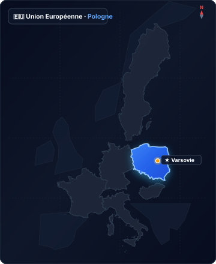

# pologne

Source : `directives/fiches-acteurs/pays/pologne.json`

## Situation géographique en Europe

## Détail des entités et coordonnées GeoJSON

Cliquez pour afficher les 1,007 points de coordonnées géographiques

- **type** : FeatureCollection
- **features** :
  - **Élément 1** :
    - **type** : Feature
    - **properties** :
      `{}` (objet vide)
    - **geometry** :
      - **coordinates** :
        - **Élément 1** :
          - **Élément 1** :
            - `18.3416748046875`
            - `54.85447755156708`
          - **Élément 2** :
            - `18.1219482421875`
            - `54.85131525968606`
          - **Élément 3** :
            - `17.874755859375`
            - `54.835500081451656`
          - **Élément 4** :
            - `17.42431640625`
            - `54.77851410375888`
          - **Élément 5** :
            - `17.127685546875`
            - `54.7246201949245`
          - **Élément 6** :
            - `16.9464111328125`
            - `54.62297813269033`
          - **Élément 7** :
            - `16.7156982421875`
            - `54.59752785211386`
          - **Élément 8** :
            - `16.512451171875`
            - `54.56887726177128`
          - **Élément 9** :
            - `16.3751220703125`
            - `54.482804559582554`
          - **Élément 10** :
            - `16.1993408203125`
            - `54.34214886448341`
          - **Élément 11** :
            - `16.0235595703125`
            - `54.27805485967281`
          - **Élément 12** :
            - `15.84228515625`
            - `54.25880719007081`
          - **Élément 13** :
            - `15.320434570312498`
            - `54.170473659213776`
          - **Élément 14** :
            - `14.83428955078125`
            - `54.04810167901885`
          - **Élément 15** :
            - `14.600830078125`
            - `54.00454043850362`
          - **Élément 16** :
            - `14.492340087890623`
            - `53.96982014387733`
          - **Élément 17** :
            - `14.386596679687498`
            - `53.91728101547621`
          - **Élément 18** :
            - `14.308319091796875`
            - `53.926176904600815`
          - **Élément 19** :
            - `14.238050188116944`
            - `53.93554698950079`
          - **Élément 20** :
            - `14.207437961631229`
            - `53.915984794781096`
          - **Élément 21** :
            - `14.188816003440934`
            - `53.9153009427006`
          - **Élément 22** :
            - `14.185830979201285`
            - `53.912406692744646`
          - **Élément 23** :
            - `14.205179540933017`
            - `53.91043265175186`
          - **Élément 24** :
            - `14.211705816824917`
            - `53.900444998350615`
          - **Élément 25** :
            - `14.215887314631544`
            - `53.88034030734422`
          - **Élément 26** :
            - `14.207980489745253`
            - `53.86345960068033`
          - **Élément 27** :
            - `14.282499863827297`
            - `53.77274176773494`
          - **Élément 28** :
            - `14.26704562852575`
            - `53.75288451877164`
          - **Élément 29** :
            - `14.273576110595343`
            - `53.74391312149769`
          - **Élément 30** :
            - `14.268495159982507`
            - `53.697766676409984`
          - **Élément 31** :
            - `14.283544326913841`
            - `53.68345232722741`
          - **Élément 32** :
            - `14.281140394650407`
            - `53.671663843907886`
          - **Élément 33** :
            - `14.270454717759968`
            - `53.664076814791926`
          - **Élément 34** :
            - `14.28499481678331`
            - `53.65894371821858`
          - **Élément 35** :
            - `14.284331189499625`
            - `53.63383747539515`
          - **Élément 36** :
            - `14.316879815406395`
            - `53.617731835314004`
          - **Élément 37** :
            - `14.306945800781364`
            - `53.5517310815021`
          - **Élément 38** :
            - `14.326171875`
            - `53.50438429010248`
          - **Élément 39** :
            - `14.35089111328125`
            - `53.49294782332984`
          - **Élément 40** :
            - `14.37286376953125`
            - `53.44553530620064`
          - **Élément 41** :
            - `14.3975830078125`
            - `53.35055131839989`
          - **Élément 42** :
            - `14.41680908203125`
            - `53.28163740806336`
          - **Élément 43** :
            - `14.45526123046875`
            - `53.26849833145892`
          - **Élément 44** :
            - `14.381103515624886`
            - `53.20274235350723`
          - **Élément 45** :
            - `14.370117187500114`
            - `53.15994678846807`
          - **Élément 46** :
            - `14.3865966796875`
            - `53.143475584594526`
          - **Élément 47** :
            - `14.34814453125`
            - `53.05772343915075`
          - **Élément 48** :
            - `14.24652099609375`
            - `52.996603366272716`
          - **Élément 49** :
            - `14.14215087890625`
            - `52.96518371955126`
          - **Élément 50** :
            - `14.161376953125`
            - `52.8757609818473`
          - **Élément 51** :
            - `14.120178222656364`
            - `52.83098033990201`
          - **Élément 52** :
            - `14.227294921875`
            - `52.81438319143107`
          - **Élément 53** :
            - `14.29046630859375`
            - `52.76621560598258`
          - **Élément 54** :
            - `14.3536376953125`
            - `52.75624323962823`
          - **Élément 55** :
            - `14.45526123046875`
            - `52.671385903202584`
          - **Élément 56** :
            - `14.59808349609375`
            - `52.6130549393468`
          - **Élément 57** :
            - `14.64202880859375`
            - `52.57301159428889`
          - **Élément 58** :
            - `14.617309570312614`
            - `52.549636074382256`
          - **Élément 59** :
            - `14.6063232421875`
            - `52.52958999943304`
          - **Élément 60** :
            - `14.633789062499886`
            - `52.49950372242746`
          - **Élément 61** :
            - `14.5513916015625`
            - `52.43257155802881`
          - **Élément 62** :
            - `14.5404052734375`
            - `52.3923633970718`
          - **Élément 63** :
            - `14.5623779296875`
            - `52.331982407533786`
          - **Élément 64** :
            - `14.58160400390625`
            - `52.303440474272755`
          - **Élément 65** :
            - `14.57611083984375`
            - `52.283282143126186`
          - **Élément 66** :
            - `14.70794677734375`
            - `52.25470880113083`
          - **Élément 67** :
            - `14.710693359375`
            - `52.217704193421454`
          - **Élément 68** :
            - `14.688720703125`
            - `52.19750685699392`
          - **Élément 69** :
            - `14.7052001953125`
            - `52.16550896167102`
          - **Élément 70** :
            - `14.67498779296875`
            - `52.13685974852633`
          - **Élément 71** :
            - `14.696960449218636`
            - `52.10313118589299`
          - **Élément 72** :
            - `14.754638671874886`
            - `52.07781801208549`
          - **Élément 73** :
            - `14.74639892578125`
            - `52.032218104145294`
          - **Élément 74** :
            - `14.71893310546875`
            - `52.00179230422271`
          - **Élément 75** :
            - `14.70245361328125`
            - `51.97134580885172`
          - **Élément 76** :
            - `14.7216796875`
            - `51.951036645095904`
          - **Élément 77** :
            - `14.694213867187386`
            - `51.90869633027845`
          - **Élément 78** :
            - `14.65301513671875`
            - `51.86970795368951`
          - **Élément 79** :
            - `14.60357666015625`
            - `51.84935276370605`
          - **Élément 80** :
            - `14.600830078125`
            - `51.82219818336938`
          - **Élément 81** :
            - `14.62554931640625`
            - `51.793328497122566`
          - **Élément 82** :
            - `14.644775390625`
            - `51.78993084774129`
          - **Élément 83** :
            - `14.66400146484375`
            - `51.735533641609564`
          - **Élément 84** :
            - `14.74639892578125`
            - `51.67255514839674`
          - **Élément 85** :
            - `14.76837158203125`
            - `51.60437164681676`
          - **Élément 86** :
            - `14.7161865234375`
            - `51.570241445811234`
          - **Élément 87** :
            - `14.72991943359375`
            - `51.536085601784755`
          - **Élément 88** :
            - `14.815063476562386`
            - `51.51045188624856`
          - **Élément 89** :
            - `14.92218017578125`
            - `51.47967237816338`
          - **Élément 90** :
            - `14.96337890625`
            - `51.46085244645549`
          - **Élément 91** :
            - `14.96612548828125`
            - `51.4163381064004`
          - **Élément 92** :
            - `14.9798583984375`
            - `51.37178037591737`
          - **Élément 93** :
            - `14.97161865234375`
            - `51.35634643388431`
          - **Élément 94** :
            - `15.03204345703125`
            - `51.2928411273273`
          - **Élément 95** :
            - `15.03753662109375`
            - `51.253320526331336`
          - **Élément 96** :
            - `15.004577636718636`
            - `51.18106473752023`
          - **Élément 97** :
            - `14.98260498046875`
            - `51.084547222263666`
          - **Élément 98** :
            - `14.91668701171875`
            - `50.9930144097952`
          - **Élément 99** :
            - `14.880981445312386`
            - `50.92727577667011`
          - **Élément 100** :
            - `14.8260498046875`
            - `50.887441411132265`
          - **Élément 101** :
            - `14.823387954214807`
            - `50.87044064652089`
          - **Élément 102** :
            - `14.831347126513348`
            - `50.87284506140205`
          - **Élément 103** :
            - `14.861068725585938`
            - `50.86946149128906`
          - **Élément 104** :
            - `14.868278503417967`
            - `50.878560631037594`
          - **Élément 105** :
            - `14.893341064453123`
            - `50.86794479528302`
          - **Élément 106** :
            - `14.902610778808594`
            - `50.877044231111014`
          - **Élément 107** :
            - `14.962348937988283`
            - `50.86166081468261`
          - **Élément 108** :
            - `14.989128112792967`
            - `50.86859481389967`
          - **Élément 109** :
            - `15.001487731933594`
            - `50.86837814203458`
          - **Élément 110** :
            - `14.994277954101562`
            - `50.89437157554849`
          - **Élément 111** :
            - `14.996681213378904`
            - `50.90195026226893`
          - **Élément 112** :
            - `15.008354187011717`
            - `50.9077958349914`
          - **Élément 113** :
            - `14.999427795410156`
            - `50.907362854775435`
          - **Élément 114** :
            - `14.989471435546873`
            - `50.92208192289137`
          - **Élément 115** :
            - `15.014190673828123`
            - `50.940257874341135`
          - **Élément 116** :
            - `15.01487731933594`
            - `50.9627515930537`
          - **Élément 117** :
            - `15.020713806152346`
            - `50.96923814278805`
          - **Élément 118** :
            - `15.005607604980469`
            - `50.98609893339354`
          - **Élément 119** :
            - `14.987411499023436`
            - `50.978101629335036`
          - **Élément 120** :
            - `14.968528747558594`
            - `50.98955680038983`
          - **Élément 121** :
            - `14.984664916992188`
            - `51.01159464737048`
          - **Élément 122** :
            - `15.00251770019531`
            - `51.012026657382386`
          - **Élément 123** :
            - `15.018310546874998`
            - `51.022825599852496`
          - **Élément 124** :
            - `15.030326843261717`
            - `51.02152985954755`
          - **Élément 125** :
            - `15.03376007080078`
            - `51.01418664707926`
          - **Élément 126** :
            - `15.059165954589842`
            - `51.012458663370076`
          - **Élément 127** :
            - `15.059852600097656`
            - `51.023473456424405`
          - **Élément 128** :
            - `15.105171203613281`
            - `51.01029859318957`
          - **Élément 129** :
            - `15.097961425781248`
            - `51.00079308917475`
          - **Élément 130** :
            - `15.102767944335938`
            - `50.993878771898736`
          - **Élément 131** :
            - `15.143280029296873`
            - `50.99258222270632`
          - **Élément 132** :
            - `15.135040283203123`
            - `50.997768202142076`
          - **Élément 133** :
            - `15.14190673828125`
            - `51.012458663370076`
          - **Élément 134** :
            - `15.174179077148436`
            - `51.01893827029199`
          - **Élément 135** :
            - `15.174179077148436`
            - `50.98955680038983`
          - **Élément 136** :
            - `15.19134521484375`
            - `50.982208525112895`
          - **Élément 137** :
            - `15.203018188476562`
            - `50.99171783645421`
          - **Élément 138** :
            - `15.240097045898438`
            - `50.996471761616284`
          - **Élément 139** :
            - `15.250396728515623`
            - `50.97961473846458`
          - **Élément 140** :
            - `15.277862548828123`
            - `50.97875011071402`
          - **Élément 141** :
            - `15.275115966796875`
            - `50.96361651868418`
          - **Élément 142** :
            - `15.292282104492188`
            - `50.95496653774911`
          - **Élément 143** :
            - `15.288848876953125`
            - `50.94458443495011`
          - **Élément 144** :
            - `15.268249511718752`
            - `50.93030525693042`
          - **Élément 145** :
            - `15.283355712890623`
            - `50.88527552329112`
          - **Élément 146** :
            - `15.314941406249998`
            - `50.85841014752971`
          - **Élément 147** :
            - `15.35064697265625`
            - `50.85147463352982`
          - **Élément 148** :
            - `15.370559692382812`
            - `50.82719221187368`
          - **Élément 149** :
            - `15.37261962890625`
            - `50.80680256863399`
          - **Élément 150** :
            - `15.368499755859375`
            - `50.801161308346565`
          - **Élément 151** :
            - `15.37261962890625`
            - `50.7798919741081`
          - **Élément 152** :
            - `15.394592285156248`
            - `50.77685270774661`
          - **Élément 153** :
            - `15.421371459960938`
            - `50.802897153288384`
          - **Élément 154** :
            - `15.441970825195312`
            - `50.80853820400125`
          - **Élément 155** :
            - `15.463256835937502`
            - `50.79899141148548`
          - **Élément 156** :
            - `15.481796264648438`
            - `50.78987674433805`
          - **Élément 157** :
            - `15.5126953125`
            - `50.79117894847138`
          - **Élément 158** :
            - `15.525741577148438`
            - `50.779023632445714`
          - **Élément 159** :
            - `15.55389404296875`
            - `50.78076029964647`
          - **Élément 160** :
            - `15.560760498046875`
            - `50.77728690074856`
          - **Élément 161** :
            - `15.58753967285156`
            - `50.77772108971944`
          - **Élément 162** :
            - `15.616378784179688`
            - `50.773379018610875`
          - **Élément 163** :
            - `15.623931884765625`
            - `50.76208774710174`
          - **Élément 164** :
            - `15.684356689453125`
            - `50.753834709847816`
          - **Élément 165** :
            - `15.692596435546873`
            - `50.73993156768006`
          - **Élément 166** :
            - `15.723495483398438`
            - `50.73862793642048`
          - **Élément 167** :
            - `15.743408203124998`
            - `50.73515140897789`
          - **Élément 168** :
            - `15.761947631835938`
            - `50.74297323282792`
          - **Élément 169** :
            - `15.781173706054688`
            - `50.74427674312445`
          - **Élément 170** :
            - `15.790786743164062`
            - `50.752097042863106`
          - **Élément 171** :
            - `15.816879272460938`
            - `50.75470351914962`
          - **Élément 172** :
            - `15.831985473632812`
            - `50.74253872133164`
          - **Élément 173** :
            - `15.831298828124998`
            - `50.72298153061673`
          - **Élément 174** :
            - `15.853271484375`
            - `50.70646021015683`
          - **Élément 175** :
            - `15.862884521484375`
            - `50.67905676828541`
          - **Élément 176** :
            - `15.86082458496094`
            - `50.67470554332169`
          - **Élément 177** :
            - `15.887603759765623`
            - `50.6712242729033`
          - **Élément 178** :
            - `15.887603759765623`
            - `50.67557582058605`
          - **Élément 179** :
            - `15.92193603515625`
            - `50.68514780554603`
          - **Élément 180** :
            - `15.925369262695312`
            - `50.680797145321655`
          - **Élément 181** :
            - `15.93635559082031`
            - `50.687322984393504`
          - **Élément 182** :
            - `15.964508056640625`
            - `50.692108022899525`
          - **Élément 183** :
            - `15.9906005859375`
            - `50.68340758986141`
          - **Élément 184** :
            - `15.99128723144531`
            - `50.67557582058605`
          - **Élément 185** :
            - `15.99609375`
            - `50.6729649403849`
          - **Élément 186** :
            - `16.005706787109375`
            - `50.65381404795093`
          - **Élément 187** :
            - `16.002273559570312`
            - `50.64510651477009`
          - **Élément 188** :
            - `16.009140014648438`
            - `50.63509085638041`
          - **Élément 189** :
            - `16.020126342773438`
            - `50.62986444811647`
          - **Élément 190** :
            - `15.992660522460936`
            - `50.621152476382164`
          - **Élément 191** :
            - `15.986480712890625`
            - `50.61505313572339`
          - **Élément 192** :
            - `16.009140014648438`
            - `50.60459528287801`
          - **Élément 193** :
            - `16.011199951171875`
            - `50.60699207947893`
          - **Élément 194** :
            - `16.0235595703125`
            - `50.598275870254675`
          - **Élément 195** :
            - `16.039695739746094`
            - `50.61309246538529`
          - **Élément 196** :
            - `16.05548858642578`
            - `50.60960662744138`
          - **Élément 197** :
            - `16.06853485107422`
            - `50.640752142960615`
          - **Élément 198** :
            - `16.089820861816406`
            - `50.652725694561994`
          - **Élément 199** :
            - `16.09668731689453`
            - `50.65424938224597`
          - **Élément 200** :
            - `16.101150512695312`
            - `50.66317284619182`
          - **Élément 201** :
            - `16.112823486328125`
            - `50.65882014875858`
          - **Élément 202** :
            - `16.12621307373047`
            - `50.6607789125291`
          - **Élément 203** :
            - `16.138229370117188`
            - `50.65207267042477`
          - **Élément 204** :
            - `16.14887237548828`
            - `50.65316103894354`
          - **Élément 205** :
            - `16.171875`
            - `50.644888805762484`
          - **Élément 206** :
            - `16.178741455078125`
            - `50.63552636417384`
          - **Élément 207** :
            - `16.180801391601562`
            - `50.62877553992307`
          - **Élément 208** :
            - `16.190414428710938`
            - `50.62812218290114`
          - **Élément 209** :
            - `16.198997497558594`
            - `50.63182441930936`
          - **Élément 210** :
            - `16.216506958007812`
            - `50.633348784855315`
          - **Élément 211** :
            - `16.221656799316406`
            - `50.644888805762484`
          - **Élément 212** :
            - `16.22234344482422`
            - `50.654031715602784`
          - **Élément 213** :
            - `16.234703063964844`
            - `50.67209461471226`
          - **Élément 214** :
            - `16.256675720214844`
            - `50.667960347404204`
          - **Élément 215** :
            - `16.273155212402344`
            - `50.66839555058174`
          - **Élément 216** :
            - `16.27967834472656`
            - `50.66752514019245`
          - **Élément 217** :
            - `16.283111572265625`
            - `50.65969072052044`
          - **Élément 218** :
            - `16.30508422851562`
            - `50.6601260003497`
          - **Élément 219** :
            - `16.315040588378906`
            - `50.66404333726616`
          - **Élément 220** :
            - `16.323623657226562`
            - `50.666872321810715`
          - **Élément 221** :
            - `16.341819763183594`
            - `50.661431815631126`
          - **Élément 222** :
            - `16.350746154785156`
            - `50.64880741356882`
          - **Élément 223** :
            - `16.358299255371094`
            - `50.6475012472797`
          - **Élément 224** :
            - `16.362075805664062`
            - `50.648372028840534`
          - **Élément 225** :
            - `16.374435424804688`
            - `50.6368328633436`
          - **Élément 226** :
            - `16.379928588867188`
            - `50.635744116557404`
          - **Élément 227** :
            - `16.37889862060547`
            - `50.63247772488185`
          - **Élément 228** :
            - `16.394004821777344`
            - `50.61832073801525`
          - **Élément 229** :
            - `16.405677795410156`
            - `50.616360203880646`
          - **Élément 230** :
            - `16.430397033691406`
            - `50.60045507391243`
          - **Élément 231** :
            - `16.444473266601562`
            - `50.58040259403807`
          - **Élément 232** :
            - `16.423187255859375`
            - `50.56993703991946`
          - **Élément 233** :
            - `16.403961181640625`
            - `50.56884674431152`
          - **Élément 234** :
            - `16.40430450439453`
            - `50.56492147120869`
          - **Élément 235** :
            - `16.40979766845703`
            - `50.55685182733484`
          - **Élément 236** :
            - `16.41082763671875`
            - `50.54681737030462`
          - **Élément 237** :
            - `16.387481689453125`
            - `50.542672079978246`
          - **Élément 238** :
            - `16.40155792236328`
            - `50.529579297094294`
          - **Élément 239** :
            - `16.391258239746094`
            - `50.523249815944496`
          - **Élément 240** :
            - `16.373748779296875`
            - `50.516046270134055`
          - **Élément 241** :
            - `16.35589599609375`
            - `50.499452103967734`
          - **Élément 242** :
            - `16.348342895507812`
            - `50.49814178983535`
          - **Élément 243** :
            - `16.315383911132812`
            - `50.50687653078476`
          - **Élément 244** :
            - `16.309890747070312`
            - `50.50032562652826`
          - **Élément 245** :
            - `16.313323974609375`
            - `50.49202650991501`
          - **Élément 246** :
            - `16.30096435546875`
            - `50.49027914167511`
          - **Élément 247** :
            - `16.292724609375`
            - `50.4797935750617`
          - **Élément 248** :
            - `16.270751953125`
            - `50.48416284390024`
          - **Élément 249** :
            - `16.271438598632812`
            - `50.47673484653018`
          - **Élément 250** :
            - `16.259765625`
            - `50.47935662596124`
          - **Élément 251** :
            - `16.250839233398438`
            - `50.47498691278631`
          - **Élément 252** :
            - `16.25152587890625`
            - `50.46930568174486`
          - **Élément 253** :
            - `16.243972778320312`
            - `50.463186669426605`
          - **Élément 254** :
            - `16.235733032226562`
            - `50.46580920023221`
          - **Élément 255** :
            - `16.233673095703125`
            - `50.46012686633918`
          - **Élément 256** :
            - `16.22406005859375`
            - `50.46056399318573`
          - **Élément 257** :
            - `16.2322998046875`
            - `50.4478856743724`
          - **Élément 258** :
            - `16.22955322265625`
            - `50.44220118709643`
          - **Élément 259** :
            - `16.219940185546875`
            - `50.44351305245805`
          - **Élément 260** :
            - `16.217193603515625`
            - `50.45138348100283`
          - **Élément 261** :
            - `16.202774047851562`
            - `50.44438760916378`
          - **Élément 262** :
            - `16.195907592773434`
            - `50.43170495507443`
          - **Élément 263** :
            - `16.208267211914062`
            - `50.42733083815175`
          - **Élément 264** :
            - `16.211013793945312`
            - `50.411580671328586`
          - **Élément 265** :
            - `16.224746704101562`
            - `50.40895513434`
          - **Élément 266** :
            - `16.235733032226562`
            - `50.41289338526561`
          - **Élément 267** :
            - `16.252212524414062`
            - `50.40370362389581`
          - **Élément 268** :
            - `16.248092651367188`
            - `50.39713841743867`
          - **Élément 269** :
            - `16.260452270507812`
            - `50.392761107929395`
          - **Élément 270** :
            - `16.268005371093746`
            - `50.38050249104245`
          - **Élément 271** :
            - `16.281051635742188`
            - `50.36736474202761`
          - **Élément 272** :
            - `16.294784545898438`
            - `50.37699944702326`
          - **Élément 273** :
            - `16.30508422851562`
            - `50.38225391604122`
          - **Élément 274** :
            - `16.333236694335938`
            - `50.37962675429049`
          - **Élément 275** :
            - `16.362075805664062`
            - `50.37875100137005`
          - **Élément 276** :
            - `16.368255615234375`
            - `50.36429874377128`
          - **Élément 277** :
            - `16.360702514648438`
            - `50.351156507586644`
          - **Élément 278** :
            - `16.40052795410156`
            - `50.31916186634034`
          - **Élément 279** :
            - `16.415634155273438`
            - `50.324422739309384`
          - **Élément 280** :
            - `16.430740356445312`
            - `50.32529949485997`
          - **Élément 281** :
            - `16.467819213867188`
            - `50.290655351123256`
          - **Élément 282** :
            - `16.467819213867188`
            - `50.28275821811706`
          - **Élément 283** :
            - `16.4959716796875`
            - `50.26169278977936`
          - **Élément 284** :
            - `16.5069580078125`
            - `50.25861996946575`
          - **Élément 285** :
            - `16.5179443359375`
            - `50.243692022558044`
          - **Élément 286** :
            - `16.535797119140625`
            - `50.237543861552275`
          - **Élément 287** :
            - `16.556396484375`
            - `50.21953397103998`
          - **Élément 288** :
            - `16.557083129882812`
            - `50.20503326494332`
          - **Élément 289** :
            - `16.555023193359375`
            - `50.195803248410634`
          - **Élément 290** :
            - `16.5618896484375`
            - `50.18041592143885`
          - **Élément 291** :
            - `16.55914306640625`
            - `50.16854231015209`
          - **Élément 292** :
            - `16.5838623046875`
            - `50.154026111358014`
          - **Élément 293** :
            - `16.582489013671875`
            - `50.14258600141398`
          - **Élément 294** :
            - `16.604461669921875`
            - `50.13598469313195`
          - **Élément 295** :
            - `16.616821289062496`
            - `50.124540267564136`
          - **Élément 296** :
            - `16.63604736328125`
            - `50.11221244066583`
          - **Élément 297** :
            - `16.657333374023438`
            - `50.10957035047152`
          - **Élément 298** :
            - `16.7047119140625`
            - `50.09679819285972`
          - **Élément 299** :
            - `16.727371215820312`
            - `50.10780887602508`
          - **Élément 300** :
            - `16.745223999023438`
            - `50.13554457352548`
          - **Élément 301** :
            - `16.757583618164062`
            - `50.1351044498705`
          - **Élément 302** :
            - `16.782302856445312`
            - `50.14654634915968`
          - **Élément 303** :
            - `16.7816162109375`
            - `50.15270623833364`
          - **Élément 304** :
            - `16.798782348632812`
            - `50.16854231015209`
          - **Élément 305** :
            - `16.801528930664062`
            - `50.18393346184497`
          - **Élément 306** :
            - `16.813201904296875`
            - `50.19008853427835`
          - **Élément 307** :
            - `16.822128295898438`
            - `50.19008853427835`
          - **Élément 308** :
            - `16.831741333007812`
            - `50.19844057810049`
          - **Élément 309** :
            - `16.846160888671875`
            - `50.20767008473418`
          - **Élément 310** :
            - `16.868820190429688`
            - `50.19756148439161`
          - **Élément 311** :
            - `16.885299682617188`
            - `50.20019871695555`
          - **Élément 312** :
            - `16.886672973632812`
            - `50.21689780678922`
          - **Élément 313** :
            - `16.89697265625`
            - `50.21821590712335`
          - **Élément 314** :
            - `16.903152465820312`
            - `50.22348794428793`
          - **Élément 315** :
            - `16.92169189453125`
            - `50.2270023120296`
          - **Élément 316** :
            - `16.95602416992187`
            - `50.22216998962196`
          - **Élément 317** :
            - `16.96563720703125`
            - `50.230955666207954`
          - **Élément 318** :
            - `16.961517333984375`
            - `50.239739724370864`
          - **Élément 319** :
            - `16.97662353515625`
            - `50.24457026654082`
          - **Élément 320** :
            - `16.993103027343746`
            - `50.222609311890224`
          - **Élément 321** :
            - `17.0013427734375`
            - `50.21821590712335`
          - **Élément 322** :
            - `17.027435302734375`
            - `50.2300771713799`
          - **Élément 323** :
            - `17.00408935546875`
            - `50.256424976453374`
          - **Élément 324** :
            - `17.018508911132812`
            - `50.27398208889897`
          - **Élément 325** :
            - `17.005462646484375`
            - `50.29635802110319`
          - **Élément 326** :
            - `16.98211669921875`
            - `50.306884231551166`
          - **Élément 327** :
            - `16.967697143554684`
            - `50.314338887919654`
          - **Élément 328** :
            - `16.951904296875`
            - `50.31258495626971`
          - **Élément 329** :
            - `16.931991577148438`
            - `50.32968303000023`
          - **Élément 330** :
            - `16.934738159179688`
            - `50.34283120939227`
          - **Élément 331** :
            - `16.914138793945312`
            - `50.36342270788681`
          - **Élément 332** :
            - `16.92169189453125`
            - `50.37086849748783`
          - **Élément 333** :
            - `16.907958984375`
            - `50.38925896931487`
          - **Élément 334** :
            - `16.893539428710938`
            - `50.39188559752665`
          - **Élément 335** :
            - `16.860580444335934`
            - `50.40807992301321`
          - **Élément 336** :
            - `16.877059936523438`
            - `50.43957734728102`
          - **Élément 337** :
            - `16.89422607421875`
            - `50.44504351608707`
          - **Élément 338** :
            - `16.911048889160156`
            - `50.44722980684235`
          - **Élément 339** :
            - `16.94435119628906`
            - `50.43279842116835`
          - **Élément 340** :
            - `16.973190307617188`
            - `50.42033141057554`
          - **Élément 341** :
            - `16.99756622314453`
            - `50.427768268027606`
          - **Élément 342** :
            - `17.015419006347656`
            - `50.41748759762506`
          - **Élément 343** :
            - `17.021942138671875`
            - `50.42098765085627`
          - **Élément 344** :
            - `17.054901123046875`
            - `50.40698588612208`
          - **Élément 345** :
            - `17.081680297851562`
            - `50.401734157440416`
          - **Élément 346** :
            - `17.086143493652344`
            - `50.40501655606602`
          - **Élément 347** :
            - `17.1112060546875`
            - `50.40523537455813`
          - **Élément 348** :
            - `17.113265991210938`
            - `50.39254223184437`
          - **Élément 349** :
            - `17.131118774414062`
            - `50.39232335474891`
          - **Élément 350** :
            - `17.14244842529297`
            - `50.38028355837026`
          - **Élément 351** :
            - `17.157211303710938`
            - `50.38137821162599`
          - **Élément 352** :
            - `17.169227600097656`
            - `50.38400527636708`
          - **Élément 353** :
            - `17.18433380126953`
            - `50.39035341541946`
          - **Élément 354** :
            - `17.203216552734375`
            - `50.385099843729385`
          - **Élément 355** :
            - `17.199783325195312`
            - `50.37021156304572`
          - **Élément 356** :
            - `17.20458984375`
            - `50.36123254743067`
          - **Élément 357** :
            - `17.22381591796875`
            - `50.346117685665725`
          - **Élément 358** :
            - `17.255401611328125`
            - `50.32858718412306`
          - **Élément 359** :
            - `17.28046417236328`
            - `50.319381081006334`
          - **Élément 360** :
            - `17.307586669921875`
            - `50.31916186634034`
          - **Élément 361** :
            - `17.325439453125`
            - `50.326833778154146`
          - **Élément 362** :
            - `17.348098754882812`
            - `50.32858718412306`
          - **Élément 363** :
            - `17.349472045898438`
            - `50.32288837817619`
          - **Élément 364** :
            - `17.340545654296875`
            - `50.3217923756109`
          - **Élément 365** :
            - `17.337112426757812`
            - `50.31280420126435`
          - **Élément 366** :
            - `17.355651855468746`
            - `50.307980577843814`
          - **Élément 367** :
            - `17.346725463867188`
            - `50.29109404231143`
          - **Élément 368** :
            - `17.34844207763672`
            - `50.2867069484263`
          - **Élément 369** :
            - `17.338829040527344`
            - `50.283416362586465`
          - **Élément 370** :
            - `17.34912872314453`
            - `50.263229125604376`
          - **Élément 371** :
            - `17.361831665039062`
            - `50.26520434170851`
          - **Élément 372** :
            - `17.36526489257812`
            - `50.28166129044449`
          - **Élément 373** :
            - `17.404747009277344`
            - `50.27573744417743`
          - **Élément 374** :
            - `17.420883178710938`
            - `50.27661509754731`
          - **Élément 375** :
            - `17.4298095703125`
            - `50.25598596571478`
          - **Élément 376** :
            - `17.451095581054684`
            - `50.2529127772726`
          - **Élément 377** :
            - `17.46002197265625`
            - `50.26696002058882`
          - **Élément 378** :
            - `17.4847412109375`
            - `50.27442093378597`
          - **Élément 379** :
            - `17.527999877929688`
            - `50.27398208889897`
          - **Élément 380** :
            - `17.567138671875`
            - `50.27091006143139`
          - **Élément 381** :
            - `17.587051391601562`
            - `50.2783703557488`
          - **Élément 382** :
            - `17.604217529296875`
            - `50.26696002058882`
          - **Élément 383** :
            - `17.646102905273438`
            - `50.2761762728848`
          - **Élément 384** :
            - `17.683181762695312`
            - `50.29898979210335`
          - **Élément 385** :
            - `17.687301635742188`
            - `50.327052957438326`
          - **Élément 386** :
            - `17.720260620117188`
            - `50.32003871893868`
          - **Élément 387** :
            - `17.731246948242188`
            - `50.30337575356313`
          - **Élément 388** :
            - `17.75115966796875`
            - `50.29898979210335`
          - **Élément 389** :
            - `17.7264404296875`
            - `50.27047118418466`
          - **Élément 390** :
            - `17.724380493164062`
            - `50.25598596571478`
          - **Élément 391** :
            - `17.766952514648438`
            - `50.23446948367872`
          - **Élément 392** :
            - `17.7593994140625`
            - `50.21865526580861`
          - **Élément 393** :
            - `17.760086059570312`
            - `50.2063516930489`
          - **Élément 394** :
            - `17.7374267578125`
            - `50.20063824155212`
          - **Élément 395** :
            - `17.718887329101562`
            - `50.20547274502523`
          - **Élément 396** :
            - `17.703781127929688`
            - `50.18437313618288`
          - **Élément 397** :
            - `17.672882080078125`
            - `50.18085562815528`
          - **Élément 398** :
            - `17.628250122070312`
            - `50.172060724813335`
          - **Élément 399** :
            - `17.599411010742188`
            - `50.168102490105014`
          - **Élément 400** :
            - `17.595977783203125`
            - `50.15666574810977`
          - **Élément 401** :
            - `17.615890502929688`
            - `50.13862532575246`
          - **Élément 402** :
            - `17.641983032226562`
            - `50.12982265022155`
          - **Élément 403** :
            - `17.654342651367188`
            - `50.10912998793372`
          - **Élément 404** :
            - `17.677001953125`
            - `50.10340490646112`
          - **Élément 405** :
            - `17.6824951171875`
            - `50.11573500084129`
          - **Élément 406** :
            - `17.731246948242188`
            - `50.095917228872004`
          - **Élément 407** :
            - `17.732620239257812`
            - `50.08270082522937`
          - **Élément 408** :
            - `17.749786376953125`
            - `50.07520991192823`
          - **Élément 409** :
            - `17.758712768554688`
            - `50.05846128509664`
          - **Élément 410** :
            - `17.774505615234375`
            - `50.03641470705322`
          - **Élément 411** :
            - `17.773818969726562`
            - `50.0227407426766`
          - **Élément 412** :
            - `17.827377319335938`
            - `50.008180308784`
          - **Élément 413** :
            - `17.838363647460938`
            - `50.00156047113753`
          - **Élément 414** :
            - `17.82806396484375`
            - `49.990525382419904`
          - **Élément 415** :
            - `17.8692626953125`
            - `49.97242235423708`
          - **Élément 416** :
            - `17.889175415039062`
            - `49.978604641965674`
          - **Élément 417** :
            - `17.922134399414062`
            - `49.97948776108648`
          - **Élément 418** :
            - `17.950286865234375`
            - `50.00553248312461`
          - **Élément 419** :
            - `17.984619140625`
            - `50.007297716437975`
          - **Élément 420** :
            - `18.0010986328125`
            - `50.01877015281717`
          - **Élément 421** :
            - `18.012771606445312`
            - `50.0086215988794`
          - **Élément 422** :
            - `18.044357299804688`
            - `50.00553248312461`
          - **Élément 423** :
            - `18.045730590820312`
            - `50.035973672195496`
          - **Élément 424** :
            - `18.029251098632812`
            - `50.03906083112809`
          - **Élément 425** :
            - `18.015518188476562`
            - `50.03156310080887`
          - **Élément 426** :
            - `18.002471923828125`
            - `50.055375373799976`
          - **Élément 427** :
            - `18.02993774414062`
            - `50.067277080898286`
          - **Élément 428** :
            - `18.0615234375`
            - `50.05846128509664`
          - **Élément 429** :
            - `18.087615966796875`
            - `50.043911679834615`
          - **Élément 430** :
            - `18.099288940429688`
            - `50.01612291059477`
          - **Élément 431** :
            - `18.119888305664062`
            - `49.99626394461266`
          - **Élément 432** :
            - `18.130874633789062`
            - `49.9975881309457`
          - **Élément 433** :
            - `18.16314697265625`
            - `49.983461596534646`
          - **Élément 434** :
            - `18.173446655273438`
            - `49.9975881309457`
          - **Élément 435** :
            - `18.21258544921875`
            - `49.99582254106424`
          - **Élément 436** :
            - `18.216705322265625`
            - `49.97065584042108`
          - **Élément 437** :
            - `18.2757568359375`
            - `49.96491422269444`
          - **Élément 438** :
            - `18.294296264648438`
            - `49.92912409759547`
          - **Élément 439** :
            - `18.332748413085938`
            - `49.92205129776332`
          - **Élément 440** :
            - `18.338241577148438`
            - `49.944150351645455`
          - **Élément 441** :
            - `18.365020751953125`
            - `49.938405572518036`
          - **Élément 442** :
            - `18.428878784179688`
            - `49.93973135157948`
          - **Élément 443** :
            - `18.43505859375`
            - `49.924703719314344`
          - **Élément 444** :
            - `18.488616943359375`
            - `49.90790258467612`
          - **Élément 445** :
            - `18.5284423828125`
            - `49.90348026046577`
          - **Élément 446** :
            - `18.544235229492188`
            - `49.90790258467612`
          - **Élément 447** :
            - `18.540115356445312`
            - `49.92426165919044`
          - **Élément 448** :
            - `18.574447631835938`
            - `49.92072503226061`
          - **Élément 449** :
            - `18.575820922851562`
            - `49.89640369842335`
          - **Élément 450** :
            - `18.56964111328125`
            - `49.874725270177926`
          - **Élément 451** :
            - `18.600540161132812`
            - `49.86498893140621`
          - **Élément 452** :
            - `18.573074340820312`
            - `49.835768138126134`
          - **Élément 453** :
            - `18.593673706054688`
            - `49.795006643729415`
          - **Élément 454** :
            - `18.61358642578125`
            - `49.75687245587369`
          - **Élément 455** :
            - `18.6273193359375`
            - `49.74844341339525`
          - **Élément 456** :
            - `18.626632690429688`
            - `49.721371848659935`
          - **Élément 457** :
            - `18.66302490234375`
            - `49.70894049964577`
          - **Élément 458** :
            - `18.67401123046875`
            - `49.70272363180733`
          - **Élément 459** :
            - `18.709716796875`
            - `49.70405588474761`
          - **Élément 460** :
            - `18.722076416015625`
            - `49.6822911785649`
          - **Élément 461** :
            - `18.7481689453125`
            - `49.67695956066327`
          - **Élément 462** :
            - `18.771514892578125`
            - `49.683623991698084`
          - **Élément 463** :
            - `18.80584716796875`
            - `49.67829251994456`
          - **Élément 464** :
            - `18.80584716796875`
            - `49.65518272008055`
          - **Élément 465** :
            - `18.818206787109375`
            - `49.62227676793601`
          - **Élément 466** :
            - `18.825759887695312`
            - `49.59869532429001`
          - **Élément 467** :
            - `18.837432861328125`
            - `49.59424471595506`
          - **Élément 468** :
            - `18.831253051757812`
            - `49.5822260446217`
          - **Élément 469** :
            - `18.840866088867184`
            - `49.55996142647716`
          - **Élément 470** :
            - `18.856658935546875`
            - `49.548825308941815`
          - **Élément 471** :
            - `18.85528564453125`
            - `49.53634984277255`
          - **Élément 472** :
            - `18.838806152343746`
            - `49.52565405076408`
          - **Élément 473** :
            - `18.842926025390625`
            - `49.51852222253561`
          - **Élément 474** :
            - `18.851502263144425`
            - `49.51827851272162`
          - **Élément 475** :
            - `18.850822899667264`
            - `49.5171223885475`
          - **Élément 476** :
            - `18.866915558035853`
            - `49.51922988502521`
          - **Élément 477** :
            - `18.89711630572417`
            - `49.5142099180279`
          - **Élément 478** :
            - `18.94199301149998`
            - `49.51964259542285`
          - **Élément 479** :
            - `18.973481909119926`
            - `49.502745123276576`
          - **Élément 480** :
            - `18.960728300522334`
            - `49.482884082502466`
          - **Élément 481** :
            - `18.97027837144209`
            - `49.476706511617266`
          - **Élément 482** :
            - `18.96004982879777`
            - `49.45516690383391`
          - **Élément 483** :
            - `18.973286087619076`
            - `49.45242479389951`
          - **Élément 484** :
            - `18.988213891056503`
            - `49.43139251594321`
          - **Élément 485** :
            - `18.98652234644038`
            - `49.422068744782194`
          - **Élément 486** :
            - `18.968611289959284`
            - `49.41265550401113`
          - **Élément 487** :
            - `18.977796508061303`
            - `49.39490137884914`
          - **Élément 488** :
            - `18.993699506760343`
            - `49.39811669468175`
          - **Élément 489** :
            - `19.02668350207199`
            - `49.394421637575086`
          - **Élément 490** :
            - `19.04555751254454`
            - `49.401033149411816`
          - **Élément 491** :
            - `19.053813606205424`
            - `49.41455412532448`
          - **Élément 492** :
            - `19.069367454823162`
            - `49.41230354650051`
          - **Élément 493** :
            - `19.07245679240041`
            - `49.417561468520745`
          - **Élément 494** :
            - `19.09156162715263`
            - `49.41576358435774`
          - **Élément 495** :
            - `19.09368112661467`
            - `49.410980596534316`
          - **Élément 496** :
            - `19.101203956144523`
            - `49.410841854573924`
          - **Élément 497** :
            - `19.107273613695508`
            - `49.40311263607033`
          - **Élément 498** :
            - `19.12587202469478`
            - `49.40313273026692`
          - **Élément 499** :
            - `19.138007355895276`
            - `49.40976158892747`
          - **Élément 500** :
            - `19.150373511374358`
            - `49.40377410382119`
          - **Élément 501** :
            - `19.176407477068658`
            - `49.41429724235709`
          - **Élément 502** :
            - `19.187437864656886`
            - `49.40995227349657`
          - **Élément 503** :
            - `19.19729224628375`
            - `49.414362459558916`
          - **Élément 504** :
            - `19.1902720760293`
            - `49.42178275522785`
          - **Élément 505** :
            - `19.19294652547415`
            - `49.42620008166991`
          - **Élément 506** :
            - `19.184907616206957`
            - `49.434134136436654`
          - **Élément 507** :
            - `19.197642892008055`
            - `49.447320816658504`
          - **Élément 508** :
            - `19.20816536692232`
            - `49.45136236675452`
          - **Élément 509** :
            - `19.218918666115314`
            - `49.44865116802712`
          - **Élément 510** :
            - `19.226212940201236`
            - `49.45566359399072`
          - **Élément 511** :
            - `19.227551834457202`
            - `49.46622122140261`
          - **Élément 512** :
            - `19.2198885818527`
            - `49.469578734552655`
          - **Élément 513** :
            - `19.223326502301646`
            - `49.47837474570688`
          - **Élément 514** :
            - `19.23127771804736`
            - `49.487422711578716`
          - **Élément 515** :
            - `19.22763612472838`
            - `49.49149789485148`
          - **Élément 516** :
            - `19.234817474931404`
            - `49.49488547719214`
          - **Élément 517** :
            - `19.23656155580506`
            - `49.502276132496924`
          - **Élément 518** :
            - `19.232817110671878`
            - `49.51001869798867`
          - **Élément 519** :
            - `19.260233943139923`
            - `49.52720142493928`
          - **Élément 520** :
            - `19.2610162499699`
            - `49.531268449101766`
          - **Élément 521** :
            - `19.274368810553806`
            - `49.53138631363659`
          - **Élément 522** :
            - `19.283566534124766`
            - `49.53539919065372`
          - **Élément 523** :
            - `19.29757148526106`
            - `49.53351067899456`
          - **Élément 524** :
            - `19.31526962485295`
            - `49.53671539184551`
          - **Élément 525** :
            - `19.319273802156857`
            - `49.5311407176349`
          - **Élément 526** :
            - `19.363195805344873`
            - `49.53611312832798`
          - **Élément 527** :
            - `19.36873107573171`
            - `49.54539980831876`
          - **Élément 528** :
            - `19.366879969205247`
            - `49.55318877559383`
          - **Élément 529** :
            - `19.373795672966033`
            - `49.55798464680919`
          - **Élément 530** :
            - `19.37100773243229`
            - `49.567277943018965`
          - **Élément 531** :
            - `19.384723727813146`
            - `49.57155689205646`
          - **Élément 532** :
            - `19.400747965979942`
            - `49.574638327417894`
          - **Élément 533** :
            - `19.40687476239227`
            - `49.580883679712215`
          - **Élément 534** :
            - `19.41023166746136`
            - `49.59221736420612`
          - **Élément 535** :
            - `19.444634437994516`
            - `49.59913700119911`
          - **Élément 536** :
            - `19.442446583863426`
            - `49.60409300935024`
          - **Élément 537** :
            - `19.446430790925127`
            - `49.61375049597579`
          - **Élément 538** :
            - `19.456040095647868`
            - `49.6115496143574`
          - **Élément 539** :
            - `19.46749599459943`
            - `49.613536553797864`
          - **Élément 540** :
            - `19.475320710757458`
            - `49.603746866123245`
          - **Élément 541** :
            - `19.467911024533635`
            - `49.59605143167213`
          - **Élément 542** :
            - `19.479565381766378`
            - `49.58722302708719`
          - **Élément 543** :
            - `19.498549544259063`
            - `49.58176137827341`
          - **Élément 544** :
            - `19.510349868291463`
            - `49.581574856692356`
          - **Élément 545** :
            - `19.518789097371286`
            - `49.57324966333073`
          - **Élément 546** :
            - `19.52976739351476`
            - `49.572557881543496`
          - **Élément 547** :
            - `19.52781704180211`
            - `49.56067676247962`
          - **Élément 548** :
            - `19.529790702826745`
            - `49.537567072397785`
          - **Élément 549** :
            - `19.53517371486886`
            - `49.52696544034677`
          - **Élément 550** :
            - `19.540556726910978`
            - `49.52445406772603`
          - **Élément 551** :
            - `19.552712028352282`
            - `49.50461394462252`
          - **Élément 552** :
            - `19.55332611586745`
            - `49.4895703181936`
          - **Élément 553** :
            - `19.56594306586596`
            - `49.48067624874173`
          - **Élément 554** :
            - `19.56763505529358`
            - `49.4716543975497`
          - **Élément 555** :
            - `19.580022263935547`
            - `49.46099301597056`
          - **Élément 556** :
            - `19.58132990720662`
            - `49.455432492453774`
          - **Élément 557** :
            - `19.593307191545332`
            - `49.45883870660979`
          - **Élément 558** :
            - `19.61268364186959`
            - `49.44703716342934`
          - **Élément 559** :
            - `19.625372582654496`
            - `49.44998955466346`
          - **Élément 560** :
            - `19.640831414780703`
            - `49.45684346194735`
          - **Élément 561** :
            - `19.64128140868194`
            - `49.449807648312`
          - **Élément 562** :
            - `19.637576565570342`
            - `49.44817396401608`
          - **Élément 563** :
            - `19.63871903230632`
            - `49.440538600593015`
          - **Élément 564** :
            - `19.64875406109505`
            - `49.4349206993134`
          - **Élément 565** :
            - `19.638306348827015`
            - `49.42415543559922`
          - **Élément 566** :
            - `19.630774249907994`
            - `49.40811076293555`
          - **Élément 567** :
            - `19.6435546875`
            - `49.40918616182351`
          - **Élément 568** :
            - `19.677851998924666`
            - `49.40430474358935`
          - **Élément 569** :
            - `19.718843214424822`
            - `49.38755605740424`
          - **Élément 570** :
            - `19.738564766750144`
            - `49.39897198239787`
          - **Élément 571** :
            - `19.74704059724221`
            - `49.40768377949807`
          - **Élément 572** :
            - `19.767667036264502`
            - `49.4134660487332`
          - **Élément 573** :
            - `19.790601718072736`
            - `49.41023745922969`
          - **Élément 574** :
            - `19.79168591153136`
            - `49.379127250475506`
          - **Élément 575** :
            - `19.803538397909186`
            - `49.36762925601626`
          - **Élément 576** :
            - `19.802695548966852`
            - `49.35282319726091`
          - **Élément 577** :
            - `19.79472045670248`
            - `49.34685117186115`
          - **Élément 578** :
            - `19.805505664396925`
            - `49.32070114465089`
          - **Élément 579** :
            - `19.793124798796246`
            - `49.30446213116727`
          - **Élément 580** :
            - `19.79367009279335`
            - `49.29695210976509`
          - **Élément 581** :
            - `19.809746209702055`
            - `49.29543220482691`
          - **Élément 582** :
            - `19.82328325954623`
            - `49.27659901727463`
          - **Élément 583** :
            - `19.80698797301484`
            - `49.27336170601002`
          - **Élément 584** :
            - `19.79300092926951`
            - `49.268015976565415`
          - **Élément 585** :
            - `19.786058342060215`
            - `49.24615940115841`
          - **Élément 586** :
            - `19.76779456415285`
            - `49.235232683061966`
          - **Élément 587** :
            - `19.759700619204324`
            - `49.206494550617506`
          - **Élément 588** :
            - `19.794916911699744`
            - `49.199049387874155`
          - **Élément 589** :
            - `19.80632654977198`
            - `49.20598756486967`
          - **Élément 590** :
            - `19.842078602548177`
            - `49.194051905124724`
          - **Élément 591** :
            - `19.88476463233917`
            - `49.20295837389225`
          - **Élément 592** :
            - `19.90237199959963`
            - `49.21353011201683`
          - **Élément 593** :
            - `19.904262352288114`
            - `49.23014104300606`
          - **Élément 594** :
            - `19.9219110117007`
            - `49.23558700054413`
          - **Élément 595** :
            - `19.981738507376292`
            - `49.23050839642602`
          - **Élément 596** :
            - `20.00788661219923`
            - `49.21940985544738`
          - **Élément 597** :
            - `20.014951217863086`
            - `49.202989919771454`
          - **Élément 598** :
            - `20.08673294235095`
            - `49.175695075952895`
          - **Élément 599** :
            - `20.08665191602516`
            - `49.20621337016611`
          - **Élément 600** :
            - `20.103212434538477`
            - `49.22283799928302`
          - **Élément 601** :
            - `20.100712047437668`
            - `49.249377332596005`
          - **Élément 602** :
            - `20.12742889452268`
            - `49.27305102090703`
          - **Élément 603** :
            - `20.132928810779227`
            - `49.30147206324075`
          - **Élément 604** :
            - `20.150447620531054`
            - `49.31904078508355`
          - **Élément 605** :
            - `20.158036040061376`
            - `49.30413314745133`
          - **Élément 606** :
            - `20.176270062072817`
            - `49.31423556609951`
          - **Élément 607** :
            - `20.16689646770015`
            - `49.3256150510915`
          - **Élément 608** :
            - `20.185785192370666`
            - `49.327689988192596`
          - **Élément 609** :
            - `20.19245596389937`
            - `49.341077974575484`
          - **Élément 610** :
            - `20.212432894504303`
            - `49.344307751135574`
          - **Élément 611** :
            - `20.222421359806773`
            - `49.350740883541704`
          - **Élément 612** :
            - `20.23240982510924`
            - `49.347537527695664`
          - **Élément 613** :
            - `20.24979359098347`
            - `49.34864918962541`
          - **Élément 614** :
            - `20.269026417396045`
            - `49.3455447898035`
          - **Élément 615** :
            - `20.27513351080918`
            - `49.351984114588134`
          - **Élément 616** :
            - `20.314699250944173`
            - `49.34351669441452`
          - **Élément 617** :
            - `20.32745361328125`
            - `49.35733376286064`
          - **Élément 618** :
            - `20.322208851764657`
            - `49.37635972459202`
          - **Élément 619** :
            - `20.331756574550695`
            - `49.39177396507366`
          - **Élément 620** :
            - `20.316644400171526`
            - `49.38950051003133`
          - **Élément 621** :
            - `20.323401262173036`
            - `49.403010182572`
          - **Élément 622** :
            - `20.36041259765625`
            - `49.398462568451485`
          - **Élément 623** :
            - `20.375397259337973`
            - `49.40750468828243`
          - **Élément 624** :
            - `20.382889590178777`
            - `49.39066622377159`
          - **Élément 625** :
            - `20.41534423828125`
            - `49.3948875168789`
          - **Élément 626** :
            - `20.416622998582966`
            - `49.405036037350655`
          - **Élément 627** :
            - `20.433441658439364`
            - `49.3959719087313`
          - **Élément 628** :
            - `20.431769712918197`
            - `49.41789020653188`
          - **Élément 629** :
            - `20.4691742336218`
            - `49.415050260664735`
          - **Élément 630** :
            - `20.506578754325403`
            - `49.402586269832256`
          - **Élément 631** :
            - `20.50925937239353`
            - `49.392788986967446`
          - **Élément 632** :
            - `20.574808048747315`
            - `49.3760703883736`
          - **Élément 633** :
            - `20.58318439669442`
            - `49.385665262361684`
          - **Élément 634** :
            - `20.59433433544706`
            - `49.38442659809684`
          - **Élément 635** :
            - `20.61821006978593`
            - `49.417218533296186`
          - **Élément 636** :
            - `20.6488037109375`
            - `49.40203735979645`
          - **Élément 637** :
            - `20.69313026224532`
            - `49.419306007065956`
          - **Élément 638** :
            - `20.740746687045714`
            - `49.41548439585877`
          - **Élément 639** :
            - `20.741848332330648`
            - `49.40492791243794`
          - **Élément 640** :
            - `20.755804843873122`
            - `49.4005526489271`
          - **Élément 641** :
            - `20.74706608507244`
            - `49.391445419086025`
          - **Élément 642** :
            - `20.76144058299496`
            - `49.384143215004876`
          - **Élément 643** :
            - `20.759456478579295`
            - `49.3727765775166`
          - **Élément 644** :
            - `20.7861328125`
            - `49.37495428548969`
          - **Élément 645** :
            - `20.78047759578493`
            - `49.36344320973436`
          - **Élément 646** :
            - `20.804461365225336`
            - `49.36431090628511`
          - **Élément 647** :
            - `20.813217394004454`
            - `49.35842238446253`
          - **Élément 648** :
            - `20.80810546875`
            - `49.354340353631216`
          - **Élément 649** :
            - `20.800084908810504`
            - `49.35985605951528`
          - **Élément 650** :
            - `20.79746142424449`
            - `49.343341353597346`
          - **Élément 651** :
            - `20.812328961667987`
            - `49.3468296261772`
          - **Élément 652** :
            - `20.829045559628753`
            - `49.33435548146963`
          - **Élément 653** :
            - `20.86160975373201`
            - `49.34849808407819`
          - **Élément 654** :
            - `20.88362930099528`
            - `49.33292280103611`
          - **Élément 655** :
            - `20.87304473605056`
            - `49.31942036673341`
          - **Élément 656** :
            - `20.90081944944508`
            - `49.32365184492098`
          - **Élément 657** :
            - `20.924618051595356`
            - `49.296778807446174`
          - **Élément 658** :
            - `20.991588113475785`
            - `49.31089448318846`
          - **Élément 659** :
            - `20.990156757142117`
            - `49.32773466423829`
          - **Élément 660** :
            - `21.017353401769725`
            - `49.34690570819552`
          - **Élément 661** :
            - `21.044238131757368`
            - `49.365054677313935`
          - **Élément 662** :
            - `21.076692439046`
            - `49.36033354979947`
          - **Élément 663** :
            - `21.102784968342945`
            - `49.3758094905851`
          - **Élément 664** :
            - `21.045357573450246`
            - `49.41866185715995`
          - **Élément 665** :
            - `21.095000898692398`
            - `49.429193391198055`
          - **Élément 666** :
            - `21.114823389597845`
            - `49.424466480068276`
          - **Élément 667** :
            - `21.123454703698968`
            - `49.4357024994812`
          - **Élément 668** :
            - `21.15643505755238`
            - `49.42320460751296`
          - **Élément 669** :
            - `21.183053633414048`
            - `49.40243020521625`
          - **Élément 670** :
            - `21.20925322867268`
            - `49.40278970691581`
          - **Élément 671** :
            - `21.22645455142927`
            - `49.41703827840516`
          - **Élément 672** :
            - `21.22393928883645`
            - `49.42521482585016`
          - **Élément 673** :
            - `21.231761915479616`
            - `49.43649472113762`
          - **Élément 674** :
            - `21.241045390775852`
            - `49.434229790083606`
          - **Élément 675** :
            - `21.265178897109195`
            - `49.44728413714799`
          - **Élément 676** :
            - `21.27368479732857`
            - `49.459950105088886`
          - **Élément 677** :
            - `21.308705229005696`
            - `49.44839021551692`
          - **Élément 678** :
            - `21.346111327430492`
            - `49.450271575719945`
          - **Élément 679** :
            - `21.37349760366113`
            - `49.43363621726489`
          - **Élément 680** :
            - `21.40207671326546`
            - `49.432514327721435`
          - **Élément 681** :
            - `21.433787820507035`
            - `49.41217123576043`
          - **Élément 682** :
            - `21.4748611370931`
            - `49.41371102968712`
          - **Élément 683** :
            - `21.49327061958425`
            - `49.428959195434516`
          - **Élément 684** :
            - `21.52160505382652`
            - `49.419188686144196`
          - **Élément 685** :
            - `21.52563318727352`
            - `49.434087435810724`
          - **Élément 686** :
            - `21.551927543690876`
            - `49.433470766740555`
          - **Élément 687** :
            - `21.56400892247227`
            - `49.44233086079799`
          - **Élément 688** :
            - `21.58396600121946`
            - `49.4330576244306`
          - **Élément 689** :
            - `21.630960636432178`
            - `49.44602007040665`
          - **Élément 690** :
            - `21.64310461286984`
            - `49.431405581168306`
          - **Élément 691** :
            - `21.652862922560004`
            - `49.428685411625175`
          - **Élément 692** :
            - `21.659258374833055`
            - `49.41574501979113`
          - **Élément 693** :
            - `21.68238716861633`
            - `49.41097126848402`
          - **Élément 694** :
            - `21.698358962159574`
            - `49.418355476759444`
          - **Élément 695** :
            - `21.723350397683163`
            - `49.41188936321919`
          - **Élément 696** :
            - `21.726870832484792`
            - `49.39817996447337`
          - **Élément 697** :
            - `21.736456347714117`
            - `49.39623177869064`
          - **Élément 698** :
            - `21.763934363545033`
            - `49.38237953491581`
          - **Élément 699** :
            - `21.768350934155542`
            - `49.361534509679785`
          - **Élément 700** :
            - `21.788671949746313`
            - `49.355190247019415`
          - **Élément 701** :
            - `21.794119999399314`
            - `49.373660380505385`
          - **Élément 702** :
            - `21.804736993669422`
            - `49.3809958300734`
          - **Élément 703** :
            - `21.824380537711363`
            - `49.390489903553885`
          - **Élément 704** :
            - `21.84140140282483`
            - `49.39135997195393`
          - **Élément 705** :
            - `21.8586547477818`
            - `49.3690537078579`
          - **Élément 706** :
            - `21.874317648242137`
            - `49.374188739091466`
          - **Élément 707** :
            - `21.88991168935994`
            - `49.36605436087283`
          - **Élément 708** :
            - `21.90391528597941`
            - `49.34911600868922`
          - **Élément 709** :
            - `21.917521271474293`
            - `49.35522719867765`
          - **Élément 710** :
            - `21.933071708961062`
            - `49.34585023242403`
          - **Élément 711** :
            - `21.96452659142639`
            - `49.348388163438194`
          - **Élément 712** :
            - `21.9793575737975`
            - `49.31344008437013`
          - **Élément 713** :
            - `22.014466723516872`
            - `49.28937810466479`
          - **Élément 714** :
            - `22.034977343388192`
            - `49.276798162842795`
          - **Élément 715** :
            - `22.030438462416953`
            - `49.26343852658015`
          - **Élément 716** :
            - `22.04044603444993`
            - `49.25695571882771`
          - **Élément 717** :
            - `22.031037955304498`
            - `49.22530842700822`
          - **Élément 718** :
            - `22.062320798698636`
            - `49.211339726514765`
          - **Élément 719** :
            - `22.14264903986851`
            - `49.200816310022695`
          - **Élément 720** :
            - `22.143057445016453`
            - `49.19263314799329`
          - **Élément 721** :
            - `22.189997145753324`
            - `49.17470954039895`
          - **Élément 722** :
            - `22.212541718368357`
            - `49.18567845960369`
          - **Élément 723** :
            - `22.227929290742424`
            - `49.184172080880316`
          - **Élément 724** :
            - `22.235642990271856`
            - `49.1686824475895`
          - **Élément 725** :
            - `22.224907489910407`
            - `49.15268562903131`
          - **Élément 726** :
            - `22.247774771190315`
            - `49.15260848427101`
          - **Élément 727** :
            - `22.319945831906054`
            - `49.134846119133016`
          - **Élément 728** :
            - `22.33546194900614`
            - `49.14509925839841`
          - **Élément 729** :
            - `22.369032676429295`
            - `49.14566557117246`
          - **Élément 730** :
            - `22.419263353682563`
            - `49.09928531830376`
          - **Élément 731** :
            - `22.45790221499408`
            - `49.10364808328784`
          - **Élément 732** :
            - `22.49711379670154`
            - `49.08491711849252`
          - **Élément 733** :
            - `22.506452503060828`
            - `49.09198642468239`
          - **Élément 734** :
            - `22.537466165575548`
            - `49.09382628145252`
          - **Élément 735** :
            - `22.564575638595045`
            - `49.08808526811153`
          - **Élément 736** :
            - `22.58237111446627`
            - `49.096880100988756`
          - **Élément 737** :
            - `22.599310999962626`
            - `49.09353587788273`
          - **Élément 738** :
            - `22.605022824705955`
            - `49.08420566275055`
          - **Élément 739** :
            - `22.627557315693032`
            - `49.07898160622544`
          - **Élément 740** :
            - `22.63968015156144`
            - `49.05936720202635`
          - **Élément 741** :
            - `22.68288943770736`
            - `49.039190880078245`
          - **Élément 742** :
            - `22.6984731498805`
            - `49.0496046582983`
          - **Élément 743** :
            - `22.72021330228074`
            - `49.05196833456849`
          - **Élément 744** :
            - `22.75535770388322`
            - `49.04292994473834`
          - **Élément 745** :
            - `22.76522497692352`
            - `49.05259520995522`
          - **Élément 746** :
            - `22.807669880441267`
            - `49.03416309957664`
          - **Élément 747** :
            - `22.814145752844013`
            - `49.024514467795086`
          - **Élément 748** :
            - `22.833446252087043`
            - `49.02548406237202`
          - **Élément 749** :
            - `22.846714154543776`
            - `49.00293193380882`
          - **Élément 750** :
            - `22.86938893673134`
            - `49.0029216997864`
          - **Élément 751** :
            - `22.892063718919985`
            - `49.00777585736065`
          - **Élément 752** :
            - `22.86529541015625`
            - `49.06576863405361`
          - **Élément 753** :
            - `22.89825439453125`
            - `49.090955798580424`
          - **Élément 754** :
            - `22.8680419921875`
            - `49.09635138645559`
          - **Élément 755** :
            - `22.863922119140625`
            - `49.11163570081922`
          - **Élément 756** :
            - `22.83782958984375`
            - `49.10983779052439`
          - **Élément 757** :
            - `22.796630859375`
            - `49.13769807866191`
          - **Élément 758** :
            - `22.796630859375`
            - `49.154766002922`
          - **Élément 759** :
            - `22.75543212890625`
            - `49.154766002922`
          - **Élément 760** :
            - `22.74993896484375`
            - `49.17811258315209`
          - **Élément 761** :
            - `22.71697998046875`
            - `49.169134431937806`
          - **Élément 762** :
            - `22.74169921875`
            - `49.208626117966396`
          - **Élément 763** :
            - `22.7197265625`
            - `49.23194729854554`
          - **Élément 764** :
            - `22.7362060546875`
            - `49.24987918000417`
          - **Élément 765** :
            - `22.74993896484375`
            - `49.341230512564564`
          - **Élément 766** :
            - `22.69775390625`
            - `49.475263243037986`
          - **Élément 767** :
            - `22.678527832031246`
            - `49.49667452747045`
          - **Élément 768** :
            - `22.6483154296875`
            - `49.53055657928003`
          - **Élément 769** :
            - `22.71697998046875`
            - `49.59290945425261`
          - **Élément 770** :
            - `22.8021240234375`
            - `49.688954878870305`
          - **Élément 771** :
            - `23.054809570312496`
            - `49.89463439573421`
          - **Élément 772** :
            - `23.2305908203125`
            - `50.0536119068041`
          - **Élément 773** :
            - `23.3514404296875`
            - `50.14170587960567`
          - **Élément 774** :
            - `23.61236572265625`
            - `50.306884231551166`
          - **Élément 775** :
            - `23.678283691406246`
            - `50.331436330838834`
          - **Élément 776** :
            - `23.69476318359375`
            - `50.36298468388075`
          - **Élément 777** :
            - `23.77716064453125`
            - `50.39976460914401`
          - **Élément 778** :
            - `24.00238037109375`
            - `50.41376850768414`
          - **Élément 779** :
            - `24.040832519531246`
            - `50.450509053586615`
          - **Élément 780** :
            - `24.0875244140625`
            - `50.544853857152326`
          - **Élément 781** :
            - `24.09027099609375`
            - `50.6512019574539`
          - **Élément 782** :
            - `24.068298339843746`
            - `50.680797145321655`
          - **Élément 783** :
            - `24.0765380859375`
            - `50.71559113343383`
          - **Élément 784** :
            - `24.0216064453125`
            - `50.72254683363231`
          - **Élément 785** :
            - `24.01885986328125`
            - `50.76947080994697`
          - **Élément 786** :
            - `23.9886474609375`
            - `50.767733723505344`
          - **Élément 787** :
            - `23.95843505859375`
            - `50.79551936692376`
          - **Élément 788** :
            - `23.98590087890625`
            - `50.835432306955276`
          - **Élément 789** :
            - `24.020145276393578`
            - `50.84025211883171`
          - **Élément 790** :
            - `24.069183088630894`
            - `50.83501089173685`
          - **Élément 791** :
            - `24.12097492554193`
            - `50.84338598481342`
          - **Élément 792** :
            - `24.14416298715915`
            - `50.86867523073613`
          - **Élément 793** :
            - `24.09576416015625`
            - `50.8822431111397`
          - **Élément 794** :
            - `24.05362408554842`
            - `50.893783240221055`
          - **Élément 795** :
            - `24.00238037109375`
            - `50.92900693240737`
          - **Élément 796** :
            - `23.97113204051135`
            - `50.94948278412471`
          - **Élément 797** :
            - `23.969470539428926`
            - `50.977844580105526`
          - **Élément 798** :
            - `23.953630032476436`
            - `50.993717993780585`
          - **Élément 799** :
            - `23.91869749704273`
            - `51.00705756707747`
          - **Élément 800** :
            - `23.927404193886048`
            - `51.015162550581074`
          - **Élément 801** :
            - `23.90766201620812`
            - `51.07479855392509`
          - **Élément 802** :
            - `23.876743611091968`
            - `51.07974523008156`
          - **Élément 803** :
            - `23.849173570347958`
            - `51.128844183748875`
          - **Élément 804** :
            - `23.869352834724534`
            - `51.13080291676136`
          - **Élément 805** :
            - `23.864863583815318`
            - `51.15420770637109`
          - **Élément 806** :
            - `23.82337294719902`
            - `51.16360034143382`
          - **Élément 807** :
            - `23.811674612068288`
            - `51.182205737603205`
          - **Élément 808** :
            - `23.741973405845666`
            - `51.214768005803414`
          - **Élément 809** :
            - `23.725030692937878`
            - `51.25967254204973`
          - **Élément 810** :
            - `23.70808798003094`
            - `51.27826388697851`
          - **Élément 811** :
            - `23.682348457452363`
            - `51.29082977284464`
          - **Élément 812** :
            - `23.650079115369948`
            - `51.28859175546813`
          - **Élément 813** :
            - `23.63749307465659`
            - `51.325621251083156`
          - **Élément 814** :
            - `23.65755174745759`
            - `51.35535572104281`
          - **Élément 815** :
            - `23.687813263232528`
            - `51.37107779412197`
          - **Élément 816** :
            - `23.680920059436346`
            - `51.390072683278206`
          - **Élément 817** :
            - `23.701778588530175`
            - `51.40448350752168`
          - **Élément 818** :
            - `23.677765363685552`
            - `51.4310088890946`
          - **Élément 819** :
            - `23.686203173069593`
            - `51.44276928228888`
          - **Élément 820** :
            - `23.651380928240357`
            - `51.44689937631232`
          - **Élément 821** :
            - `23.648667088496694`
            - `51.45719569202004`
          - **Élément 822** :
            - `23.67341906906597`
            - `51.471723867970276`
          - **Élément 823** :
            - `23.660039165628035`
            - `51.488903693651686`
          - **Élément 824** :
            - `23.63931321524808`
            - `51.48575166949244`
          - **Élément 825** :
            - `23.621883526067066`
            - `51.495807941333354`
          - **Élément 826** :
            - `23.617513475894587`
            - `51.50713439079632`
          - **Élément 827** :
            - `23.624725341796875`
            - `51.515579783755925`
          - **Élément 828** :
            - `23.609619140625`
            - `51.52754263322114`
          - **Élément 829** :
            - `23.567047119140625`
            - `51.53523137707124`
          - **Élément 830** :
            - `23.575286865234375`
            - `51.55743600972587`
          - **Élément 831** :
            - `23.565673828125`
            - `51.57706953722565`
          - **Élément 832** :
            - `23.54095458984375`
            - `51.59840071243278`
          - **Élément 833** :
            - `23.543701171875`
            - `51.62824753375085`
          - **Élément 834** :
            - `23.539581298828125`
            - `51.6580747314511`
          - **Élément 835** :
            - `23.558807373046875`
            - `51.66488962182639`
          - **Élément 836** :
            - `23.553314208984375`
            - `51.70745946802612`
          - **Élément 837** :
            - `23.545074462890625`
            - `51.725326868064954`
          - **Élément 838** :
            - `23.528594970703125`
            - `51.72447619956401`
          - **Élément 839** :
            - `23.528594970703125`
            - `51.74403752566788`
          - **Élément 840** :
            - `23.565673828125`
            - `51.7576404113981`
          - **Élément 841** :
            - `23.600006103515625`
            - `51.77123920059797`
          - **Élément 842** :
            - `23.627471923828125`
            - `51.77803705914517`
          - **Élément 843** :
            - `23.641204833984375`
            - `51.80691653515817`
          - **Élément 844** :
            - `23.619232177734375`
            - `51.82983706423939`
          - **Élément 845** :
            - `23.6041259765625`
            - `51.83068574881732`
          - **Élément 846** :
            - `23.602752685546875`
            - `51.839171715043946`
          - **Élément 847** :
            - `23.616485595703125`
            - `51.851897666096065`
          - **Élément 848** :
            - `23.60824584960937`
            - `51.878186564984`
          - **Élément 849** :
            - `23.62335205078125`
            - `51.87479531230162`
          - **Élément 850** :
            - `23.632965087890625`
            - `51.89768130456134`
          - **Élément 851** :
            - `23.609619140625`
            - `51.91547346517476`
          - **Élément 852** :
            - `23.641204833984375`
            - `51.93241182796718`
          - **Élément 853** :
            - `23.641204833984375`
            - `51.94680441112578`
          - **Élément 854** :
            - `23.6260986328125`
            - `51.947650889871994`
          - **Élément 855** :
            - `23.66867065429687`
            - `51.96626938051444`
          - **Élément 856** :
            - `23.6700439453125`
            - `51.98065110068555`
          - **Élément 857** :
            - `23.6865234375`
            - `51.98995445995023`
          - **Élément 858** :
            - `23.660430908203125`
            - `52.01616262168624`
          - **Élément 859** :
            - `23.6590576171875`
            - `52.04151074927383`
          - **Élément 860** :
            - `23.6480712890625`
            - `52.05924589011585`
          - **Élément 861** :
            - `23.6480712890625`
            - `52.082037871680605`
          - **Élément 862** :
            - `23.616485595703125`
            - `52.093851356247676`
          - **Élément 863** :
            - `23.61236572265625`
            - `52.10566171347183`
          - **Élément 864** :
            - `23.59451293945312`
            - `52.12084186372001`
          - **Élément 865** :
            - `23.5601806640625`
            - `52.119998657638156`
          - **Élément 866** :
            - `23.5546875`
            - `52.10734865208675`
          - **Élément 867** :
            - `23.543701171875`
            - `52.12168505384983`
          - **Élément 868** :
            - `23.525848388671875`
            - `52.13264507395748`
          - **Élément 869** :
            - `23.509368896484375`
            - `52.14697334064471`
          - **Élément 870** :
            - `23.4832763671875`
            - `52.15455702760558`
          - **Élément 871** :
            - `23.492889404296875`
            - `52.16466660088196`
          - **Élément 872** :
            - `23.506622314453125`
            - `52.17477387796151`
          - **Élément 873** :
            - `23.48602294921875`
            - `52.18066872927717`
          - **Élément 874** :
            - `23.4722900390625`
            - `52.17393169256849`
          - **Élément 875** :
            - `23.455810546875`
            - `52.18319485497131`
          - **Élément 876** :
            - `23.43109130859375`
            - `52.17393169256849`
          - **Élément 877** :
            - `23.404998779296875`
            - `52.178142460091195`
          - **Élément 878** :
            - `23.396759033203125`
            - `52.19919031904484`
          - **Élément 879** :
            - `23.3734130859375`
            - `52.19498154435874`
          - **Élément 880** :
            - `23.35281372070312`
            - `52.20928975234919`
          - **Élément 881** :
            - `23.314361572265625`
            - `52.20928975234919`
          - **Élément 882** :
            - `23.303375244140625`
            - `52.21938689037313`
          - **Élément 883** :
            - `23.267669677734375`
            - `52.21602143271678`
          - **Élément 884** :
            - `23.201751708984375`
            - `52.22864058406609`
          - **Élément 885** :
            - `23.1976318359375`
            - `52.24041522350549`
          - **Élément 886** :
            - `23.207244873046875`
            - `52.25975249383111`
          - **Élément 887** :
            - `23.201751708984375`
            - `52.27656066060598`
          - **Élément 888** :
            - `23.182525634765625`
            - `52.283282143126186`
          - **Élément 889** :
            - `23.25942993164062`
            - `52.377275885161175`
          - **Élément 890** :
            - `23.31024169921875`
            - `52.41163438166172`
          - **Élément 891** :
            - `23.3184814453125`
            - `52.431734261871235`
          - **Élément 892** :
            - `23.3624267578125`
            - `52.47859835330476`
          - **Élément 893** :
            - `23.44757080078125`
            - `52.53794364304724`
          - **Élément 894** :
            - `23.575286865234375`
            - `52.59303784115741`
          - **Élément 895** :
            - `23.718109130859375`
            - `52.6147226179558`
          - **Élément 896** :
            - `23.7469482421875`
            - `52.6130549393468`
          - **Élément 897** :
            - `23.871917724609375`
            - `52.67554942424349`
          - **Élément 898** :
            - `23.93646240234375`
            - `52.7113393283508`
          - **Élément 899** :
            - `23.937149047851566`
            - `52.757489910302176`
          - **Élément 900** :
            - `23.939895629882812`
            - `52.8114780386736`
          - **Élément 901** :
            - `23.926162719726562`
            - `52.83098033990201`
          - **Élément 902** :
            - `23.923416137695312`
            - `52.85835177736801`
          - **Élément 903** :
            - `23.92478942871094`
            - `52.89979078061555`
          - **Élément 904** :
            - `23.915863037109375`
            - `52.90351834877129`
          - **Élément 905** :
            - `23.91380310058594`
            - `52.93622435398741`
          - **Élément 906** :
            - `23.942642211914066`
            - `52.957325237458704`
          - **Élément 907** :
            - `23.922042846679688`
            - `53.021805239768426`
          - **Élément 908** :
            - `23.901443481445316`
            - `53.04905626863946`
          - **Élément 909** :
            - `23.879470825195323`
            - `53.06721405437317`
          - **Élément 910** :
            - `23.873977661132812`
            - `53.08618901256233`
          - **Élément 911** :
            - `23.887710571289066`
            - `53.11504790581504`
          - **Élément 912** :
            - `23.906936645507816`
            - `53.13482567307557`
          - **Élément 913** :
            - `23.916549682617188`
            - `53.16118187405573`
          - **Élément 914** :
            - `23.889083862304695`
            - `53.17682321567047`
          - **Élément 915** :
            - `23.861618041992195`
            - `53.19245885638094`
          - **Élément 916** :
            - `23.850631713867195`
            - `53.22700162666453`
          - **Élément 917** :
            - `23.819046020507823`
            - `53.24097530800699`
          - **Élément 918** :
            - `23.74626159667969`
            - `53.362435912562916`
          - **Élément 919** :
            - `23.66661071777344`
            - `53.50724292480583`
          - **Élément 920** :
            - `23.59931945800782`
            - `53.65562641116443`
          - **Élément 921** :
            - `23.577346801757823`
            - `53.738558756244316`
          - **Élément 922** :
            - `23.54713439941407`
            - `53.76778999399878`
          - **Élément 923** :
            - `23.540267944335945`
            - `53.81322038544684`
          - **Élément 924** :
            - `23.54713439941407`
            - `53.83105458000117`
          - **Élément 925** :
            - `23.544387817382816`
            - `53.854551694376624`
          - **Élément 926** :
            - `23.523788452148445`
            - `53.8594115200184`
          - **Élément 927** :
            - `23.50730895996094`
            - `53.91687661183864`
          - **Élément 928** :
            - `23.51496702847379`
            - `53.95628412808707`
          - **Élément 929** :
            - `23.509456909425325`
            - `53.96349847879635`
          - **Élément 930** :
            - `23.49063174420337`
            - `53.97503454314027`
          - **Élément 931** :
            - `23.48052978515625`
            - `53.99850726916941`
          - **Élément 932** :
            - `23.494569361726136`
            - `54.006904399789896`
          - **Élément 933** :
            - `23.503558403541405`
            - `54.006666563678706`
          - **Élément 934** :
            - `23.51281283622717`
            - `54.01860343569714`
          - **Élément 935** :
            - `23.516170097332292`
            - `54.02804617886126`
          - **Élément 936** :
            - `23.526557735728034`
            - `54.03209834768966`
          - **Élément 937** :
            - `23.528513206255795`
            - `54.06661463620765`
          - **Élément 938** :
            - `23.518471592961596`
            - `54.07727129500448`
          - **Élément 939** :
            - `23.518990188702816`
            - `54.09008291774264`
          - **Élément 940** :
            - `23.507581869042824`
            - `54.09825467418648`
          - **Élément 941** :
            - `23.5016481394509`
            - `54.112572127436685`
          - **Élément 942** :
            - `23.493860309659805`
            - `54.115159836906955`
          - **Élément 943** :
            - `23.49432383471011`
            - `54.13241772685099`
          - **Élément 944** :
            - `23.485604569294175`
            - `54.153441783787784`
          - **Élément 945** :
            - `23.474587413498007`
            - `54.15739816161391`
          - **Élément 946** :
            - `23.475048745784793`
            - `54.163236488887335`
          - **Élément 947** :
            - `23.463802020226808`
            - `54.16719318760306`
          - **Élément 948** :
            - `23.459901527042263`
            - `54.17491288671373`
          - **Élément 949** :
            - `23.425540358771443`
            - `54.17803838375022`
          - **Élément 950** :
            - `23.42010498046875`
            - `54.189762544552885`
          - **Élément 951** :
            - `23.40677465262399`
            - `54.196411332278416`
          - **Élément 952** :
            - `23.394362603826657`
            - `54.21648894027537`
          - **Élément 953** :
            - `23.386526668593476`
            - `54.21931782266263`
          - **Élément 954** :
            - `23.386924681440945`
            - `54.22470868615707`
          - **Élément 955** :
            - `23.37759654275606`
            - `54.229821751523595`
          - **Élément 956** :
            - `23.362299590269018`
            - `54.230908968306764`
          - **Élément 957** :
            - `23.34065890599814`
            - `54.25106253701238`
          - **Élément 958** :
            - `23.282870026016056`
            - `54.259208373213596`
          - **Élément 959** :
            - `23.26727495721175`
            - `54.260105163025656`
          - **Élément 960** :
            - `23.24754763269798`
            - `54.25697903442011`
          - **Élément 961** :
            - `23.233804796975505`
            - `54.26065094362039`
          - **Élément 962** :
            - `23.202498204028643`
            - `54.287922959966004`
          - **Élément 963** :
            - `23.15541512655092`
            - `54.29621354244978`
          - **Élément 964** :
            - `23.15975567568111`
            - `54.30932714069077`
          - **Élément 965** :
            - `23.141347542068445`
            - `54.31572941028257`
          - **Élément 966** :
            - `23.095836516778633`
            - `54.298350863510535`
          - **Élément 967** :
            - `23.043151043120048`
            - `54.315977931661706`
          - **Élément 968** :
            - `23.04955835867439`
            - `54.332202095785235`
          - **Élément 969** :
            - `23.062852767078482`
            - `54.34119764890186`
          - **Élément 970** :
            - `23.049386574672283`
            - `54.34900050741284`
          - **Élément 971** :
            - `23.01280940945471`
            - `54.35450762689788`
          - **Élément 972** :
            - `22.99413868564605`
            - `54.36242288378676`
          - **Élément 973** :
            - `23.010438138724027`
            - `54.383221687925705`
          - **Élément 974** :
            - `22.985180060249142`
            - `54.38467453262355`
          - **Élément 975** :
            - `22.984256376509236`
            - `54.38960319704975`
          - **Élément 976** :
            - `22.887602102162965`
            - `54.40081323127127`
          - **Élément 977** :
            - `22.887255045173976`
            - `54.40922367535329`
          - **Élément 978** :
            - `22.85362037274669`
            - `54.409483375157656`
          - **Élément 979** :
            - `22.836593407237146`
            - `54.40549353565375`
          - **Élément 980** :
            - `22.811321331882873`
            - `54.37101539897379`
          - **Élément 981** :
            - `22.79339548890209`
            - `54.363814233421834`
          - **Élément 982** :
            - `22.6593017578125`
            - `54.35815677227375`
          - **Élément 983** :
            - `22.32696533203125`
            - `54.33734527614333`
          - **Élément 984** :
            - `21.91497802734375`
            - `54.33574395530071`
          - **Élément 985** :
            - `21.5167236328125`
            - `54.32613472050531`
          - **Élément 986** :
            - `21.258544921875`
            - `54.3325411265145`
          - **Élément 987** :
            - `20.91522216796875`
            - `54.36135760559306`
          - **Élément 988** :
            - `20.643310546875`
            - `54.36775852406841`
          - **Élément 989** :
            - `20.32745361328125`
            - `54.40614309031968`
          - **Élément 990** :
            - `19.63531494140625`
            - `54.457266680933856`
          - **Élément 991** :
            - `19.5611572265625`
            - `54.45087972039684`
          - **Élément 992** :
            - `19.4677734375`
            - `54.422126065167866`
          - **Élément 993** :
            - `19.2095947265625`
            - `54.37735803151501`
          - **Élément 994** :
            - `19.00634765625`
            - `54.380557368630654`
          - **Élément 995** :
            - `18.7811279296875`
            - `54.41253702796797`
          - **Élément 996** :
            - `18.6273193359375`
            - `54.473229723078795`
          - **Élément 997** :
            - `18.5888671875`
            - `54.55295156056188`
          - **Élément 998** :
            - `18.544921875`
            - `54.648412502316695`
          - **Élément 999** :
            - `18.4515380859375`
            - `54.73730756865752`
          - **Élément 1000** :
            - `18.621826171875`
            - `54.686534234529695`
          - **Élément 1001** :
            - `18.720703125`
            - `54.61661705439048`
          - **Élément 1002** :
            - `18.8031005859375`
            - `54.57206165565852`
          - **Élément 1003** :
            - `18.8580322265625`
            - `54.59752785211386`
          - **Élément 1004** :
            - `18.80859375`
            - `54.65794628989232`
          - **Élément 1005** :
            - `18.6767578125`
            - `54.730964378350336`
          - **Élément 1006** :
            - `18.511962890625`
            - `54.80701713846256`
          - **Élément 1007** :
            - `18.3416748046875`
            - `54.85447755156708`
      - **type** : Polygon

